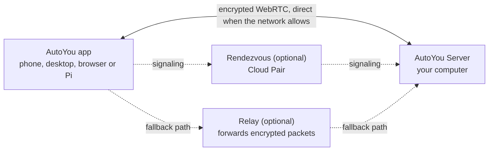

<div align="center">

**English** · [简体中文](docs/readme/README_zh.md) · [繁體中文](docs/readme/README_zh-TW.md) · [日本語](docs/readme/README_ja.md) · [한국어](docs/readme/README_ko.md) · [हिन्दी](docs/readme/README_hi.md) · [Español](docs/readme/README_es.md) · [Français](docs/readme/README_fr.md) · [Deutsch](docs/readme/README_de.md) · [Português (Brasil)](docs/readme/README_pt-BR.md) · [Русский](docs/readme/README_ru.md) · [العربية](docs/readme/README_ar.md)


# AutoYou Server

### Your own AI server, on the computer you already own.

**You are not the product. You are the owner.**

[](https://github.com/autoyou-ai/AutoYou-Server/actions/workflows/public-checks.yml)
[](https://github.com/autoyou-ai/AutoYou-Server/actions/workflows/codeql.yml)
[](https://github.com/autoyou-ai/AutoYou-Server/releases)
[](requirements/README.md)
[](servers/README.md)
[](autoyou_agents/README.md)
[](LICENSE)

**[Website](https://www.autoyou.me/) · [Apps](https://www.autoyou.me/downloads/) · [Ecosystem](https://www.autoyou.me/ecosystem/) · [Community](https://www.autoyou.me/community/)**

[Quick start](#quick-start) · [How it works](#how-autoyou-works) · [What you can do](#what-you-can-do) · [Agents](#agents) · [Pairing](#pairing-modes) · [Security](#security-modes-and-tiers) · [Clients](#supported-clients) · [FAQ](#faq) · [Documentation](#documentation)

<code>./run_autoyou.sh</code>

</div>

> [!IMPORTANT]
> Get AutoYou Server from [autoyou-ai/AutoYou-Server](https://github.com/autoyou-ai/AutoYou-Server)
> or [autoyou.me](https://www.autoyou.me/), and get the apps from the store links in
> [Supported clients](#supported-clients). A similar repository name or a copied README does
> not make a download official.

<div align="center">

<br />


<br /><br />

</div>

---

Turn the computer on your desk into a private AI server for every device you own. AutoYou
Server runs your AI models and agents, voice and video calls, remote desktop, games, and your
own web apps on your Windows, macOS, or Linux machine. Your phone, other computers, and
browsers reach it over encrypted peer-to-peer connections, at home or away.

Your conversations, files, and agent activity stay on that computer, not in a hosted AutoYou
service. Run local models through Ollama to chat without a token bill, or connect the cloud
provider you prefer. Pair a device once, and everything the server offers is in your pocket:
chat, a hands-free assistant, live voice in many languages, your desktop, your games, and any
web service you already run.

> **New here?** Run the launcher, open **http://127.0.0.1:8001/**, and the setup guide walks
> you through choosing your AI, turning on the features you want, and pairing your first device.

<a id="quick-start"></a>

## Quick start

You need Git and Python 3.11 or newer. Some optional features need a newer Python or a
particular platform; see the [dependency profiles](requirements/README.md).

### 1. Get the server

```bash
git clone https://github.com/autoyou-ai/AutoYou-Server.git
cd AutoYou-Server
```

### 2. Run the launcher

Windows:

```powershell
.\run_autoyou.bat --profile base
# Or select the Full profile with LAN access:
.\run_autoyou.bat --profile full --host 0.0.0.0
```

macOS or Linux:

```bash
./run_autoyou.sh --profile base
# Or select the Full profile with LAN access:
./run_autoyou.sh --profile full --host 0.0.0.0
```

The launcher creates a Python environment, installs dependencies from package indexes, and may
download models and native tools. Read the scripts first and run them in an environment you
can safely modify.

### 3. Open the console and pair a device

Go to **http://127.0.0.1:8001/**, choose a unique server password, and follow the setup. It
asks what you want to use AutoYou for (chat, a hands-free assistant, calls, games, coding,
and more), installs the matching agents, and shows a pairing QR code for your phone.

For unattended first setup, provide `AUTOYOU_SERVER_PASSWORD` through your environment or a
secret manager. Keep real passwords out of shared commands, issues, and screenshots.

<details>
<summary><strong>Choose a profile</strong></summary>

Profiles select which dependency sets are installed. They are cumulative, and the launcher
uses `recommended` when `--profile` is omitted.

| Profile       | Adds                                                                                   |
| ------------- | -------------------------------------------------------------------------------------- |
| `base`        | Core server, local administration, device connections, and cloud-provider integrations |
| `local`       | Local-model helpers and on-device intent routing                                       |
| `recommended` | Messaging and Bluetooth integration dependencies                                       |
| `full`        | Speech, browser, and desktop-automation dependencies                                   |

The root launchers also request the internet (browser) component, including for `base`.
Profiles choose dependencies only; integrations still need configuration, and optional
features may download models or native tools and require provider accounts. See
[requirements/README.md](requirements/README.md) for platform limits and the current
dependency review.

`--skip-nuitka` and `--skip-backend-compile` keep the launcher's embedded libraries, so
dependency security updates for packaged apps need a full launcher rebuild.

</details>

### Update AutoYou Server

AutoYou changes quickly, and new releases include frequent fixes. From your checkout:

```bash
git pull
./run_autoyou.sh
```

Use `.\run_autoyou.bat` on Windows. Release notes are in [docs/releases/](docs/releases/) and on
the [releases page](https://github.com/autoyou-ai/AutoYou-Server/releases). Once your server is
linked to an AutoYou account, the console also checks for updates; turn that off with
`software_update.enabled` or `AUTOYOU_SOFTWARE_UPDATES_ENABLED=0`.

<a id="how-autoyou-works"></a>

## How AutoYou works

**The server is your own computer, and devices talk to it directly.** Apps and the server
connect with WebRTC. After a short pairing handshake they open an encrypted link (DTLS, with
SRTP for media) that carries chat, voice, video, screen sharing, game input, and proxied web
traffic. Most home and mobile networks can form that link without opening router ports. When a
network is too strict, the connection falls back to a relay that forwards the same encrypted
packets.



On the server, an on-device intent router sends each request to the right agent or tool.
Google ADK runs the native agents; OpenClaw, Hermes Agent, and Odysseus can be bridged in.
LiteLLM sends model calls to Ollama on your machine or to the cloud provider you choose.
Speech is recognized locally, replies are spoken locally, and memory lives in SQLite.

<picture>
  <source media="(prefers-color-scheme: dark)" srcset="docs/images/architecture-dark.png" />
  
</picture>

The diagram is generated by [scripts/build_architecture_diagram.py](scripts/build_architecture_diagram.py).
Dashed boxes are optional add-ons or bridged projects.

<a id="what-you-can-do"></a>

## What you can do

| Feature                                           | What it gives you                                                                                       | Learn more                                                                                     |
| ------------------------------------------------- | ------------------------------------------------------------------------------------------------------- | ---------------------------------------------------------------------------------------------- |
| [AI chat](#ai-chat)                               | Chat with your own AI from any paired device, with no message cap from AutoYou                          | [AI and speech](docs/admin-ui/ai-and-speech.mdx)                                               |
| [Realtime voice](#realtime-voice-in-many-languages) | Live voice calls with your AI, local speech recognition, and spoken replies in 30+ languages          | [Speech settings](docs/admin-ui/ai-and-speech.mdx#speech-screen)                               |
| [Assistant mode](#assistant-mode)                 | A wake word such as "Hey Jarvis" on your phone, computer, Raspberry Pi, or browser                      | [Assistant mode](docs/admin-ui/assistant-mode.mdx)                                             |
| [Remote Desktop](#remote-desktop)                 | See and control your computer from your phone, including the Windows lock screen                        | [Remote Desktop agent](docs/agents/utility.mdx)                                                |
| [Computer video](#computer-video)                 | Send the computer's screen, camera, a video file, or API-fed frames into a call                         | [Live View and media](docs/admin-ui/live-view-and-media.mdx)                                   |
| [Game mode and Game Studio](#game-mode-and-game-studio) | Stream games from your computer to your phone, or build offline games that run on the phone       | [Game Studio agent](docs/agents/utility.mdx)                                                   |
| [Web app factory](#web-app-factory)               | Ask an agent to build a web app, then open it on every paired device                                    | [Agent web frontends](docs/agent-framework/agent-web-frontends.mdx)                            |
| [Host any local port](#host-any-local-port)       | Share any web service on your computer, such as `localhost:3000`, with your paired devices              | [Website gateway](docs/api-reference/website-gateway.mdx)                                      |
| [Agents](#agents)                                 | 45 built-in agents for notes, files, coding, media, browsing, training, and more                        | [Agent catalog](autoyou_agents/README.md)                                                      |
| [MCP](#use-autoyou-from-your-coding-agent)        | Use AutoYou tools from ChatGPT, Codex, Claude, Antigravity, Cursor, and VS Code                          | [MCP integration](docs/guides/mcp-integration.mdx)                                             |
| Messaging                                         | Reach your server through Telegram, Signal, and WhatsApp connectors that you control                    | [Messaging bridges](docs/admin-ui/messaging-bridges.mdx)                                       |
| Memory                                            | SQLite-backed memory and a private persona journal, with Cognee as an optional add-on                  | [Memory system](docs/technical/memory-system.md)                                               |

Features depend on the selected profile, hardware, permissions, and configured integrations.
Powerful capabilities such as desktop control, game mode, recording, and file access stay off
until you turn them on.

<a id="ai-chat"></a>

### AI chat

Talk to your own AI from your phone, another computer, a browser, or a messaging app. Pick a
provider in **AI** on the console:

- **Ollama + Agents** (the default): a local model on your computer with every AutoYou agent and
  tool. No API key is needed.
- **Apple Intelligence + Agents** on supported Macs.
- **Gemini**, **OpenRouter**, or **other providers through LiteLLM** (Anthropic, OpenAI,
  Mistral, DeepSeek, xAI, and more), still using AutoYou's agents and tools.
- **OpenClaw**, **Hermes Agent**, or **Odysseus** as the primary session runtime.

AutoYou does not cap how many messages you send. With a local model, chat has no per-message
cost and keeps working without an internet connection. A cloud provider you connect bills you
under its own plan and sees the prompts you send to it. The built-in model library can browse,
download, and switch local models, and the Model Picker agent recommends one that fits your
hardware.

Small and quantized local models get help to stay accurate: an offline intent classifier sends
common requests straight to the right agent, and a compact routing mode keeps the tool list
short. See [how small models are kept on track](autoyou_agents/README.md#small-local-models).

<a id="realtime-voice-in-many-languages"></a>

### Realtime voice in many languages

Call your AI and talk. Speech recognition runs on your computer (whisper.cpp in the default
build, faster-whisper in full voice builds), with voice activity detection, interruption when you
start speaking, and a **Wait until I finish talking** hold for long thoughts.

- **Speak in your language.** Leave **STT language** on `auto` and a multilingual model detects
  the language you speak. Locales such as `ja-JP` and `es-MX` are accepted.
- **Hear replies in that language.** **Auto TTS**, the default, detects the reply's language and
  picks a matching installed system voice. The local Supertonic 3 model speaks `ar, bg, hr, cs,
  da, nl, en, et, fi, fr, de, el, hi, hu, id, it, ja, ko, lv, lt, pl, pt, ro, ru, sk, sl, es, sv,
  tr, uk, vi`, and works offline after a one-time download of about 401 MB.
- **Choose your voice.** System voices, ten Supertonic voice presets, a custom voice you train
  in the Voice Training app, EmotiVoice for Chinese and English, or hosted OpenAI and Azure
  speech.

Text-to-speech speaks the reply it is given; it does not translate. The chat model you choose
must also support the conversation language.

<a id="assistant-mode"></a>

### Assistant mode

Give your server a wake word, such as "Hey Jarvis". Say it near a paired phone, computer,
Raspberry Pi, the Chrome extension, or the admin page, and whatever you say next goes to
AutoYou. Until the word is heard, nothing you say is transcribed or sent to AI.

You record the word three times, train it on your server in a few seconds, test it, and turn
it on. Phones, desktop apps, and the Raspberry Pi download the trained word (only its acoustic
pattern) and listen on the device. During a video call, the request after the wake word can
carry the latest camera picture, so "Hey Jarvis, what am I holding?" works. The Assistant agent
can open and read web pages, focus desktop windows, and hand coding requests to the Pi agent.

[Set up Assistant mode](docs/admin-ui/assistant-mode.mdx)

<a id="remote-desktop"></a>

### Remote Desktop

View and control your computer from a paired phone or desktop app: pick a monitor or a single
application window, move the mouse, type, and use hardware modifier keys. Remote desktop video
prefers H.264 when the device supports it.

On Windows, the optional **AutoYou Secure Desktop Helper** service lets the paired owner see
and use the lock screen and UAC prompts, and the server can keep the computer awake while you
are connected. Screen capture and input are separate permissions, both off until you turn them
on, and remote desktop is never offered over a Peer Link.

<a id="computer-video"></a>

### Computer video

In a call, the computer can send video from four sources: its **screen**, a **camera**, a
**video file** you upload and play into the call, or **API frames** that your own program
feeds in. The computer's microphone and sound can be shared too. In the console, **Interact**
shows live camera pictures from connected devices and can play their microphones on the
computer's speakers, without AI processing and without recording.

<a id="game-mode-and-game-studio"></a>

### Game mode and Game Studio

Play games on your phone that run on your computer, or build games that run on the phone.

- **Game mode** streams a game rendered on your computer to a paired device, and the device's
  touch, motion sensors, controller, mouse, and keyboard come back as game input. You can
  define up to four labeled virtual buttons. Game mode is its own permission and also turns on
  screen sending and Remote Desktop input.
- **Bring your own engine.** A local game engine can read authenticated input frames from a
  loopback WebSocket using the `autoyou_game_v1` protocol. For Unreal, the server offers a
  source plugin at `/api/game/unreal-plugin`.
- **Offline games for the phone.** The Game Studio agent helps you build portable web or WASM
  games, packages them as `.aygame` files of up to 5 GiB, and sends them to connected clients
  over WebRTC or an approved Peer Link. Each game gets its own private on-device SQLite
  database, and saved progress survives updates.

**Neon Horizon** is the built-in demo, playable as a phone download, in the Game Studio page,
or streamed from your computer.

<a id="web-app-factory"></a>

### Web app factory

Describe an app and let the agents build it. The **Website agent** creates a browser frontend
for an agent: a simple starter, or React or Angular when you ask, with a Python/FastAPI,
Node/TypeScript, Go, or Rust backend. The **Agent Builder** scaffolds a new agent with its
tools, and the **Coding** and **Pi** agents implement and test the code.

Every app is registered with the local website service and appears in your paired devices'
browser. Websites can require a one-time code, use per-agent authenticator profiles, and share
sign-in sessions. The **Hosting agent** explains how to publish a site to a public link: a
free temporary `/pair` tunnel, or a paid persistent URL.

<a id="host-any-local-port"></a>

### Host any local port

Already running something? Share it. In **Websites & Browser > Advertised Websites**, add any
port from 1 to 65535 with a label and an optional forward URL, such as `http://127.0.0.1:3000`
or another host on your network. Paired clients discover it and open it on the same port on
their side, so dashboards, dev servers, home-lab tools, and apps that were never designed to
live under a sub-path keep working.

Traffic travels inside the encrypted peer link, so you do not need to open the port on your
router. Requests from other devices need a device pass, and paired browsers get a
`viewer`, `editor`, or `admin` role that limits what they may change.

<a id="agents"></a>

## Agents

AutoYou ships with 45 built-in agents. The main agent routes each request to the specialist that
fits, and many specialists come with their own web page on your paired devices. Agents marked
opt-in stay uninstalled until you install them in **Agents** on the console.

| Area                 | Agents                                                                                                                                                      |
| -------------------- | ----------------------------------------------------------------------------------------------------------------------------------------------------------- |
| Everyday             | Notes, Tasks, Notify, Memory, Persona, Page feed, Prompts, Location (opt-in)                                                                                |
| Web and automation   | Internet, Assistant, Browser (opt-in), Client Browser Control, Proxy (opt-in)                                                                               |
| Media and creative   | Audio, TV, Media Generation (opt-in), Game Studio                                                                                                           |
| Coding and building  | Coding, Pi, Agent Builder, Website, Skills, Files, CLI, Claude CLI, Claude Desktop, Codex Desktop, Antigravity, Prompt Builder (all opt-in)                |
| Intelligence         | Model Picker (opt-in), OpenClaw (opt-in), Hermes Agent (opt-in)                                                                                             |
| Training             | Data Collector, Fine-Tuning, Voice Training (all opt-in)                                                                                                    |
| System and computer  | Admin, Remote Desktop, Backup, Hosting (opt-in), Windows Security (opt-in), macOS Security (opt-in), Education (opt-in)                                     |
| Supporting AutoYou   | Support Ads, Earnings, Donation                                                                                                                             |

Add your own by copying a package into `autoyou_agents/`; the server finds it with no list to
edit. See the [agent catalog](autoyou_agents/README.md) for what each agent does, its default
state, and how to write one, and the [generated agent reference](docs/agents/) for every tool.

<a id="pairing-modes"></a>

## Pairing modes

Pairing connects an app to your computer. You choose how a device finds it, and the setup QR
code advertises the methods that are available right now.

| Method             | How it connects                                                                                       | Typical use                              |
| ------------------ | ----------------------------------------------------------------------------------------------------- | ---------------------------------------- |
| **Local Pair**     | Directly over your LAN. Your own server answers the signaling.                                        | Same Wi-Fi or office network             |
| **Bluetooth Pair** | Connection details are handed over Bluetooth Low Energy.                                              | First-time setup of a nearby phone       |
| **Live Pair**      | The phone and the computer show each other animated QR codes, with no network path between them.     | Air-gapped or locked-down networks       |
| **One-time code**  | `/pair` in a messaging chat returns a short-lived code and link.                                      | Guest devices and untrusted networks     |
| **Auto Pair**      | An encrypted pairing message is carried through a Telegram, Signal, or WhatsApp chat you set up.      | Pairing from afar without a cloud account |
| **Cloud Pair**     | An optional, paid AutoYou Cloud rendezvous finds your computer across NAT, with relay fallback.       | Away from home or behind strict networks |

Two related connections are separate from pairing:

- **Peer Link** connects one AutoYou app to another app. The receiving app approves each link,
  and it never uses your computer's password.
- **Lobbies** are group rooms that the apps host and join nearby over Wi-Fi and Bluetooth.

Devices of your own AutoYou account paired through Cloud Pair are treated as **own**; every
other pairing, including Local Pair and messaging partners, is **shared**, and agent websites
can tell the two apart. See [pairing protocols](docs/technical/pairing-protocols.md) and
[pairing and discovery](docs/architecture/pairing-and-discovery.mdx), or follow the step-by-step
[mobile](guides/MOBILE_PAIRING_GUIDE.md), [Chrome](guides/CHROME_PAIRING_GUIDE.md),
[Telegram/Signal](guides/SIGNAL_QR_PAIRING_GUIDE.md), and [WhatsApp](guides/WHATSAPP_QR_PAIRING_GUIDE.md) guides.

<a id="security-modes-and-tiers"></a>

## Security modes and tiers

One security mode applies to the whole server, so every device pairs under the same rules. A
new installation starts in **Secure**.

| Mode                            | Pairing messages                   | What a device needs to pair                  | Data on this computer                                                    |
| ------------------------------- | ---------------------------------- | -------------------------------------------- | ------------------------------------------------------------------------ |
| **Normal**                      | Not encrypted                      | A one-time code                              | Unchanged                                                                |
| **Secure**                      | Encrypted with the server password | The server password                          | Unchanged                                                                |
| **Secure Professional**         | Encrypted with the server password | The password and a current authenticator code | Unchanged                                                                |
| **Secure Professional Maximus** | Same as Secure Professional        | The password and a current authenticator code | Sessions, agent data, websites, notes, and settings are encrypted at rest |

In Secure modes, pairing messages are encrypted under a key from a password-authenticated key
exchange (a CPace-family construction over ristretto255 using libsodium). A relay or messaging
bridge that carries them cannot read them, and a recorded exchange cannot be used to test
password guesses offline. Maximus keeps its storage key in the operating system's credential
store.

**Pairing security tier.** A separate setting decides how much work a chat-message pairing takes:

| Tier                    | How it pairs                                                                            |
| ----------------------- | --------------------------------------------------------------------------------------- |
| **Quick Pairing** (B)   | A client can pair with a single chat message. Best compatibility.                       |
| **Enhanced Pairing** (A) | Every client must complete an extra hello round trip first, which makes guessing harder. |

Local Pair, Bluetooth Pair, and Cloud Pair always use the Enhanced flow; Auto Pair and one-time
codes follow your setting.

**Access roles for paired browsers.** A paired device's browser gets the `viewer`, `editor`, or
`admin` role. Credentials and security settings can be changed only from the computer itself or
from an HTTPS admin session opened directly on the admin port.

<details>
<summary><strong>What protects what, and where it stops</strong></summary>

| Layer            | What AutoYou does                                                                                     |
| ---------------- | ----------------------------------------------------------------------------------------------------- |
| Network exposure | Binds to `127.0.0.1` by default. Listening on your LAN is an explicit setting.                        |
| Access           | The admin console sits behind a server password, with optional authenticator-app (TOTP) codes.        |
| Pairing          | Password-authenticated key exchange, one-time codes, and per-link approval for Peer Link.            |
| Transport        | WebRTC DTLS and SRTP between the two endpoints, including when a relay forwards the packets.          |
| Data at rest     | Credentials are kept in an encrypted key store; Maximus also encrypts AutoYou-managed data.           |
| Dependencies     | Manifests with a lock file, advisory checks, and pinned CI actions.                                   |

Encryption protects the connection. It does not protect everything around it:

- **Endpoints.** Malware on the server computer or on a paired device has the access that
  endpoint has.
- **Agents.** Agents run with the server's permissions. Browser automation, file access, desktop
  control, and command execution are powerful; enable only what you need and review what agents do.
- **Third parties.** Cloud model providers, messaging bridges, and public tunnels have their own
  data flows and terms. Review each before enabling it.
- **Operations.** Running a server makes you responsible for updates, backups, and credentials.

</details>

<details>
<summary><strong>Which outside services are involved</strong></summary>

You operate one server, your own. No AutoYou-operated application server is needed to run your
assistant or hold your data, and the server runs on a local network without an AutoYou Cloud
connection ([details](docs/architecture/cloud-and-remote.mdx)). Everything else is a default you
can change or an optional helper:

| Component                                                   | Runs on                                    | What it can see                                                         |
| ----------------------------------------------------------- | ------------------------------------------ | ----------------------------------------------------------------------- |
| AutoYou Server: agents, models, storage, admin console      | Your computer                              | Your data. It is an endpoint.                                           |
| Apps and browser clients                                    | Your devices                               | Whatever you share with them                                            |
| STUN servers for address discovery (on by default)          | Google's public STUN servers unless changed | The public IP address and port a WebRTC connection appears from        |
| Cloud Pair rendezvous (optional)                            | AutoYou Cloud                              | Account email, device ID, short-lived pairing details, network metadata |
| Relay fallback (optional)                                   | AutoYou Cloud                              | Encrypted packets and network metadata                                  |
| Push wake-ups for sleeping phone apps (optional)            | Apple and Google push services             | That a wake-up was requested                                            |
| Software update checks (on once an account is linked)       | AutoYou Cloud update feed                  | An update request authenticated with the account link                   |
| Cloud model providers (optional)                            | The provider you pick                      | The prompts you send to that provider                                   |
| Telegram, Signal, WhatsApp bridges (optional)               | Those services                             | Messages routed through them, under their terms                         |
| Public tunnel for websites (optional)                       | Tunnel host                                | Traffic to the public URL. This is not peer-to-peer.                    |

**Public STUN is on by default**, including for Local Pair. To keep that lookup off the internet,
set `AUTOYOU_DISABLE_PUBLIC_STUN=1` before starting the server, or point it at your own STUN and
TURN host with `AUTOYOU_LOCAL_STUNTURN_HOST` (plus `AUTOYOU_LOCAL_TURN_USERNAME` and
`AUTOYOU_LOCAL_TURN_PASSWORD` for TURN). Without any STUN or TURN server, connections across NAT
may fail.

</details>

Read the full guide in [security modes](docs/security/security-modes.md), and report suspected
vulnerabilities privately through [SECURITY.md](SECURITY.md).

<a id="supported-clients"></a>

## Supported clients

AutoYou Server runs on your computer; the apps reach it from everywhere else. The client apps are
distributed separately and their source is not part of this repository.

| Platform        | Get it                                                                                             |
| --------------- | -------------------------------------------------------------------------------------------------- |
| iPhone and iPad | [App Store](https://apps.apple.com/us/app/autoyou/id6760363728)                                    |
| Android         | [Google Play](https://play.google.com/store/apps/details?id=com.autoyou.app)                       |
| Windows         | [Microsoft Store](https://apps.microsoft.com/detail/9mw8l2wfw7wv?hl=en-US&gl=US)                   |
| macOS and Linux | [Downloads](https://www.autoyou.me/downloads/)                                                     |
| Browser         | Chrome extension and web client, listed on the [ecosystem page](https://www.autoyou.me/ecosystem/) |
| Raspberry Pi    | A Python voice client for Assistant mode ([setup](docs/admin-ui/assistant-mode.mdx))               |

| Pairing modes | Chat with your own AI | Nearby Lobbies | Local AI on the phone |
| --- | --- | --- | --- |
|  |  |  |  |

- **Local AI without a computer.** *Local* chat runs on the phone with LFM 2.5 350M, Gemini
  Nano, or Apple Intelligence, depending on the device.
- **Lobbies.** Host or join nearby rooms over Wi-Fi and Bluetooth, with chat and audio or video
  for up to six guests and the host.
- **Peer Link.** Connect one app to another. The receiving app approves each link, and optional
  AI replies answer using only what you told it.
- **Your computer, everywhere.** Chat, calls, Remote Desktop, game mode, agent websites, and
  advertised ports, on every device you pair.

<a id="use-autoyou-from-your-coding-agent"></a>

## Use AutoYou from your coding agent

Connect MCP-compatible features in ChatGPT, Codex, Claude Code or Claude Desktop, Google
Antigravity, Cursor, and VS Code to supported AutoYou tools. The local MCP adapter is a
separate process; the server does not install it into those clients, and MCP calls expose the
adapter's supported tools, not arbitrary access to your files or every AutoYou feature.

1. Start AutoYou Server and open **http://127.0.0.1:8001/**.
2. In **Admin UI > Messaging > AutoYou MCP**, enable MCP, generate the private adapter token,
   and download `autoyou-mcp.env`. Keep this file private.
3. Install the separately maintained adapter in a dedicated Python environment:

   ```powershell
   git clone https://github.com/autoyou-ai/AutoYou.git
   cd AutoYou
   py -3 -m venv .venv-mcp
   .\.venv-mcp\Scripts\python.exe -m pip install -e .\plugins\autoyou-mcp
   ```

   On macOS or Linux, use `python3 -m venv .venv-mcp` and
   `.venv-mcp/bin/python -m pip install -e ./plugins/autoyou-mcp`.

For clients that launch a local MCP process, use this command shape with absolute paths:

```text
<path-to-.venv-mcp-python> -m autoyou_mcp --env-file <path-to-autoyou-mcp.env> --transport stdio
```

<details>
<summary><strong>Add AutoYou to each client</strong></summary>

For clients that use the `mcpServers` JSON format, the entry looks like this. Replace both example
paths, escaping Windows backslashes if you use them in JSON:

```json
{
  "mcpServers": {
    "autoyou": {
      "command": "C:/path/to/AutoYou/.venv-mcp/Scripts/python.exe",
      "args": [
        "-m", "autoyou_mcp",
        "--env-file", "C:/path/to/autoyou-mcp.env",
        "--transport", "stdio"
      ]
    }
  }
}
```

**ChatGPT web** uses a remote MCP connection, not a local `stdio` process. Start the adapter with
`--transport streamable-http`, then connect its local `http://127.0.0.1:8071/mcp` endpoint through
OpenAI Secure MCP Tunnel. ChatGPT requires Developer Mode and the relevant workspace/admin access,
and OpenAI limits full MCP actions by plan. Follow the
[AutoYou MCP ChatGPT setup](https://github.com/autoyou-ai/AutoYou/blob/main/plugins/autoyou-mcp/README.md#connect-chatgpt-web)
and the [OpenAI MCP app guide](https://help.openai.com/en/articles/12584461-developer-mode-and-mcp-apps-in-chatgpt).

**Codex CLI, desktop app, and IDE extension** share the Codex host's MCP configuration:

```powershell
codex mcp add autoyou -- "C:/path/to/AutoYou/.venv-mcp/Scripts/python.exe" -m autoyou_mcp --env-file "C:/path/to/autoyou-mcp.env" --transport stdio
codex mcp list
```

Or add the equivalent `[mcp_servers.autoyou]` `command` and `args` to `~/.codex/config.toml`. See the
[Codex MCP guide](https://learn.chatgpt.com/docs/extend/mcp?surface=cli).

**Claude Code:**

```powershell
claude mcp add --transport stdio autoyou -- "C:/path/to/AutoYou/.venv-mcp/Scripts/python.exe" -m autoyou_mcp --env-file "C:/path/to/autoyou-mcp.env" --transport stdio
claude mcp list
```

Then run `/mcp` in Claude Code. See the [Claude Code MCP guide](https://code.claude.com/docs/en/mcp).

**Claude Desktop** launches the adapter as a local stdio server. Add an `mcpServers.autoyou` entry
to `~/Library/Application Support/Claude/claude_desktop_config.json` on macOS or
`%APPDATA%\Claude\claude_desktop_config.json` on Windows, then fully quit and restart Claude
Desktop. AutoYou does not currently ship a `.mcpb` desktop extension. See the
[Claude Desktop MCP guide](https://support.claude.com/en/articles/10949351-getting-started-with-local-mcp-servers-on-claude-desktop).

**Google Antigravity** uses `~/.gemini/config/mcp_config.json` globally or `.agents/mcp_config.json`
in a workspace. In Antigravity IDE, open **MCP Servers > Manage MCP Servers > View raw config**.
See the [Antigravity MCP guide](https://antigravity.google/docs/mcp).

**Cursor** uses `~/.cursor/mcp.json` or `.cursor/mcp.json` with the same `mcpServers` entry. See the
[Cursor MCP guide](https://prod.cursor.com/help/customization/mcp).

**VS Code** can use the portable `.mcp.json` file at the workspace root. `.vscode/mcp.json` uses a
top-level `servers` object instead, with `"type": "stdio"`. See the
[VS Code MCP guide](https://code.visualstudio.com/docs/agent-customization/mcp-servers).

On macOS or Linux, the Python executable is `.venv-mcp/bin/python`. Client versions, settings,
organization policies, and tool approvals can affect availability.

</details>

After connecting, check that `get_autoyou_status` is listed and returns the expected server
status before using any write-capable tool. See the [AutoYou MCP integration guide](docs/guides/mcp-integration.mdx)
for its scope, security model, and limitations.

<a id="admin-console"></a>

## Admin console

<p align="center">
  
</p>

The local console brings setup, models, speech, agents, connections, permissions, and security
together. Guided setup asks what you want to use AutoYou for and proposes the agents and
permissions to match; nothing changes until you review and save the plan. These screenshots use
example values. Select a preview to open the full image.

| Server overview | Devices and activity | Access and security |
| --- | --- | --- |
| [](docs/images/admin/overview.png) | [](docs/images/admin/live-view.png) | [](docs/images/admin/security.png) |

<a id="other-ways-to-run"></a>

## Other ways to run

<details>
<summary><strong>Docker</strong></summary>

Provide `AUTOYOU_SERVER_PASSWORD` securely, then run:

```bash
docker compose up --build
```

The Compose file binds published ports to host loopback and keeps configuration in a named
volume. Open `http://localhost:8001/` on the same computer; the file declares loopback-only
publishing (`AUTOYOU_ADMIN_TRUST_PUBLISHED_LOOPBACK=1`), so the sign-in is not refused as
"requires localhost or HTTPS". With plain `docker run`, publish on `127.0.0.1` and pass the same
variable, or put a TLS proxy in front. Check how your Docker version publishes ports before
relying on loopback isolation.

To disable build-time and runtime Tunnelmole downloads, set both
`AUTOYOU_SKIP_TUNNELMOLE_DOWNLOAD=1` and `AUTOYOU_NO_DOWNLOAD_TUNNELMOLE=1` before building and
starting. Features that need it then require a separately supplied binary.

</details>

<details>
<summary><strong>Compile an unofficial local build</strong></summary>

From the repository root:

```powershell
# Windows
.\servers\windows\build-all.ps1 -Configuration Debug
```

```bash
# macOS
./servers/macos/build-all.sh --no-sign --dev

# Linux / WSL
./servers/wsl/build-backend.sh --unofficial
```

These routes do not require an AutoYou account or official release approval. They may install or
reconcile dependencies. Review the license and notices when prompted. For unattended
acknowledgement after review, pass `-AcceptTerms` on Windows or `--accept-terms` on macOS and Linux.

Prerequisites, output locations, and known limitations:
[Windows](servers/windows/README.md) · [macOS](servers/macos/README.md) · [Linux / WSL](servers/wsl/README.md).

</details>

<a id="faq"></a>

## FAQ

<details>
<summary><strong>Do I need a cloud account or a VPN?</strong></summary>

No. Local Pair, Bluetooth Pair, Live Pair, one-time codes, and Auto Pair work without an AutoYou
account. Cloud Pair is an optional paid helper for reaching your computer across strict networks.
If you already use a VPN such as Tailscale, AutoYou works over it too.

</details>

<details>
<summary><strong>Is AI chat really unlimited?</strong></summary>

AutoYou puts no cap on messages. With a local Ollama model, chat costs nothing per message and runs
on your hardware, so speed depends on your computer. A cloud provider you connect has its own
pricing and limits.

</details>

<details>
<summary><strong>Which languages can I speak?</strong></summary>

Speech recognition detects the language when **STT language** is `auto` and a multilingual model is
selected. Spoken replies use a matching system voice or the local Supertonic 3 model, which covers
31 languages. Your chat model must also understand the language.

</details>

<details>
<summary><strong>Can I share a web app or a game with friends?</strong></summary>

Yes. Anyone you pair with your server can open your agent websites and advertised ports, within the
role you give them. Shared devices are marked as shared, so your websites can limit what they see.
For people who are not paired, the Hosting agent explains the free temporary link and the paid
persistent URL.

</details>

<details>
<summary><strong>Does AutoYou upload my files or conversations?</strong></summary>

They are stored on your computer. Data leaves only through services you turn on, such as a cloud
model provider, a messaging bridge, or a public tunnel, and each has its own terms. See
[which outside services are involved](#security-modes-and-tiers).

</details>

<details>
<summary><strong>What should I do if I hit a bug?</strong></summary>

Update first; a recent release may already fix it. If the problem persists,
[open an issue](https://github.com/autoyou-ai/AutoYou-Server/issues) with your AutoYou version
(`VERSION`), operating system, profile, the steps to reproduce, and the error output. Report
vulnerabilities privately through [SECURITY.md](SECURITY.md).

</details>

<a id="documentation"></a>

## Documentation

- [Quick start](docs/quickstart.mdx): setup and first pairing.
- [Architecture](docs/architecture/): pairing, WebRTC, data channels, and remote access.
- [Security and privacy](docs/security/): security modes, encryption, data privacy, and the dependency audit.
- [Admin console](docs/admin-ui/): every screen, including Assistant mode and Live View.
- [Agents](autoyou_agents/README.md) and the [generated agent reference](docs/agents/).
- [Agent framework](docs/agent-framework/): building agents, web frontends, tools, and permissions.
- [HTTP and WebSocket API](docs/api-reference/), with a [route catalog](docs/api-reference/route-catalog.mdx) generated from the source.
- [Guides](docs/guides/): custom agents, API routers, MCP, and production deployment.
- [Pairing guides](guides/README.md): step-by-step pairing for phones, Chrome, and messaging apps.
- [Dependencies and advisory review](requirements/README.md) and the [glossary](docs/glossary.md).

<a id="contributing"></a>

## Contributing

We'd love your help with AutoYou. Start with the [built-in agents](autoyou_agents/README.md), the
[Agent Builder](docs/admin-ui/agent-workbench-ui.mdx), or the
[custom agent tutorial](docs/guides/custom-agent-tutorial.mdx).

- **Build** an agent, a game, an extension, an integration, or a web interface.
- **Improve** setup, accessibility, platform support, translations, documentation, or a
  reproducible bug.
- **Share** a demo, a guide, or a clearly labeled unofficial build that follows the license.

Read [CONTRIBUTING.md](CONTRIBUTING.md) and the [Code of Conduct](CODE_OF_CONDUCT.md) before
submitting work. Independent original code can use your chosen license, including MIT or
Apache-2.0. Changes to existing AutoYou code keep its applicable license.

<a id="license"></a>

## License

AutoYou Server is source-available under the [server license](LICENSE). It is not currently an
OSI-approved open-source project, and the definitions in `LICENSE` control.

| Material or use                                | Terms                                                               |
| ---------------------------------------------- | ------------------------------------------------------------------- |
| Individual use, local builds, and free sharing | Permitted under the server license and its conditions               |
| Modifications to AutoYou code                  | Retain the applicable AutoYou license                               |
| Independent original, separable code           | Your chosen license, including MIT or Apache-2.0                    |
| Institutional use or commercial exploitation   | Separate [Enterprise agreement](https://www.autoyou.me/enterprise/) |

Preserve notices, identify unofficial builds, and meet the obligations of included components. See
[THIRD-PARTY-NOTICES.md](THIRD-PARTY-NOTICES.md) and the [trademark policy](docs/legal/trademark-policy.md).

OpenStorey allocates at least 15% of qualifying net receipts to the contributor pool, awarded under
the [pool's review and eligibility rules](docs/contributors/contributor-pool.md). The
[funding roadmap](https://www.autoyou.me/donate/) includes a $5M server open-source milestone; a
milestone does not itself change the license of a copy you have. Details:
[docs/legal/open-source-commitment.md](docs/legal/open-source-commitment.md).

## Support

- **Questions and setup help:** [SUPPORT.md](SUPPORT.md) and the [community](https://www.autoyou.me/community/).
- **Bugs and focused proposals:** [open an issue](https://github.com/autoyou-ai/AutoYou-Server/issues).
- **Vulnerabilities:** report privately as described in [SECURITY.md](SECURITY.md). Do not use
  public issues for undisclosed vulnerabilities.

Agents run with the server's permissions, so review their actions, enable only what you need, and
keep backups.

Copyright &copy; 2026 OpenStorey LLC and contributors.
