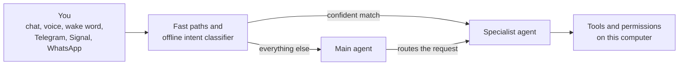

[AutoYou Server](../README.md) · **Agents** · [Generated agent reference](../docs/agents/) · [Agent framework](../docs/agent-framework/)

# AutoYou Agents

### 45 built-in specialists that run on your own computer.

**Ask in plain words. The main agent picks the specialist, and the specialist does the work.**

[Catalog](#catalog) · [How routing works](#how-routing-works) · [Agent websites](#agent-websites) · [Small local models](#small-local-models) · [Your own agents](#your-own-agents) · [Website security](#website-security-contract)

---

AutoYou agents are focused helpers for notes, tasks, files, coding, media, browsing, games,
training, and running the computer itself. They run inside AutoYou Server on Google ADK, use the
model you chose (a local Ollama model or a cloud provider), and act with the permissions you
grant. Many come with their own web page that opens on every paired device.

Agents marked **opt-in** stay uninstalled until you install them in **Agents** on the admin
console. Agents marked **on** are installed by default, and features such as screen capture,
recording, and file access still need their own permission. The source tree includes the
optional voice, video, and browser-backed helpers; use the `full` profile for a representative
trial, since smaller profiles leave those dependency bundles out.

## Catalog

The **Web** column marks agents that ship a browser page under `website/`. Defaults come from
`DEFAULT_AGENT_INSTALL_STATES` in [`shared_tools/agent_install_registry.py`](shared_tools/agent_install_registry.py).

### Everyday

| Agent | Package | Default | Web | What it does |
| --- | --- | --- | --- | --- |
| Notes | `notes_agent` | on | ✓ | Notes and to-dos with tags, categories, search, and attachments |
| Tasks | `tasks_agent` | on | ✓ | Schedules recurring and one-time AI jobs that run on a timer |
| Notify | `notify_agent` | on | ✓ | Timed notifications and reminders delivered straight to your devices |
| Memory | `memory_agent` | on | | Stores and recalls long-term memory from the local memory backend |
| Persona | `persona_agent` | on | ✓ | Your private persona journal: preferences, background, and facts you choose to save |
| Page | `page_agent` | on | ✓ | Turns links into media cards and manages your personal page feed |
| Prompts | `prompts_agent` | on | ✓ | Harvests prompts across Codex, Claude, Cursor, Antigravity, and VS Code into a mind map |
| Location | `location_agent` | opt-in | ✓ | A private timeline of consented locations from your connected devices |

### Web and automation

| Agent | Package | Default | Web | What it does |
| --- | --- | --- | --- | --- |
| Internet | `internet_agent` | on | | Live web search, browsing, scraping, screenshots, and downloads |
| Assistant | `assistant_agent` | on | | Hands-free [Assistant mode](../docs/admin-ui/assistant-mode.mdx) turns after the wake word: opens and reads web pages, focuses desktop windows, hands code requests to Pi, and can use the live camera picture. Acts only once Assistant mode is turned on |
| Browser | `browser_agent` | opt-in | | Real-browser automation for multi-step workflows, logged-in sessions, and dynamic pages |
| Client Browser Control | `client_browser_control_agent` | on | | Controls the in-app browser on the connected phone or desktop app |
| Proxy | `proxy_agent` | opt-in | ✓ | Relays web requests from your computer through a one-time-code-protected browser page |

### Media and creative

| Agent | Package | Default | Web | What it does |
| --- | --- | --- | --- | --- |
| Audio | `audio_agent` | on | ✓ | Searches your local music and plays, queues, shuffles, and repeats it on your call |
| TV | `tv_agent` | on | ✓ | Your media library: indexing, streaming, playback, and FFmpeg transcoding. Media is published only when you select it |
| Media Generation | `media_generation_agent` | opt-in | ✓ | Local image and video generation with Wan2GP, including Flux image models |
| Game Studio | `game_agent` | on | ✓ | Builds offline `.aygame` games for phones and desktops, streams hosted games, and documents the `autoyou_game_v1` input protocol and Unreal plugin |

### Coding and building

| Agent | Package | Default | Web | What it does |
| --- | --- | --- | --- | --- |
| Coding | `coding_agent` | opt-in | | Repo-aware coding: reads and edits code, runs focused checks, and reports results |
| Pi | `pi_agent` | opt-in | | Implements and investigates source changes with Pi, sharing the Coding agent's backend |
| Agent Builder | `agent_builder_agent` | opt-in | ✓ | Creates new agent drafts from templates and hands them to the coding and website workflow |
| Website | `website_agent` | opt-in | ✓ | Builds a browser frontend for an agent: starter, React, or Angular, with a FastAPI, Node/TypeScript, Go, or Rust backend |
| Skills | `skills_agent` | opt-in | ✓ | Creates, edits, and runs reusable skills from instructions and scripts |
| Files | `files_agent` | opt-in | ✓ | Authenticated inspection and operations on your local filesystem |
| CLI | `cli_agent` | opt-in | | A persistent terminal whose screen streams back to your chat |
| Claude CLI | `claude_cli_agent` | opt-in | | Bridges to the local Claude Code CLI through its SDK |
| Claude Desktop | `claude_desktop_agent` | opt-in | | Drives the local Claude desktop app: model, permissions mode, prompt, and images |
| Codex Desktop | `codex_desktop_agent` | opt-in | | Drives the local Codex desktop app: model, approval mode, prompt, and images |
| Antigravity | `antigravity_agent` | opt-in | ✓ | Drives Google Antigravity and the `agy` CLI on Windows, macOS, Linux, WSL, and Docker |
| Prompt Builder | `build_prompt_agent` | opt-in | ✓ | Assembles one exact prompt from Telegram Saved Messages or its page and sends it to a desktop coding app |

### Intelligence and models

| Agent | Package | Default | Web | What it does |
| --- | --- | --- | --- | --- |
| Model Picker | `model_picker_agent` | opt-in | | Analyzes your hardware, recommends a local model, and switches to it after confirmation and admin 2FA |
| OpenClaw | `openclaw_agent` | opt-in | | Sends tasks to a local OpenClaw Gateway, for smart home, music, and app integrations |
| Hermes Agent | `hermes_agent` | opt-in | | Sends tasks to a local Hermes Agent gateway |

### Training

| Agent | Package | Default | Web | What it does |
| --- | --- | --- | --- | --- |
| Data Collector | `data_collector_agent` | opt-in | ✓ | Collects consented local conversations and prepares private training datasets |
| Fine-Tuning | `fine_tuning_agent` | opt-in | ✓ | Prepares datasets, runs local training jobs, and installs the finished personal model |
| Voice Training | `voice_training_agent` | opt-in | ✓ | Your voice recordings, consented local voice cloning, and call transcripts |

### System and computer

| Agent | Package | Default | Web | What it does |
| --- | --- | --- | --- | --- |
| Admin | `admin_agent` | on | ✓ | Manages models, speech, agents, messaging, tunnels, and restarts, with TOTP 2FA for high-risk operations |
| Remote Desktop | `remote_desktop_agent` | on | ✓ | Screen casting, monitor and window selection, and mouse and keyboard control. Capture and input permissions stay explicit |
| Backup | `backup_agent` | on | ✓ | Resumable local file backup and archive management |
| Hosting | `hosting_agent` | opt-in | ✓ | Publishes a local website or agent access to a public link: the free `/pair` tunnel or a paid persistent URL |
| Education | `education_agent` | opt-in | ✓ | A private learning workspace for live sessions, questions, transcripts, and kept recordings |
| Windows Security | `win_security_agent` | opt-in | ✓ | Read-only Windows network activity, attributed to local processes |
| macOS Security | `mac_security_agent` | opt-in | ✓ | Read-only macOS network activity, attributed to local processes |

### Supporting AutoYou

| Agent | Package | Default | Web | What it does |
| --- | --- | --- | --- | --- |
| Support Ads | `ads_watching_agent` | on | ✓ | Starts AutoYou-owned support ads on connected clients. Viewers are not paid |
| Earnings | `earnings_agent` | on | ✓ | Support, credits, and contributor requests, without payout promises |
| Donation | `donation_agent` | on | ✓ | Finds the official donation page and explains what is safe to share |

Some experimental or partner-specific helpers are private or disabled by default until they are
ready for wider use. Calibrated Claude and Codex Desktop asset packs are excluded from the public
source distribution; their desktop bridge agents need compatible local asset packs before those
controls can be used. Every tool each agent declares is listed in the
[generated agent reference](../docs/agents/).

## How routing works

Only installed agents are offered for routing. If you ask for an agent that is not installed, or
installed but not working, AutoYou says so instead of pretending. You can also name an agent
directly, as in "use notes to ...", through each agent's `ROUTE_ALIASES`.

## Agent websites

An agent with a `website/` folder gets its own page on the local website service (port `8067`).
Paired devices see these pages in the app's browser, under `/agent/<name>/` or on a direct
same-port route. Websites can require a one-time code, use a per-agent authenticator profile,
and share a sign-in session across agents. The owner chooses which website every device lands
on, and can switch any agent's page off. See [agent web frontends](../docs/agent-framework/agent-web-frontends.mdx)
and the [website gateway](../docs/api-reference/website-gateway.mdx).

## How small local models stay accurate

Small or quantized Ollama models (such as `ministral-3:8b`, `qwen38-turbo`, `gemma4:e2b/e4b`, and models under 20B parameters) are prone to context exhaustion, tool hallucinations, and schema-echoing degeneration when exposed to extensive tool catalogs. AutoYou uses a multi-tier routing pipeline to keep small models accurate:

1. **Dynamic Prompt Filtering (`_build_effective_agent_instruction`)**:
   - `prompt.py` defines factory text templates (`SUB_AGENTS_SECTION` and `ROUTING_RULES_SECTION`).
   - At startup, `_filter_prompt_section_by_installed_agents` strips every line or bullet referencing an uninstalled agent.
   - If an operator authors a custom `AGENT_INSTRUCTION`, `_filter_unavailable_agents_from_instruction` automatically purges references to unavailable agents to prevent phantom routing targets.

2. **Compact Two-Stage Enum Routing (`route_to_specialist`)**:
   - Enabled automatically for small/quantized models via `model_uses_compact_root_tool_routing`.
   - **Catalog Stripping**: `_strip_duplicate_agent_catalog` removes the repetitive bulleted agent catalog from the prompt (~4.6k characters saved), preventing the prompt bloat that causes small models to echo schemas instead of invoking tools.
   - **Single Dispatcher Tool**: Rather than advertising dozens of distinct JSON function schemas, the model is given a single tool: `route_to_specialist`.
   - **JSON Schema Enum Constraint**: The `agent` argument is strictly constrained to a JSON Schema `enum` containing only installed specialists.
   - **Forgiving Argument Resolution**: `_resolve_specialist_tool` normalizes casing and forgives small-model tendencies to drop the `autoyou_` prefix or `_agent` suffix. If an unknown agent is requested, it safely fails closed with an informative error listing valid choices.

3. **Pre-Model Fast Paths & Offline Intent Classifier**:
   - Deterministic pattern-matchers intercept common commands (notes, media generation, CLI, files, etc.).
   - An offline 23 MB `all-MiniLM-L6-v2` embedding classifier (`classify_intent`) evaluates user queries against an `allowed` set consisting solely of enabled/installed agents. Confident matches dispatch directly to the target specialist tool, bypassing the root quantized model entirely.
   - If a requested agent is uninstalled or installed-but-broken, the system immediately returns an explicit refusal or explanation (`_unavailable_agent_response`), preventing hallucinated confirmations.

4. **Adapter Safeguards (`litellm_ollama_adapter.py`)**:
   - Detects and repairs responses that degenerate into JSON schema echos.
   - Catches truncated tool calls when reasoning models exhaust `num_predict`, automatically retrying with expanded prediction budgets.
   - Handles Ollama KV-cache pre-allocation memory failures with automatic context size recovery.

## Full-server integration

The full server starts and supervises the AI worker process and managed
frontend services from `core_server/services.py`. Worker HTTP endpoints live in
`routers/ai_agent.py`; full-server admin routes for agent management live in
`routers/agents.py`. `server.py` supplies the shared runtime namespace but does
not own those routes or process lifecycles. Packaged full-server builds compile
`autoyou_agents/` alongside `core_server/` and `routers/`.
The packaged server includes only the built-in agents listed by the install
policy, plus any a build names explicitly.

## Your own agents

Copy an agent package into this folder and the server finds it. No list to
edit:

- `autoyou_agents/<name>_agent/` for an agent you want in this repository.
- `autoyou_agents/private/<name>_agent/` for one you keep to yourself. That
  folder is git-ignored and can also be a link to wherever you keep your agents.

A package needs `__init__.py`, `prompt.py` with `AGENT_NAME`,
`AGENT_DESCRIPTION` and `AGENT_INSTRUCTION`, and `agent.py` with
`create_<name>_agent(model_config)`. Use a name no built-in agent uses. The
Agent Builder scaffolds this for you. An agent you copy in starts uninstalled;
install it in the admin UI. Optional, in `prompt.py`:

- `ROUTING_LABEL`: its name in the main agent's list of agents.
- `ROUTING_RULE`: when the main agent should call it. Without it,
  `AGENT_DESCRIPTION` is used.
- `ROUTE_ALIASES`: names that send a request straight to it, as in
  "use <alias> to ...".

A website goes in `website/` with a `manifest.json`. Set
`"expose_by_default": false` to keep it off until the owner turns it on, and
`control_label` and `control_help` for its admin toggle.

## Website security contract

Agent website authentication is a two-part boundary:

- The backend must reject every protected read and write with `401` until the
  scoped session is authenticated. The shared website factories verify an
  assigned per-agent TOTP profile first, then fall back to the shared pairing
  TOTP when no profile is assigned.
- The frontend must fail closed before its page-specific JavaScript runs. A
  login dialog or dark backdrop is not a lock: protected content must be
  hidden and `inert` until authentication succeeds. The shared website
  factories inject this gate for factory-built pages; Persona also keeps its
  protected shell hidden and inert locally.

The observed regression was a visible, usable background behind an OTP modal.
New websites should use `create_agent_website_app`, `create_agent_chat_app`, or
the scheduler factory and must not place private data in unauthenticated HTML
or bootstrap payloads.
