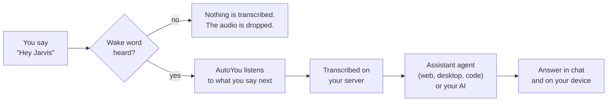

# Assistant Mode & Wake Word

Assistant mode gives your server a wake word, such as "Hey Jarvis". Say it from a
connected phone, computer, Raspberry Pi or the admin page, and whatever you say next
goes to AutoYou. The answer arrives in chat and on the device you spoke to. Until the
word is heard, nothing you say is transcribed or sent to AI. Safety Recording keeps
recording as before.

It is set up in **Chat & History → Assistant mode** on the admin page, and its
permissions also appear under **Permissions → Assistant mode**.

---

## How it works

The word can be heard in two places:

- **On the device.** iPhones, Android phones, the desktop apps and the Raspberry Pi download
  the trained word (only its acoustic pattern, never your recordings) and listen themselves.
  After the word, they upload only what you said next.
- **On the server.** Before a word is trained, while Safety Recording runs, during a call,
  and in the Chrome extension, the device streams its microphone and the server listens,
  transcribing nothing until the word matches.

During a video call, what you ask after the wake word also carries the latest camera
picture (unless **Let it see the camera** is off), so "Hey Jarvis, what am I holding?"
works.

---

## Set it up

The admin page walks you through the five steps below, and each step is checked off when
it is done. Open **Chat & History** and choose the **Assistant mode** button next to
**New chat**.

<Steps>
  <Step title="Choose the wake word">
    Type it, for example "Hey Jarvis". Two or three syllables work best. If you leave it
    blank, the server's own name is used. Rename the server in Settings to rename your
    assistant.
  </Step>
  <Step title="Record it three times">
    Choose **Record wake word** and say only the word, the way you will say it day to day.
    Each recording is checked for length and level, and you can play it back or delete it.
    Phones and computers can also record it from their own microphone (**Teach wake word**
    in their settings), if you allow that.
  </Step>
  <Step title="Train">
    Choose **Train**. It takes a few seconds on your server. With **Learn from Voice
    Training clips** on, clips from Voice Training that say the word are added, and other
    clips teach it what to ignore.
  </Step>
  <Step title="Test it">
    Choose **Test**, then say the word and a short question. The result shows the voice
    match and what was heard. If it does not wake, record once more or raise
    **Sensitivity** under **Fine-tune recognition**.
  </Step>
  <Step title="Turn it on">
    Choose **Turn on Assistant mode**. Then turn on **Assistant mode (wake word)** in the
    settings of each phone or computer that should listen, or switch it on during a call
    (see below).
  </Step>
</Steps>

<Tip>
**Typed text only** needs no recordings: short bursts of speech are transcribed on your
server and discarded unless they contain the word. It uses more CPU. **Recorded voice +
text** requires both a voice match and the word in the transcript, for the fewest
accidental wakes. The two voice choices never fall back to transcribing: until the
word is trained (or after you change it), they wait, and devices say the word needs
teaching.
</Tip>

When you save a new **Sensitivity** or listening time, phones and computers that listen
on their own pick it up without training again, and a browser already listening on this
page restarts with it.

---

## Who can change what

Assistant mode follows the same rule as the other **Permissions**: only an admin on this
computer can change it.

| Who | Can do |
| :--- | :--- |
| **Admin on this computer** (the admin page opened at `localhost` or `127.0.0.1` on the server itself) | Everything: turn it on or off, the wake word, recordings, training, the permissions below |
| **Admin from another device** (home network, a public link, a paired browser) | View the settings, **Test**, **Listen in this browser**, and turn it on during their own call. The page shows **View only** and the server refuses changes with `403` |
| **A connected device** (phone, desktop app, Raspberry Pi, Chrome) | Listen for the word, turn it on during its own call, and teach the word, as far as the permissions below allow |

A request reaches the server from this computer only when it arrives directly on
loopback. A tunnel, reverse proxy, AutoYou's browser forwarding and paired devices all
arrive on loopback too, so they are recognised by their forwarding headers and treated as
remote. Admins in WSL or Docker can be allowed with **Allow network admin permissions**
(or `AUTOYOU_ALLOW_REMOTE_ADMIN_PERMISSIONS=1`), exactly as for the other permissions.

### Permissions

These are in **Permissions → Assistant mode** and under **Where it listens and what
devices may do** in the setup panel.

| Setting | Default | What it does |
| :--- | :--- | :--- |
| **Allow Assistant mode** | Off | The master switch. Off: no device listens and nothing is transcribed for the wake word |
| **Wake word in every call** | Off | Every call answers only after the wake word. Calls and their recordings carry on as usual |
| **Devices can turn it on during a call** | On | Someone on a call can switch their own call to wake-word answers. It ends with the call |
| **Devices can record and train the wake word** | On | Devices may teach the word from their microphone. Off: only the admin page on this computer can |
| **Listen during Safety Recording** | On | Devices already recording can also wake the assistant. Recording is unchanged |
| **Let it see the camera** | On | In a video call, the turn after the wake word includes the latest camera picture |

Turning a permission off applies at once, including to calls already in Assistant mode.

---

## Use it

| Where | Listen for the word | During a call |
| :--- | :--- | :--- |
| **Admin page** | **Listen in this browser**, or the ◎ button in the composer | **Assistant mode** switch on the call card |
| **Windows app** | Calls → **Assistant mode (wake word)** | The same switch becomes **Assistant mode for this call** |
| **macOS app** | Calls → **Assistant mode (wake word)** | **Assistant mode for this call**, under the call controls |
| **Android** | Settings → **Assistant Mode (wake word)** | ✨ button on the call banner |
| **iPhone** | Settings → **Assistant Mode (wake word)** | **Assistant mode** button at the top of the call screen |
| **Chrome extension** | Settings → **Assistant mode (wake word)** | **Assistant mode** button in the call controls |
| **Raspberry Pi** | `python clients/python/autoyou_assistant.py --host <server> --accept-terms` | Not applicable (it listens all the time) |

During a call, Assistant mode means AutoYou stops answering everything you say and
answers only what follows the wake word. Hang up, and the next call starts normally
again. If **Wake word in every call** is on, the switch shows as on and cannot be turned
off from the device.

### What you can ask

The Assistant agent answers most requests itself or hands them to the right agent:

- "Hey Jarvis, open example.com and read the title." Reads the page through the
  Browser agent's desktop. Install the **Browser agent** under Agents and start its
  browser desktop (see `servers/browser-desktop/README.md`).
- "Hey Jarvis, switch to my editor." Lists and focuses windows on this computer.
- "Hey Jarvis, write a script that renames these photos." Passes the job to the Pi or
  coding agent.
- Anything else goes to your AI with the recent chat and, in a video call, the camera
  picture.

---

## Troubleshooting

| What you see | What to do |
| :--- | :--- |
| **View only** in the setup panel | You opened the admin page from another device. Open it on the server computer itself |
| "Devices cannot use Assistant mode until call audio and AutoYou Agents for calls are on" | Turn on **Allow audio calls**, and turn off **Disable AutoYou Agents for call audio**, in Permissions |
| A device says the computer "does not let calls use Assistant mode" | Turn on **Devices can turn it on during a call** |
| **Teach wake word** is missing on a device | Turn on **Devices can record and train the wake word**, or record on this computer's admin page |
| It wakes by accident | Lower **Sensitivity**, choose **Recorded voice + text**, or record the word again more clearly |
| It does not wake | Raise **Sensitivity**, record in the room you will use it, and train again |
| "The trained word was …, train again" | You changed the wake word. Record the new word and choose **Train** |
| A device says the computer "has no trained wake word yet" | **Recorded voice** or **Recorded voice + text** needs the word trained. Teach it on the device or record it here, or choose **Typed text only** |

---

## API

| Route | Who |
| :--- | :--- |
| `GET /api/assistant-mode` | Any admin. Includes `editable`: whether this admin may change it |
| `POST /api/assistant-mode/settings` | Admin on this computer |
| `POST /api/assistant-mode/samples`, `DELETE /api/assistant-mode/samples[/{id}]` | Admin on this computer |
| `POST /api/assistant-mode/train`, `DELETE /api/assistant-mode/model` | Admin on this computer |
| `GET /api/assistant-mode/model`, `GET /api/assistant-mode/samples/{id}/audio` | Any admin |
| `POST /api/assistant-mode/test`, `POST /api/assistant-mode/transcribe` | Any admin |

Devices use `voice_call_control` events on the DataChannel: `assistant_model_request`,
`assistant_utterance`, `assistant_wake`, `assistant_sample`, `assistant_enroll`,
`assistant_cancel`, and `assistant_call_mode` (`{"enabled": true}` during a call). The
server answers `assistant_call_mode` with `enabled`, `forced` (every call already waits
for the word) and a `reason` when refused (`disabled`, `not_allowed`). Capabilities
advertise `assistant_mode.call_toggle`, `call_mode_forced` and `device_teaching`, and
`model_revision`, which changes when the model is retrained or its word, sensitivity,
listening time or confirmation changes; devices fetch the model again when it does.
