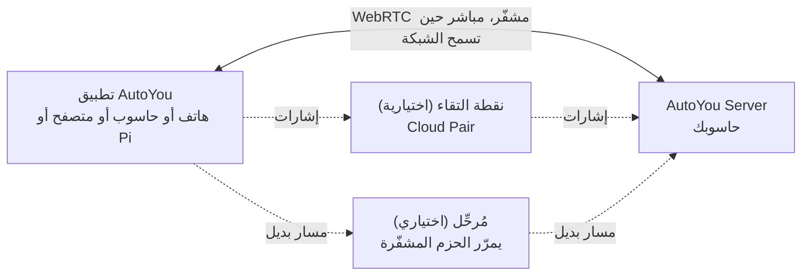

<div dir="rtl">

<div align="center">

[English](../../README.md) · [简体中文](README_zh.md) · [繁體中文](README_zh-TW.md) · [日本語](README_ja.md) · [한국어](README_ko.md) · [हिन्दी](README_hi.md) · [Español](README_es.md) · [Français](README_fr.md) · [Deutsch](README_de.md) · [Português (Brasil)](README_pt-BR.md) · [Русский](README_ru.md) · **العربية**


# AutoYou Server

### خادم الذكاء الاصطناعي الخاص بك، على الحاسوب الذي تملكه بالفعل.

**أنت لست المنتج. أنت المالك.**

[](https://github.com/autoyou-ai/AutoYou-Server/actions/workflows/public-checks.yml)
[](https://github.com/autoyou-ai/AutoYou-Server/releases)
[](../../requirements/README.md)
[](../../servers/README.md)
[](../../autoyou_agents/README.md)
[](../../LICENSE)

**[الموقع](https://www.autoyou.me/) · [التطبيقات](https://www.autoyou.me/downloads/) · [المنظومة](https://www.autoyou.me/ecosystem/) · [المجتمع](https://www.autoyou.me/community/)**

[البدء السريع](#quick-start) · [كيف يعمل](#how-autoyou-works) · [ماذا يمكنك أن تفعل](#what-you-can-do) · [الوكلاء](#agents) · [الإقران](#pairing-modes) · [الأمان](#security-modes-and-tiers) · [العملاء](#supported-clients) · [الأسئلة الشائعة](#faq) · [التوثيق](#documentation)

<code>./run_autoyou.sh</code>

</div>

> [!IMPORTANT]
> احصل على AutoYou Server من [autoyou-ai/AutoYou-Server](https://github.com/autoyou-ai/AutoYou-Server) أو [autoyou.me](https://www.autoyou.me/)، واحصل على التطبيقات من روابط المتاجر في قسم [العملاء المدعومون](#supported-clients). المستودع ذو الاسم المشابه أو ملف README المنسوخ لا يجعل التنزيل رسميًا.

<div align="center">
<br />

<br /><br />
</div>

---

حوّل الحاسوب الموجود على مكتبك إلى خادم ذكاء اصطناعي خاص لجميع أجهزتك. يشغّل AutoYou Server نماذج الذكاء الاصطناعي والوكلاء، ومكالمات الصوت والفيديو، وسطح المكتب البعيد، والألعاب، وتطبيقات الويب الخاصة بك على جهاز Windows أو macOS أو Linux. يتصل به هاتفك وحواسيبك الأخرى ومتصفحاتك عبر اتصالات مشفّرة من نظير إلى نظير، في المنزل أو خارجه.

تبقى محادثاتك وملفاتك ونشاط الوكلاء على ذلك الحاسوب، لا في خدمة AutoYou مستضافة. شغّل نماذج محلية عبر Ollama لتدردش دون فاتورة رموز، أو اربط مزوّد السحابة الذي تفضّله. أقرِن جهازك مرة واحدة، وسيكون كل ما يقدّمه الخادم في جيبك: الدردشة، ومساعد دون استخدام اليدين، وصوت فوري بلغات كثيرة، وسطح مكتبك، وألعابك، وأي خدمة ويب تشغّلها بالفعل.

> **هل هذه أول مرة؟** شغّل سكربت التشغيل، وافتح **http://127.0.0.1:8001/**، وسيرشدك معالج الإعداد إلى اختيار الذكاء الاصطناعي وتفعيل الميزات التي تريدها وإقران أول جهاز.

<a id="quick-start"></a>

## البدء السريع

تحتاج إلى Git وPython 3.11 أو أحدث. بعض الميزات الاختيارية تحتاج إلى Python أحدث أو منصة محددة؛ راجع [ملفات تعريف الاعتماديات](../../requirements/README.md).

### 1. احصل على الخادم

```bash
git clone https://github.com/autoyou-ai/AutoYou-Server.git
cd AutoYou-Server
```

### 2. شغّل سكربت التشغيل

Windows:

```powershell
.\run_autoyou.bat --profile base
# Or select the Full profile with LAN access:
.\run_autoyou.bat --profile full --host 0.0.0.0
```

macOS أو Linux:

```bash
./run_autoyou.sh --profile base
# Or select the Full profile with LAN access:
./run_autoyou.sh --profile full --host 0.0.0.0
```

ينشئ السكربت بيئة Python، ويثبّت الاعتماديات من فهارس الحزم، وقد ينزّل نماذج وأدوات أصلية. اقرأ السكربتات أولًا وشغّلها في بيئة يمكنك تعديلها بأمان.

### 3. افتح لوحة التحكم وأقرِن جهازًا

انتقل إلى **http://127.0.0.1:8001/**، واختر كلمة مرور فريدة للخادم، واتبع الإعداد. سيسألك عمّا تريد استخدام AutoYou له (الدردشة، المساعد دون يدين، المكالمات، الألعاب، البرمجة وغيرها)، ثم يثبّت الوكلاء المناسبين ويعرض رمز QR لإقران هاتفك.

للإعداد الأول دون تدخّل، مرّر `AUTOYOU_SERVER_PASSWORD` عبر متغيرات البيئة أو مدير أسرار. لا تضع كلمات مرور حقيقية في الأوامر المشتركة أو البلاغات أو لقطات الشاشة.

| ملف التعريف | ما يضيفه |
| --- | --- |
| `base` | الخادم الأساسي، والإدارة المحلية، واتصالات الأجهزة، وتكاملات مزوّدي السحابة |
| `local` | أدوات مساعدة للنماذج المحلية وتوجيه النوايا على الجهاز |
| `recommended` | اعتماديات المراسلة وBluetooth (الافتراضي عند حذف `--profile`) |
| `full` | اعتماديات الكلام والمتصفح وأتمتة سطح المكتب |

الملفات الشخصية تختار التبعيات فقط؛ وما زالت التكاملات تحتاج إلى إعداد. يحتفظ `--skip-nuitka` و`--skip-backend-compile` بالمكتبات المضمّنة في المشغّل، لذا تحتاج تحديثات أمان التبعيات في التطبيقات المحزّمة إلى إعادة بناء كاملة.

للتحديث، نفّذ `git pull` في نسختك ثم أعد تشغيل السكربت. ملاحظات الإصدارات في [docs/releases/](../releases/).

<a id="how-autoyou-works"></a>

## كيف يعمل AutoYou

**الخادم هو حاسوبك أنت، والأجهزة تتحدث إليه مباشرة.** تتصل التطبيقات والخادم عبر WebRTC. بعد مصافحة إقران قصيرة يفتحان رابطًا مشفّرًا (DTLS، مع SRTP للوسائط) ينقل الدردشة والصوت والفيديو ومشاركة الشاشة ومدخلات الألعاب وحركة الويب الممرّرة. تستطيع معظم الشبكات المنزلية والخلوية إنشاء هذا الرابط دون فتح منافذ في الموجّه. وإذا كانت الشبكة شديدة التقييد، ينتقل الاتصال إلى مُرحِّل يمرّر الحزم المشفّرة نفسها.



على الخادم، يوجّه موجّه النوايا المحلي كل طلب إلى الوكيل أو الأداة المناسبة. يشغّل Google ADK الوكلاء الأصليين، ويمكن ربط OpenClaw وHermes Agent وOdysseus. يرسل LiteLLM استدعاءات النموذج إلى Ollama على جهازك أو إلى مزوّد السحابة الذي تختاره. يُتعرَّف على الكلام ويُنطق محليًا، وتُحفظ الذاكرة في SQLite.

<picture>
  <source media="(prefers-color-scheme: dark)" srcset="../images/architecture-dark.png" />
  
</picture>

يُنشأ هذا المخطط بواسطة [scripts/build_architecture_diagram.py](../../scripts/build_architecture_diagram.py). المربعات المتقطعة إضافات اختيارية أو مشاريع متصلة.

<a id="what-you-can-do"></a>

## ماذا يمكنك أن تفعل

| الميزة | ماذا تمنحك |
| --- | --- |
| **دردشة الذكاء الاصطناعي** | دردش مع ذكائك الاصطناعي من أي جهاز مُقرَن؛ لا يضع AutoYou حدًا لعدد الرسائل |
| **الصوت الفوري** | مكالمات حية مع الذكاء الاصطناعي، وتعرّف محلي على الكلام، وردود منطوقة بأكثر من 30 لغة |
| **وضع المساعد** | كلمة تنبيه مثل "Hey Jarvis" على الهاتف أو الحاسوب أو Raspberry Pi أو المتصفح |
| **سطح المكتب البعيد** | شاهد حاسوبك وتحكّم فيه من هاتفك، بما في ذلك شاشة قفل Windows |
| **فيديو الحاسوب** | أرسل إلى المكالمة الشاشة أو الكاميرا أو ملف فيديو أو إطارات عبر API |
| **وضع الألعاب وGame Studio** | بُثّ الألعاب من حاسوبك إلى هاتفك، أو أنشئ ألعابًا تعمل على الهاتف دون اتصال |
| **مصنع تطبيقات الويب** | اطلب من وكيل بناء تطبيق ويب وافتحه على كل أجهزتك المُقرَنة |
| **استضافة أي منفذ محلي** | شارك أي خدمة ويب على حاسوبك، مثل `localhost:3000`، مع أجهزتك المُقرَنة |
| **الوكلاء** | 45 وكيلًا مدمجًا للملاحظات والملفات والبرمجة والوسائط والتصفح والتدريب وغيرها |
| **MCP** | استخدم أدوات AutoYou من ChatGPT وCodex وClaude وAntigravity وCursor وVS Code |
| **المراسلة** | تواصل مع خادمك عبر Telegram وSignal وWhatsApp بموصلات تتحكم فيها |
| **الذاكرة** | ذاكرة في SQLite ويوميات شخصية خاصة، مع Cognee كإضافة اختيارية |

تعتمد الميزات على ملف التعريف المختار والعتاد والأذونات والتكاملات المُعدّة. تبقى القدرات القوية مثل التحكم في سطح المكتب ووضع الألعاب والتسجيل والوصول إلى الملفات مطفأة حتى تفعّلها.

<a id="ai-chat"></a>

### دردشة الذكاء الاصطناعي

اختر مزوّدًا من قسم **AI** في لوحة التحكم: الافتراضي **Ollama + Agents** (نموذج محلي، دون مفتاح API)، أو **Apple Intelligence** على أجهزة Mac المدعومة، أو **Gemini**، أو **OpenRouter**، أو مزوّدين آخرين عبر LiteLLM (Anthropic وOpenAI وMistral وDeepSeek وxAI وغيرها)، مع إبقاء جميع وكلاء AutoYou وأدواته. يمكنك أيضًا جعل **OpenClaw** أو **Hermes Agent** أو **Odysseus** بيئة الجلسة الرئيسية.

لا يحدّ AutoYou عدد الرسائل التي ترسلها. مع النموذج المحلي، لا كلفة لكل رسالة، وتعمل الدردشة دون إنترنت. أما مزوّد السحابة الذي تربطه فيحاسبك وفق خطته ويرى الأوامر التي ترسلها إليه. تتيح مكتبة النماذج المدمجة تصفّح النماذج المحلية وتنزيلها والتبديل بينها، ويقترح وكيل Model Picker نموذجًا يناسب عتادك.

تحصل النماذج المحلية الصغيرة والمكمّمة على مساعدة لتبقى دقيقة: مصنّف نوايا يعمل دون اتصال يرسل الطلبات الشائعة مباشرة إلى الوكيل المناسب، ووضع توجيه مضغوط يُبقي قائمة الأدوات قصيرة. راجع [كيف تبقى النماذج الصغيرة دقيقة](../../autoyou_agents/README.md#small-local-models).

<a id="realtime-voice-in-many-languages"></a>

### صوت فوري بلغات كثيرة

اتصل بذكائك الاصطناعي وتحدّث. يعمل التعرّف على الكلام على حاسوبك (whisper.cpp في الإصدار الافتراضي، وfaster-whisper في إصدارات الصوت الكاملة)، مع كشف النشاط الصوتي، وإيقاف الرد فور بدئك الكلام، وخاصية **انتظر حتى أنتهي من الكلام** للأفكار الطويلة.

- **تحدّث بلغتك.** اترك **STT language** على `auto` واختر نموذجًا متعدد اللغات، فيكتشف اللغة التي تتحدث بها.
- **اسمع الرد بتلك اللغة.** يكتشف **Auto TTS** الافتراضي لغة الرد ويختار صوت نظام مطابقًا. ويتحدث نموذج Supertonic 3 المحلي 31 لغة منها العربية، ويعمل دون اتصال بعد تنزيل لمرة واحدة بحجم 401 ميغابايت تقريبًا.
- **اختر صوتك.** أصوات النظام، أو عشرة أصوات جاهزة من Supertonic، أو صوت مخصّص درّبته في تطبيق Voice Training، أو EmotiVoice للصينية والإنجليزية، أو أصوات OpenAI وAzure المستضافة.

تحويل النص إلى كلام ينطق الرد الذي يصله ولا يترجمه، ويجب أن يدعم نموذج الدردشة الذي تختاره لغة المحادثة أيضًا.

<a id="assistant-mode"></a>

### وضع المساعد

امنح خادمك كلمة تنبيه مثل "Hey Jarvis". قلها قرب هاتف أو حاسوب أو Raspberry Pi مُقرَن، أو قرب إضافة Chrome أو صفحة الإدارة، وسيذهب ما تقوله بعدها إلى AutoYou. وقبل سماع الكلمة لا يُنسَخ أي شيء مما تقوله ولا يُرسَل إلى الذكاء الاصطناعي. سجّلها ثلاث مرات، ودرّبها على خادمك في ثوانٍ، واختبرها، ثم فعّلها. وفي مكالمة الفيديو، يمكن أن يحمل الطلب بعد كلمة التنبيه أحدث صورة من الكاميرا. راجع [وضع المساعد](../admin-ui/assistant-mode.mdx).

<a id="remote-desktop"></a>

### سطح المكتب البعيد

شاهد حاسوبك وتحكّم فيه من هاتف أو تطبيق سطح مكتب مُقرَن: اختر شاشة أو نافذة تطبيق واحدة، وحرّك الفأرة، واكتب، واستخدم مفاتيح التعديل. يُفضَّل H.264 حين يدعمه الجهاز. وعلى Windows تسمح الخدمة الاختيارية **AutoYou Secure Desktop Helper** للمالك المُقرَن برؤية شاشة القفل ومطالبات UAC واستخدامها، ويمكن للخادم إبقاء الحاسوب مستيقظًا أثناء اتصالك. التقاط الشاشة والإدخال إذنان منفصلان، مطفآن افتراضيًا، ولا يُقدَّم سطح المكتب البعيد أبدًا عبر Peer Link.

<a id="computer-video"></a>

### فيديو الحاسوب

أثناء المكالمة يمكن للحاسوب إرسال الفيديو من أربعة مصادر: **الشاشة**، أو **كاميرا**، أو **ملف فيديو** ترفعه وتشغّله، أو **إطارات عبر API** يرسلها برنامجك الخاص. ويمكن مشاركة ميكروفون الحاسوب وصوته أيضًا. وفي لوحة التحكم، يعرض قسم **Interact** صور الكاميرات الحية من الأجهزة المتصلة، ويمكنه تشغيل ميكروفوناتها على سماعات الحاسوب، دون معالجة بالذكاء الاصطناعي ودون تسجيل.

<a id="game-mode-and-game-studio"></a>

### وضع الألعاب وGame Studio

- **وضع الألعاب** يبثّ إلى جهاز مُقرَن لعبة تُرسَم على حاسوبك، وتعود لمسات الجهاز وحساسات الحركة ووحدة التحكم والفأرة ولوحة المفاتيح كمدخلات للعبة. يمكنك تعريف ما يصل إلى أربعة أزرار افتراضية مسمّاة. وضع الألعاب إذن مستقل، ويفعّل أيضًا إرسال الشاشة وإدخال سطح المكتب البعيد.
- **استخدم محركك الخاص.** يمكن لمحرك ألعاب محلي قراءة إطارات إدخال موثّقة بالبروتوكول `autoyou_game_v1` عبر WebSocket محلي. ولمحرك Unreal يوفّر الخادم إضافة بشيفرتها المصدرية على `/api/game/unreal-plugin`.
- **ألعاب دون اتصال للهاتف.** يساعدك وكيل Game Studio على بناء ألعاب ويب أو WASM محمولة، ويحزمها في ملفات `.aygame` حتى 5 غيبيبايت، ويرسلها إلى العملاء عبر WebRTC أو Peer Link معتمد. لكل لعبة قاعدة بيانات SQLite خاصة بها على الجهاز، ويبقى التقدّم المحفوظ بعد التحديثات.

**Neon Horizon** هي اللعبة التجريبية المدمجة: نزّلها على الهاتف، أو العبها في صفحة Game Studio، أو بُثّها من حاسوبك.

<a id="web-app-factory"></a>

### مصنع تطبيقات الويب

صِف تطبيقًا ودَع الوكلاء يبنونه. ينشئ وكيل **Website** واجهة متصفح لوكيل ما: قالبًا بسيطًا، أو React أو Angular عند الطلب، مع خلفية بـ Python/FastAPI أو Node/TypeScript أو Go أو Rust. ويبني **Agent Builder** هيكل وكيل جديد، بينما ينفّذ وكيلا **Coding** و**Pi** الشيفرة ويختبرانها. يُسجَّل كل تطبيق في خدمة المواقع المحلية ويظهر في متصفح أجهزتك المُقرَنة. ويشرح وكيل **Hosting** كيفية النشر عبر رابط عام: نفق `/pair` مؤقت مجاني أو رابط دائم مدفوع.

<a id="host-any-local-port"></a>

### استضافة أي منفذ محلي

هل لديك شيء يعمل بالفعل؟ شاركه. في **Websites & Browser > Advertised Websites** أضف أي منفذ من 1 إلى 65535 مع تسمية وعنوان إعادة توجيه اختياري، مثل `http://127.0.0.1:3000` أو مضيف آخر على شبكتك. تكتشفه العملاء المُقرَنة وتفتحه على المنفذ نفسه لديها، فتستمر لوحات المعلومات وخوادم التطوير وأدوات المختبر المنزلي والتطبيقات غير المصمّمة للعمل تحت مسار فرعي في العمل كما هي. تمرّ الحركة داخل الرابط المشفّر، فلا حاجة إلى فتح المنفذ في الموجّه، وتحصل المتصفحات المُقرَنة على دور `viewer` أو `editor` أو `admin` الذي يحدّ ما يمكنها تغييره.

<a id="agents"></a>

## الوكلاء

يأتي AutoYou مع 45 وكيلًا مدمجًا. يوجّه الوكيل الرئيسي كل طلب إلى المختص المناسب، ولكثير من المختصين صفحة ويب خاصة على أجهزتك المُقرَنة. الوكلاء المعلَّمون بـ opt-in لا يُثبَّتون حتى تثبّتهم من قسم **Agents** في لوحة التحكم.

| المجال | الوكلاء |
| --- | --- |
| الاستخدام اليومي | Notes، Tasks، Notify، Memory، Persona، Page، Prompts، Location (opt-in) |
| الويب والأتمتة | Internet، Assistant، Browser (opt-in)، Client Browser Control، Proxy (opt-in) |
| الوسائط والإبداع | Audio، TV، Media Generation (opt-in)، Game Studio |
| البرمجة والبناء | Coding، Pi، Agent Builder، Website، Skills، Files، CLI، Claude CLI، Claude Desktop، Codex Desktop، Antigravity، Prompt Builder (جميعها opt-in) |
| الذكاء والنماذج | Model Picker، OpenClaw، Hermes Agent (جميعها opt-in) |
| التدريب | Data Collector، Fine-Tuning، Voice Training (جميعها opt-in) |
| النظام والحاسوب | Admin، Remote Desktop، Backup، Hosting (opt-in)، Windows Security (opt-in)، macOS Security (opt-in)، Education (opt-in) |
| دعم AutoYou | Support Ads، Earnings، Donation |

أضف وكلاءك بنسخ حزمة إلى `autoyou_agents/`. كل التفاصيل في [دليل الوكلاء](../../autoyou_agents/README.md).

يسرد [مرجع الوكلاء المُولّد](../agents/) كل أداة يعلنها كل وكيل.

<a id="pairing-modes"></a>

## طرق الإقران

| الطريقة | كيف تتصل | الاستخدام المعتاد |
| --- | --- | --- |
| **Local Pair** | مباشرة عبر شبكتك المحلية؛ يتولى خادمك الإشارات | نفس شبكة Wi-Fi أو شبكة المكتب |
| **Bluetooth Pair** | تُسلَّم بيانات الاتصال عبر Bluetooth Low Energy | الإعداد الأول لهاتف قريب |
| **Live Pair** | يعرض الهاتف والحاسوب رموز QR متحركة لبعضهما، دون مسار شبكي بينهما | الشبكات المعزولة أو المقيّدة |
| **رمز لمرة واحدة** | إرسال `/pair` في محادثة مراسلة يعيد رمزًا ورابطًا قصيري الأجل | أجهزة الضيوف والشبكات غير الموثوقة |
| **Auto Pair** | تُنقل رسالة إقران مشفّرة عبر محادثة Telegram أو Signal أو WhatsApp تُعدّها أنت | الإقران عن بُعد دون حساب سحابي |
| **Cloud Pair** | نقطة التقاء اختيارية مدفوعة من AutoYou Cloud تجد حاسوبك عبر NAT، مع مُرحِّل احتياطي | خارج المنزل أو خلف شبكات صارمة |

يربط **Peer Link** تطبيق AutoYou بتطبيق آخر؛ يوافق التطبيق المستقبِل على كل رابط، ولا تُستخدم كلمة مرور حاسوبك أبدًا. أما **Lobbies** فهي غرف جماعية تنشئها التطبيقات وتنضم إليها بالقرب عبر Wi-Fi وBluetooth. راجع [بروتوكولات الإقران](../technical/pairing-protocols.md).

<a id="security-modes-and-tiers"></a>

## أوضاع الأمان ومستوياته

يُطبَّق وضع أمان واحد على الخادم كله. تبدأ أي تثبيتة جديدة في وضع **Secure**.

| الوضع | رسائل الإقران | ما يحتاجه الجهاز للإقران | البيانات على الحاسوب |
| --- | --- | --- | --- |
| **Normal** | غير مشفّرة | رمز لمرة واحدة | دون تغيير |
| **Secure** | مشفّرة بكلمة مرور الخادم | كلمة مرور الخادم | دون تغيير |
| **Secure Professional** | مشفّرة بكلمة مرور الخادم | كلمة المرور ورمز المصادقة الحالي | دون تغيير |
| **Secure Professional Maximus** | مثل Secure Professional | كلمة المرور ورمز المصادقة الحالي | الجلسات وبيانات الوكلاء والمواقع والملاحظات والإعدادات مشفّرة أثناء التخزين |

في أوضاع Secure، تُشفَّر رسائل الإقران بمفتاح مشتق من تبادل مفاتيح موثَّق بكلمة مرور (بنية من عائلة CPace فوق ristretto255 باستخدام libsodium). لا يستطيع المُرحِّل أو جسر المراسلة الذي ينقلها قراءتها، ولا يمكن استخدام تبادل مسجَّل لتخمين كلمات المرور دون اتصال.

**مستوى أمان الإقران** يحدد مقدار العمل الذي يتطلبه الإقران عبر رسالة دردشة: **Quick Pairing (B)** يسمح بالإقران برسالة واحدة ويقدّم أفضل توافق؛ و**Enhanced Pairing (A)** يلزم كل عميل بإتمام جولة hello إضافية أولًا، مما يصعّب التخمين. تستخدم Local Pair وBluetooth Pair وCloud Pair المسار المعزَّز دائمًا.

يحصل متصفح الجهاز المُقرَن على دور `viewer` أو `editor` أو `admin`. ولا يمكن تغيير بيانات الاعتماد وإعدادات الأمان إلا من الحاسوب نفسه أو من جلسة إدارة HTTPS مفتوحة مباشرة على منفذ الإدارة. التشفير يحمي الاتصال، لا الأجهزة نفسها ولا أذونات الوكلاء ولا خدمات الأطراف الثالثة. راجع [أوضاع الأمان](../security/security-modes.md) و[SECURITY.md](../../SECURITY.md).

<details>
<summary><strong>ما تحميه كل طبقة وأين تتوقف</strong></summary>

| الطبقة | ما يفعله AutoYou |
| --- | --- |
| الانكشاف على الشبكة | يستمع على `127.0.0.1` افتراضيًا. الاستماع على شبكتك المحلية إعداد صريح. |
| الوصول | وحدة الإدارة محمية بكلمة مرور الخادم، مع رموز اختيارية من تطبيق مصادقة (TOTP). |
| الاقتران | تبادل مفاتيح مُصادَق بكلمة المرور، ورموز لمرة واحدة، والموافقة على كل رابط في Peer Link. |
| النقل | WebRTC DTLS وSRTP بين الطرفين، حتى عندما يمرّر مُرحِّل الحزم. |
| البيانات المخزّنة | تُحفظ بيانات الاعتماد في مخزن مفاتيح مشفّر؛ ويشفّر Maximus أيضًا البيانات التي يديرها AutoYou. |
| التبعيات | ملفات بيان مع ملفات قفل، وفحص تنبيهات الأمان، وإجراءات CI مثبّتة. |

التشفير يحمي الاتصال. لكنه لا يحمي كل ما حوله:

- **الأجهزة.** البرمجيات الخبيثة على حاسوب الخادم أو على جهاز مقترن تملك صلاحيات ذلك الجهاز نفسها.
- **الوكلاء.** يعمل الوكلاء بصلاحيات الخادم. أتمتة المتصفح والوصول إلى الملفات والتحكم في سطح المكتب وتنفيذ الأوامر قدرات قوية؛ فعّل ما تحتاجه فقط وراجع ما يفعله الوكلاء.
- **الأطراف الثالثة.** لمزوّدي النماذج السحابية وجسور المراسلة والأنفاق العامة تدفقات بيانات وشروط خاصة بها. راجعها قبل التفعيل.
- **التشغيل.** تشغيل خادم يجعلك مسؤولًا عن التحديثات والنسخ الاحتياطية وبيانات الاعتماد.

</details>

<details>
<summary><strong>ما الخدمات الخارجية المشاركة</strong></summary>

أنت تشغّل خادمًا واحدًا: خادمك. لا يلزم أي خادم تطبيقات يديره AutoYou لتشغيل مساعدك أو تخزين بياناتك، ويعمل الخادم على شبكة محلية دون اتصال بـ AutoYou Cloud ([التفاصيل](../architecture/cloud-and-remote.mdx)). كل ما عدا ذلك إعداد افتراضي يمكنك تغييره أو أداة مساعدة اختيارية:

| المكوّن | يعمل على | ما يمكنه رؤيته |
| --- | --- | --- |
| AutoYou Server: الوكلاء والنماذج والتخزين ووحدة الإدارة | حاسوبك | بياناتك. إنه أحد طرفي الاتصال. |
| التطبيقات وعملاء المتصفح | أجهزتك | ما تشاركه معها |
| خوادم STUN لاكتشاف العنوان (مفعّلة افتراضيًا) | خوادم STUN العامة من Google ما لم تغيّرها | عنوان IP العام والمنفذ اللذين يظهر منهما اتصال WebRTC |
| نقطة التقاء Cloud Pair (اختياري) | AutoYou Cloud | بريد الحساب ومعرّف الجهاز وبيانات اقتران مؤقتة وبيانات وصفية للشبكة |
| مُرحِّل احتياطي (اختياري) | AutoYou Cloud | حزم مشفّرة وبيانات وصفية للشبكة |
| إشعارات الدفع لإيقاظ تطبيقات الهاتف (اختياري) | خدمات الدفع من Apple وGoogle | أنه طُلب إيقاظ التطبيق |
| التحقق من التحديثات (مفعّل عند ربط حساب) | قناة تحديثات AutoYou Cloud | طلب تحديث مُصادَق بالحساب المرتبط |
| مزوّدو النماذج السحابية (اختياري) | المزوّد الذي تختاره | الطلبات التي ترسلها إليه |
| جسور Telegram وSignal وWhatsApp (اختياري) | تلك الخدمات | الرسائل التي تمر عبرها، وفق شروطها |
| نفق عام للمواقع (اختياري) | مزوّد النفق | حركة المرور إلى الرابط العام. ليس من طرف إلى طرف. |

**خوادم STUN العامة مفعّلة افتراضيًا**، بما في ذلك مع Local Pair. لمنع هذا الاستعلام من الخروج إلى الإنترنت، اضبط `AUTOYOU_DISABLE_PUBLIC_STUN=1` قبل تشغيل الخادم، أو وجّهه إلى خادم STUN وTURN خاص بك عبر `AUTOYOU_LOCAL_STUNTURN_HOST` (مع `AUTOYOU_LOCAL_TURN_USERNAME` و`AUTOYOU_LOCAL_TURN_PASSWORD` لخادم TURN). من دون أي خادم STUN أو TURN قد تفشل الاتصالات عبر NAT.

</details>

<a id="supported-clients"></a>

## العملاء المدعومون

يعمل AutoYou Server على حاسوبك، وتصل إليه التطبيقات من أي مكان آخر. تُوزَّع تطبيقات العملاء بشكل منفصل، وشيفرتها المصدرية ليست جزءًا من هذا المستودع.

| المنصة | من أين تحصل عليه |
| --- | --- |
| iPhone وiPad | [App Store](https://apps.apple.com/us/app/autoyou/id6760363728) |
| Android | [Google Play](https://play.google.com/store/apps/details?id=com.autoyou.app) |
| Windows | [Microsoft Store](https://apps.microsoft.com/detail/9mw8l2wfw7wv?hl=en-US&gl=US) |
| macOS وLinux | [التنزيلات](https://www.autoyou.me/downloads/) |
| المتصفح | إضافة Chrome وعميل الويب ([صفحة المنظومة](https://www.autoyou.me/ecosystem/)) |
| Raspberry Pi | عميل صوتي بلغة Python لوضع المساعد ([الإعداد](../admin-ui/assistant-mode.mdx)) |

تتضمن تطبيقات الهاتف أيضًا ذكاءً اصطناعيًا محليًا صغيرًا (LFM 2.5 350M أو Gemini Nano أو Apple Intelligence بحسب الجهاز) للدردشة حتى دون حاسوب.

| أوضاع الاقتران | تحدّث مع ذكائك الاصطناعي | الردهات القريبة | ذكاء اصطناعي محلي على الهاتف |
| --- | --- | --- | --- |
|  |  |  |  |

- **الردهات (Lobbies).** أنشئ غرفًا قريبة أو انضم إليها عبر Wi-Fi وBluetooth، مع دردشة وصوت أو فيديو لما يصل إلى ستة ضيوف إضافة إلى المضيف.
- **Peer Link.** صِل تطبيقًا بآخر. يوافق التطبيق المستقبِل على كل رابط، وتستخدم ردود الذكاء الاصطناعي الاختيارية ما أخبرته به فقط.
- **حاسوبك في كل مكان.** دردشة ومكالمات وسطح مكتب بعيد ووضع ألعاب ومواقع الوكلاء والمنافذ المنشورة على كل جهاز تقرنه.

<a id="mcp"></a>
<a id="use-autoyou-from-your-coding-agent"></a>

## استخدم AutoYou من وكيل البرمجة الخاص بك

اربط ميزات MCP في ChatGPT وCodex وClaude Code أو Claude Desktop وGoogle Antigravity وCursor وVS Code بأدوات AutoYou المدعومة. محوّل MCP المحلي عملية منفصلة؛ لا يثبّته الخادم في هذه العملاء، واستدعاءات MCP تكشف الأدوات التي يدعمها المحوّل فقط، لا وصولًا عشوائيًا إلى ملفاتك ولا كل ميزات AutoYou.

1. شغّل AutoYou Server وافتح **http://127.0.0.1:8001/**.
2. في **Admin UI > Messaging > AutoYou MCP** فعّل MCP، وأنشئ رمز المحوّل الخاص، ونزّل `autoyou-mcp.env`. احتفظ بهذا الملف سرًّا.
3. ثبّت المحوّل، الذي يُصان بشكل منفصل، في بيئة Python مخصصة:

   ```powershell
   git clone https://github.com/autoyou-ai/AutoYou.git
   cd AutoYou
   py -3 -m venv .venv-mcp
   .\.venv-mcp\Scripts\python.exe -m pip install -e .\plugins\autoyou-mcp
   ```

   على macOS أو Linux استخدم `python3 -m venv .venv-mcp` و`.venv-mcp/bin/python -m pip install -e ./plugins/autoyou-mcp`.

للعملاء الذين يشغّلون عملية MCP محلية، استخدم هذا الأمر بمسارات مطلقة:

```text
<path-to-.venv-mcp-python> -m autoyou_mcp --env-file <path-to-autoyou-mcp.env> --transport stdio
```

<details>
<summary><strong>أضف AutoYou إلى كل عميل</strong></summary>

للعملاء الذين يستخدمون صيغة JSON `mcpServers`، يبدو الإدخال هكذا. استبدل مساري المثال، واهرب الشرطات المائلة العكسية في Windows إن استخدمتها داخل JSON:

```json
{
  "mcpServers": {
    "autoyou": {
      "command": "C:/path/to/AutoYou/.venv-mcp/Scripts/python.exe",
      "args": [
        "-m", "autoyou_mcp",
        "--env-file", "C:/path/to/autoyou-mcp.env",
        "--transport", "stdio"
      ]
    }
  }
}
```

**ChatGPT على الويب** يستخدم اتصال MCP بعيدًا، لا عملية `stdio` محلية. شغّل المحوّل مع `--transport streamable-http` وصِل نقطة النهاية المحلية `http://127.0.0.1:8071/mcp` عبر OpenAI Secure MCP Tunnel. يتطلب ChatGPT وضع المطوّر وصلاحيات مساحة العمل أو المشرف المناسبة، وتحدّ OpenAI إجراءات MCP الكاملة حسب الخطة. اتبع [إعداد AutoYou MCP لـ ChatGPT](https://github.com/autoyou-ai/AutoYou/blob/main/plugins/autoyou-mcp/README.md#connect-chatgpt-web) و[دليل تطبيقات MCP من OpenAI](https://help.openai.com/en/articles/12584461-developer-mode-and-mcp-apps-in-chatgpt).

**Codex CLI وتطبيق سطح المكتب وإضافة بيئة التطوير** تتشارك إعداد MCP لمضيف Codex:

```powershell
codex mcp add autoyou -- "C:/path/to/AutoYou/.venv-mcp/Scripts/python.exe" -m autoyou_mcp --env-file "C:/path/to/autoyou-mcp.env" --transport stdio
codex mcp list
```

أو أضف `command` و`args` المكافئين تحت `[mcp_servers.autoyou]` في `~/.codex/config.toml`. راجع [دليل MCP في Codex](https://learn.chatgpt.com/docs/extend/mcp?surface=cli).

**Claude Code:**

```powershell
claude mcp add --transport stdio autoyou -- "C:/path/to/AutoYou/.venv-mcp/Scripts/python.exe" -m autoyou_mcp --env-file "C:/path/to/autoyou-mcp.env" --transport stdio
claude mcp list
```

ثم شغّل `/mcp` داخل Claude Code. راجع [دليل MCP في Claude Code](https://code.claude.com/docs/en/mcp).

**Claude Desktop** يشغّل المحوّل كخادم stdio محلي. أضف إدخال `mcpServers.autoyou` إلى `~/Library/Application Support/Claude/claude_desktop_config.json` على macOS أو إلى `%APPDATA%\Claude\claude_desktop_config.json` على Windows، ثم أغلق Claude Desktop تمامًا وأعد فتحه. لا يوزّع AutoYou حاليًا إضافة سطح مكتب بصيغة `.mcpb`. راجع [دليل MCP في Claude Desktop](https://support.claude.com/en/articles/10949351-getting-started-with-local-mcp-servers-on-claude-desktop).

**Google Antigravity** يستخدم `~/.gemini/config/mcp_config.json` على مستوى النظام أو `.agents/mcp_config.json` داخل مساحة عمل. في Antigravity IDE افتح **MCP Servers > Manage MCP Servers > View raw config**. راجع [دليل MCP في Antigravity](https://antigravity.google/docs/mcp).

**Cursor** يستخدم `~/.cursor/mcp.json` أو `.cursor/mcp.json` بإدخال `mcpServers` نفسه. راجع [دليل MCP في Cursor](https://prod.cursor.com/help/customization/mcp).

**VS Code** يمكنه استخدام الملف المحمول `.mcp.json` في جذر مساحة العمل. أما `.vscode/mcp.json` فيستخدم كائن `servers` في المستوى الأعلى مع `"type": "stdio"`. راجع [دليل MCP في VS Code](https://code.visualstudio.com/docs/agent-customization/mcp-servers).

على macOS أو Linux يكون ملف Python التنفيذي `.venv-mcp/bin/python`. قد تؤثر إصدارات العملاء وإعداداتها وسياسات المؤسسة والموافقة على الأدوات في التوفر.

</details>

بعد الاتصال، تأكد من ظهور `get_autoyou_status` وأنه يعيد حالة الخادم المتوقعة قبل استخدام أي أداة تكتب بيانات. راجع [دليل تكامل MCP في AutoYou](../guides/mcp-integration.mdx) لمعرفة النطاق ونموذج الأمان والحدود.

<a id="admin-console"></a>

## وحدة الإدارة

<p align="center">
  
</p>

تجمع وحدة الإدارة المحلية الإعداد والنماذج والصوت والوكلاء والاتصالات والصلاحيات والأمان. يسألك الإعداد الموجَّه عمّا تريد استخدام AutoYou له ويقترح الوكلاء والصلاحيات المناسبة؛ ولا يتغير شيء حتى تراجع الخطة وتحفظها. تستخدم لقطات الشاشة قيمًا تجريبية. اختر صورة مصغّرة لفتح الصورة بحجمها الكامل.

| نظرة عامة على الخادم | الأجهزة والنشاط | الوصول والأمان |
| --- | --- | --- |
| [](../images/admin/overview.png) | [](../images/admin/live-view.png) | [](../images/admin/security.png) |

<a id="other-ways-to-run"></a>

## طرق أخرى للتشغيل

<details>
<summary><strong>Docker</strong></summary>

وفّر `AUTOYOU_SERVER_PASSWORD` بطريقة آمنة، ثم شغّل:

```bash
docker compose up --build
```

ينشر ملف Compose المنافذ على واجهة loopback للمضيف فقط، ويحفظ الإعدادات في وحدة تخزين مسمّاة. افتح `http://localhost:8001/` على الحاسوب نفسه؛ يعلن الملف أن هذا النشر على loopback فقط (`AUTOYOU_ADMIN_TRUST_PUBLISHED_LOOPBACK=1`)، فلا يُرفض تسجيل الدخول برسالة "requires localhost or HTTPS". مع `docker run` العادي، انشر على `127.0.0.1` ومرّر المتغير نفسه، أو ضع وكيل TLS أمامه. تحقّق من طريقة نشر إصدار Docker لديك للمنافذ قبل الاعتماد على عزل loopback.

لتعطيل تنزيلات Tunnelmole أثناء البناء والتشغيل، اضبط `AUTOYOU_SKIP_TUNNELMOLE_DOWNLOAD=1` و`AUTOYOU_NO_DOWNLOAD_TUNNELMOLE=1` قبل البناء والتشغيل. ستحتاج الميزات التي تعتمد عليه حينها إلى ملف تنفيذي يُوفَّر بشكل منفصل.

</details>

<details>
<summary><strong>ابنِ نسخة محلية غير رسمية</strong></summary>

من جذر المستودع:

```powershell
# Windows
.\servers\windows\build-all.ps1 -Configuration Debug
```

```bash
# macOS
./servers/macos/build-all.sh --no-sign --dev

# Linux / WSL
./servers/wsl/build-backend.sh --unofficial
```

لا تحتاج هذه الطرق إلى حساب AutoYou ولا إلى موافقة على إصدار رسمي. قد تثبّت التبعيات أو تعدّلها. راجع الترخيص والإشعارات عند ظهورها. لقبولها دون تفاعل بعد مراجعتها، مرّر `-AcceptTerms` على Windows أو `--accept-terms` على macOS وLinux.

المتطلبات ومكان النتائج والقيود المعروفة:
[Windows](../../servers/windows/README.md) · [macOS](../../servers/macos/README.md) · [Linux / WSL](../../servers/wsl/README.md).

</details>

<a id="faq"></a>

## الأسئلة الشائعة

<details>
<summary><strong>هل أحتاج إلى حساب سحابي أو VPN؟</strong></summary>

لا. تعمل Local Pair وBluetooth Pair وLive Pair والرموز لمرة واحدة وAuto Pair دون حساب AutoYou. أما Cloud Pair فمساعد اختياري مدفوع. وإن كنت تستخدم VPN مثل Tailscale، فإن AutoYou يعمل عبره أيضًا.

</details>

<details>
<summary><strong>هل دردشة الذكاء الاصطناعي غير محدودة حقًا؟</strong></summary>

لا يضع AutoYou حدًا للرسائل. مع نموذج Ollama محلي تكون كل رسالة مجانية، وتعتمد السرعة على حاسوبك. أما مزوّد السحابة الذي تربطه فله أسعاره وحدوده الخاصة.

</details>

<details>
<summary><strong>هل يرفع AutoYou ملفاتي أو محادثاتي؟</strong></summary>

تُحفظ على حاسوبك. ولا تغادره البيانات إلا عبر الخدمات التي تفعّلها، مثل مزوّد نماذج سحابي أو جسر مراسلة أو نفق عام، ولكل منها شروطه الخاصة.

</details>

<details>
<summary><strong>بأي لغات يمكنني التحدث؟</strong></summary>

يكتشف التعرّف على الكلام اللغة عندما تكون **STT language** مضبوطة على `auto` ويكون نموذج متعدد اللغات محددًا. تستخدم الردود المنطوقة صوتًا مطابقًا من النظام أو النموذج المحلي Supertonic 3 الذي يغطي 31 لغة. ويجب أن يفهم نموذج الدردشة اللغة أيضًا.

</details>

<details>
<summary><strong>هل يمكنني مشاركة تطبيق ويب أو لعبة مع أصدقائي؟</strong></summary>

نعم. يمكن لأي شخص يقترن بخادمك فتح مواقع وكلائك ومنافذك المنشورة ضمن الدور الذي تمنحه له. تُعلَّم الأجهزة المشتركة بأنها مشتركة، فتستطيع مواقعك تقييد ما تراه. ولغير المقترنين، يشرح وكيل Hosting الرابط المؤقت المجاني والرابط الدائم المدفوع.

</details>

<details>
<summary><strong>ماذا أفعل إذا وجدت خطأ؟</strong></summary>

حدّث أولًا؛ فقد يكون إصدار حديث أصلحه. إذا استمرت المشكلة، [افتح issue](https://github.com/autoyou-ai/AutoYou-Server/issues) مع إصدار AutoYou لديك (`VERSION`) ونظام التشغيل والملف الشخصي وخطوات إعادة إنتاج المشكلة ومخرجات الخطأ. أبلغ عن الثغرات الأمنية بشكل خاص وفق [SECURITY.md](../../SECURITY.md).

</details>

<a id="documentation"></a>

## التوثيق

- [البدء السريع](../quickstart.mdx) · [البنية](../architecture/) · [الأمان والخصوصية](../security/) · [لوحة الإدارة](../admin-ui/)
- [دليل الوكلاء](../../autoyou_agents/README.md) · [مرجع الوكلاء](../agents/) · [إطار عمل الوكلاء](../agent-framework/)
- [واجهات HTTP وWebSocket](../api-reference/) · [الأدلة](../guides/) · [أدلة الإقران](../../guides/README.md)

<a id="contributing"></a>

## المساهمة

يسعدنا أن تساعدنا. ابدأ من [الوكلاء المدمجين](../../autoyou_agents/README.md) أو [Agent Builder](../admin-ui/agent-workbench-ui.mdx) أو [دليل الوكيل المخصص](../guides/custom-agent-tutorial.mdx).

- **ابنِ** وكيلًا أو لعبة أو إضافة أو تكاملًا أو واجهة ويب.
- **حسّن** التثبيت أو إمكانية الوصول أو دعم المنصات أو الترجمات أو التوثيق أو أصلح خطأً قابلًا لإعادة الإنتاج.
- **شارك** عرضًا تجريبيًا أو دليلًا أو نسخة غير رسمية معرّفة بوضوح تحترم الترخيص.

اقرأ [CONTRIBUTING.md](../../CONTRIBUTING.md) و[مدونة السلوك](../../CODE_OF_CONDUCT.md) قبل إرسال عملك. يمكن للشيفرة الأصلية المستقلة أن تستخدم الترخيص الذي تختاره، بما في ذلك MIT أو Apache-2.0. وتحتفظ التعديلات على شيفرة AutoYou الحالية بترخيصها.

<a id="license"></a>

## الترخيص

AutoYou Server متاح المصدر (source-available) بموجب [ترخيص الخادم](../../LICENSE). وهو ليس حاليًا مشروعًا مفتوح المصدر معتمدًا من OSI، والمرجع هو التعريفات الواردة في `LICENSE`.

| المادة أو الاستخدام | الشروط |
| --- | --- |
| الاستخدام الفردي والبناء المحلي والتوزيع المجاني | مسموح وفق ترخيص الخادم وشروطه |
| التعديلات على شيفرة AutoYou | تحتفظ بترخيص AutoYou المطبّق |
| الشيفرة الأصلية المستقلة القابلة للفصل | الترخيص الذي تختاره، بما في ذلك MIT أو Apache-2.0 |
| الاستخدام المؤسسي أو الاستغلال التجاري | [اتفاقية Enterprise](https://www.autoyou.me/enterprise/) منفصلة |

احتفظ بالإشعارات، وعرّف النسخ غير الرسمية، والتزم بواجبات المكونات المضمّنة. راجع [THIRD-PARTY-NOTICES.md](../../THIRD-PARTY-NOTICES.md) و[سياسة العلامات التجارية](../legal/trademark-policy.md).

تخصص OpenStorey ما لا يقل عن 15% من صافي الإيرادات المؤهلة لصندوق المساهمين، ويُوزَّع وفق [قواعد المراجعة والأهلية](../contributors/contributor-pool.md). تتضمن [خارطة التمويل](https://www.autoyou.me/donate/) مرحلة بقيمة 5 ملايين دولار لفتح شيفرة الخادم؛ ولا تغيّر المرحلة وحدها ترخيص نسخة تملكها بالفعل. التفاصيل: [docs/legal/open-source-commitment.md](../legal/open-source-commitment.md).

<a id="support"></a>

## الدعم

- **الأسئلة والمساعدة في التثبيت:** [SUPPORT.md](../../SUPPORT.md) و[المجتمع](https://www.autoyou.me/community/).
- **الأخطاء والمقترحات المحددة:** [افتح issue](https://github.com/autoyou-ai/AutoYou-Server/issues).
- **الثغرات الأمنية:** أبلغ عنها بشكل خاص كما هو موضح في [SECURITY.md](../../SECURITY.md). لا تستخدم الـ issues العامة لثغرات غير مُعلنة.

يعمل الوكلاء بصلاحيات الخادم: راجع ما يفعلونه، وفعّل ما تحتاجه فقط، واحتفظ بنسخ احتياطية.

Copyright &copy; 2026 OpenStorey LLC and contributors.

</div>
