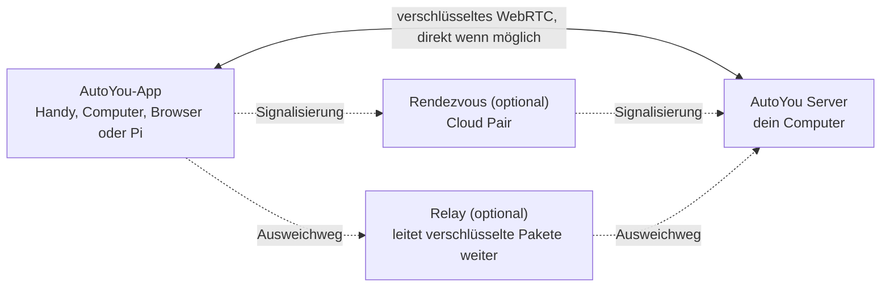

<div align="center">

[English](../../README.md) · [简体中文](README_zh.md) · [繁體中文](README_zh-TW.md) · [日本語](README_ja.md) · [한국어](README_ko.md) · [हिन्दी](README_hi.md) · [Español](README_es.md) · [Français](README_fr.md) · **Deutsch** · [Português (Brasil)](README_pt-BR.md) · [Русский](README_ru.md) · [العربية](README_ar.md)


# AutoYou Server

### Dein eigener KI-Server, auf dem Computer, den du schon hast.

**Du bist nicht das Produkt. Du bist der Eigentümer.**

[](https://github.com/autoyou-ai/AutoYou-Server/actions/workflows/public-checks.yml)
[](https://github.com/autoyou-ai/AutoYou-Server/releases)
[](../../requirements/README.md)
[](../../servers/README.md)
[](../../autoyou_agents/README.md)
[](../../LICENSE)

**[Website](https://www.autoyou.me/) · [Apps](https://www.autoyou.me/downloads/) · [Ökosystem](https://www.autoyou.me/ecosystem/) · [Community](https://www.autoyou.me/community/)**

[Schnellstart](#quick-start) · [So funktioniert es](#how-autoyou-works) · [Was du tun kannst](#what-you-can-do) · [Agenten](#agents) · [Kopplung](#pairing-modes) · [Sicherheit](#security-modes-and-tiers) · [Clients](#supported-clients) · [FAQ](#faq) · [Dokumentation](#documentation)

<code>./run_autoyou.sh</code>

</div>

> [!IMPORTANT]
> Lade AutoYou Server von [autoyou-ai/AutoYou-Server](https://github.com/autoyou-ai/AutoYou-Server) oder [autoyou.me](https://www.autoyou.me/) herunter und die Apps über die Store-Links unter [Unterstützte Clients](#supported-clients). Ein ähnlich benanntes Repository oder eine kopierte README macht einen Download nicht offiziell.

<div align="center">
<br />

<br /><br />
</div>

---

Mach den Computer auf deinem Schreibtisch zu einem privaten KI-Server für alle deine Geräte. AutoYou Server betreibt deine KI-Modelle und Agenten, Sprach- und Videoanrufe, Remote Desktop, Spiele und deine eigenen Web-Apps auf deinem Windows-, macOS- oder Linux-Rechner. Dein Handy, andere Computer und Browser erreichen ihn über verschlüsselte Peer-to-Peer-Verbindungen, zu Hause und unterwegs.

Deine Unterhaltungen, Dateien und Agentenaktivitäten bleiben auf diesem Computer, nicht in einem gehosteten AutoYou-Dienst. Betreibe lokale Modelle mit Ollama und chatte ohne Token-Rechnung, oder verbinde den Cloud-Anbieter deiner Wahl. Koppel ein Gerät einmal, und alles, was der Server bietet, ist in deiner Hosentasche: Chat, ein Freihand-Assistent, Echtzeit-Sprache in vielen Sprachen, dein Desktop, deine Spiele und jeder Webdienst, den du schon betreibst.

> **Neu hier?** Starte das Startskript, öffne **http://127.0.0.1:8001/**, und die Einrichtung führt dich durch die Wahl deiner KI, das Einschalten der gewünschten Funktionen und das Koppeln deines ersten Geräts.

<a id="quick-start"></a>

## Schnellstart

Du brauchst Git und Python 3.11 oder neuer. Einige optionale Funktionen brauchen ein neueres Python oder eine bestimmte Plattform; siehe die [Abhängigkeitsprofile](../../requirements/README.md).

### 1. Server holen

```bash
git clone https://github.com/autoyou-ai/AutoYou-Server.git
cd AutoYou-Server
```

### 2. Startskript ausführen

Windows:

```powershell
.\run_autoyou.bat --profile base
# Or select the Full profile with LAN access:
.\run_autoyou.bat --profile full --host 0.0.0.0
```

macOS oder Linux:

```bash
./run_autoyou.sh --profile base
# Or select the Full profile with LAN access:
./run_autoyou.sh --profile full --host 0.0.0.0
```

Das Startskript legt eine Python-Umgebung an, installiert Abhängigkeiten aus Paketindizes und kann Modelle und native Werkzeuge herunterladen. Lies die Skripte zuerst und führe sie in einer Umgebung aus, die du gefahrlos verändern kannst.

### 3. Konsole öffnen und ein Gerät koppeln

Öffne **http://127.0.0.1:8001/**, wähle ein eindeutiges Server-Passwort und folge der Einrichtung. Sie fragt, wofür du AutoYou nutzen willst (Chat, Freihand-Assistent, Anrufe, Spiele, Programmieren und mehr), installiert die passenden Agenten und zeigt einen QR-Code zum Koppeln deines Handys.

Für eine unbeaufsichtigte Ersteinrichtung übergib `AUTOYOU_SERVER_PASSWORD` über deine Umgebung oder einen Secret-Manager. Echte Passwörter gehören nicht in geteilte Befehle, Issues oder Screenshots.

| Profil | Fügt hinzu |
| --- | --- |
| `base` | Kernserver, lokale Verwaltung, Geräteverbindungen und Cloud-Anbieter-Integrationen |
| `local` | Helfer für lokale Modelle und Intent-Routing auf dem Gerät |
| `recommended` | Abhängigkeiten für Messaging und Bluetooth (Standard, wenn `--profile` fehlt) |
| `full` | Abhängigkeiten für Sprache, Browser und Desktop-Automatisierung |

Profile wählen nur Abhängigkeiten aus; Integrationen müssen weiterhin eingerichtet werden. `--skip-nuitka` und `--skip-backend-compile` behalten die gebündelten Bibliotheken des Launchers, daher brauchen Sicherheitsupdates von Abhängigkeiten in paketierten Apps einen vollständigen Neubau.

Zum Aktualisieren `git pull` im Checkout ausführen und das Startskript neu starten. Versionshinweise stehen in [docs/releases/](../releases/).

<a id="how-autoyou-works"></a>

## So funktioniert AutoYou

**Der Server ist dein eigener Computer, und Geräte sprechen direkt mit ihm.** Apps und Server verbinden sich per WebRTC. Nach einem kurzen Kopplungs-Handshake öffnen sie eine verschlüsselte Verbindung (DTLS, für Medien SRTP), die Chat, Sprache, Video, Bildschirmfreigabe, Spieleingaben und weitergeleiteten Webverkehr trägt. Die meisten Heim- und Mobilfunknetze bauen diese Verbindung auf, ohne Ports im Router zu öffnen. Ist ein Netz zu streng, weicht die Verbindung auf ein Relay aus, das dieselben verschlüsselten Pakete weiterleitet.



Auf dem Server leitet ein lokaler Intent-Router jede Anfrage an den passenden Agenten oder das passende Werkzeug. Google ADK führt die nativen Agenten aus; OpenClaw, Hermes Agent und Odysseus lassen sich anbinden. LiteLLM schickt Modellaufrufe an Ollama auf deinem Rechner oder an den Cloud-Anbieter deiner Wahl. Sprache wird lokal erkannt und lokal gesprochen, das Gedächtnis liegt in SQLite.

<picture>
  <source media="(prefers-color-scheme: dark)" srcset="../images/architecture-dark.png" />
  
</picture>

Das Diagramm wird von [scripts/build_architecture_diagram.py](../../scripts/build_architecture_diagram.py) erzeugt. Gestrichelte Kästen sind optionale Add-ons oder verbundene Projekte.

<a id="what-you-can-do"></a>

## Was du tun kannst

| Funktion | Was sie dir bringt |
| --- | --- |
| **KI-Chat** | Chatte von jedem gekoppelten Gerät mit deiner eigenen KI; AutoYou begrenzt die Nachrichten nicht |
| **Echtzeit-Sprache** | Live-Anrufe mit deiner KI, lokale Spracherkennung und gesprochene Antworten in über 30 Sprachen |
| **Assistent-Modus** | Ein Aktivierungswort wie „Hey Jarvis“ auf Handy, Computer, Raspberry Pi oder im Browser |
| **Remote Desktop** | Deinen Computer vom Handy aus sehen und steuern, auch den Windows-Sperrbildschirm |
| **Computer-Video** | Bildschirm, Kamera, eine Videodatei oder per API gelieferte Bilder in einen Anruf senden |
| **Spielmodus und Game Studio** | Spiele vom Computer aufs Handy streamen oder Spiele bauen, die offline auf dem Handy laufen |
| **Web-App-Fabrik** | Einen Agenten eine Web-App bauen lassen und sie auf allen gekoppelten Geräten öffnen |
| **Jeden lokalen Port freigeben** | Jeden Webdienst auf deinem Computer, etwa `localhost:3000`, mit deinen Geräten teilen |
| **Agenten** | 45 eingebaute Agenten für Notizen, Dateien, Code, Medien, Browsen, Training und mehr |
| **MCP** | AutoYou-Werkzeuge in ChatGPT, Codex, Claude, Antigravity, Cursor und VS Code nutzen |
| **Messaging** | Erreiche deinen Server über Telegram, Signal und WhatsApp mit Konnektoren, die du kontrollierst |
| **Gedächtnis** | SQLite-Gedächtnis und ein privates Persona-Tagebuch, mit Cognee als optionalem Add-on |

Die Funktionen hängen vom gewählten Profil, der Hardware, den Berechtigungen und den eingerichteten Integrationen ab. Mächtige Fähigkeiten wie Desktop-Steuerung, Spielmodus, Aufnahme und Dateizugriff bleiben aus, bis du sie einschaltest.

<a id="ai-chat"></a>

### KI-Chat

Wähle in der Konsole unter **AI** einen Anbieter: standardmäßig **Ollama + Agents** (lokales Modell, kein API-Schlüssel nötig), **Apple Intelligence** auf unterstützten Macs, **Gemini**, **OpenRouter** oder weitere Anbieter über LiteLLM (Anthropic, OpenAI, Mistral, DeepSeek, xAI und mehr), jeweils mit allen AutoYou-Agenten und -Werkzeugen. Auch **OpenClaw**, **Hermes Agent** oder **Odysseus** können die Haupt-Sitzungsumgebung sein.

AutoYou begrenzt nicht, wie viele Nachrichten du sendest. Mit einem lokalen Modell kostet der Chat nichts pro Nachricht und funktioniert ohne Internet. Ein verbundener Cloud-Anbieter rechnet nach seinem eigenen Tarif ab und sieht die Prompts, die du ihm schickst. In der eingebauten Modellbibliothek kannst du lokale Modelle durchsuchen, herunterladen und wechseln, und der Model-Picker-Agent empfiehlt eines, das zu deiner Hardware passt.

Kleine, quantisierte lokale Modelle bekommen Hilfe, um genau zu bleiben: Ein Offline-Intent-Klassifikator schickt häufige Anfragen direkt an den passenden Agenten, und ein kompakter Routing-Modus hält die Werkzeugliste kurz. Siehe [wie kleine Modelle genau bleiben](../../autoyou_agents/README.md#small-local-models).

<a id="realtime-voice-in-many-languages"></a>

### Echtzeit-Sprache in vielen Sprachen

Ruf deine KI an und sprich. Die Spracherkennung läuft auf deinem Computer (whisper.cpp im Standard-Build, faster-whisper in vollen Sprach-Builds), mit Sprachaktivitätserkennung, Unterbrechung, sobald du zu sprechen beginnst, und einem **Warte, bis ich fertig bin**-Halt für längere Gedanken.

- **Sprich deine Sprache.** Lass **STT language** auf `auto` und ein mehrsprachiges Modell erkennt die gesprochene Sprache.
- **Hör die Antwort in dieser Sprache.** **Auto TTS**, die Voreinstellung, erkennt die Sprache der Antwort und wählt eine passende Systemstimme. Das lokale Supertonic-3-Modell spricht 31 Sprachen und läuft nach einem einmaligen Download von etwa 401 MB offline.
- **Wähle deine Stimme.** Systemstimmen, zehn Supertonic-Voreinstellungen, eine eigene in der Voice-Training-App trainierte Stimme, EmotiVoice für Chinesisch und Englisch oder gehostete Sprache von OpenAI und Azure.

Die Sprachausgabe spricht die Antwort, die sie bekommt; sie übersetzt nicht. Das gewählte Chat-Modell muss die Gesprächssprache ebenfalls beherrschen.

<a id="assistant-mode"></a>

### Assistent-Modus

Gib deinem Server ein Aktivierungswort wie „Hey Jarvis“. Sag es in der Nähe eines gekoppelten Handys, Computers, Raspberry Pi, der Chrome-Erweiterung oder der Admin-Seite, und was du danach sagst, geht an AutoYou. Bis das Wort erkannt wird, wird nichts transkribiert oder an die KI gesendet. Nimm es dreimal auf, trainiere es in wenigen Sekunden auf deinem Server, teste es und schalte es ein. In einem Videoanruf kann die Anfrage nach dem Aktivierungswort das neueste Kamerabild mitnehmen. Siehe [Assistent-Modus](../admin-ui/assistant-mode.mdx).

<a id="remote-desktop"></a>

### Remote Desktop

Sieh und steuere deinen Computer von einem gekoppelten Handy oder einer Desktop-App aus: wähle einen Monitor oder ein einzelnes Fenster, bewege die Maus, tippe und nutze Sondertasten. H.264 wird bevorzugt, wenn das Gerät es unterstützt. Unter Windows lässt der optionale Dienst **AutoYou Secure Desktop Helper** den gekoppelten Eigentümer den Sperrbildschirm und UAC-Abfragen sehen und bedienen, und der Server kann den Computer während der Verbindung wach halten. Bildschirmaufnahme und Eingabe sind getrennte Berechtigungen, standardmäßig aus, und über einen Peer Link wird Remote Desktop nie angeboten.

<a id="computer-video"></a>

### Computer-Video

In einem Anruf kann der Computer Video aus vier Quellen senden: seinem **Bildschirm**, einer **Kamera**, einer hochgeladenen und abgespielten **Videodatei** oder **API-Bildern**, die dein eigenes Programm liefert. Auch Mikrofon und Ton des Computers lassen sich teilen. In der Konsole zeigt **Interact** Live-Kamerabilder verbundener Geräte und kann deren Mikrofone über die Lautsprecher des Computers abspielen, ohne KI-Verarbeitung und ohne Aufnahme.

<a id="game-mode-and-game-studio"></a>

### Spielmodus und Game Studio

- **Der Spielmodus** streamt ein auf deinem Computer gerendertes Spiel auf ein gekoppeltes Gerät, und Touch, Bewegungssensoren, Controller, Maus und Tastatur des Geräts kommen als Spieleingaben zurück. Du kannst bis zu vier beschriftete virtuelle Tasten festlegen. Der Spielmodus ist eine eigene Berechtigung und schaltet auch Bildschirmübertragung und Remote-Desktop-Eingabe ein.
- **Bring deine eigene Engine mit.** Eine lokale Spiel-Engine kann über einen Loopback-WebSocket authentifizierte Eingabe-Frames im Protokoll `autoyou_game_v1` lesen. Für Unreal stellt der Server unter `/api/game/unreal-plugin` ein Quellcode-Plugin bereit.
- **Offline-Spiele fürs Handy.** Der Game-Studio-Agent hilft dir, portable Web- oder WASM-Spiele zu bauen, packt sie als `.aygame`-Dateien mit bis zu 5 GiB und sendet sie über WebRTC oder einen genehmigten Peer Link an Clients. Jedes Spiel bekommt seine eigene SQLite-Datenbank auf dem Gerät, und Spielstände überstehen Updates.

**Neon Horizon** ist die eingebaute Demo, spielbar als Handy-Download, auf der Game-Studio-Seite oder gestreamt von deinem Computer.

<a id="web-app-factory"></a>

### Web-App-Fabrik

Beschreibe eine App und lass die Agenten sie bauen. Der **Website**-Agent erstellt ein Browser-Frontend für einen Agenten: einen einfachen Starter, auf Wunsch React oder Angular, mit einem Python/FastAPI-, Node/TypeScript-, Go- oder Rust-Backend. Der **Agent Builder** legt das Gerüst eines neuen Agenten an, und die Agenten **Coding** und **Pi** implementieren und testen den Code. Jede App wird beim lokalen Webdienst registriert und erscheint im Browser deiner gekoppelten Geräte. Der **Hosting**-Agent erklärt, wie du unter einem öffentlichen Link veröffentlichst: über einen kostenlosen temporären `/pair`-Tunnel oder eine kostenpflichtige dauerhafte URL.

<a id="host-any-local-port"></a>

### Jeden lokalen Port freigeben

Läuft schon etwas? Teil es. Füge unter **Websites & Browser > Advertised Websites** einen beliebigen Port von 1 bis 65535 mit Bezeichnung und optionaler Weiterleitungs-URL hinzu, etwa `http://127.0.0.1:3000` oder einen anderen Rechner in deinem Netz. Gekoppelte Clients finden ihn und öffnen ihn auf ihrer Seite unter demselben Port, sodass Dashboards, Entwicklungsserver, Homelab-Werkzeuge und Apps, die nicht für einen Unterpfad gebaut wurden, weiter funktionieren. Der Verkehr läuft in der verschlüsselten Verbindung, du musst also keinen Port im Router öffnen. Gekoppelte Browser erhalten die Rolle `viewer`, `editor` oder `admin`, die begrenzt, was sie ändern dürfen.

<a id="agents"></a>

## Agenten

AutoYou bringt 45 eingebaute Agenten mit. Der Hauptagent gibt jede Anfrage an den passenden Spezialisten weiter, und viele Spezialisten haben eine eigene Webseite auf deinen gekoppelten Geräten. Mit opt-in markierte Agenten bleiben deinstalliert, bis du sie in der Konsole unter **Agents** installierst.

| Bereich | Agenten |
| --- | --- |
| Alltag | Notes, Tasks, Notify, Memory, Persona, Page, Prompts, Location (opt-in) |
| Web und Automatisierung | Internet, Assistant, Browser (opt-in), Client Browser Control, Proxy (opt-in) |
| Medien und Kreatives | Audio, TV, Media Generation (opt-in), Game Studio |
| Programmieren und Bauen | Coding, Pi, Agent Builder, Website, Skills, Files, CLI, Claude CLI, Claude Desktop, Codex Desktop, Antigravity, Prompt Builder (alle opt-in) |
| Intelligenz und Modelle | Model Picker, OpenClaw, Hermes Agent (alle opt-in) |
| Training | Data Collector, Fine-Tuning, Voice Training (alle opt-in) |
| System und Computer | Admin, Remote Desktop, Backup, Hosting (opt-in), Windows Security (opt-in), macOS Security (opt-in), Education (opt-in) |
| AutoYou unterstützen | Support Ads, Earnings, Donation |

Eigene Agenten fügst du hinzu, indem du ein Paket nach `autoyou_agents/` kopierst. Alle Details stehen im [Agentenkatalog](../../autoyou_agents/README.md).

Die [generierte Agenten-Referenz](../agents/) listet jedes Werkzeug, das jeder Agent deklariert.

<a id="pairing-modes"></a>

## Kopplungsarten

| Methode | Wie sie verbindet | Typischer Einsatz |
| --- | --- | --- |
| **Local Pair** | Direkt über dein LAN; dein eigener Server beantwortet die Signalisierung | Gleiches WLAN oder Büronetz |
| **Bluetooth Pair** | Verbindungsdaten werden per Bluetooth Low Energy übergeben | Ersteinrichtung eines Handys in der Nähe |
| **Live Pair** | Handy und Computer zeigen sich gegenseitig animierte QR-Codes, ohne Netzwerkpfad | Abgeschottete oder gesperrte Netze |
| **Einmalcode** | `/pair` in einem Messaging-Chat liefert einen kurzlebigen Code und Link | Gastgeräte und nicht vertrauenswürdige Netze |
| **Auto Pair** | Eine verschlüsselte Kopplungsnachricht läuft über einen von dir eingerichteten Telegram-, Signal- oder WhatsApp-Chat | Kopplung aus der Ferne ohne Cloud-Konto |
| **Cloud Pair** | Ein optionales, kostenpflichtiges AutoYou-Cloud-Rendezvous findet deinen Computer über NAT hinweg, mit Relay als Rückfall | Unterwegs oder hinter strengen Netzen |

**Peer Link** verbindet eine AutoYou-App mit einer anderen; die empfangende App genehmigt jede Verbindung, und das Passwort deines Computers wird nie verwendet. **Lobbies** sind Gruppenräume, die Apps in der Nähe über WLAN und Bluetooth eröffnen und betreten. Siehe [Kopplungsprotokolle](../technical/pairing-protocols.md).

<a id="security-modes-and-tiers"></a>

## Sicherheitsmodi und Sicherheitsstufen

Ein Sicherheitsmodus gilt für den ganzen Server. Eine Neuinstallation startet in **Secure**.

| Modus | Kopplungsnachrichten | Was ein Gerät zum Koppeln braucht | Daten auf dem Computer |
| --- | --- | --- | --- |
| **Normal** | Unverschlüsselt | Einen Einmalcode | Unverändert |
| **Secure** | Mit dem Server-Passwort verschlüsselt | Das Server-Passwort | Unverändert |
| **Secure Professional** | Mit dem Server-Passwort verschlüsselt | Das Passwort und einen aktuellen Authenticator-Code | Unverändert |
| **Secure Professional Maximus** | Wie Secure Professional | Das Passwort und einen aktuellen Authenticator-Code | Sitzungen, Agentendaten, Websites, Notizen und Einstellungen sind ruhend verschlüsselt |

In den Secure-Modi werden Kopplungsnachrichten mit einem Schlüssel aus einem passwortauthentifizierten Schlüsselaustausch verschlüsselt (eine Konstruktion der CPace-Familie über ristretto255 mit libsodium). Ein Relay oder Messaging-Bridge, das sie transportiert, kann sie nicht lesen, und ein aufgezeichneter Austausch taugt nicht zum Offline-Erraten von Passwörtern.

**Die Kopplungs-Sicherheitsstufe** legt fest, wie viel Aufwand eine Kopplung per Chatnachricht erfordert: **Quick Pairing (B)** erlaubt die Kopplung mit einer einzigen Nachricht und hat die beste Kompatibilität; **Enhanced Pairing (A)** verlangt von jedem Client zuerst einen zusätzlichen Hello-Durchlauf, was Raten erschwert. Local Pair, Bluetooth Pair und Cloud Pair nutzen immer den verstärkten Ablauf.

Der Browser eines gekoppelten Geräts erhält die Rolle `viewer`, `editor` oder `admin`. Zugangsdaten und Sicherheitseinstellungen lassen sich nur am Computer selbst oder über eine direkt am Admin-Port geöffnete HTTPS-Admin-Sitzung ändern. Verschlüsselung schützt die Verbindung, nicht die Endgeräte, die Agentenberechtigungen oder Dienste Dritter. Siehe [Sicherheitsmodi](../security/security-modes.md) und [SECURITY.md](../../SECURITY.md).

<details>
<summary><strong>Was jede Schicht schützt und wo sie endet</strong></summary>

| Schicht | Was AutoYou tut |
| --- | --- |
| Netzwerk-Erreichbarkeit | Lauscht standardmäßig auf `127.0.0.1`. Lauschen im LAN ist eine ausdrückliche Einstellung. |
| Zugang | Die Admin-Konsole ist durch das Server-Passwort geschützt, optional mit Codes aus einer Authenticator-App (TOTP). |
| Kopplung | Passwort-authentifizierter Schlüsselaustausch, Einmalcodes und Freigabe jeder Verbindung bei Peer Link. |
| Transport | WebRTC DTLS und SRTP zwischen den beiden Endpunkten, auch wenn ein Relay die Pakete weiterleitet. |
| Ruhende Daten | Zugangsdaten liegen in einem verschlüsselten Schlüsselspeicher; Maximus verschlüsselt zusätzlich die von AutoYou verwalteten Daten. |
| Abhängigkeiten | Manifeste mit Lockfile, Prüfung von Sicherheitshinweisen und gepinnte CI-Actions. |

Verschlüsselung schützt die Verbindung. Sie schützt nicht alles um sie herum:

- **Geräte.** Schadsoftware auf dem Server-Computer oder einem gekoppelten Gerät hat den Zugriff, den dieses Gerät hat.
- **Agenten.** Agenten laufen mit den Rechten des Servers. Browser-Automatisierung, Dateizugriff, Desktop-Steuerung und Befehlsausführung sind mächtig; aktiviere nur, was du brauchst, und prüfe, was sie tun.
- **Dritte.** Cloud-Modellanbieter, Messaging-Brücken und öffentliche Tunnel haben eigene Datenflüsse und Bedingungen. Prüfe sie, bevor du sie aktivierst.
- **Betrieb.** Wer einen Server betreibt, ist für Updates, Backups und Zugangsdaten verantwortlich.

</details>

<details>
<summary><strong>Welche externen Dienste beteiligt sind</strong></summary>

Du betreibst einen einzigen Server: deinen eigenen. Für deinen Assistenten oder deine Daten ist kein von AutoYou betriebener Anwendungsserver nötig, und der Server läuft in einem lokalen Netzwerk ohne Verbindung zu AutoYou Cloud ([Details](../architecture/cloud-and-remote.mdx)). Alles andere ist eine änderbare Voreinstellung oder ein optionaler Helfer:

| Komponente | Läuft auf | Was sie sehen kann |
| --- | --- | --- |
| AutoYou Server: Agenten, Modelle, Speicher, Konsole | Deinem Computer | Deine Daten. Er ist ein Endpunkt der Verbindung. |
| Apps und Browser-Clients | Deinen Geräten | Was du mit ihnen teilst |
| STUN-Server zur Adressermittlung (standardmäßig aktiv) | Den öffentlichen STUN-Servern von Google, sofern du sie nicht änderst | Die öffentliche IP und den Port, von dem eine WebRTC-Verbindung kommt |
| Cloud-Pair-Treffpunkt (optional) | AutoYou Cloud | Konto-E-Mail, Geräte-ID, temporäre Kopplungsdaten und Netzwerk-Metadaten |
| Ausweich-Relay (optional) | AutoYou Cloud | Verschlüsselte Pakete und Netzwerk-Metadaten |
| Push-Benachrichtigungen zum Aufwecken von Handy-Apps (optional) | Push-Dienste von Apple und Google | Dass ein Aufwecken der App angefordert wurde |
| Update-Prüfung (aktiv, wenn ein Konto verknüpft ist) | Update-Kanal von AutoYou Cloud | Eine mit dem verknüpften Konto authentifizierte Update-Anfrage |
| Cloud-Modellanbieter (optional) | Der Anbieter deiner Wahl | Die Prompts, die du ihm schickst |
| Telegram-, Signal- und WhatsApp-Brücken (optional) | Diese Dienste | Die Nachrichten, die über sie laufen, gemäß ihren Bedingungen |
| Öffentlicher Tunnel für Websites (optional) | Der Tunnel-Anbieter | Der Verkehr zur öffentlichen URL. Nicht Ende-zu-Ende. |

**Öffentliches STUN ist standardmäßig aktiv**, auch für Local Pair. Damit diese Abfrage nicht ins Internet geht, setze `AUTOYOU_DISABLE_PUBLIC_STUN=1` vor dem Serverstart oder verweise mit `AUTOYOU_LOCAL_STUNTURN_HOST` auf deinen eigenen STUN- und TURN-Server (plus `AUTOYOU_LOCAL_TURN_USERNAME` und `AUTOYOU_LOCAL_TURN_PASSWORD` für TURN). Ganz ohne STUN- oder TURN-Server können Verbindungen über NAT scheitern.

</details>

<a id="supported-clients"></a>

## Unterstützte Clients

AutoYou Server läuft auf deinem Computer; die Apps erreichen ihn von überall sonst. Die Client-Apps werden separat vertrieben, ihr Quellcode ist nicht Teil dieses Repositorys.

| Plattform | Bezugsquelle |
| --- | --- |
| iPhone und iPad | [App Store](https://apps.apple.com/us/app/autoyou/id6760363728) |
| Android | [Google Play](https://play.google.com/store/apps/details?id=com.autoyou.app) |
| Windows | [Microsoft Store](https://apps.microsoft.com/detail/9mw8l2wfw7wv?hl=en-US&gl=US) |
| macOS und Linux | [Downloads](https://www.autoyou.me/downloads/) |
| Browser | Chrome-Erweiterung und Web-Client ([Ökosystem-Seite](https://www.autoyou.me/ecosystem/)) |
| Raspberry Pi | Ein Python-Sprachclient für den Assistent-Modus ([Einrichtung](../admin-ui/assistant-mode.mdx)) |

Die Handy-Apps enthalten außerdem eine kleine lokale KI (je nach Gerät LFM 2.5 350M, Gemini Nano oder Apple Intelligence), damit du auch ohne Computer chatten kannst.

| Kopplungsmodi | Chatte mit deiner eigenen KI | Lobbies in der Nähe | Lokale KI auf dem Handy |
| --- | --- | --- | --- |
|  |  |  |  |

- **Lobbies.** Erstelle oder betritt Räume in der Nähe über WLAN und Bluetooth, mit Chat und Audio oder Video für bis zu sechs Gäste plus Gastgeber.
- **Peer Link.** Verbinde eine App mit einer anderen. Die empfangende App bestätigt jede Verbindung, und optionale KI-Antworten nutzen nur, was du ihr erzählt hast.
- **Dein Computer, überall.** Chat, Anrufe, Remote-Desktop, Spielmodus, Agenten-Websites und veröffentlichte Ports auf jedem gekoppelten Gerät.

<a id="mcp"></a>
<a id="use-autoyou-from-your-coding-agent"></a>

## AutoYou aus deinem Coding-Agenten nutzen

Verbinde die MCP-fähigen Funktionen von ChatGPT, Codex, Claude Code oder Claude Desktop, Google Antigravity, Cursor und VS Code mit den unterstützten Werkzeugen von AutoYou. Der lokale MCP-Adapter ist ein eigener Prozess; der Server installiert ihn nicht in diesen Clients, und MCP-Aufrufe stellen die vom Adapter unterstützten Werkzeuge bereit, keinen beliebigen Zugriff auf deine Dateien und nicht alle AutoYou-Funktionen.

1. Starte AutoYou Server und öffne **http://127.0.0.1:8001/**.
2. Aktiviere unter **Admin UI > Messaging > AutoYou MCP** MCP, erzeuge das private Adapter-Token und lade `autoyou-mcp.env` herunter. Halte diese Datei privat.
3. Installiere den separat gepflegten Adapter in einer eigenen Python-Umgebung:

   ```powershell
   git clone https://github.com/autoyou-ai/AutoYou.git
   cd AutoYou
   py -3 -m venv .venv-mcp
   .\.venv-mcp\Scripts\python.exe -m pip install -e .\plugins\autoyou-mcp
   ```

   Unter macOS oder Linux verwende `python3 -m venv .venv-mcp` und `.venv-mcp/bin/python -m pip install -e ./plugins/autoyou-mcp`.

Für Clients, die einen lokalen MCP-Prozess starten, verwende diesen Befehl mit absoluten Pfaden:

```text
<path-to-.venv-mcp-python> -m autoyou_mcp --env-file <path-to-autoyou-mcp.env> --transport stdio
```

<details>
<summary><strong>AutoYou zu jedem Client hinzufügen</strong></summary>

Für Clients mit dem JSON-Format `mcpServers` sieht der Eintrag so aus. Ersetze die beiden Beispielpfade und maskiere Windows-Backslashes, wenn du sie in JSON verwendest:

```json
{
  "mcpServers": {
    "autoyou": {
      "command": "C:/path/to/AutoYou/.venv-mcp/Scripts/python.exe",
      "args": [
        "-m", "autoyou_mcp",
        "--env-file", "C:/path/to/autoyou-mcp.env",
        "--transport", "stdio"
      ]
    }
  }
}
```

**ChatGPT im Web** nutzt eine entfernte MCP-Verbindung, keinen lokalen `stdio`-Prozess. Starte den Adapter mit `--transport streamable-http` und verbinde seinen lokalen Endpunkt `http://127.0.0.1:8071/mcp` über OpenAI Secure MCP Tunnel. ChatGPT erfordert den Entwicklermodus und passenden Workspace- oder Admin-Zugang, und OpenAI begrenzt volle MCP-Aktionen je nach Tarif. Folge der [AutoYou-MCP-Einrichtung für ChatGPT](https://github.com/autoyou-ai/AutoYou/blob/main/plugins/autoyou-mcp/README.md#connect-chatgpt-web) und dem [MCP-Apps-Leitfaden von OpenAI](https://help.openai.com/en/articles/12584461-developer-mode-and-mcp-apps-in-chatgpt).

**Codex CLI, die Desktop-App und die IDE-Erweiterung** teilen sich die MCP-Konfiguration des Codex-Hosts:

```powershell
codex mcp add autoyou -- "C:/path/to/AutoYou/.venv-mcp/Scripts/python.exe" -m autoyou_mcp --env-file "C:/path/to/autoyou-mcp.env" --transport stdio
codex mcp list
```

Oder trage den entsprechenden `command` und die `args` unter `[mcp_servers.autoyou]` in `~/.codex/config.toml` ein. Siehe den [MCP-Leitfaden von Codex](https://learn.chatgpt.com/docs/extend/mcp?surface=cli).

**Claude Code:**

```powershell
claude mcp add --transport stdio autoyou -- "C:/path/to/AutoYou/.venv-mcp/Scripts/python.exe" -m autoyou_mcp --env-file "C:/path/to/autoyou-mcp.env" --transport stdio
claude mcp list
```

Führe dann `/mcp` in Claude Code aus. Siehe den [MCP-Leitfaden von Claude Code](https://code.claude.com/docs/en/mcp).

**Claude Desktop** startet den Adapter als lokalen stdio-Server. Füge einen Eintrag `mcpServers.autoyou` zu `~/Library/Application Support/Claude/claude_desktop_config.json` unter macOS oder zu `%APPDATA%\Claude\claude_desktop_config.json` unter Windows hinzu und beende Claude Desktop vollständig, bevor du es neu öffnest. AutoYou liefert derzeit keine `.mcpb`-Desktop-Erweiterung aus. Siehe den [MCP-Leitfaden von Claude Desktop](https://support.claude.com/en/articles/10949351-getting-started-with-local-mcp-servers-on-claude-desktop).

**Google Antigravity** verwendet global `~/.gemini/config/mcp_config.json` oder in einem Workspace `.agents/mcp_config.json`. Öffne in der Antigravity IDE **MCP Servers > Manage MCP Servers > View raw config**. Siehe den [MCP-Leitfaden von Antigravity](https://antigravity.google/docs/mcp).

**Cursor** verwendet `~/.cursor/mcp.json` oder `.cursor/mcp.json` mit demselben `mcpServers`-Eintrag. Siehe den [MCP-Leitfaden von Cursor](https://prod.cursor.com/help/customization/mcp).

**VS Code** kann die portable Datei `.mcp.json` im Workspace-Stamm verwenden. `.vscode/mcp.json` nutzt stattdessen ein oberstes `servers`-Objekt mit `"type": "stdio"`. Siehe den [MCP-Leitfaden von VS Code](https://code.visualstudio.com/docs/agent-customization/mcp-servers).

Unter macOS oder Linux ist die Python-Programmdatei `.venv-mcp/bin/python`. Client-Versionen, Einstellungen, Organisationsrichtlinien und Werkzeugfreigaben können die Verfügbarkeit beeinflussen.

</details>

Prüfe nach dem Verbinden, dass `get_autoyou_status` erscheint und den erwarteten Serverstatus liefert, bevor du ein schreibendes Werkzeug verwendest. Umfang, Sicherheitsmodell und Grenzen beschreibt der [MCP-Integrationsleitfaden von AutoYou](../guides/mcp-integration.mdx).

<a id="admin-console"></a>

## Admin-Konsole

<p align="center">
  
</p>

Die lokale Konsole bündelt Einrichtung, Modelle, Sprache, Agenten, Verbindungen, Berechtigungen und Sicherheit. Die geführte Einrichtung fragt, wofür du AutoYou nutzen willst, und schlägt passende Agenten und Berechtigungen vor; nichts ändert sich, bevor du den Plan geprüft und gespeichert hast. Die Screenshots zeigen Beispielwerte. Wähle eine Vorschau, um das Bild in voller Größe zu öffnen.

| Serverübersicht | Geräte und Aktivität | Zugang und Sicherheit |
| --- | --- | --- |
| [](../images/admin/overview.png) | [](../images/admin/live-view.png) | [](../images/admin/security.png) |

<a id="other-ways-to-run"></a>

## Weitere Betriebsarten

<details>
<summary><strong>Docker</strong></summary>

Stelle `AUTOYOU_SERVER_PASSWORD` sicher bereit und führe dann aus:

```bash
docker compose up --build
```

Die Compose-Datei veröffentlicht Ports nur auf dem Loopback des Hosts und speichert die Konfiguration in einem benannten Volume. Öffne `http://localhost:8001/` auf demselben Computer; die Datei deklariert diese reine Loopback-Veröffentlichung (`AUTOYOU_ADMIN_TRUST_PUBLISHED_LOOPBACK=1`), sodass die Anmeldung nicht mit "requires localhost or HTTPS" abgelehnt wird. Bei einem einfachen `docker run` veröffentliche auf `127.0.0.1` und übergib dieselbe Variable, oder setze einen TLS-Proxy davor. Prüfe, wie deine Docker-Version Ports veröffentlicht, bevor du dich auf die Loopback-Isolation verlässt.

Um Tunnelmole-Downloads bei Build und Laufzeit abzuschalten, setze `AUTOYOU_SKIP_TUNNELMOLE_DOWNLOAD=1` und `AUTOYOU_NO_DOWNLOAD_TUNNELMOLE=1` vor dem Bauen und Starten. Funktionen, die es brauchen, benötigen dann eine separat bereitgestellte Programmdatei.

</details>

<details>
<summary><strong>Eine inoffizielle lokale Version bauen</strong></summary>

Aus dem Stammverzeichnis des Repositorys:

```powershell
# Windows
.\servers\windows\build-all.ps1 -Configuration Debug
```

```bash
# macOS
./servers/macos/build-all.sh --no-sign --dev

# Linux / WSL
./servers/wsl/build-backend.sh --unofficial
```

Diese Wege brauchen weder ein AutoYou-Konto noch die Freigabe einer offiziellen Version. Sie können Abhängigkeiten installieren oder anpassen. Lies Lizenz und Hinweise, wenn sie angezeigt werden. Um sie nach dem Lesen ohne Rückfrage zu akzeptieren, übergib `-AcceptTerms` unter Windows oder `--accept-terms` unter macOS und Linux.

Voraussetzungen, Ablageort der Ergebnisse und bekannte Einschränkungen:
[Windows](../../servers/windows/README.md) · [macOS](../../servers/macos/README.md) · [Linux / WSL](../../servers/wsl/README.md).

</details>

<a id="faq"></a>

## FAQ

<details>
<summary><strong>Brauche ich ein Cloud-Konto oder ein VPN?</strong></summary>

Nein. Local Pair, Bluetooth Pair, Live Pair, Einmalcodes und Auto Pair funktionieren ohne AutoYou-Konto. Cloud Pair ist ein optionaler, kostenpflichtiger Helfer. Wenn du bereits ein VPN wie Tailscale nutzt, funktioniert AutoYou auch darüber.

</details>

<details>
<summary><strong>Ist der KI-Chat wirklich unbegrenzt?</strong></summary>

AutoYou begrenzt die Nachrichten nicht. Mit einem lokalen Ollama-Modell kostet jede Nachricht nichts, und die Geschwindigkeit hängt von deinem Computer ab. Ein verbundener Cloud-Anbieter hat eigene Preise und Grenzen.

</details>

<details>
<summary><strong>Lädt AutoYou meine Dateien oder Unterhaltungen hoch?</strong></summary>

Sie werden auf deinem Computer gespeichert. Daten verlassen ihn nur über Dienste, die du einschaltest, etwa einen Cloud-Modellanbieter, eine Messaging-Bridge oder einen öffentlichen Tunnel, und jeder davon hat eigene Bedingungen.

</details>

<details>
<summary><strong>In welchen Sprachen kann ich sprechen?</strong></summary>

Die Spracherkennung erkennt die Sprache, wenn **STT language** auf `auto` steht und ein mehrsprachiges Modell gewählt ist. Gesprochene Antworten nutzen eine passende Systemstimme oder das lokale Modell Supertonic 3, das 31 Sprachen abdeckt. Dein Chat-Modell muss die Sprache ebenfalls verstehen.

</details>

<details>
<summary><strong>Kann ich eine Web-App oder ein Spiel mit Freunden teilen?</strong></summary>

Ja. Wer sich mit deinem Server koppelt, kann deine Agenten-Websites und veröffentlichten Ports öffnen, im Rahmen der Rolle, die du vergibst. Geteilte Geräte sind als geteilt markiert, sodass deine Websites einschränken können, was sie sehen. Für nicht gekoppelte Personen erklärt der Hosting-Agent den kostenlosen temporären Link und die kostenpflichtige dauerhafte URL.

</details>

<details>
<summary><strong>Was tue ich, wenn ich einen Fehler finde?</strong></summary>

Aktualisiere zuerst; eine neue Version hat ihn vielleicht schon behoben. Besteht das Problem weiter, [eröffne ein Issue](https://github.com/autoyou-ai/AutoYou-Server/issues) mit deiner AutoYou-Version (`VERSION`), dem Betriebssystem, dem Profil, den Schritten zur Reproduktion und der Fehlerausgabe. Melde Sicherheitslücken vertraulich gemäß [SECURITY.md](../../SECURITY.md).

</details>

<a id="documentation"></a>

## Dokumentation

- [Schnellstart](../quickstart.mdx) · [Architektur](../architecture/) · [Sicherheit und Datenschutz](../security/) · [Admin-Konsole](../admin-ui/)
- [Agentenkatalog](../../autoyou_agents/README.md) · [Agentenreferenz](../agents/) · [Agenten-Framework](../agent-framework/)
- [HTTP- und WebSocket-API](../api-reference/) · [Anleitungen](../guides/) · [Kopplungsanleitungen](../../guides/README.md)

<a id="contributing"></a>

## Mitwirken

Wir freuen uns über deine Hilfe. Fang mit den [integrierten Agenten](../../autoyou_agents/README.md), dem [Agent Builder](../admin-ui/agent-workbench-ui.mdx) oder dem [Tutorial für eigene Agenten](../guides/custom-agent-tutorial.mdx) an.

- **Baue** einen Agenten, ein Spiel, eine Erweiterung, eine Integration oder eine Web-Oberfläche.
- **Verbessere** Installation, Barrierefreiheit, Plattformunterstützung, Übersetzungen, Dokumentation oder einen reproduzierbaren Fehler.
- **Teile** eine Demo, eine Anleitung oder eine klar gekennzeichnete inoffizielle Version, die die Lizenz einhält.

Lies [CONTRIBUTING.md](../../CONTRIBUTING.md) und den [Verhaltenskodex](../../CODE_OF_CONDUCT.md), bevor du Arbeit einreichst. Originaler, unabhängiger Code kann eine Lizenz deiner Wahl nutzen, auch MIT oder Apache-2.0. Änderungen am bestehenden AutoYou-Code behalten dessen Lizenz.

<a id="license"></a>

## Lizenz

AutoYou Server ist source-available unter der [Server-Lizenz](../../LICENSE). Es ist derzeit kein von der OSI anerkanntes Open-Source-Projekt, und die Definitionen in `LICENSE` sind maßgeblich.

| Material oder Nutzung | Bedingungen |
| --- | --- |
| Private Nutzung, lokale Builds und kostenlose Weitergabe | Erlaubt gemäß der Server-Lizenz und ihren Bedingungen |
| Änderungen am AutoYou-Code | Behalten die geltende AutoYou-Lizenz |
| Originaler, unabhängiger und abtrennbarer Code | Eine Lizenz deiner Wahl, auch MIT oder Apache-2.0 |
| Institutionelle Nutzung oder kommerzielle Verwertung | Separate [Enterprise-Vereinbarung](https://www.autoyou.me/enterprise/) |

Behalte Hinweise bei, kennzeichne inoffizielle Versionen und erfülle die Pflichten der enthaltenen Komponenten. Siehe [THIRD-PARTY-NOTICES.md](../../THIRD-PARTY-NOTICES.md) und die [Markenrichtlinie](../legal/trademark-policy.md).

OpenStorey führt mindestens 15 % der berechtigten Nettoeinnahmen dem Contributor-Pool zu, der nach seinen [Prüf- und Berechtigungsregeln](../contributors/contributor-pool.md) verteilt wird. Die [Finanzierungs-Roadmap](https://www.autoyou.me/donate/) enthält einen Meilenstein von 5 Millionen US-Dollar für die Öffnung des Server-Codes; ein Meilenstein ändert für sich allein nicht die Lizenz einer Kopie, die du bereits hast. Details: [docs/legal/open-source-commitment.md](../legal/open-source-commitment.md).

<a id="support"></a>

## Support

- **Fragen und Hilfe bei der Installation:** [SUPPORT.md](../../SUPPORT.md) und die [Community](https://www.autoyou.me/community/).
- **Fehler und konkrete Vorschläge:** [eröffne ein Issue](https://github.com/autoyou-ai/AutoYou-Server/issues).
- **Sicherheitslücken:** melde sie vertraulich wie in [SECURITY.md](../../SECURITY.md) beschrieben. Nutze keine öffentlichen Issues für nicht offengelegte Sicherheitslücken.

Agenten laufen mit den Rechten des Servers: Prüfe, was sie tun, aktiviere nur, was du brauchst, und mache Backups.

Copyright &copy; 2026 OpenStorey LLC and contributors.
