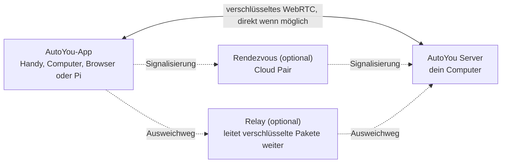

<div align="center">

[English](../../README.md) · [简体中文](README_zh.md) · [繁體中文](README_zh-TW.md) · [日本語](README_ja.md) · [한국어](README_ko.md) · [हिन्दी](README_hi.md) · [Español](README_es.md) · [Français](README_fr.md) · **Deutsch** · [Português (Brasil)](README_pt-BR.md) · [Русский](README_ru.md) · [العربية](README_ar.md)


# AutoYou Server

### Dein eigener KI-Server, auf dem Computer, den du schon hast.

**Du bist nicht das Produkt. Du bist der Eigentümer.**

[](https://github.com/autoyou-ai/AutoYou-Server/actions/workflows/public-checks.yml)
[](https://github.com/autoyou-ai/AutoYou-Server/releases)
[](../../requirements/README.md)
[](../../servers/README.md)
[](../../autoyou_agents/README.md)
[](../../LICENSE)

**[Website](https://www.autoyou.me/) · [Apps](https://www.autoyou.me/downloads/) · [Ökosystem](https://www.autoyou.me/ecosystem/) · [Community](https://www.autoyou.me/community/)**

[Schnellstart](#quick-start) · [So funktioniert es](#how-autoyou-works) · [Was du tun kannst](#what-you-can-do) · [Agenten](#agents) · [Kopplung](#pairing-modes) · [Sicherheit](#security-modes-and-tiers) · [Clients](#supported-clients) · [FAQ](#faq) · [Dokumentation](#documentation)

<code>./run_autoyou.sh</code>

</div>

> [!IMPORTANT]
> Lade AutoYou Server von [autoyou-ai/AutoYou-Server](https://github.com/autoyou-ai/AutoYou-Server) oder [autoyou.me](https://www.autoyou.me/) herunter und die Apps über die Store-Links unter [Unterstützte Clients](#supported-clients). Ein ähnlich benanntes Repository oder eine kopierte README macht einen Download nicht offiziell.

<div align="center">
<br />

<br /><br />
</div>

---

Mach den Computer auf deinem Schreibtisch zu einem privaten KI-Server für alle deine Geräte. AutoYou Server betreibt deine KI-Modelle und Agenten, Sprach- und Videoanrufe, Remote Desktop, Spiele und deine eigenen Web-Apps auf deinem Windows-, macOS- oder Linux-Rechner. Dein Handy, andere Computer und Browser erreichen ihn über verschlüsselte Peer-to-Peer-Verbindungen, zu Hause und unterwegs.

Deine Unterhaltungen, Dateien und Agentenaktivitäten bleiben auf diesem Computer, nicht in einem gehosteten AutoYou-Dienst. Betreibe lokale Modelle mit Ollama und chatte ohne Token-Rechnung, oder verbinde den Cloud-Anbieter deiner Wahl. Koppel ein Gerät einmal, und alles, was der Server bietet, ist in deiner Hosentasche: Chat, ein Freihand-Assistent, Echtzeit-Sprache in vielen Sprachen, dein Desktop, deine Spiele und jeder Webdienst, den du schon betreibst.

> **Neu hier?** Starte das Startskript, öffne **http://127.0.0.1:8001/**, und die Einrichtung führt dich durch die Wahl deiner KI, das Einschalten der gewünschten Funktionen und das Koppeln deines ersten Geräts.

<a id="quick-start"></a>

## Schnellstart

Du brauchst Git und Python 3.11 oder neuer. Einige optionale Funktionen brauchen ein neueres Python oder eine bestimmte Plattform; siehe die [Abhängigkeitsprofile](../../requirements/README.md).

### 1. Server holen

```bash
git clone https://github.com/autoyou-ai/AutoYou-Server.git
cd AutoYou-Server
```

### 2. Startskript ausführen

Windows:

```powershell
.\run_autoyou.bat --profile base
# Or select the Full profile with LAN access:
.\run_autoyou.bat --profile full --host 0.0.0.0
```

macOS oder Linux:

```bash
./run_autoyou.sh --profile base
# Or select the Full profile with LAN access:
./run_autoyou.sh --profile full --host 0.0.0.0
```

Das Startskript legt eine Python-Umgebung an, installiert Abhängigkeiten aus Paketindizes und kann Modelle und native Werkzeuge herunterladen. Lies die Skripte zuerst und führe sie in einer Umgebung aus, die du gefahrlos verändern kannst.

### 3. Konsole öffnen und ein Gerät koppeln

Öffne **http://127.0.0.1:8001/**, wähle ein eindeutiges Server-Passwort und folge der Einrichtung. Sie fragt, wofür du AutoYou nutzen willst (Chat, Freihand-Assistent, Anrufe, Spiele, Programmieren und mehr), installiert die passenden Agenten und zeigt einen QR-Code zum Koppeln deines Handys.

Für eine unbeaufsichtigte Ersteinrichtung übergib `AUTOYOU_SERVER_PASSWORD` über deine Umgebung oder einen Secret-Manager. Echte Passwörter gehören nicht in geteilte Befehle, Issues oder Screenshots.

| Profil | Fügt hinzu |
| --- | --- |
| `base` | Kernserver, lokale Verwaltung, Geräteverbindungen und Cloud-Anbieter-Integrationen |
| `local` | Helfer für lokale Modelle und Intent-Routing auf dem Gerät |
| `recommended` | Abhängigkeiten für Messaging und Bluetooth (Standard, wenn `--profile` fehlt) |
| `full` | Abhängigkeiten für Sprache, Browser und Desktop-Automatisierung |

Zum Aktualisieren `git pull` im Checkout ausführen und das Startskript neu starten. Versionshinweise stehen in [docs/releases/](../releases/).

<a id="how-autoyou-works"></a>

## So funktioniert AutoYou

**Der Server ist dein eigener Computer, und Geräte sprechen direkt mit ihm.** Apps und Server verbinden sich per WebRTC. Nach einem kurzen Kopplungs-Handshake öffnen sie eine verschlüsselte Verbindung (DTLS, für Medien SRTP), die Chat, Sprache, Video, Bildschirmfreigabe, Spieleingaben und weitergeleiteten Webverkehr trägt. Die meisten Heim- und Mobilfunknetze bauen diese Verbindung auf, ohne Ports im Router zu öffnen. Ist ein Netz zu streng, weicht die Verbindung auf ein Relay aus, das dieselben verschlüsselten Pakete weiterleitet.



Auf dem Server leitet ein lokaler Intent-Router jede Anfrage an den passenden Agenten oder das passende Werkzeug. Google ADK führt die nativen Agenten aus; OpenClaw, Hermes Agent und Odysseus lassen sich anbinden. LiteLLM schickt Modellaufrufe an Ollama auf deinem Rechner oder an den Cloud-Anbieter deiner Wahl. Sprache wird lokal erkannt und lokal gesprochen, das Gedächtnis liegt in SQLite.

<a id="what-you-can-do"></a>

## Was du tun kannst

| Funktion | Was sie dir bringt |
| --- | --- |
| **KI-Chat** | Chatte von jedem gekoppelten Gerät mit deiner eigenen KI; AutoYou begrenzt die Nachrichten nicht |
| **Echtzeit-Sprache** | Live-Anrufe mit deiner KI, lokale Spracherkennung und gesprochene Antworten in über 30 Sprachen |
| **Assistent-Modus** | Ein Aktivierungswort wie „Hey Jarvis“ auf Handy, Computer, Raspberry Pi oder im Browser |
| **Remote Desktop** | Deinen Computer vom Handy aus sehen und steuern, auch den Windows-Sperrbildschirm |
| **Computer-Video** | Bildschirm, Kamera, eine Videodatei oder per API gelieferte Bilder in einen Anruf senden |
| **Spielmodus und Game Studio** | Spiele vom Computer aufs Handy streamen oder Spiele bauen, die offline auf dem Handy laufen |
| **Web-App-Fabrik** | Einen Agenten eine Web-App bauen lassen und sie auf allen gekoppelten Geräten öffnen |
| **Jeden lokalen Port freigeben** | Jeden Webdienst auf deinem Computer, etwa `localhost:3000`, mit deinen Geräten teilen |
| **Agenten** | 45 eingebaute Agenten für Notizen, Dateien, Code, Medien, Browsen, Training und mehr |
| **MCP** | AutoYou-Werkzeuge in ChatGPT, Codex, Claude, Antigravity, Cursor und VS Code nutzen |

Die Funktionen hängen vom gewählten Profil, der Hardware, den Berechtigungen und den eingerichteten Integrationen ab. Mächtige Fähigkeiten wie Desktop-Steuerung, Spielmodus, Aufnahme und Dateizugriff bleiben aus, bis du sie einschaltest.

### KI-Chat

Wähle in der Konsole unter **AI** einen Anbieter: standardmäßig **Ollama + Agents** (lokales Modell, kein API-Schlüssel nötig), **Apple Intelligence** auf unterstützten Macs, **Gemini**, **OpenRouter** oder weitere Anbieter über LiteLLM (Anthropic, OpenAI, Mistral, DeepSeek, xAI und mehr), jeweils mit allen AutoYou-Agenten und -Werkzeugen. Auch **OpenClaw**, **Hermes Agent** oder **Odysseus** können die Haupt-Sitzungsumgebung sein.

AutoYou begrenzt nicht, wie viele Nachrichten du sendest. Mit einem lokalen Modell kostet der Chat nichts pro Nachricht und funktioniert ohne Internet. Ein verbundener Cloud-Anbieter rechnet nach seinem eigenen Tarif ab und sieht die Prompts, die du ihm schickst. In der eingebauten Modellbibliothek kannst du lokale Modelle durchsuchen, herunterladen und wechseln, und der Model-Picker-Agent empfiehlt eines, das zu deiner Hardware passt.

### Echtzeit-Sprache in vielen Sprachen

Ruf deine KI an und sprich. Die Spracherkennung läuft auf deinem Computer (whisper.cpp im Standard-Build, faster-whisper in vollen Sprach-Builds), mit Sprachaktivitätserkennung, Unterbrechung, sobald du zu sprechen beginnst, und einem **Warte, bis ich fertig bin**-Halt für längere Gedanken.

- **Sprich deine Sprache.** Lass **STT language** auf `auto` und ein mehrsprachiges Modell erkennt die gesprochene Sprache.
- **Hör die Antwort in dieser Sprache.** **Auto TTS**, die Voreinstellung, erkennt die Sprache der Antwort und wählt eine passende Systemstimme. Das lokale Supertonic-3-Modell spricht 31 Sprachen und läuft nach einem einmaligen Download von etwa 401 MB offline.
- **Wähle deine Stimme.** Systemstimmen, zehn Supertonic-Voreinstellungen, eine eigene in der Voice-Training-App trainierte Stimme, EmotiVoice für Chinesisch und Englisch oder gehostete Sprache von OpenAI und Azure.

Die Sprachausgabe spricht die Antwort, die sie bekommt; sie übersetzt nicht. Das gewählte Chat-Modell muss die Gesprächssprache ebenfalls beherrschen.

### Assistent-Modus

Gib deinem Server ein Aktivierungswort wie „Hey Jarvis“. Sag es in der Nähe eines gekoppelten Handys, Computers, Raspberry Pi, der Chrome-Erweiterung oder der Admin-Seite, und was du danach sagst, geht an AutoYou. Bis das Wort erkannt wird, wird nichts transkribiert oder an die KI gesendet. Nimm es dreimal auf, trainiere es in wenigen Sekunden auf deinem Server, teste es und schalte es ein. In einem Videoanruf kann die Anfrage nach dem Aktivierungswort das neueste Kamerabild mitnehmen. Siehe [Assistent-Modus](../admin-ui/assistant-mode.mdx).

### Remote Desktop

Sieh und steuere deinen Computer von einem gekoppelten Handy oder einer Desktop-App aus: wähle einen Monitor oder ein einzelnes Fenster, bewege die Maus, tippe und nutze Sondertasten. H.264 wird bevorzugt, wenn das Gerät es unterstützt. Unter Windows lässt der optionale Dienst **AutoYou Secure Desktop Helper** den gekoppelten Eigentümer den Sperrbildschirm und UAC-Abfragen sehen und bedienen, und der Server kann den Computer während der Verbindung wach halten. Bildschirmaufnahme und Eingabe sind getrennte Berechtigungen, standardmäßig aus, und über einen Peer Link wird Remote Desktop nie angeboten.

### Computer-Video

In einem Anruf kann der Computer Video aus vier Quellen senden: seinem **Bildschirm**, einer **Kamera**, einer hochgeladenen und abgespielten **Videodatei** oder **API-Bildern**, die dein eigenes Programm liefert. Auch Mikrofon und Ton des Computers lassen sich teilen. In der Konsole zeigt **Interact** Live-Kamerabilder verbundener Geräte und kann deren Mikrofone über die Lautsprecher des Computers abspielen, ohne KI-Verarbeitung und ohne Aufnahme.

### Spielmodus und Game Studio

- **Der Spielmodus** streamt ein auf deinem Computer gerendertes Spiel auf ein gekoppeltes Gerät, und Touch, Bewegungssensoren, Controller, Maus und Tastatur des Geräts kommen als Spieleingaben zurück. Du kannst bis zu vier beschriftete virtuelle Tasten festlegen. Der Spielmodus ist eine eigene Berechtigung und schaltet auch Bildschirmübertragung und Remote-Desktop-Eingabe ein.
- **Bring deine eigene Engine mit.** Eine lokale Spiel-Engine kann über einen Loopback-WebSocket authentifizierte Eingabe-Frames im Protokoll `autoyou_game_v1` lesen. Für Unreal stellt der Server unter `/api/game/unreal-plugin` ein Quellcode-Plugin bereit.
- **Offline-Spiele fürs Handy.** Der Game-Studio-Agent hilft dir, portable Web- oder WASM-Spiele zu bauen, packt sie als `.aygame`-Dateien mit bis zu 5 GiB und sendet sie über WebRTC oder einen genehmigten Peer Link an Clients. Jedes Spiel bekommt seine eigene SQLite-Datenbank auf dem Gerät, und Spielstände überstehen Updates.

**Neon Horizon** ist die eingebaute Demo, spielbar als Handy-Download, auf der Game-Studio-Seite oder gestreamt von deinem Computer.

### Web-App-Fabrik

Beschreibe eine App und lass die Agenten sie bauen. Der **Website**-Agent erstellt ein Browser-Frontend für einen Agenten: einen einfachen Starter, auf Wunsch React oder Angular, mit einem Python/FastAPI-, Node/TypeScript-, Go- oder Rust-Backend. Der **Agent Builder** legt das Gerüst eines neuen Agenten an, und die Agenten **Coding** und **Pi** implementieren und testen den Code. Jede App wird beim lokalen Webdienst registriert und erscheint im Browser deiner gekoppelten Geräte. Der **Hosting**-Agent erklärt, wie du unter einem öffentlichen Link veröffentlichst: über einen kostenlosen temporären `/pair`-Tunnel oder eine kostenpflichtige dauerhafte URL.

### Jeden lokalen Port freigeben

Läuft schon etwas? Teil es. Füge unter **Websites & Browser > Advertised Websites** einen beliebigen Port von 1 bis 65535 mit Bezeichnung und optionaler Weiterleitungs-URL hinzu, etwa `http://127.0.0.1:3000` oder einen anderen Rechner in deinem Netz. Gekoppelte Clients finden ihn und öffnen ihn auf ihrer Seite unter demselben Port, sodass Dashboards, Entwicklungsserver, Homelab-Werkzeuge und Apps, die nicht für einen Unterpfad gebaut wurden, weiter funktionieren. Der Verkehr läuft in der verschlüsselten Verbindung, du musst also keinen Port im Router öffnen. Gekoppelte Browser erhalten die Rolle `viewer`, `editor` oder `admin`, die begrenzt, was sie ändern dürfen.

<a id="agents"></a>

## Agenten

AutoYou bringt 45 eingebaute Agenten mit. Der Hauptagent gibt jede Anfrage an den passenden Spezialisten weiter, und viele Spezialisten haben eine eigene Webseite auf deinen gekoppelten Geräten. Mit opt-in markierte Agenten bleiben deinstalliert, bis du sie in der Konsole unter **Agents** installierst.

| Bereich | Agenten |
| --- | --- |
| Alltag | Notes, Tasks, Notify, Memory, Persona, Page, Prompts, Location (opt-in) |
| Web und Automatisierung | Internet, Assistant, Browser (opt-in), Client Browser Control, Proxy (opt-in) |
| Medien und Kreatives | Audio, TV, Media Generation (opt-in), Game Studio |
| Programmieren und Bauen | Coding, Pi, Agent Builder, Website, Skills, Files, CLI, Claude CLI, Claude Desktop, Codex Desktop, Antigravity, Prompt Builder (alle opt-in) |
| Intelligenz und Modelle | Model Picker, OpenClaw, Hermes Agent (alle opt-in) |
| Training | Data Collector, Fine-Tuning, Voice Training (alle opt-in) |
| System und Computer | Admin, Remote Desktop, Backup, Hosting (opt-in), Windows Security (opt-in), macOS Security (opt-in), Education (opt-in) |
| AutoYou unterstützen | Support Ads, Earnings, Donation |

Eigene Agenten fügst du hinzu, indem du ein Paket nach `autoyou_agents/` kopierst. Alle Details stehen im [Agentenkatalog](../../autoyou_agents/README.md).

<a id="pairing-modes"></a>

## Kopplungsarten

| Methode | Wie sie verbindet | Typischer Einsatz |
| --- | --- | --- |
| **Local Pair** | Direkt über dein LAN; dein eigener Server beantwortet die Signalisierung | Gleiches WLAN oder Büronetz |
| **Bluetooth Pair** | Verbindungsdaten werden per Bluetooth Low Energy übergeben | Ersteinrichtung eines Handys in der Nähe |
| **Live Pair** | Handy und Computer zeigen sich gegenseitig animierte QR-Codes, ohne Netzwerkpfad | Abgeschottete oder gesperrte Netze |
| **Einmalcode** | `/pair` in einem Messaging-Chat liefert einen kurzlebigen Code und Link | Gastgeräte und nicht vertrauenswürdige Netze |
| **Auto Pair** | Eine verschlüsselte Kopplungsnachricht läuft über einen von dir eingerichteten Telegram-, Signal- oder WhatsApp-Chat | Kopplung aus der Ferne ohne Cloud-Konto |
| **Cloud Pair** | Ein optionales, kostenpflichtiges AutoYou-Cloud-Rendezvous findet deinen Computer über NAT hinweg, mit Relay als Rückfall | Unterwegs oder hinter strengen Netzen |

**Peer Link** verbindet eine AutoYou-App mit einer anderen; die empfangende App genehmigt jede Verbindung, und das Passwort deines Computers wird nie verwendet. **Lobbies** sind Gruppenräume, die Apps in der Nähe über WLAN und Bluetooth eröffnen und betreten. Siehe [Kopplungsprotokolle](../technical/pairing-protocols.md).

<a id="security-modes-and-tiers"></a>

## Sicherheitsmodi und Sicherheitsstufen

Ein Sicherheitsmodus gilt für den ganzen Server. Eine Neuinstallation startet in **Secure**.

| Modus | Kopplungsnachrichten | Was ein Gerät zum Koppeln braucht | Daten auf dem Computer |
| --- | --- | --- | --- |
| **Normal** | Unverschlüsselt | Einen Einmalcode | Unverändert |
| **Secure** | Mit dem Server-Passwort verschlüsselt | Das Server-Passwort | Unverändert |
| **Secure Professional** | Mit dem Server-Passwort verschlüsselt | Das Passwort und einen aktuellen Authenticator-Code | Unverändert |
| **Secure Professional Maximus** | Wie Secure Professional | Das Passwort und einen aktuellen Authenticator-Code | Sitzungen, Agentendaten, Websites, Notizen und Einstellungen sind ruhend verschlüsselt |

In den Secure-Modi werden Kopplungsnachrichten mit einem Schlüssel aus einem passwortauthentifizierten Schlüsselaustausch verschlüsselt (eine Konstruktion der CPace-Familie über ristretto255 mit libsodium). Ein Relay oder Messaging-Bridge, das sie transportiert, kann sie nicht lesen, und ein aufgezeichneter Austausch taugt nicht zum Offline-Erraten von Passwörtern.

**Die Kopplungs-Sicherheitsstufe** legt fest, wie viel Aufwand eine Kopplung per Chatnachricht erfordert: **Quick Pairing (B)** erlaubt die Kopplung mit einer einzigen Nachricht und hat die beste Kompatibilität; **Enhanced Pairing (A)** verlangt von jedem Client zuerst einen zusätzlichen Hello-Durchlauf, was Raten erschwert. Local Pair, Bluetooth Pair und Cloud Pair nutzen immer den verstärkten Ablauf.

Der Browser eines gekoppelten Geräts erhält die Rolle `viewer`, `editor` oder `admin`. Zugangsdaten und Sicherheitseinstellungen lassen sich nur am Computer selbst oder über eine direkt am Admin-Port geöffnete HTTPS-Admin-Sitzung ändern. Verschlüsselung schützt die Verbindung, nicht die Endgeräte, die Agentenberechtigungen oder Dienste Dritter. Siehe [Sicherheitsmodi](../security/security-modes.md) und [SECURITY.md](../../SECURITY.md).

<a id="supported-clients"></a>

## Unterstützte Clients

AutoYou Server läuft auf deinem Computer; die Apps erreichen ihn von überall sonst. Die Client-Apps werden separat vertrieben, ihr Quellcode ist nicht Teil dieses Repositorys.

| Plattform | Bezugsquelle |
| --- | --- |
| iPhone und iPad | [App Store](https://apps.apple.com/us/app/autoyou/id6760363728) |
| Android | [Google Play](https://play.google.com/store/apps/details?id=com.autoyou.app) |
| Windows | [Microsoft Store](https://apps.microsoft.com/detail/9mw8l2wfw7wv?hl=en-US&gl=US) |
| macOS und Linux | [Downloads](https://www.autoyou.me/downloads/) |
| Browser | Chrome-Erweiterung und Web-Client ([Ökosystem-Seite](https://www.autoyou.me/ecosystem/)) |
| Raspberry Pi | Ein Python-Sprachclient für den Assistent-Modus ([Einrichtung](../admin-ui/assistant-mode.mdx)) |

Die Handy-Apps enthalten außerdem eine kleine lokale KI (je nach Gerät LFM 2.5 350M, Gemini Nano oder Apple Intelligence), damit du auch ohne Computer chatten kannst.

<a id="mcp"></a>

## AutoYou aus deinem Coding-Agenten nutzen

Der lokale MCP-Adapter verbindet unterstützte AutoYou-Werkzeuge mit ChatGPT, Codex, Claude Code, Claude Desktop, Google Antigravity, Cursor und VS Code. Aktiviere MCP unter **Admin UI > Messaging > AutoYou MCP**, lade `autoyou-mcp.env` herunter und folge den [Schritten in der englischen README](../../README.md#use-autoyou-from-your-coding-agent) für jeden Client.

<a id="faq"></a>

## FAQ

<details>
<summary><strong>Brauche ich ein Cloud-Konto oder ein VPN?</strong></summary>

Nein. Local Pair, Bluetooth Pair, Live Pair, Einmalcodes und Auto Pair funktionieren ohne AutoYou-Konto. Cloud Pair ist ein optionaler, kostenpflichtiger Helfer. Wenn du bereits ein VPN wie Tailscale nutzt, funktioniert AutoYou auch darüber.

</details>

<details>
<summary><strong>Ist der KI-Chat wirklich unbegrenzt?</strong></summary>

AutoYou begrenzt die Nachrichten nicht. Mit einem lokalen Ollama-Modell kostet jede Nachricht nichts, und die Geschwindigkeit hängt von deinem Computer ab. Ein verbundener Cloud-Anbieter hat eigene Preise und Grenzen.

</details>

<details>
<summary><strong>Lädt AutoYou meine Dateien oder Unterhaltungen hoch?</strong></summary>

Sie werden auf deinem Computer gespeichert. Daten verlassen ihn nur über Dienste, die du einschaltest, etwa einen Cloud-Modellanbieter, eine Messaging-Bridge oder einen öffentlichen Tunnel, und jeder davon hat eigene Bedingungen.

</details>

<a id="documentation"></a>

## Dokumentation

- [Schnellstart](../quickstart.mdx) · [Architektur](../architecture/) · [Sicherheit und Datenschutz](../security/) · [Admin-Konsole](../admin-ui/)
- [Agentenkatalog](../../autoyou_agents/README.md) · [Agentenreferenz](../agents/) · [Agenten-Framework](../agent-framework/)
- [HTTP- und WebSocket-API](../api-reference/) · [Anleitungen](../guides/) · [Kopplungsanleitungen](../../guides/README.md)

## Mitwirken

Wir freuen uns über deine Hilfe: Bau einen Agenten, ein Spiel, eine Erweiterung oder eine Integration; verbessere Einrichtung, Barrierefreiheit, Plattformunterstützung, Übersetzungen oder Dokumentation; oder teile eine Demo oder Anleitung. Lies vor dem Einreichen [CONTRIBUTING.md](../../CONTRIBUTING.md) und den [Verhaltenskodex](../../CODE_OF_CONDUCT.md).

## Lizenz

AutoYou Server ist unter der [Server-Lizenz](../../LICENSE) source-available. Es ist derzeit kein von der OSI anerkanntes Open-Source-Projekt, maßgeblich sind die Definitionen in `LICENSE`. Private Nutzung, lokale Builds und kostenlose Weitergabe sind unter den Lizenzbedingungen erlaubt; institutionelle oder kommerzielle Nutzung erfordert eine separate [Enterprise-Vereinbarung](https://www.autoyou.me/enterprise/). Siehe die [englische README](../../README.md#license) und [THIRD-PARTY-NOTICES.md](../../THIRD-PARTY-NOTICES.md).

Copyright &copy; 2026 OpenStorey LLC and contributors.
