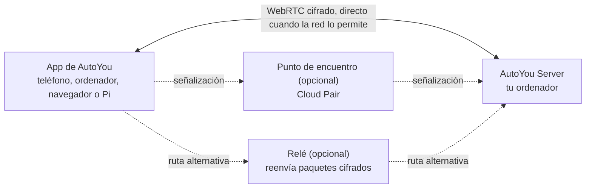

<div align="center">

[English](../../README.md) · [简体中文](README_zh.md) · [繁體中文](README_zh-TW.md) · [日本語](README_ja.md) · [한국어](README_ko.md) · [हिन्दी](README_hi.md) · **Español** · [Français](README_fr.md) · [Deutsch](README_de.md) · [Português (Brasil)](README_pt-BR.md) · [Русский](README_ru.md) · [العربية](README_ar.md)


# AutoYou Server

### Tu propio servidor de IA, en el ordenador que ya tienes.

**No eres el producto. Eres el dueño.**

[](https://github.com/autoyou-ai/AutoYou-Server/actions/workflows/public-checks.yml)
[](https://github.com/autoyou-ai/AutoYou-Server/releases)
[](../../requirements/README.md)
[](../../servers/README.md)
[](../../autoyou_agents/README.md)
[](../../LICENSE)

**[Sitio web](https://www.autoyou.me/) · [Apps](https://www.autoyou.me/downloads/) · [Ecosistema](https://www.autoyou.me/ecosystem/) · [Comunidad](https://www.autoyou.me/community/)**

[Inicio rápido](#quick-start) · [Cómo funciona](#how-autoyou-works) · [Qué puedes hacer](#what-you-can-do) · [Agentes](#agents) · [Emparejamiento](#pairing-modes) · [Seguridad](#security-modes-and-tiers) · [Clientes](#supported-clients) · [Preguntas frecuentes](#faq) · [Documentación](#documentation)

<code>./run_autoyou.sh</code>

</div>

> [!IMPORTANT]
> Descarga AutoYou Server desde [autoyou-ai/AutoYou-Server](https://github.com/autoyou-ai/AutoYou-Server) o [autoyou.me](https://www.autoyou.me/), y las apps desde los enlaces de tienda de [Clientes compatibles](#supported-clients). Un repositorio con un nombre parecido o un README copiado no convierte una descarga en oficial.

<div align="center">
<br />

<br /><br />
</div>

---

Convierte el ordenador de tu escritorio en un servidor de IA privado para todos tus dispositivos. AutoYou Server ejecuta tus modelos y agentes de IA, llamadas de voz y vídeo, escritorio remoto, juegos y tus propias aplicaciones web en tu equipo Windows, macOS o Linux. Tu teléfono, otros ordenadores y navegadores se conectan a él mediante conexiones cifradas punto a punto, en casa o fuera.

Tus conversaciones, archivos y la actividad de los agentes se quedan en ese ordenador, no en un servicio alojado de AutoYou. Ejecuta modelos locales con Ollama para chatear sin facturas por tokens, o conecta el proveedor en la nube que prefieras. Empareja un dispositivo una vez y todo lo que ofrece el servidor está en tu bolsillo: chat, un asistente manos libres, voz en tiempo real en muchos idiomas, tu escritorio, tus juegos y cualquier servicio web que ya tengas en marcha.

> **¿Primera vez?** Ejecuta el lanzador, abre **http://127.0.0.1:8001/** y la guía de configuración te ayudará a elegir tu IA, activar las funciones que quieras y emparejar tu primer dispositivo.

<a id="quick-start"></a>

## Inicio rápido

Necesitas Git y Python 3.11 o superior. Algunas funciones opcionales necesitan un Python más reciente o una plataforma concreta; consulta los [perfiles de dependencias](../../requirements/README.md).

### 1. Descarga el servidor

```bash
git clone https://github.com/autoyou-ai/AutoYou-Server.git
cd AutoYou-Server
```

### 2. Ejecuta el lanzador

Windows:

```powershell
.\run_autoyou.bat --profile base
# Or select the Full profile with LAN access:
.\run_autoyou.bat --profile full --host 0.0.0.0
```

macOS o Linux:

```bash
./run_autoyou.sh --profile base
# Or select the Full profile with LAN access:
./run_autoyou.sh --profile full --host 0.0.0.0
```

El lanzador crea un entorno de Python, instala dependencias desde los índices de paquetes y puede descargar modelos y herramientas nativas. Lee primero los scripts y ejecútalos en un entorno que puedas modificar con seguridad.

### 3. Abre la consola y empareja un dispositivo

Ve a **http://127.0.0.1:8001/**, elige una contraseña de servidor única y sigue la configuración. Te pregunta para qué quieres usar AutoYou (chat, asistente manos libres, llamadas, juegos, programación y más), instala los agentes correspondientes y muestra un código QR para emparejar tu teléfono.

Para una primera configuración desatendida, proporciona `AUTOYOU_SERVER_PASSWORD` mediante tu entorno o un gestor de secretos. No pongas contraseñas reales en comandos compartidos, issues ni capturas de pantalla.

| Perfil | Añade |
| --- | --- |
| `base` | Servidor principal, administración local, conexiones de dispositivos e integraciones con proveedores en la nube |
| `local` | Ayudantes para modelos locales y enrutamiento de intenciones en el dispositivo |
| `recommended` | Dependencias de mensajería y Bluetooth (valor por defecto si omites `--profile`) |
| `full` | Dependencias de voz, navegador y automatización del escritorio |

Para actualizar, ejecuta `git pull` en tu copia y vuelve a lanzar el script. Las notas de versión están en [docs/releases/](../releases/).

<a id="how-autoyou-works"></a>

## Cómo funciona AutoYou

**El servidor es tu propio ordenador, y los dispositivos hablan directamente con él.** Las apps y el servidor se conectan con WebRTC. Tras un breve intercambio de emparejamiento abren un enlace cifrado (DTLS, con SRTP para el audio y el vídeo) que transporta chat, voz, vídeo, pantalla compartida, controles de juego y tráfico web a través de proxy. La mayoría de las redes domésticas y móviles crean ese enlace sin abrir puertos en el router. Si una red es demasiado estricta, la conexión pasa a un relé que reenvía los mismos paquetes cifrados.



En el servidor, un enrutador de intenciones local envía cada petición al agente o herramienta adecuados. Google ADK ejecuta los agentes nativos, y se pueden conectar OpenClaw, Hermes Agent y Odysseus. LiteLLM envía las llamadas al modelo a Ollama en tu equipo o al proveedor en la nube que elijas. La voz se reconoce y se sintetiza localmente, y la memoria vive en SQLite.

<a id="what-you-can-do"></a>

## Qué puedes hacer

| Función | Lo que te da |
| --- | --- |
| **Chat con IA** | Chatea con tu propia IA desde cualquier dispositivo emparejado; AutoYou no limita los mensajes |
| **Voz en tiempo real** | Llamadas en vivo con tu IA, reconocimiento de voz local y respuestas habladas en más de 30 idiomas |
| **Modo asistente** | Una palabra de activación como "Hey Jarvis" en tu teléfono, ordenador, Raspberry Pi o navegador |
| **Escritorio remoto** | Ve y controla tu ordenador desde el teléfono, incluida la pantalla de bloqueo de Windows |
| **Vídeo del ordenador** | Envía a una llamada la pantalla, una cámara, un archivo de vídeo o fotogramas por API |
| **Modo juego y Game Studio** | Transmite juegos de tu ordenador al teléfono o crea juegos que funcionan sin conexión en él |
| **Fábrica de apps web** | Pide a un agente que cree una app web y ábrela en todos tus dispositivos emparejados |
| **Publica cualquier puerto local** | Comparte cualquier servicio web de tu ordenador, como `localhost:3000`, con tus dispositivos |
| **Agentes** | 45 agentes integrados para notas, archivos, programación, multimedia, navegación, entrenamiento y más |
| **MCP** | Usa herramientas de AutoYou desde ChatGPT, Codex, Claude, Antigravity, Cursor y VS Code |

Las funciones dependen del perfil elegido, el hardware, los permisos y las integraciones configuradas. Las capacidades potentes, como el control del escritorio, el modo juego, la grabación y el acceso a archivos, permanecen desactivadas hasta que las actives.

### Chat con IA

Elige un proveedor en **AI** en la consola: **Ollama + Agents** por defecto (modelo local, sin clave de API), **Apple Intelligence** en Mac compatibles, **Gemini**, **OpenRouter** u otros proveedores mediante LiteLLM (Anthropic, OpenAI, Mistral, DeepSeek, xAI y más), siempre con los agentes y herramientas de AutoYou. También puedes usar **OpenClaw**, **Hermes Agent** u **Odysseus** como entorno de sesión principal.

AutoYou no limita cuántos mensajes envías. Con un modelo local, el chat no tiene coste por mensaje y funciona sin conexión a internet. Un proveedor en la nube que conectes te cobra según su propio plan y ve los prompts que le envías. La biblioteca de modelos integrada permite explorar, descargar y cambiar de modelo local, y el agente Model Picker recomienda uno adecuado para tu hardware.

### Voz en tiempo real en muchos idiomas

Llama a tu IA y habla. El reconocimiento de voz se ejecuta en tu ordenador (whisper.cpp en la compilación por defecto, faster-whisper en las compilaciones de voz completas), con detección de actividad de voz, interrupción en cuanto empiezas a hablar y una pausa **Espera a que termine de hablar** para ideas largas.

- **Habla en tu idioma.** Deja **STT language** en `auto` y un modelo multilingüe detecta el idioma que hablas.
- **Escucha la respuesta en ese idioma.** **Auto TTS**, la opción por defecto, detecta el idioma de la respuesta y elige una voz del sistema que coincida. El modelo local Supertonic 3 habla 31 idiomas y funciona sin conexión tras una única descarga de unos 401 MB.
- **Elige tu voz.** Voces del sistema, diez voces predefinidas de Supertonic, una voz personalizada entrenada en la app Voice Training, EmotiVoice para chino e inglés, o la voz alojada de OpenAI y Azure.

La síntesis de voz pronuncia la respuesta que recibe; no la traduce. El modelo de chat que elijas también debe admitir el idioma de la conversación.

### Modo asistente

Dale a tu servidor una palabra de activación, como "Hey Jarvis". Dila cerca de un teléfono, ordenador, Raspberry Pi, la extensión de Chrome o la página de administración, y lo que digas a continuación llega a AutoYou. Hasta que se oye la palabra, nada de lo que dices se transcribe ni se envía a la IA. Grábala tres veces, entrénala en tu servidor en unos segundos, pruébala y actívala. En una videollamada, la petición tras la palabra de activación puede incluir la imagen más reciente de la cámara. Consulta [Modo asistente](../admin-ui/assistant-mode.mdx).

### Escritorio remoto

Ve y controla tu ordenador desde un teléfono o app de escritorio emparejados: elige un monitor o una sola ventana, mueve el ratón, escribe y usa teclas modificadoras. Se prefiere H.264 cuando el dispositivo lo admite. En Windows, el servicio opcional **AutoYou Secure Desktop Helper** permite al propietario emparejado ver y usar la pantalla de bloqueo y los avisos de UAC, y el servidor puede mantener el equipo despierto mientras estás conectado. La captura de pantalla y el control son permisos separados, desactivados por defecto, y el escritorio remoto nunca se ofrece a través de un Peer Link.

### Vídeo del ordenador

En una llamada, el ordenador puede enviar vídeo desde cuatro fuentes: su **pantalla**, una **cámara**, un **archivo de vídeo** que subes y reproduces, o **fotogramas por API** que envía tu propio programa. También puede compartir su micrófono y su sonido. En la consola, **Interact** muestra la imagen en directo de las cámaras de los dispositivos conectados y puede reproducir sus micrófonos en los altavoces del ordenador, sin procesamiento de IA y sin grabar.

### Modo juego y Game Studio

- **El modo juego** transmite a un dispositivo emparejado un juego que se renderiza en tu ordenador, y el tacto, los sensores de movimiento, el mando, el ratón y el teclado del dispositivo vuelven como controles del juego. Puedes definir hasta cuatro botones virtuales con nombre. El modo juego es un permiso propio y también activa el envío de pantalla y el control del escritorio remoto.
- **Usa tu propio motor.** Un motor de juego local puede leer fotogramas de entrada autenticados con el protocolo `autoyou_game_v1` desde un WebSocket local. Para Unreal, el servidor ofrece un plugin con código fuente en `/api/game/unreal-plugin`.
- **Juegos sin conexión para el teléfono.** El agente Game Studio te ayuda a crear juegos web o WASM portátiles, los empaqueta como archivos `.aygame` de hasta 5 GiB y los envía a los clientes por WebRTC o por un Peer Link aprobado. Cada juego tiene su propia base de datos SQLite en el dispositivo, y el progreso guardado sobrevive a las actualizaciones.

**Neon Horizon** es la demo integrada: se juega como descarga en el teléfono, en la página de Game Studio o transmitido desde tu ordenador.

### Fábrica de apps web

Describe una app y deja que los agentes la construyan. El agente **Website** crea una interfaz web para un agente: una plantilla sencilla, o React o Angular si lo pides, con backend en Python/FastAPI, Node/TypeScript, Go o Rust. **Agent Builder** genera la estructura de un nuevo agente, y los agentes **Coding** y **Pi** implementan y prueban el código. Cada app se registra en el servicio web local y aparece en el navegador de tus dispositivos emparejados. El agente **Hosting** explica cómo publicar en un enlace público: un túnel temporal gratuito `/pair` o una URL persistente de pago.

### Publica cualquier puerto local

¿Ya tienes algo en marcha? Compártelo. En **Websites & Browser > Advertised Websites**, añade cualquier puerto del 1 al 65535 con una etiqueta y una URL de reenvío opcional, como `http://127.0.0.1:3000` u otro equipo de tu red. Los clientes emparejados lo descubren y lo abren en el mismo puerto en su lado, así que los paneles, servidores de desarrollo, herramientas de homelab y apps que no se diseñaron para vivir bajo una subruta siguen funcionando. El tráfico viaja dentro del enlace cifrado, por lo que no necesitas abrir el puerto en el router, y los navegadores emparejados reciben el rol `viewer`, `editor` o `admin`, que limita lo que pueden cambiar.

<a id="agents"></a>

## Agentes

AutoYou incluye 45 agentes. El agente principal envía cada petición al especialista adecuado, y muchos especialistas tienen su propia página web en tus dispositivos emparejados. Los marcados como opt-in no se instalan hasta que lo hagas en **Agents** en la consola.

| Área | Agentes |
| --- | --- |
| Día a día | Notes, Tasks, Notify, Memory, Persona, Page, Prompts, Location (opt-in) |
| Web y automatización | Internet, Assistant, Browser (opt-in), Client Browser Control, Proxy (opt-in) |
| Multimedia y creatividad | Audio, TV, Media Generation (opt-in), Game Studio |
| Programación y construcción | Coding, Pi, Agent Builder, Website, Skills, Files, CLI, Claude CLI, Claude Desktop, Codex Desktop, Antigravity, Prompt Builder (todos opt-in) |
| Inteligencia y modelos | Model Picker, OpenClaw, Hermes Agent (todos opt-in) |
| Entrenamiento | Data Collector, Fine-Tuning, Voice Training (todos opt-in) |
| Sistema y ordenador | Admin, Remote Desktop, Backup, Hosting (opt-in), Windows Security (opt-in), macOS Security (opt-in), Education (opt-in) |
| Apoyar a AutoYou | Support Ads, Earnings, Donation |

Añade los tuyos copiando un paquete en `autoyou_agents/`. Todos los detalles están en el [catálogo de agentes](../../autoyou_agents/README.md).

<a id="pairing-modes"></a>

## Modos de emparejamiento

| Método | Cómo conecta | Uso típico |
| --- | --- | --- |
| **Local Pair** | Directamente por tu LAN; tu propio servidor responde a la señalización | Misma Wi-Fi o red de oficina |
| **Bluetooth Pair** | Los datos de conexión se entregan por Bluetooth Low Energy | Primera configuración de un teléfono cercano |
| **Live Pair** | El teléfono y el ordenador se muestran códigos QR animados, sin ruta de red entre ellos | Redes aisladas o muy restringidas |
| **Código de un solo uso** | `/pair` en un chat de mensajería devuelve un código temporal y un enlace | Dispositivos de invitados y redes no fiables |
| **Auto Pair** | Un mensaje de emparejamiento cifrado viaja por un chat de Telegram, Signal o WhatsApp que configuras | Emparejar a distancia sin cuenta en la nube |
| **Cloud Pair** | Un punto de encuentro opcional y de pago de AutoYou Cloud encuentra tu ordenador a través de NAT, con relé de respaldo | Fuera de casa o en redes estrictas |

**Peer Link** conecta una app de AutoYou con otra; la app receptora aprueba cada enlace y nunca usa la contraseña de tu ordenador. Los **Lobbies** son salas de grupo que las apps crean y a las que se unen cerca por Wi-Fi y Bluetooth. Consulta los [protocolos de emparejamiento](../technical/pairing-protocols.md).

<a id="security-modes-and-tiers"></a>

## Modos y niveles de seguridad

Un único modo de seguridad se aplica a todo el servidor. Una instalación nueva empieza en **Secure**.

| Modo | Mensajes de emparejamiento | Qué necesita un dispositivo | Datos en el ordenador |
| --- | --- | --- | --- |
| **Normal** | Sin cifrar | Un código de un solo uso | Sin cambios |
| **Secure** | Cifrados con la contraseña del servidor | La contraseña del servidor | Sin cambios |
| **Secure Professional** | Cifrados con la contraseña del servidor | La contraseña y un código del autenticador | Sin cambios |
| **Secure Professional Maximus** | Igual que Secure Professional | La contraseña y un código del autenticador | Sesiones, datos de agentes, webs, notas y ajustes cifrados en reposo |

En los modos Secure, los mensajes de emparejamiento se cifran con una clave obtenida mediante un intercambio de claves autenticado por contraseña (una construcción de la familia CPace sobre ristretto255 con libsodium). Un relé o puente de mensajería que los transporte no puede leerlos, y un intercambio grabado no sirve para probar contraseñas sin conexión.

**El nivel de seguridad del emparejamiento** decide cuánto trabajo exige un emparejamiento por mensaje de chat: **Quick Pairing (B)** permite emparejar con un solo mensaje y ofrece la mejor compatibilidad; **Enhanced Pairing (A)** obliga a cada cliente a completar antes un intercambio hello adicional, lo que dificulta adivinar. Local Pair, Bluetooth Pair y Cloud Pair siempre usan el flujo reforzado.

El navegador de un dispositivo emparejado recibe el rol `viewer`, `editor` o `admin`. Las credenciales y los ajustes de seguridad solo pueden cambiarse desde el propio ordenador o desde una sesión de administración HTTPS abierta directamente en el puerto de administración. El cifrado protege la conexión, no los dispositivos, los permisos de los agentes ni los servicios de terceros. Consulta [modos de seguridad](../security/security-modes.md) y [SECURITY.md](../../SECURITY.md).

<a id="supported-clients"></a>

## Clientes compatibles

AutoYou Server se ejecuta en tu ordenador; las apps llegan a él desde cualquier otro lugar. Las apps cliente se distribuyen por separado y su código no forma parte de este repositorio.

| Plataforma | Dónde conseguirla |
| --- | --- |
| iPhone y iPad | [App Store](https://apps.apple.com/us/app/autoyou/id6760363728) |
| Android | [Google Play](https://play.google.com/store/apps/details?id=com.autoyou.app) |
| Windows | [Microsoft Store](https://apps.microsoft.com/detail/9mw8l2wfw7wv?hl=en-US&gl=US) |
| macOS y Linux | [Descargas](https://www.autoyou.me/downloads/) |
| Navegador | Extensión de Chrome y cliente web ([página del ecosistema](https://www.autoyou.me/ecosystem/)) |
| Raspberry Pi | Cliente de voz en Python para el modo asistente ([configuración](../admin-ui/assistant-mode.mdx)) |

Las apps del teléfono incluyen además una pequeña IA local (LFM 2.5 350M, Gemini Nano o Apple Intelligence, según el dispositivo) para chatear cuando no hay ordenador disponible.

<a id="mcp"></a>

## Usa AutoYou desde tu agente de programación

El adaptador MCP local conecta las herramientas compatibles de AutoYou con ChatGPT, Codex, Claude Code, Claude Desktop, Google Antigravity, Cursor y VS Code. Activa MCP en **Admin UI > Messaging > AutoYou MCP**, descarga `autoyou-mcp.env` y sigue los [pasos del README en inglés](../../README.md#use-autoyou-from-your-coding-agent) para cada cliente.

<a id="faq"></a>

## Preguntas frecuentes

<details>
<summary><strong>¿Necesito una cuenta en la nube o una VPN?</strong></summary>

No. Local Pair, Bluetooth Pair, Live Pair, los códigos de un solo uso y Auto Pair funcionan sin cuenta de AutoYou. Cloud Pair es un ayudante opcional de pago. Si ya usas una VPN como Tailscale, AutoYou también funciona a través de ella.

</details>

<details>
<summary><strong>¿El chat con IA es realmente ilimitado?</strong></summary>

AutoYou no limita los mensajes. Con un modelo local de Ollama, cada mensaje es gratis y la velocidad depende de tu ordenador. Un proveedor en la nube que conectes tiene sus propios precios y límites.

</details>

<details>
<summary><strong>¿AutoYou sube mis archivos o conversaciones?</strong></summary>

Se guardan en tu ordenador. Los datos solo salen a través de los servicios que actives, como un proveedor de modelos en la nube, un puente de mensajería o un túnel público, y cada uno tiene sus propias condiciones.

</details>

<a id="documentation"></a>

## Documentación

- [Inicio rápido](../quickstart.mdx) · [Arquitectura](../architecture/) · [Seguridad y privacidad](../security/) · [Consola de administración](../admin-ui/)
- [Catálogo de agentes](../../autoyou_agents/README.md) · [Referencia de agentes](../agents/) · [Framework de agentes](../agent-framework/)
- [API HTTP y WebSocket](../api-reference/) · [Guías](../guides/) · [Guías de emparejamiento](../../guides/README.md)

## Contribuir

Nos encantaría contar con tu ayuda: crea un agente, un juego, una extensión o una integración; mejora la instalación, la accesibilidad, el soporte de plataformas, las traducciones o la documentación; o comparte una demo o una guía. Lee [CONTRIBUTING.md](../../CONTRIBUTING.md) y el [Código de conducta](../../CODE_OF_CONDUCT.md) antes de enviar tu trabajo.

## Licencia

AutoYou Server es source-available bajo la [licencia del servidor](../../LICENSE). Actualmente no es un proyecto de código abierto aprobado por la OSI, y prevalecen las definiciones de `LICENSE`. El uso individual, las compilaciones locales y la distribución gratuita están permitidos según las condiciones de la licencia; el uso institucional o comercial requiere un [acuerdo Enterprise](https://www.autoyou.me/enterprise/) independiente. Consulta el [README en inglés](../../README.md#license) y [THIRD-PARTY-NOTICES.md](../../THIRD-PARTY-NOTICES.md).

Copyright &copy; 2026 OpenStorey LLC and contributors.
