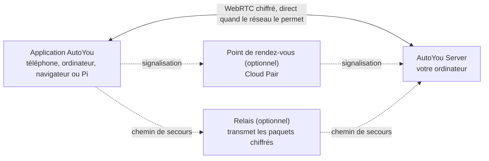

<div align="center">

[English](../../README.md) · [简体中文](README_zh.md) · [繁體中文](README_zh-TW.md) · [日本語](README_ja.md) · [한국어](README_ko.md) · [हिन्दी](README_hi.md) · [Español](README_es.md) · **Français** · [Deutsch](README_de.md) · [Português (Brasil)](README_pt-BR.md) · [Русский](README_ru.md) · [العربية](README_ar.md)


# AutoYou Server

### Votre propre serveur d'IA, sur l'ordinateur que vous possédez déjà.

**Vous n'êtes pas le produit. Vous êtes le propriétaire.**

[](https://github.com/autoyou-ai/AutoYou-Server/actions/workflows/public-checks.yml)
[](https://github.com/autoyou-ai/AutoYou-Server/releases)
[](../../requirements/README.md)
[](../../servers/README.md)
[](../../autoyou_agents/README.md)
[](../../LICENSE)

**[Site web](https://www.autoyou.me/) · [Applications](https://www.autoyou.me/downloads/) · [Écosystème](https://www.autoyou.me/ecosystem/) · [Communauté](https://www.autoyou.me/community/)**

[Démarrage rapide](#quick-start) · [Fonctionnement](#how-autoyou-works) · [Ce que vous pouvez faire](#what-you-can-do) · [Agents](#agents) · [Appairage](#pairing-modes) · [Sécurité](#security-modes-and-tiers) · [Clients](#supported-clients) · [FAQ](#faq) · [Documentation](#documentation)

<code>./run_autoyou.sh</code>

</div>

> [!IMPORTANT]
> Téléchargez AutoYou Server depuis [autoyou-ai/AutoYou-Server](https://github.com/autoyou-ai/AutoYou-Server) ou [autoyou.me](https://www.autoyou.me/), et les applications depuis les liens des boutiques dans [Clients pris en charge](#supported-clients). Un dépôt au nom similaire ou un README copié ne rend pas un téléchargement officiel.

<div align="center">
<br />

<br /><br />
</div>

---

Transformez l'ordinateur posé sur votre bureau en serveur d'IA privé pour tous vos appareils. AutoYou Server exécute vos modèles et agents d'IA, vos appels vocaux et vidéo, le bureau à distance, vos jeux et vos propres applications web sur votre machine Windows, macOS ou Linux. Votre téléphone, vos autres ordinateurs et vos navigateurs s'y connectent par des liaisons pair à pair chiffrées, à la maison comme en déplacement.

Vos conversations, vos fichiers et l'activité des agents restent sur cet ordinateur, pas dans un service AutoYou hébergé. Faites tourner des modèles locaux avec Ollama pour discuter sans facture de tokens, ou connectez le fournisseur cloud de votre choix. Appairez un appareil une fois, et tout ce que propose le serveur tient dans votre poche : le chat, un assistant mains libres, la voix en temps réel dans de nombreuses langues, votre bureau, vos jeux et n'importe quel service web que vous faites déjà tourner.

> **Première fois ?** Lancez le script, ouvrez **http://127.0.0.1:8001/**, et l'assistant de configuration vous guide pour choisir votre IA, activer les fonctions voulues et appairer votre premier appareil.

<a id="quick-start"></a>

## Démarrage rapide

Il vous faut Git et Python 3.11 ou plus récent. Certaines fonctions optionnelles exigent un Python plus récent ou une plateforme particulière ; voir les [profils de dépendances](../../requirements/README.md).

### 1. Récupérer le serveur

```bash
git clone https://github.com/autoyou-ai/AutoYou-Server.git
cd AutoYou-Server
```

### 2. Lancer le script

Windows :

```powershell
.\run_autoyou.bat --profile base
# Or select the Full profile with LAN access:
.\run_autoyou.bat --profile full --host 0.0.0.0
```

macOS ou Linux :

```bash
./run_autoyou.sh --profile base
# Or select the Full profile with LAN access:
./run_autoyou.sh --profile full --host 0.0.0.0
```

Le script crée un environnement Python, installe les dépendances depuis les index de paquets et peut télécharger des modèles et des outils natifs. Lisez d'abord les scripts et exécutez-les dans un environnement que vous pouvez modifier sans risque.

### 3. Ouvrir la console et appairer un appareil

Rendez-vous sur **http://127.0.0.1:8001/**, choisissez un mot de passe serveur unique et suivez la configuration. Elle vous demande à quoi servira AutoYou (chat, assistant mains libres, appels, jeux, programmation, etc.), installe les agents correspondants et affiche un QR code pour appairer votre téléphone.

Pour une première configuration sans surveillance, fournissez `AUTOYOU_SERVER_PASSWORD` via votre environnement ou un gestionnaire de secrets. Ne mettez jamais de vrai mot de passe dans des commandes partagées, des issues ou des captures d'écran.

| Profil | Ajoute |
| --- | --- |
| `base` | Serveur principal, administration locale, connexions des appareils et intégrations cloud |
| `local` | Outils pour modèles locaux et routage d'intention sur l'appareil |
| `recommended` | Dépendances messagerie et Bluetooth (par défaut si `--profile` est omis) |
| `full` | Dépendances voix, navigateur et automatisation du bureau |

Pour mettre à jour, lancez `git pull` dans votre copie puis relancez le script. Les notes de version sont dans [docs/releases/](../releases/).

<a id="how-autoyou-works"></a>

## Fonctionnement

**Le serveur, c'est votre propre ordinateur, et les appareils lui parlent directement.** Les applications et le serveur se connectent avec WebRTC. Après une courte négociation d'appairage, ils ouvrent une liaison chiffrée (DTLS, avec SRTP pour les médias) qui transporte le chat, la voix, la vidéo, le partage d'écran, les commandes de jeu et le trafic web relayé. La plupart des réseaux domestiques et mobiles établissent cette liaison sans ouvrir de port sur le routeur. Si un réseau est trop strict, la connexion bascule sur un relais qui transmet les mêmes paquets chiffrés.



Sur le serveur, un routeur d'intention local envoie chaque requête au bon agent ou outil. Google ADK exécute les agents natifs, et OpenClaw, Hermes Agent et Odysseus peuvent être raccordés. LiteLLM envoie les appels de modèle à Ollama sur votre machine ou au fournisseur cloud que vous choisissez. La parole est reconnue et synthétisée localement, et la mémoire est stockée dans SQLite.

<a id="what-you-can-do"></a>

## Ce que vous pouvez faire

| Fonction | Ce qu'elle vous apporte |
| --- | --- |
| **Chat IA** | Discutez avec votre propre IA depuis n'importe quel appareil appairé ; AutoYou ne limite pas les messages |
| **Voix en temps réel** | Appels en direct avec votre IA, reconnaissance vocale locale et réponses parlées dans plus de 30 langues |
| **Mode assistant** | Un mot d'activation comme « Hey Jarvis » sur téléphone, ordinateur, Raspberry Pi ou navigateur |
| **Bureau à distance** | Voir et contrôler votre ordinateur depuis votre téléphone, écran de verrouillage Windows compris |
| **Vidéo de l'ordinateur** | Envoyer dans un appel l'écran, une caméra, un fichier vidéo ou des images fournies par API |
| **Mode jeu et Game Studio** | Diffuser des jeux de l'ordinateur vers le téléphone, ou créer des jeux qui tournent hors ligne sur le téléphone |
| **Fabrique d'applications web** | Demander à un agent de créer une appli web, puis l'ouvrir sur tous vos appareils appairés |
| **Publier n'importe quel port local** | Partager tout service web de votre ordinateur, comme `localhost:3000`, avec vos appareils |
| **Agents** | 45 agents intégrés : notes, fichiers, code, médias, navigation, entraînement, etc. |
| **MCP** | Utiliser les outils AutoYou depuis ChatGPT, Codex, Claude, Antigravity, Cursor et VS Code |

Les fonctions dépendent du profil choisi, du matériel, des autorisations et des intégrations configurées. Les capacités puissantes, comme le contrôle du bureau, le mode jeu, l'enregistrement et l'accès aux fichiers, restent désactivées tant que vous ne les activez pas.

### Chat IA

Choisissez un fournisseur dans **AI** sur la console : **Ollama + Agents** par défaut (modèle local, sans clé d'API), **Apple Intelligence** sur les Mac compatibles, **Gemini**, **OpenRouter** ou d'autres fournisseurs via LiteLLM (Anthropic, OpenAI, Mistral, DeepSeek, xAI, etc.), toujours avec les agents et outils d'AutoYou. Vous pouvez aussi utiliser **OpenClaw**, **Hermes Agent** ou **Odysseus** comme environnement de session principal.

AutoYou ne plafonne pas le nombre de messages. Avec un modèle local, le chat ne coûte rien par message et fonctionne sans internet. Un fournisseur cloud que vous connectez facture selon sa propre offre et reçoit les prompts que vous lui envoyez. La bibliothèque de modèles intégrée permet de parcourir, télécharger et changer de modèle local, et l'agent Model Picker recommande celui qui convient à votre matériel.

### Voix en temps réel dans de nombreuses langues

Appelez votre IA et parlez. La reconnaissance vocale tourne sur votre ordinateur (whisper.cpp dans la version par défaut, faster-whisper dans les versions vocales complètes), avec détection d'activité vocale, interruption dès que vous parlez et une pause **Attends que j'aie fini de parler** pour les longues réflexions.

- **Parlez votre langue.** Laissez **STT language** sur `auto` et un modèle multilingue détecte la langue parlée.
- **Écoutez la réponse dans cette langue.** **Auto TTS**, le réglage par défaut, détecte la langue de la réponse et choisit une voix système correspondante. Le modèle local Supertonic 3 parle 31 langues et fonctionne hors ligne après un téléchargement unique d'environ 401 Mo.
- **Choisissez votre voix.** Voix système, dix voix prédéfinies Supertonic, une voix personnalisée entraînée dans l'application Voice Training, EmotiVoice pour le chinois et l'anglais, ou les voix hébergées d'OpenAI et Azure.

La synthèse vocale prononce la réponse qu'elle reçoit ; elle ne la traduit pas. Le modèle de chat choisi doit aussi prendre en charge la langue de la conversation.

### Mode assistant

Donnez à votre serveur un mot d'activation, comme « Hey Jarvis ». Dites-le près d'un téléphone, d'un ordinateur, d'un Raspberry Pi, de l'extension Chrome ou de la page d'administration, et ce que vous dites ensuite part vers AutoYou. Tant que le mot n'est pas entendu, rien de ce que vous dites n'est transcrit ni envoyé à l'IA. Enregistrez-le trois fois, entraînez-le sur votre serveur en quelques secondes, testez-le et activez-le. En visioconférence, la demande qui suit le mot d'activation peut inclure la dernière image de la caméra. Voir [Mode assistant](../admin-ui/assistant-mode.mdx).

### Bureau à distance

Voyez et contrôlez votre ordinateur depuis un téléphone ou une application de bureau appairés : choisissez un écran ou une seule fenêtre, déplacez la souris, tapez et utilisez les touches de modification. H.264 est privilégié quand l'appareil le prend en charge. Sous Windows, le service optionnel **AutoYou Secure Desktop Helper** permet au propriétaire appairé de voir et d'utiliser l'écran de verrouillage et les invites UAC, et le serveur peut garder l'ordinateur éveillé pendant la connexion. La capture d'écran et la saisie sont des autorisations distinctes, désactivées par défaut, et le bureau à distance n'est jamais proposé via un Peer Link.

### Vidéo de l'ordinateur

Pendant un appel, l'ordinateur peut envoyer de la vidéo depuis quatre sources : son **écran**, une **caméra**, un **fichier vidéo** que vous téléversez et lisez, ou des **images par API** fournies par votre propre programme. Il peut aussi partager son micro et son son. Dans la console, **Interact** affiche en direct les caméras des appareils connectés et peut diffuser leurs micros sur les haut-parleurs de l'ordinateur, sans traitement par l'IA et sans enregistrement.

### Mode jeu et Game Studio

- **Le mode jeu** diffuse vers un appareil appairé un jeu rendu sur votre ordinateur, et le tactile, les capteurs de mouvement, la manette, la souris et le clavier de l'appareil reviennent comme commandes de jeu. Vous pouvez définir jusqu'à quatre boutons virtuels nommés. Le mode jeu est une autorisation à part entière et active aussi l'envoi d'écran et la saisie du bureau à distance.
- **Utilisez votre propre moteur.** Un moteur de jeu local peut lire, via un WebSocket local, des trames d'entrée authentifiées au protocole `autoyou_game_v1`. Pour Unreal, le serveur propose un plugin source à `/api/game/unreal-plugin`.
- **Des jeux hors ligne pour le téléphone.** L'agent Game Studio vous aide à créer des jeux web ou WASM portables, les empaquette en fichiers `.aygame` jusqu'à 5 Gio et les envoie aux clients par WebRTC ou par un Peer Link approuvé. Chaque jeu dispose de sa propre base SQLite sur l'appareil, et la progression survit aux mises à jour.

**Neon Horizon** est la démo intégrée : à télécharger sur le téléphone, à jouer sur la page Game Studio ou en streaming depuis votre ordinateur.

### Fabrique d'applications web

Décrivez une application et laissez les agents la construire. L'agent **Website** crée une interface web pour un agent : un modèle simple, ou React ou Angular sur demande, avec un backend Python/FastAPI, Node/TypeScript, Go ou Rust. **Agent Builder** génère la structure d'un nouvel agent, et les agents **Coding** et **Pi** implémentent et testent le code. Chaque application est enregistrée auprès du service web local et apparaît dans le navigateur de vos appareils appairés. L'agent **Hosting** explique comment publier sur un lien public : un tunnel temporaire gratuit `/pair` ou une URL persistante payante.

### Publier n'importe quel port local

Vous faites déjà tourner quelque chose ? Partagez-le. Dans **Websites & Browser > Advertised Websites**, ajoutez n'importe quel port de 1 à 65535 avec un libellé et une URL de redirection optionnelle, comme `http://127.0.0.1:3000` ou une autre machine de votre réseau. Les clients appairés le découvrent et l'ouvrent sur le même port de leur côté, si bien que les tableaux de bord, serveurs de développement, outils de homelab et applications non prévues pour vivre sous un sous-chemin continuent de fonctionner. Le trafic circule dans la liaison chiffrée : inutile d'ouvrir le port sur votre routeur. Les navigateurs appairés reçoivent le rôle `viewer`, `editor` ou `admin`, qui limite ce qu'ils peuvent modifier.

<a id="agents"></a>

## Agents

AutoYou est livré avec 45 agents. L'agent principal confie chaque requête au spécialiste adapté, et beaucoup de spécialistes ont leur propre page web sur vos appareils appairés. Les agents marqués opt-in ne sont installés que lorsque vous le faites dans **Agents** sur la console.

| Domaine | Agents |
| --- | --- |
| Au quotidien | Notes, Tasks, Notify, Memory, Persona, Page, Prompts, Location (opt-in) |
| Web et automatisation | Internet, Assistant, Browser (opt-in), Client Browser Control, Proxy (opt-in) |
| Médias et création | Audio, TV, Media Generation (opt-in), Game Studio |
| Code et construction | Coding, Pi, Agent Builder, Website, Skills, Files, CLI, Claude CLI, Claude Desktop, Codex Desktop, Antigravity, Prompt Builder (tous opt-in) |
| Intelligence et modèles | Model Picker, OpenClaw, Hermes Agent (tous opt-in) |
| Entraînement | Data Collector, Fine-Tuning, Voice Training (tous opt-in) |
| Système et ordinateur | Admin, Remote Desktop, Backup, Hosting (opt-in), Windows Security (opt-in), macOS Security (opt-in), Education (opt-in) |
| Soutenir AutoYou | Support Ads, Earnings, Donation |

Ajoutez les vôtres en copiant un paquet dans `autoyou_agents/`. Tous les détails sont dans le [catalogue des agents](../../autoyou_agents/README.md).

<a id="pairing-modes"></a>

## Modes d'appairage

| Méthode | Comment elle se connecte | Usage typique |
| --- | --- | --- |
| **Local Pair** | Directement sur votre réseau local ; votre propre serveur gère la signalisation | Même Wi-Fi ou réseau de bureau |
| **Bluetooth Pair** | Les informations de connexion passent par Bluetooth Low Energy | Première configuration d'un téléphone proche |
| **Live Pair** | Le téléphone et l'ordinateur se montrent des QR codes animés, sans chemin réseau entre eux | Réseaux isolés ou verrouillés |
| **Code à usage unique** | `/pair` dans une messagerie renvoie un code et un lien temporaires | Appareils invités et réseaux non fiables |
| **Auto Pair** | Un message d'appairage chiffré transite par une discussion Telegram, Signal ou WhatsApp que vous configurez | Appairage à distance sans compte cloud |
| **Cloud Pair** | Un point de rendez-vous AutoYou Cloud optionnel et payant retrouve votre ordinateur à travers le NAT, avec relais de secours | En déplacement ou derrière un réseau strict |

**Peer Link** relie une application AutoYou à une autre ; l'application qui reçoit approuve chaque lien, et le mot de passe de votre ordinateur n'est jamais utilisé. Les **Lobbies** sont des salons de groupe que les applications créent et rejoignent à proximité via Wi-Fi et Bluetooth. Voir les [protocoles d'appairage](../technical/pairing-protocols.md).

<a id="security-modes-and-tiers"></a>

## Modes et niveaux de sécurité

Un seul mode de sécurité s'applique à tout le serveur. Une nouvelle installation démarre en **Secure**.

| Mode | Messages d'appairage | Ce qu'il faut pour appairer | Données sur l'ordinateur |
| --- | --- | --- | --- |
| **Normal** | Non chiffrés | Un code à usage unique | Inchangées |
| **Secure** | Chiffrés avec le mot de passe du serveur | Le mot de passe du serveur | Inchangées |
| **Secure Professional** | Chiffrés avec le mot de passe du serveur | Le mot de passe et un code d'authentification | Inchangées |
| **Secure Professional Maximus** | Comme Secure Professional | Le mot de passe et un code d'authentification | Sessions, données d'agents, sites, notes et réglages chiffrés au repos |

En modes Secure, les messages d'appairage sont chiffrés avec une clé issue d'un échange de clés authentifié par mot de passe (une construction de la famille CPace sur ristretto255 avec libsodium). Un relais ou un pont de messagerie qui les transporte ne peut pas les lire, et un échange enregistré ne permet pas de tester des mots de passe hors ligne.

**Le niveau de sécurité d'appairage** détermine l'effort exigé par un appairage par message : **Quick Pairing (B)** permet d'appairer en un seul message et offre la meilleure compatibilité ; **Enhanced Pairing (A)** impose à chaque client un aller-retour hello supplémentaire, ce qui complique la devinette. Local Pair, Bluetooth Pair et Cloud Pair utilisent toujours le flux renforcé.

Le navigateur d'un appareil appairé reçoit le rôle `viewer`, `editor` ou `admin`. Les identifiants et les réglages de sécurité ne peuvent être modifiés que depuis l'ordinateur lui-même ou depuis une session d'administration HTTPS ouverte directement sur le port d'administration. Le chiffrement protège la connexion, pas les appareils eux-mêmes, les autorisations des agents ni les services tiers. Voir [modes de sécurité](../security/security-modes.md) et [SECURITY.md](../../SECURITY.md).

<a id="supported-clients"></a>

## Clients pris en charge

AutoYou Server tourne sur votre ordinateur ; les applications le rejoignent depuis partout ailleurs. Les applications clientes sont distribuées séparément et leur code n'est pas dans ce dépôt.

| Plateforme | Où l'obtenir |
| --- | --- |
| iPhone et iPad | [App Store](https://apps.apple.com/us/app/autoyou/id6760363728) |
| Android | [Google Play](https://play.google.com/store/apps/details?id=com.autoyou.app) |
| Windows | [Microsoft Store](https://apps.microsoft.com/detail/9mw8l2wfw7wv?hl=en-US&gl=US) |
| macOS et Linux | [Téléchargements](https://www.autoyou.me/downloads/) |
| Navigateur | Extension Chrome et client web ([page écosystème](https://www.autoyou.me/ecosystem/)) |
| Raspberry Pi | Client vocal Python pour le mode assistant ([configuration](../admin-ui/assistant-mode.mdx)) |

Les applications mobiles embarquent aussi une petite IA locale (LFM 2.5 350M, Gemini Nano ou Apple Intelligence selon l'appareil) pour discuter même sans ordinateur.

<a id="mcp"></a>

## Utiliser AutoYou depuis votre agent de code

L'adaptateur MCP local relie les outils AutoYou pris en charge à ChatGPT, Codex, Claude Code, Claude Desktop, Google Antigravity, Cursor et VS Code. Activez MCP dans **Admin UI > Messaging > AutoYou MCP**, téléchargez `autoyou-mcp.env`, puis suivez les [étapes du README anglais](../../README.md#use-autoyou-from-your-coding-agent) pour chaque client.

<a id="faq"></a>

## FAQ

<details>
<summary><strong>Faut-il un compte cloud ou un VPN ?</strong></summary>

Non. Local Pair, Bluetooth Pair, Live Pair, les codes à usage unique et Auto Pair fonctionnent sans compte AutoYou. Cloud Pair est une aide optionnelle et payante. Si vous utilisez déjà un VPN comme Tailscale, AutoYou fonctionne aussi à travers lui.

</details>

<details>
<summary><strong>Le chat IA est-il vraiment illimité ?</strong></summary>

AutoYou ne plafonne pas les messages. Avec un modèle Ollama local, chaque message est gratuit et la vitesse dépend de votre ordinateur. Un fournisseur cloud que vous connectez a ses propres tarifs et limites.

</details>

<details>
<summary><strong>AutoYou envoie-t-il mes fichiers ou conversations ailleurs ?</strong></summary>

Ils sont stockés sur votre ordinateur. Les données ne sortent que par les services que vous activez, comme un fournisseur de modèles cloud, un pont de messagerie ou un tunnel public, chacun ayant ses propres conditions.

</details>

<a id="documentation"></a>

## Documentation

- [Démarrage rapide](../quickstart.mdx) · [Architecture](../architecture/) · [Sécurité et confidentialité](../security/) · [Console d'administration](../admin-ui/)
- [Catalogue des agents](../../autoyou_agents/README.md) · [Référence des agents](../agents/) · [Framework d'agents](../agent-framework/)
- [API HTTP et WebSocket](../api-reference/) · [Guides](../guides/) · [Guides d'appairage](../../guides/README.md)

## Contribuer

Votre aide est la bienvenue : créez un agent, un jeu, une extension ou une intégration ; améliorez l'installation, l'accessibilité, la prise en charge des plateformes, les traductions ou la documentation ; ou partagez une démo ou un guide. Lisez [CONTRIBUTING.md](../../CONTRIBUTING.md) et le [Code de conduite](../../CODE_OF_CONDUCT.md) avant de proposer votre travail.

## Licence

AutoYou Server est source-available sous la [licence serveur](../../LICENSE). Ce n'est pas actuellement un projet open source approuvé par l'OSI, et les définitions de `LICENSE` prévalent. L'usage individuel, les compilations locales et le partage gratuit sont autorisés selon les conditions de la licence ; l'usage institutionnel ou commercial nécessite un [accord Enterprise](https://www.autoyou.me/enterprise/) distinct. Voir le [README anglais](../../README.md#license) et [THIRD-PARTY-NOTICES.md](../../THIRD-PARTY-NOTICES.md).

Copyright &copy; 2026 OpenStorey LLC and contributors.
