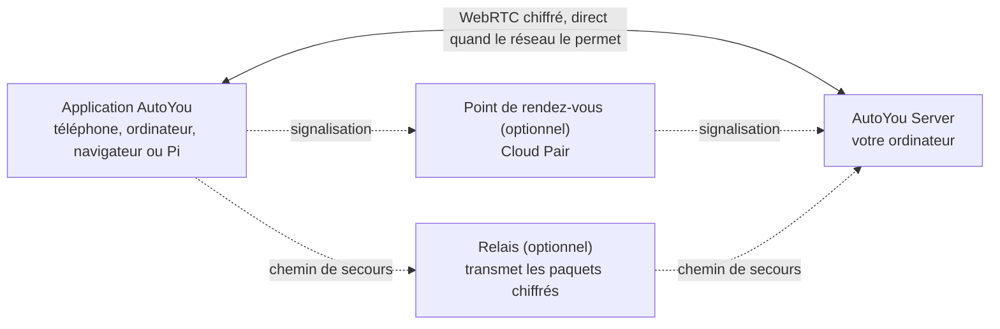

<div align="center">

[English](../../README.md) · [简体中文](README_zh.md) · [繁體中文](README_zh-TW.md) · [日本語](README_ja.md) · [한국어](README_ko.md) · [हिन्दी](README_hi.md) · [Español](README_es.md) · **Français** · [Deutsch](README_de.md) · [Português (Brasil)](README_pt-BR.md) · [Русский](README_ru.md) · [العربية](README_ar.md)


# AutoYou Server

### Votre propre serveur d'IA, sur l'ordinateur que vous possédez déjà.

**Vous n'êtes pas le produit. Vous êtes le propriétaire.**

[](https://github.com/autoyou-ai/AutoYou-Server/actions/workflows/public-checks.yml)
[](https://github.com/autoyou-ai/AutoYou-Server/releases)
[](../../requirements/README.md)
[](../../servers/README.md)
[](../../autoyou_agents/README.md)
[](../../LICENSE)

**[Site web](https://www.autoyou.me/) · [Applications](https://www.autoyou.me/downloads/) · [Écosystème](https://www.autoyou.me/ecosystem/) · [Communauté](https://www.autoyou.me/community/)**

[Démarrage rapide](#quick-start) · [Fonctionnement](#how-autoyou-works) · [Ce que vous pouvez faire](#what-you-can-do) · [Agents](#agents) · [Appairage](#pairing-modes) · [Sécurité](#security-modes-and-tiers) · [Clients](#supported-clients) · [FAQ](#faq) · [Documentation](#documentation)

<code>./run_autoyou.sh</code>

</div>

> [!IMPORTANT]
> Téléchargez AutoYou Server depuis [autoyou-ai/AutoYou-Server](https://github.com/autoyou-ai/AutoYou-Server) ou [autoyou.me](https://www.autoyou.me/), et les applications depuis les liens des boutiques dans [Clients pris en charge](#supported-clients). Un dépôt au nom similaire ou un README copié ne rend pas un téléchargement officiel.

<div align="center">
<br />

<br /><br />
</div>

---

Transformez l'ordinateur posé sur votre bureau en serveur d'IA privé pour tous vos appareils. AutoYou Server exécute vos modèles et agents d'IA, vos appels vocaux et vidéo, le bureau à distance, vos jeux et vos propres applications web sur votre machine Windows, macOS ou Linux. Votre téléphone, vos autres ordinateurs et vos navigateurs s'y connectent par des liaisons pair à pair chiffrées, à la maison comme en déplacement.

Vos conversations, vos fichiers et l'activité des agents restent sur cet ordinateur, pas dans un service AutoYou hébergé. Faites tourner des modèles locaux avec Ollama pour discuter sans facture de tokens, ou connectez le fournisseur cloud de votre choix. Appairez un appareil une fois, et tout ce que propose le serveur tient dans votre poche : le chat, un assistant mains libres, la voix en temps réel dans de nombreuses langues, votre bureau, vos jeux et n'importe quel service web que vous faites déjà tourner.

> **Première fois ?** Lancez le script, ouvrez **http://127.0.0.1:8001/**, et l'assistant de configuration vous guide pour choisir votre IA, activer les fonctions voulues et appairer votre premier appareil.

<a id="quick-start"></a>

## Démarrage rapide

Il vous faut Git et Python 3.11 ou plus récent. Certaines fonctions optionnelles exigent un Python plus récent ou une plateforme particulière ; voir les [profils de dépendances](../../requirements/README.md).

### 1. Récupérer le serveur

```bash
git clone https://github.com/autoyou-ai/AutoYou-Server.git
cd AutoYou-Server
```

### 2. Lancer le script

Windows :

```powershell
.\run_autoyou.bat --profile base
# Or select the Full profile with LAN access:
.\run_autoyou.bat --profile full --host 0.0.0.0
```

macOS ou Linux :

```bash
./run_autoyou.sh --profile base
# Or select the Full profile with LAN access:
./run_autoyou.sh --profile full --host 0.0.0.0
```

Le script crée un environnement Python, installe les dépendances depuis les index de paquets et peut télécharger des modèles et des outils natifs. Lisez d'abord les scripts et exécutez-les dans un environnement que vous pouvez modifier sans risque.

### 3. Ouvrir la console et appairer un appareil

Rendez-vous sur **http://127.0.0.1:8001/**, choisissez un mot de passe serveur unique et suivez la configuration. Elle vous demande à quoi servira AutoYou (chat, assistant mains libres, appels, jeux, programmation, etc.), installe les agents correspondants et affiche un QR code pour appairer votre téléphone.

Pour une première configuration sans surveillance, fournissez `AUTOYOU_SERVER_PASSWORD` via votre environnement ou un gestionnaire de secrets. Ne mettez jamais de vrai mot de passe dans des commandes partagées, des issues ou des captures d'écran.

| Profil | Ajoute |
| --- | --- |
| `base` | Serveur principal, administration locale, connexions des appareils et intégrations cloud |
| `local` | Outils pour modèles locaux et routage d'intention sur l'appareil |
| `recommended` | Dépendances messagerie et Bluetooth (par défaut si `--profile` est omis) |
| `full` | Dépendances voix, navigateur et automatisation du bureau |

Les profils ne choisissent que les dépendances ; les intégrations doivent toujours être configurées. `--skip-nuitka` et `--skip-backend-compile` conservent les bibliothèques intégrées du lanceur : les mises à jour de sécurité des dépendances dans les applications packagées nécessitent donc une recompilation complète.

Pour mettre à jour, lancez `git pull` dans votre copie puis relancez le script. Les notes de version sont dans [docs/releases/](../releases/).

<a id="how-autoyou-works"></a>

## Fonctionnement

**Le serveur, c'est votre propre ordinateur, et les appareils lui parlent directement.** Les applications et le serveur se connectent avec WebRTC. Après une courte négociation d'appairage, ils ouvrent une liaison chiffrée (DTLS, avec SRTP pour les médias) qui transporte le chat, la voix, la vidéo, le partage d'écran, les commandes de jeu et le trafic web relayé. La plupart des réseaux domestiques et mobiles établissent cette liaison sans ouvrir de port sur le routeur. Si un réseau est trop strict, la connexion bascule sur un relais qui transmet les mêmes paquets chiffrés.



Sur le serveur, un routeur d'intention local envoie chaque requête au bon agent ou outil. Google ADK exécute les agents natifs, et OpenClaw, Hermes Agent et Odysseus peuvent être raccordés. LiteLLM envoie les appels de modèle à Ollama sur votre machine ou au fournisseur cloud que vous choisissez. La parole est reconnue et synthétisée localement, et la mémoire est stockée dans SQLite.

<picture>
  <source media="(prefers-color-scheme: dark)" srcset="../images/architecture-dark.png" />
  
</picture>

Le diagramme est généré par [scripts/build_architecture_diagram.py](../../scripts/build_architecture_diagram.py). Les cadres en pointillés sont des modules complémentaires facultatifs ou des projets connectés.

<a id="what-you-can-do"></a>

## Ce que vous pouvez faire

| Fonction | Ce qu'elle vous apporte |
| --- | --- |
| **Chat IA** | Discutez avec votre propre IA depuis n'importe quel appareil appairé ; AutoYou ne limite pas les messages |
| **Voix en temps réel** | Appels en direct avec votre IA, reconnaissance vocale locale et réponses parlées dans plus de 30 langues |
| **Mode assistant** | Un mot d'activation comme « Hey Jarvis » sur téléphone, ordinateur, Raspberry Pi ou navigateur |
| **Bureau à distance** | Voir et contrôler votre ordinateur depuis votre téléphone, écran de verrouillage Windows compris |
| **Vidéo de l'ordinateur** | Envoyer dans un appel l'écran, une caméra, un fichier vidéo ou des images fournies par API |
| **Mode jeu et Game Studio** | Diffuser des jeux de l'ordinateur vers le téléphone, ou créer des jeux qui tournent hors ligne sur le téléphone |
| **Fabrique d'applications web** | Demander à un agent de créer une appli web, puis l'ouvrir sur tous vos appareils appairés |
| **Publier n'importe quel port local** | Partager tout service web de votre ordinateur, comme `localhost:3000`, avec vos appareils |
| **Agents** | 45 agents intégrés : notes, fichiers, code, médias, navigation, entraînement, etc. |
| **MCP** | Utiliser les outils AutoYou depuis ChatGPT, Codex, Claude, Antigravity, Cursor et VS Code |
| **Messagerie** | Joignez votre serveur via Telegram, Signal et WhatsApp avec des connecteurs que vous contrôlez |
| **Mémoire** | Mémoire SQLite et journal de persona privé, avec Cognee en module facultatif |

Les fonctions dépendent du profil choisi, du matériel, des autorisations et des intégrations configurées. Les capacités puissantes, comme le contrôle du bureau, le mode jeu, l'enregistrement et l'accès aux fichiers, restent désactivées tant que vous ne les activez pas.

<a id="ai-chat"></a>

### Chat IA

Choisissez un fournisseur dans **AI** sur la console : **Ollama + Agents** par défaut (modèle local, sans clé d'API), **Apple Intelligence** sur les Mac compatibles, **Gemini**, **OpenRouter** ou d'autres fournisseurs via LiteLLM (Anthropic, OpenAI, Mistral, DeepSeek, xAI, etc.), toujours avec les agents et outils d'AutoYou. Vous pouvez aussi utiliser **OpenClaw**, **Hermes Agent** ou **Odysseus** comme environnement de session principal.

AutoYou ne plafonne pas le nombre de messages. Avec un modèle local, le chat ne coûte rien par message et fonctionne sans internet. Un fournisseur cloud que vous connectez facture selon sa propre offre et reçoit les prompts que vous lui envoyez. La bibliothèque de modèles intégrée permet de parcourir, télécharger et changer de modèle local, et l'agent Model Picker recommande celui qui convient à votre matériel.

Les petits modèles locaux quantifiés sont aidés pour rester précis : un classifieur d'intentions hors ligne envoie les demandes courantes directement au bon agent, et un mode de routage compact garde la liste d'outils courte. Voir [comment les petits modèles restent précis](../../autoyou_agents/README.md#small-local-models).

<a id="realtime-voice-in-many-languages"></a>

### Voix en temps réel dans de nombreuses langues

Appelez votre IA et parlez. La reconnaissance vocale tourne sur votre ordinateur (whisper.cpp dans la version par défaut, faster-whisper dans les versions vocales complètes), avec détection d'activité vocale, interruption dès que vous parlez et une pause **Attends que j'aie fini de parler** pour les longues réflexions.

- **Parlez votre langue.** Laissez **STT language** sur `auto` et un modèle multilingue détecte la langue parlée.
- **Écoutez la réponse dans cette langue.** **Auto TTS**, le réglage par défaut, détecte la langue de la réponse et choisit une voix système correspondante. Le modèle local Supertonic 3 parle 31 langues et fonctionne hors ligne après un téléchargement unique d'environ 401 Mo.
- **Choisissez votre voix.** Voix système, dix voix prédéfinies Supertonic, une voix personnalisée entraînée dans l'application Voice Training, EmotiVoice pour le chinois et l'anglais, ou les voix hébergées d'OpenAI et Azure.

La synthèse vocale prononce la réponse qu'elle reçoit ; elle ne la traduit pas. Le modèle de chat choisi doit aussi prendre en charge la langue de la conversation.

<a id="assistant-mode"></a>

### Mode assistant

Donnez à votre serveur un mot d'activation, comme « Hey Jarvis ». Dites-le près d'un téléphone, d'un ordinateur, d'un Raspberry Pi, de l'extension Chrome ou de la page d'administration, et ce que vous dites ensuite part vers AutoYou. Tant que le mot n'est pas entendu, rien de ce que vous dites n'est transcrit ni envoyé à l'IA. Enregistrez-le trois fois, entraînez-le sur votre serveur en quelques secondes, testez-le et activez-le. En visioconférence, la demande qui suit le mot d'activation peut inclure la dernière image de la caméra. Voir [Mode assistant](../admin-ui/assistant-mode.mdx).

<a id="remote-desktop"></a>

### Bureau à distance

Voyez et contrôlez votre ordinateur depuis un téléphone ou une application de bureau appairés : choisissez un écran ou une seule fenêtre, déplacez la souris, tapez et utilisez les touches de modification. H.264 est privilégié quand l'appareil le prend en charge. Sous Windows, le service optionnel **AutoYou Secure Desktop Helper** permet au propriétaire appairé de voir et d'utiliser l'écran de verrouillage et les invites UAC, et le serveur peut garder l'ordinateur éveillé pendant la connexion. La capture d'écran et la saisie sont des autorisations distinctes, désactivées par défaut, et le bureau à distance n'est jamais proposé via un Peer Link.

<a id="computer-video"></a>

### Vidéo de l'ordinateur

Pendant un appel, l'ordinateur peut envoyer de la vidéo depuis quatre sources : son **écran**, une **caméra**, un **fichier vidéo** que vous téléversez et lisez, ou des **images par API** fournies par votre propre programme. Il peut aussi partager son micro et son son. Dans la console, **Interact** affiche en direct les caméras des appareils connectés et peut diffuser leurs micros sur les haut-parleurs de l'ordinateur, sans traitement par l'IA et sans enregistrement.

<a id="game-mode-and-game-studio"></a>

### Mode jeu et Game Studio

- **Le mode jeu** diffuse vers un appareil appairé un jeu rendu sur votre ordinateur, et le tactile, les capteurs de mouvement, la manette, la souris et le clavier de l'appareil reviennent comme commandes de jeu. Vous pouvez définir jusqu'à quatre boutons virtuels nommés. Le mode jeu est une autorisation à part entière et active aussi l'envoi d'écran et la saisie du bureau à distance.
- **Utilisez votre propre moteur.** Un moteur de jeu local peut lire, via un WebSocket local, des trames d'entrée authentifiées au protocole `autoyou_game_v1`. Pour Unreal, le serveur propose un plugin source à `/api/game/unreal-plugin`.
- **Des jeux hors ligne pour le téléphone.** L'agent Game Studio vous aide à créer des jeux web ou WASM portables, les empaquette en fichiers `.aygame` jusqu'à 5 Gio et les envoie aux clients par WebRTC ou par un Peer Link approuvé. Chaque jeu dispose de sa propre base SQLite sur l'appareil, et la progression survit aux mises à jour.

**Neon Horizon** est la démo intégrée : à télécharger sur le téléphone, à jouer sur la page Game Studio ou en streaming depuis votre ordinateur.

<a id="web-app-factory"></a>

### Fabrique d'applications web

Décrivez une application et laissez les agents la construire. L'agent **Website** crée une interface web pour un agent : un modèle simple, ou React ou Angular sur demande, avec un backend Python/FastAPI, Node/TypeScript, Go ou Rust. **Agent Builder** génère la structure d'un nouvel agent, et les agents **Coding** et **Pi** implémentent et testent le code. Chaque application est enregistrée auprès du service web local et apparaît dans le navigateur de vos appareils appairés. L'agent **Hosting** explique comment publier sur un lien public : un tunnel temporaire gratuit `/pair` ou une URL persistante payante.

<a id="host-any-local-port"></a>

### Publier n'importe quel port local

Vous faites déjà tourner quelque chose ? Partagez-le. Dans **Websites & Browser > Advertised Websites**, ajoutez n'importe quel port de 1 à 65535 avec un libellé et une URL de redirection optionnelle, comme `http://127.0.0.1:3000` ou une autre machine de votre réseau. Les clients appairés le découvrent et l'ouvrent sur le même port de leur côté, si bien que les tableaux de bord, serveurs de développement, outils de homelab et applications non prévues pour vivre sous un sous-chemin continuent de fonctionner. Le trafic circule dans la liaison chiffrée : inutile d'ouvrir le port sur votre routeur. Les navigateurs appairés reçoivent le rôle `viewer`, `editor` ou `admin`, qui limite ce qu'ils peuvent modifier.

<a id="agents"></a>

## Agents

AutoYou est livré avec 45 agents. L'agent principal confie chaque requête au spécialiste adapté, et beaucoup de spécialistes ont leur propre page web sur vos appareils appairés. Les agents marqués opt-in ne sont installés que lorsque vous le faites dans **Agents** sur la console.

| Domaine | Agents |
| --- | --- |
| Au quotidien | Notes, Tasks, Notify, Memory, Persona, Page, Prompts, Location (opt-in) |
| Web et automatisation | Internet, Assistant, Browser (opt-in), Client Browser Control, Proxy (opt-in) |
| Médias et création | Audio, TV, Media Generation (opt-in), Game Studio |
| Code et construction | Coding, Pi, Agent Builder, Website, Skills, Files, CLI, Claude CLI, Claude Desktop, Codex Desktop, Antigravity, Prompt Builder (tous opt-in) |
| Intelligence et modèles | Model Picker, OpenClaw, Hermes Agent (tous opt-in) |
| Entraînement | Data Collector, Fine-Tuning, Voice Training (tous opt-in) |
| Système et ordinateur | Admin, Remote Desktop, Backup, Hosting (opt-in), Windows Security (opt-in), macOS Security (opt-in), Education (opt-in) |
| Soutenir AutoYou | Support Ads, Earnings, Donation |

Ajoutez les vôtres en copiant un paquet dans `autoyou_agents/`. Tous les détails sont dans le [catalogue des agents](../../autoyou_agents/README.md).

La [référence des agents générée](../agents/) liste chaque outil déclaré par chaque agent.

<a id="pairing-modes"></a>

## Modes d'appairage

| Méthode | Comment elle se connecte | Usage typique |
| --- | --- | --- |
| **Local Pair** | Directement sur votre réseau local ; votre propre serveur gère la signalisation | Même Wi-Fi ou réseau de bureau |
| **Bluetooth Pair** | Les informations de connexion passent par Bluetooth Low Energy | Première configuration d'un téléphone proche |
| **Live Pair** | Le téléphone et l'ordinateur se montrent des QR codes animés, sans chemin réseau entre eux | Réseaux isolés ou verrouillés |
| **Code à usage unique** | `/pair` dans une messagerie renvoie un code et un lien temporaires | Appareils invités et réseaux non fiables |
| **Auto Pair** | Un message d'appairage chiffré transite par une discussion Telegram, Signal ou WhatsApp que vous configurez | Appairage à distance sans compte cloud |
| **Cloud Pair** | Un point de rendez-vous AutoYou Cloud optionnel et payant retrouve votre ordinateur à travers le NAT, avec relais de secours | En déplacement ou derrière un réseau strict |

**Peer Link** relie une application AutoYou à une autre ; l'application qui reçoit approuve chaque lien, et le mot de passe de votre ordinateur n'est jamais utilisé. Les **Lobbies** sont des salons de groupe que les applications créent et rejoignent à proximité via Wi-Fi et Bluetooth. Voir les [protocoles d'appairage](../technical/pairing-protocols.md).

<a id="security-modes-and-tiers"></a>

## Modes et niveaux de sécurité

Un seul mode de sécurité s'applique à tout le serveur. Une nouvelle installation démarre en **Secure**.

| Mode | Messages d'appairage | Ce qu'il faut pour appairer | Données sur l'ordinateur |
| --- | --- | --- | --- |
| **Normal** | Non chiffrés | Un code à usage unique | Inchangées |
| **Secure** | Chiffrés avec le mot de passe du serveur | Le mot de passe du serveur | Inchangées |
| **Secure Professional** | Chiffrés avec le mot de passe du serveur | Le mot de passe et un code d'authentification | Inchangées |
| **Secure Professional Maximus** | Comme Secure Professional | Le mot de passe et un code d'authentification | Sessions, données d'agents, sites, notes et réglages chiffrés au repos |

En modes Secure, les messages d'appairage sont chiffrés avec une clé issue d'un échange de clés authentifié par mot de passe (une construction de la famille CPace sur ristretto255 avec libsodium). Un relais ou un pont de messagerie qui les transporte ne peut pas les lire, et un échange enregistré ne permet pas de tester des mots de passe hors ligne.

**Le niveau de sécurité d'appairage** détermine l'effort exigé par un appairage par message : **Quick Pairing (B)** permet d'appairer en un seul message et offre la meilleure compatibilité ; **Enhanced Pairing (A)** impose à chaque client un aller-retour hello supplémentaire, ce qui complique la devinette. Local Pair, Bluetooth Pair et Cloud Pair utilisent toujours le flux renforcé.

Le navigateur d'un appareil appairé reçoit le rôle `viewer`, `editor` ou `admin`. Les identifiants et les réglages de sécurité ne peuvent être modifiés que depuis l'ordinateur lui-même ou depuis une session d'administration HTTPS ouverte directement sur le port d'administration. Le chiffrement protège la connexion, pas les appareils eux-mêmes, les autorisations des agents ni les services tiers. Voir [modes de sécurité](../security/security-modes.md) et [SECURITY.md](../../SECURITY.md).

<details>
<summary><strong>Ce que protège chaque couche, et où elle s'arrête</strong></summary>

| Couche | Ce que fait AutoYou |
| --- | --- |
| Exposition réseau | Écoute sur `127.0.0.1` par défaut. L'écoute sur votre réseau local est un réglage explicite. |
| Accès | La console d'administration est protégée par le mot de passe du serveur, avec des codes facultatifs d'application d'authentification (TOTP). |
| Appairage | Échange de clés authentifié par mot de passe, codes à usage unique et approbation de chaque lien pour Peer Link. |
| Transport | WebRTC DTLS et SRTP entre les deux extrémités, y compris quand un relais transmet les paquets. |
| Données au repos | Les identifiants sont stockés dans un coffre de clés chiffré ; Maximus chiffre aussi les données gérées par AutoYou. |
| Dépendances | Manifestes avec fichier de verrouillage, vérification des avis de sécurité et actions CI épinglées. |

Le chiffrement protège la connexion. Il ne protège pas tout ce qui l'entoure :

- **Appareils.** Un logiciel malveillant sur l'ordinateur serveur ou sur un appareil appairé dispose de l'accès de cet appareil.
- **Agents.** Les agents s'exécutent avec les permissions du serveur. L'automatisation du navigateur, l'accès aux fichiers, le contrôle du bureau et l'exécution de commandes sont puissants ; n'activez que ce dont vous avez besoin et vérifiez ce qu'ils font.
- **Tiers.** Les fournisseurs de modèles cloud, les ponts de messagerie et les tunnels publics ont leurs propres flux de données et conditions. Examinez-les avant de les activer.
- **Exploitation.** Gérer un serveur vous rend responsable des mises à jour, des sauvegardes et des identifiants.

</details>

<details>
<summary><strong>Quels services externes interviennent</strong></summary>

Vous exploitez un seul serveur : le vôtre. Aucun serveur d'application exploité par AutoYou n'est nécessaire pour faire tourner votre assistant ou stocker vos données, et le serveur fonctionne sur un réseau local sans connexion à AutoYou Cloud ([détails](../architecture/cloud-and-remote.mdx)). Tout le reste est un réglage par défaut modifiable ou une aide facultative :

| Composant | S'exécute sur | Ce qu'il peut voir |
| --- | --- | --- |
| AutoYou Server : agents, modèles, stockage, console | Votre ordinateur | Vos données. C'est une extrémité de la connexion. |
| Applications et clients navigateur | Vos appareils | Ce que vous partagez avec eux |
| Serveurs STUN de découverte d'adresse (actifs par défaut) | Les serveurs STUN publics de Google, sauf si vous les changez | L'IP publique et le port d'où apparaît une connexion WebRTC |
| Point de rendez-vous Cloud Pair (facultatif) | AutoYou Cloud | E-mail du compte, ID de l'appareil, données d'appairage temporaires et métadonnées réseau |
| Relais de secours (facultatif) | AutoYou Cloud | Paquets chiffrés et métadonnées réseau |
| Notifications push pour réveiller les applications mobiles (facultatif) | Services push d'Apple et de Google | Qu'un réveil de l'application a été demandé |
| Vérification des mises à jour (active quand un compte est lié) | Canal de mises à jour d'AutoYou Cloud | Une demande de mise à jour authentifiée avec le compte lié |
| Fournisseurs de modèles cloud (facultatif) | Le fournisseur que vous choisissez | Les prompts que vous lui envoyez |
| Ponts Telegram, Signal et WhatsApp (facultatif) | Ces services | Les messages qui y transitent, selon leurs conditions |
| Tunnel public pour les sites web (facultatif) | Le fournisseur du tunnel | Le trafic vers l'URL publique. Ce n'est pas de bout en bout. |

**Le STUN public est actif par défaut**, y compris pour Local Pair. Pour que cette requête ne sorte pas sur internet, définissez `AUTOYOU_DISABLE_PUBLIC_STUN=1` avant de démarrer le serveur, ou pointez vers votre propre serveur STUN et TURN avec `AUTOYOU_LOCAL_STUNTURN_HOST` (plus `AUTOYOU_LOCAL_TURN_USERNAME` et `AUTOYOU_LOCAL_TURN_PASSWORD` pour TURN). Sans aucun serveur STUN ou TURN, les connexions à travers un NAT peuvent échouer.

</details>

<a id="supported-clients"></a>

## Clients pris en charge

AutoYou Server tourne sur votre ordinateur ; les applications le rejoignent depuis partout ailleurs. Les applications clientes sont distribuées séparément et leur code n'est pas dans ce dépôt.

| Plateforme | Où l'obtenir |
| --- | --- |
| iPhone et iPad | [App Store](https://apps.apple.com/us/app/autoyou/id6760363728) |
| Android | [Google Play](https://play.google.com/store/apps/details?id=com.autoyou.app) |
| Windows | [Microsoft Store](https://apps.microsoft.com/detail/9mw8l2wfw7wv?hl=en-US&gl=US) |
| macOS et Linux | [Téléchargements](https://www.autoyou.me/downloads/) |
| Navigateur | Extension Chrome et client web ([page écosystème](https://www.autoyou.me/ecosystem/)) |
| Raspberry Pi | Client vocal Python pour le mode assistant ([configuration](../admin-ui/assistant-mode.mdx)) |

Les applications mobiles embarquent aussi une petite IA locale (LFM 2.5 350M, Gemini Nano ou Apple Intelligence selon l'appareil) pour discuter même sans ordinateur.

| Modes d'appairage | Discutez avec votre propre IA | Lobbies à proximité | IA locale sur le téléphone |
| --- | --- | --- | --- |
|  |  |  |  |

- **Lobbies.** Créez ou rejoignez des salons à proximité via Wi-Fi et Bluetooth, avec chat et audio ou vidéo pour jusqu'à six invités plus l'hôte.
- **Peer Link.** Reliez une application à une autre. L'application qui reçoit approuve chaque lien, et les réponses IA facultatives n'utilisent que ce que vous lui avez dit.
- **Votre ordinateur, partout.** Chat, appels, bureau à distance, mode jeu, sites d'agents et ports publiés, sur chaque appareil que vous appairez.

<a id="mcp"></a>
<a id="use-autoyou-from-your-coding-agent"></a>

## Utilisez AutoYou depuis votre agent de programmation

Reliez les fonctions compatibles MCP de ChatGPT, Codex, Claude Code ou Claude Desktop, Google Antigravity, Cursor et VS Code aux outils pris en charge d'AutoYou. L'adaptateur MCP local est un processus distinct ; le serveur ne l'installe pas dans ces clients, et les appels MCP exposent les outils pris en charge par l'adaptateur, pas un accès arbitraire à vos fichiers ni toutes les fonctions d'AutoYou.

1. Démarrez AutoYou Server et ouvrez **http://127.0.0.1:8001/**.
2. Dans **Admin UI > Messaging > AutoYou MCP**, activez MCP, générez le jeton privé de l'adaptateur et téléchargez `autoyou-mcp.env`. Gardez ce fichier privé.
3. Installez l'adaptateur, maintenu séparément, dans un environnement Python dédié :

   ```powershell
   git clone https://github.com/autoyou-ai/AutoYou.git
   cd AutoYou
   py -3 -m venv .venv-mcp
   .\.venv-mcp\Scripts\python.exe -m pip install -e .\plugins\autoyou-mcp
   ```

   Sur macOS ou Linux, utilisez `python3 -m venv .venv-mcp` et `.venv-mcp/bin/python -m pip install -e ./plugins/autoyou-mcp`.

Pour les clients qui lancent un processus MCP local, utilisez cette commande avec des chemins absolus :

```text
<path-to-.venv-mcp-python> -m autoyou_mcp --env-file <path-to-autoyou-mcp.env> --transport stdio
```

<details>
<summary><strong>Ajouter AutoYou à chaque client</strong></summary>

Pour les clients qui utilisent le format JSON `mcpServers`, l'entrée ressemble à ceci. Remplacez les deux chemins d'exemple et échappez les barres obliques inverses de Windows si vous les utilisez en JSON :

```json
{
  "mcpServers": {
    "autoyou": {
      "command": "C:/path/to/AutoYou/.venv-mcp/Scripts/python.exe",
      "args": [
        "-m", "autoyou_mcp",
        "--env-file", "C:/path/to/autoyou-mcp.env",
        "--transport", "stdio"
      ]
    }
  }
}
```

**ChatGPT web** utilise une connexion MCP distante, pas un processus `stdio` local. Lancez l'adaptateur avec `--transport streamable-http` et reliez son point de terminaison local `http://127.0.0.1:8071/mcp` via OpenAI Secure MCP Tunnel. ChatGPT exige le mode développeur et l'accès espace de travail ou administrateur correspondant, et OpenAI limite les actions MCP complètes selon l'abonnement. Suivez la [configuration AutoYou MCP pour ChatGPT](https://github.com/autoyou-ai/AutoYou/blob/main/plugins/autoyou-mcp/README.md#connect-chatgpt-web) et le [guide des applications MCP d'OpenAI](https://help.openai.com/en/articles/12584461-developer-mode-and-mcp-apps-in-chatgpt).

**Codex CLI, l'application de bureau et l'extension IDE** partagent la configuration MCP de l'hôte Codex :

```powershell
codex mcp add autoyou -- "C:/path/to/AutoYou/.venv-mcp/Scripts/python.exe" -m autoyou_mcp --env-file "C:/path/to/autoyou-mcp.env" --transport stdio
codex mcp list
```

Ou ajoutez la `command` et les `args` équivalents sous `[mcp_servers.autoyou]` dans `~/.codex/config.toml`. Voir le [guide MCP de Codex](https://learn.chatgpt.com/docs/extend/mcp?surface=cli).

**Claude Code :**

```powershell
claude mcp add --transport stdio autoyou -- "C:/path/to/AutoYou/.venv-mcp/Scripts/python.exe" -m autoyou_mcp --env-file "C:/path/to/autoyou-mcp.env" --transport stdio
claude mcp list
```

Puis exécutez `/mcp` dans Claude Code. Voir le [guide MCP de Claude Code](https://code.claude.com/docs/en/mcp).

**Claude Desktop** lance l'adaptateur comme serveur stdio local. Ajoutez une entrée `mcpServers.autoyou` à `~/Library/Application Support/Claude/claude_desktop_config.json` sur macOS ou à `%APPDATA%\Claude\claude_desktop_config.json` sur Windows, puis quittez et rouvrez complètement Claude Desktop. AutoYou ne distribue pas encore d'extension de bureau `.mcpb`. Voir le [guide MCP de Claude Desktop](https://support.claude.com/en/articles/10949351-getting-started-with-local-mcp-servers-on-claude-desktop).

**Google Antigravity** utilise `~/.gemini/config/mcp_config.json` globalement ou `.agents/mcp_config.json` dans un espace de travail. Dans Antigravity IDE, ouvrez **MCP Servers > Manage MCP Servers > View raw config**. Voir le [guide MCP d'Antigravity](https://antigravity.google/docs/mcp).

**Cursor** utilise `~/.cursor/mcp.json` ou `.cursor/mcp.json` avec la même entrée `mcpServers`. Voir le [guide MCP de Cursor](https://prod.cursor.com/help/customization/mcp).

**VS Code** peut utiliser le fichier portable `.mcp.json` à la racine de l'espace de travail. `.vscode/mcp.json` utilise plutôt un objet `servers` de premier niveau, avec `"type": "stdio"`. Voir le [guide MCP de VS Code](https://code.visualstudio.com/docs/agent-customization/mcp-servers).

Sur macOS ou Linux, l'exécutable Python est `.venv-mcp/bin/python`. Les versions des clients, leurs réglages, les politiques de l'organisation et l'approbation des outils peuvent influer sur la disponibilité.

</details>

Après la connexion, vérifiez que `get_autoyou_status` apparaît et renvoie l'état attendu du serveur avant d'utiliser un outil qui écrit. Voir le [guide d'intégration MCP d'AutoYou](../guides/mcp-integration.mdx) pour sa portée, son modèle de sécurité et ses limites.

<a id="admin-console"></a>

## Console d'administration

<p align="center">
  
</p>

La console locale regroupe configuration, modèles, voix, agents, connexions, permissions et sécurité. La configuration guidée demande à quoi vous voulez utiliser AutoYou et propose les agents et permissions adaptés ; rien ne change tant que vous n'avez pas relu et enregistré le plan. Les captures utilisent des valeurs d'exemple. Sélectionnez un aperçu pour ouvrir l'image en taille réelle.

| Vue d'ensemble du serveur | Appareils et activité | Accès et sécurité |
| --- | --- | --- |
| [](../images/admin/overview.png) | [](../images/admin/live-view.png) | [](../images/admin/security.png) |

<a id="other-ways-to-run"></a>

## Autres façons de l'exécuter

<details>
<summary><strong>Docker</strong></summary>

Fournissez `AUTOYOU_SERVER_PASSWORD` de manière sûre, puis exécutez :

```bash
docker compose up --build
```

Le fichier Compose publie les ports uniquement sur le loopback de l'hôte et conserve la configuration dans un volume nommé. Ouvrez `http://localhost:8001/` sur le même ordinateur ; le fichier déclare cette publication en loopback uniquement (`AUTOYOU_ADMIN_TRUST_PUBLISHED_LOOPBACK=1`), si bien que la connexion n'est pas refusée avec « requires localhost or HTTPS ». Avec un simple `docker run`, publiez sur `127.0.0.1` et passez la même variable, ou placez un proxy TLS devant. Vérifiez comment votre version de Docker publie les ports avant de compter sur l'isolation loopback.

Pour désactiver les téléchargements de Tunnelmole à la compilation et à l'exécution, définissez `AUTOYOU_SKIP_TUNNELMOLE_DOWNLOAD=1` et `AUTOYOU_NO_DOWNLOAD_TUNNELMOLE=1` avant de compiler et de démarrer. Les fonctions qui en dépendent exigeront alors un binaire fourni séparément.

</details>

<details>
<summary><strong>Compiler une version locale non officielle</strong></summary>

Depuis la racine du dépôt :

```powershell
# Windows
.\servers\windows\build-all.ps1 -Configuration Debug
```

```bash
# macOS
./servers/macos/build-all.sh --no-sign --dev

# Linux / WSL
./servers/wsl/build-backend.sh --unofficial
```

Ces chemins ne nécessitent ni compte AutoYou ni approbation d'une version officielle. Ils peuvent installer ou ajuster des dépendances. Lisez la licence et les avis quand ils s'affichent. Pour les accepter sans interaction après les avoir lus, passez `-AcceptTerms` sur Windows ou `--accept-terms` sur macOS et Linux.

Prérequis, emplacement des résultats et limites connues :
[Windows](../../servers/windows/README.md) · [macOS](../../servers/macos/README.md) · [Linux / WSL](../../servers/wsl/README.md).

</details>

<a id="faq"></a>

## FAQ

<details>
<summary><strong>Faut-il un compte cloud ou un VPN ?</strong></summary>

Non. Local Pair, Bluetooth Pair, Live Pair, les codes à usage unique et Auto Pair fonctionnent sans compte AutoYou. Cloud Pair est une aide optionnelle et payante. Si vous utilisez déjà un VPN comme Tailscale, AutoYou fonctionne aussi à travers lui.

</details>

<details>
<summary><strong>Le chat IA est-il vraiment illimité ?</strong></summary>

AutoYou ne plafonne pas les messages. Avec un modèle Ollama local, chaque message est gratuit et la vitesse dépend de votre ordinateur. Un fournisseur cloud que vous connectez a ses propres tarifs et limites.

</details>

<details>
<summary><strong>AutoYou envoie-t-il mes fichiers ou conversations ailleurs ?</strong></summary>

Ils sont stockés sur votre ordinateur. Les données ne sortent que par les services que vous activez, comme un fournisseur de modèles cloud, un pont de messagerie ou un tunnel public, chacun ayant ses propres conditions.

</details>

<details>
<summary><strong>Dans quelles langues puis-je parler ?</strong></summary>

La reconnaissance vocale détecte la langue quand **STT language** vaut `auto` et qu'un modèle multilingue est sélectionné. Les réponses parlées utilisent une voix système correspondante ou le modèle local Supertonic 3, qui couvre 31 langues. Votre modèle de chat doit aussi comprendre la langue.

</details>

<details>
<summary><strong>Puis-je partager une application web ou un jeu avec des amis ?</strong></summary>

Oui. Toute personne qui s'appaire avec votre serveur peut ouvrir vos sites d'agents et vos ports publiés, dans les limites du rôle que vous lui donnez. Les appareils partagés sont marqués comme tels, donc vos sites peuvent restreindre ce qu'ils voient. Pour les personnes non appairées, l'agent Hosting explique le lien temporaire gratuit et l'URL persistante payante.

</details>

<details>
<summary><strong>Que faire si je trouve un bug ?</strong></summary>

Mettez d'abord à jour ; une version récente l'a peut-être déjà corrigé. Si le problème persiste, [ouvrez une issue](https://github.com/autoyou-ai/AutoYou-Server/issues) avec votre version d'AutoYou (`VERSION`), le système d'exploitation, le profil, les étapes pour le reproduire et la sortie d'erreur. Signalez les vulnérabilités en privé selon [SECURITY.md](../../SECURITY.md).

</details>

<a id="documentation"></a>

## Documentation

- [Démarrage rapide](../quickstart.mdx) · [Architecture](../architecture/) · [Sécurité et confidentialité](../security/) · [Console d'administration](../admin-ui/)
- [Catalogue des agents](../../autoyou_agents/README.md) · [Référence des agents](../agents/) · [Framework d'agents](../agent-framework/)
- [API HTTP et WebSocket](../api-reference/) · [Guides](../guides/) · [Guides d'appairage](../../guides/README.md)

<a id="contributing"></a>

## Contribuer

Votre aide est la bienvenue. Commencez par les [agents intégrés](../../autoyou_agents/README.md), l'[Agent Builder](../admin-ui/agent-workbench-ui.mdx) ou le [tutoriel d'agent personnalisé](../guides/custom-agent-tutorial.mdx).

- **Créez** un agent, un jeu, une extension, une intégration ou une interface web.
- **Améliorez** l'installation, l'accessibilité, la prise en charge des plateformes, les traductions, la documentation ou un bug reproductible.
- **Partagez** une démo, un guide ou une version non officielle clairement identifiée qui respecte la licence.

Lisez [CONTRIBUTING.md](../../CONTRIBUTING.md) et le [Code de conduite](../../CODE_OF_CONDUCT.md) avant de soumettre votre travail. Le code original et indépendant peut utiliser la licence de votre choix, y compris MIT ou Apache-2.0. Les modifications du code existant d'AutoYou conservent sa licence.

<a id="license"></a>

## Licence

AutoYou Server est source-available sous la [licence du serveur](../../LICENSE). Ce n'est pas actuellement un projet open source approuvé par l'OSI, et les définitions de `LICENSE` font foi.

| Contenu ou usage | Conditions |
| --- | --- |
| Usage individuel, compilations locales et distribution gratuite | Autorisés selon la licence du serveur et ses conditions |
| Modifications du code d'AutoYou | Conservent la licence AutoYou applicable |
| Code original, indépendant et séparable | La licence de votre choix, y compris MIT ou Apache-2.0 |
| Usage institutionnel ou exploitation commerciale | [Accord Enterprise](https://www.autoyou.me/enterprise/) distinct |

Conservez les avis, identifiez les versions non officielles et respectez les obligations des composants inclus. Voir [THIRD-PARTY-NOTICES.md](../../THIRD-PARTY-NOTICES.md) et la [politique relative aux marques](../legal/trademark-policy.md).

OpenStorey consacre au moins 15 % des revenus nets éligibles au fonds des contributeurs, réparti selon ses [règles d'examen et d'éligibilité](../contributors/contributor-pool.md). La [feuille de route de financement](https://www.autoyou.me/donate/) prévoit un palier de 5 millions de dollars pour ouvrir le code du serveur ; un palier ne change pas à lui seul la licence d'une copie que vous possédez déjà. Détails : [docs/legal/open-source-commitment.md](../legal/open-source-commitment.md).

<a id="support"></a>

## Support

- **Questions et aide à l'installation :** [SUPPORT.md](../../SUPPORT.md) et la [communauté](https://www.autoyou.me/community/).
- **Bugs et propositions concrètes :** [ouvrez une issue](https://github.com/autoyou-ai/AutoYou-Server/issues).
- **Vulnérabilités :** signalez-les en privé comme décrit dans [SECURITY.md](../../SECURITY.md). N'utilisez pas les issues publiques pour des vulnérabilités non divulguées.

Les agents s'exécutent avec les permissions du serveur : vérifiez ce qu'ils font, n'activez que ce dont vous avez besoin et faites des sauvegardes.

Copyright &copy; 2026 OpenStorey LLC and contributors.
