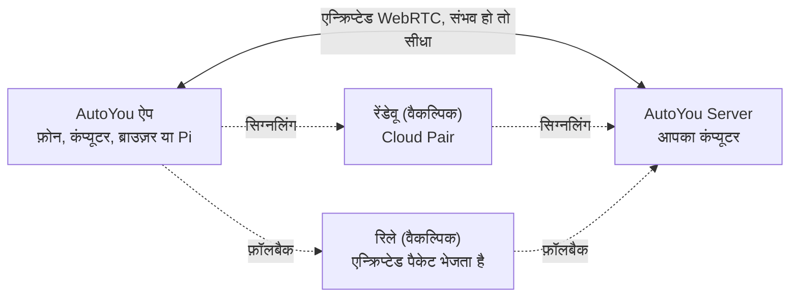

<div align="center">

[English](../../README.md) · [简体中文](README_zh.md) · [繁體中文](README_zh-TW.md) · [日本語](README_ja.md) · [한국어](README_ko.md) · **हिन्दी** · [Español](README_es.md) · [Français](README_fr.md) · [Deutsch](README_de.md) · [Português (Brasil)](README_pt-BR.md) · [Русский](README_ru.md) · [العربية](README_ar.md)


# AutoYou Server

### आपका अपना AI सर्वर, उसी कंप्यूटर पर जो आपके पास पहले से है।

**आप उत्पाद नहीं हैं। आप मालिक हैं।**

[](https://github.com/autoyou-ai/AutoYou-Server/actions/workflows/public-checks.yml)
[](https://github.com/autoyou-ai/AutoYou-Server/releases)
[](../../requirements/README.md)
[](../../servers/README.md)
[](../../autoyou_agents/README.md)
[](../../LICENSE)

**[वेबसाइट](https://www.autoyou.me/) · [ऐप्स](https://www.autoyou.me/downloads/) · [इकोसिस्टम](https://www.autoyou.me/ecosystem/) · [कम्युनिटी](https://www.autoyou.me/community/)**

[क्विक स्टार्ट](#quick-start) · [यह कैसे काम करता है](#how-autoyou-works) · [आप क्या कर सकते हैं](#what-you-can-do) · [एजेंट](#agents) · [पेयरिंग](#pairing-modes) · [सुरक्षा](#security-modes-and-tiers) · [क्लाइंट](#supported-clients) · [FAQ](#faq) · [दस्तावेज़](#documentation)

<code>./run_autoyou.sh</code>

</div>

> [!IMPORTANT]
> AutoYou Server को [autoyou-ai/AutoYou-Server](https://github.com/autoyou-ai/AutoYou-Server) या [autoyou.me](https://www.autoyou.me/) से लें, और ऐप्स को [समर्थित क्लाइंट](#supported-clients) में दिए स्टोर लिंक से लें। मिलते-जुलते नाम वाला रिपॉज़िटरी या कॉपी किया गया README किसी डाउनलोड को आधिकारिक नहीं बनाता।

<div align="center">
<br />

<br /><br />
</div>

---

अपनी मेज़ पर रखे कंप्यूटर को अपने हर डिवाइस के लिए एक निजी AI सर्वर बना दीजिए। AutoYou Server आपके Windows, macOS या Linux कंप्यूटर पर AI मॉडल और एजेंट, वॉइस और वीडियो कॉल, रिमोट डेस्कटॉप, गेम और आपके अपने वेब ऐप चलाता है। आपका फ़ोन, दूसरे कंप्यूटर और ब्राउज़र, घर पर हों या बाहर, एन्क्रिप्टेड पीयर-टू-पीयर कनेक्शन से इससे जुड़ते हैं।

आपकी बातचीत, फ़ाइलें और एजेंट की गतिविधि उसी कंप्यूटर पर रहती हैं, किसी होस्टेड AutoYou सेवा में नहीं। Ollama से लोकल मॉडल चलाएँ तो चैट के लिए टोकन का बिल नहीं आता, या अपनी पसंद का क्लाउड प्रोवाइडर जोड़ें। एक बार डिवाइस पेयर करें और सर्वर की हर सुविधा आपकी जेब में: चैट, हैंड्स-फ़्री असिस्टेंट, कई भाषाओं में लाइव आवाज़, आपका डेस्कटॉप, आपके गेम और कोई भी वेब सेवा जो आप पहले से चला रहे हैं।

> **पहली बार?** लॉन्चर चलाएँ, **http://127.0.0.1:8001/** खोलें, और सेटअप गाइड आपको AI चुनने, ज़रूरी सुविधाएँ चालू करने और पहला डिवाइस पेयर करने में मदद करेगी।

<a id="quick-start"></a>

## क्विक स्टार्ट

आपको Git और Python 3.11 या नया चाहिए। कुछ वैकल्पिक सुविधाओं के लिए नया Python या कोई खास प्लेटफ़ॉर्म चाहिए; [डिपेंडेंसी प्रोफ़ाइल](../../requirements/README.md) देखें।

### 1. सर्वर लें

```bash
git clone https://github.com/autoyou-ai/AutoYou-Server.git
cd AutoYou-Server
```

### 2. लॉन्चर चलाएँ

Windows:

```powershell
.\run_autoyou.bat --profile base
# Or select the Full profile with LAN access:
.\run_autoyou.bat --profile full --host 0.0.0.0
```

macOS या Linux:

```bash
./run_autoyou.sh --profile base
# Or select the Full profile with LAN access:
./run_autoyou.sh --profile full --host 0.0.0.0
```

लॉन्चर एक Python एनवायरनमेंट बनाता है, पैकेज इंडेक्स से डिपेंडेंसी इंस्टॉल करता है, और मॉडल व नेटिव टूल डाउनलोड कर सकता है। पहले स्क्रिप्ट पढ़ें और उन्हें ऐसे एनवायरनमेंट में चलाएँ जिसे आप सुरक्षित रूप से बदल सकें।

### 3. कंसोल खोलें और डिवाइस पेयर करें

**http://127.0.0.1:8001/** पर जाएँ, एक अनोखा सर्वर पासवर्ड चुनें और सेटअप का पालन करें। यह पूछता है कि आप AutoYou से क्या करना चाहते हैं (चैट, हैंड्स-फ़्री असिस्टेंट, कॉल, गेम, कोडिंग और भी बहुत कुछ), उसके हिसाब से एजेंट इंस्टॉल करता है और फ़ोन पेयर करने के लिए QR कोड दिखाता है।

बिना निगरानी वाले सेटअप के लिए `AUTOYOU_SERVER_PASSWORD` को एनवायरनमेंट या सीक्रेट मैनेजर से दें। असली पासवर्ड को साझा कमांड, issue या स्क्रीनशॉट में न डालें।

| प्रोफ़ाइल | क्या जोड़ता है |
| --- | --- |
| `base` | कोर सर्वर, लोकल एडमिनिस्ट्रेशन, डिवाइस कनेक्शन और क्लाउड-प्रोवाइडर इंटीग्रेशन |
| `local` | लोकल-मॉडल हेल्पर और डिवाइस पर इंटेंट रूटिंग |
| `recommended` | मैसेजिंग और Bluetooth इंटीग्रेशन डिपेंडेंसी (`--profile` न देने पर डिफ़ॉल्ट) |
| `full` | स्पीच, ब्राउज़र और डेस्कटॉप-ऑटोमेशन डिपेंडेंसी |

अपडेट करने के लिए रिपॉज़िटरी में `git pull` चलाएँ और फिर लॉन्चर दोबारा चलाएँ। रिलीज़ नोट्स [docs/releases/](../releases/) में हैं।

<a id="how-autoyou-works"></a>

## यह कैसे काम करता है

**सर्वर आपका अपना कंप्यूटर है, और डिवाइस सीधे उससे बात करते हैं।** ऐप और सर्वर WebRTC से जुड़ते हैं। एक छोटे पेयरिंग हैंडशेक के बाद वे एक एन्क्रिप्टेड लिंक (DTLS, मीडिया के लिए SRTP) खोलते हैं, जो चैट, आवाज़, वीडियो, स्क्रीन शेयरिंग, गेम इनपुट और प्रॉक्सी वेब ट्रैफ़िक ले जाता है। ज़्यादातर घरेलू और मोबाइल नेटवर्क पर राउटर का पोर्ट खोले बिना यह लिंक बन जाता है। नेटवर्क बहुत सख़्त हो तो कनेक्शन एक रिले पर चला जाता है, जो वही एन्क्रिप्टेड पैकेट आगे भेजता है।



सर्वर पर, डिवाइस पर चलने वाला इंटेंट राउटर हर अनुरोध को सही एजेंट या टूल तक भेजता है। Google ADK नेटिव एजेंट चलाता है; OpenClaw, Hermes Agent और Odysseus को भी जोड़ा जा सकता है। LiteLLM मॉडल कॉल को आपके कंप्यूटर के Ollama या आपके चुने क्लाउड प्रोवाइडर तक भेजता है। आवाज़ की पहचान और बोलना दोनों लोकल होते हैं, और मेमोरी SQLite में रहती है।

<a id="what-you-can-do"></a>

## आप क्या कर सकते हैं

| सुविधा | आपको क्या मिलता है |
| --- | --- |
| **AI चैट** | किसी भी पेयर किए डिवाइस से अपने AI से चैट; AutoYou मैसेज की कोई सीमा नहीं लगाता |
| **रियलटाइम आवाज़** | AI से लाइव कॉल, लोकल स्पीच रिकग्निशन, 30+ भाषाओं में बोले गए जवाब |
| **असिस्टेंट मोड** | फ़ोन, कंप्यूटर, Raspberry Pi या ब्राउज़र पर "Hey Jarvis" जैसा वेक वर्ड |
| **रिमोट डेस्कटॉप** | फ़ोन से कंप्यूटर देखें और चलाएँ, Windows लॉक स्क्रीन समेत |
| **कंप्यूटर वीडियो** | कंप्यूटर की स्क्रीन, कैमरा, वीडियो फ़ाइल या API फ़्रेम को कॉल में भेजें |
| **गेम मोड और Game Studio** | कंप्यूटर के गेम फ़ोन पर स्ट्रीम करें, या फ़ोन पर ऑफ़लाइन चलने वाले गेम बनाएँ |
| **वेब ऐप फ़ैक्टरी** | एजेंट से वेब ऐप बनवाएँ और हर पेयर किए डिवाइस पर खोलें |
| **कोई भी लोकल पोर्ट होस्ट करें** | `localhost:3000` जैसी किसी भी वेब सेवा को पेयर किए डिवाइस से साझा करें |
| **एजेंट** | नोट्स, फ़ाइलें, कोडिंग, मीडिया, ब्राउज़िंग, ट्रेनिंग आदि के लिए 45 बिल्ट-इन एजेंट |
| **MCP** | ChatGPT, Codex, Claude, Antigravity, Cursor और VS Code से AutoYou टूल इस्तेमाल करें |

सुविधाएँ चुनी गई प्रोफ़ाइल, हार्डवेयर, अनुमतियों और कॉन्फ़िगर किए इंटीग्रेशन पर निर्भर करती हैं। डेस्कटॉप कंट्रोल, गेम मोड, रिकॉर्डिंग और फ़ाइल एक्सेस जैसी ताक़तवर सुविधाएँ तब तक बंद रहती हैं जब तक आप उन्हें चालू न करें।

### AI चैट

कंसोल के **AI** में प्रोवाइडर चुनें: डिफ़ॉल्ट **Ollama + Agents** (लोकल मॉडल, API key की ज़रूरत नहीं), सपोर्टेड Mac पर **Apple Intelligence**, **Gemini**, **OpenRouter**, या LiteLLM के ज़रिए Anthropic, OpenAI, Mistral, DeepSeek, xAI आदि, AutoYou के सभी एजेंट और टूल के साथ। **OpenClaw**, **Hermes Agent** या **Odysseus** को मुख्य सेशन रनटाइम भी बना सकते हैं।

AutoYou यह सीमा नहीं लगाता कि आप कितने मैसेज भेजें। लोकल मॉडल के साथ हर मैसेज मुफ़्त है और इंटरनेट के बिना भी काम करता है। आपका जोड़ा क्लाउड प्रोवाइडर अपने प्लान के अनुसार बिल करता है और आपके भेजे प्रॉम्प्ट देखता है। बिल्ट-इन मॉडल लाइब्रेरी से लोकल मॉडल देख, डाउनलोड और बदल सकते हैं, और Model Picker एजेंट आपके हार्डवेयर के लिए सही मॉडल सुझाता है।

### कई भाषाओं में रियलटाइम आवाज़

अपने AI को कॉल करें और बात करें। स्पीच रिकग्निशन आपके कंप्यूटर पर चलता है (डिफ़ॉल्ट बिल्ड में whisper.cpp, फ़ुल वॉइस बिल्ड में faster-whisper), वॉइस एक्टिविटी डिटेक्शन के साथ; आप बोलना शुरू करें तो जवाब रुक जाता है, और लंबे विचारों के लिए **"मेरी बात पूरी होने तक रुको"** होल्ड है।

- **अपनी भाषा में बोलें।** **STT language** को `auto` रखें और मल्टीलिंगुअल मॉडल चुनें; यह आपकी बोली गई भाषा पहचान लेता है।
- **उसी भाषा में जवाब सुनें।** डिफ़ॉल्ट **Auto TTS** जवाब की भाषा पहचानकर मेल खाती सिस्टम आवाज़ चुनता है। लोकल Supertonic 3 मॉडल हिंदी समेत 31 भाषाएँ बोलता है और लगभग 401 MB के एक बार के डाउनलोड के बाद ऑफ़लाइन चलता है।
- **अपनी आवाज़ चुनें।** सिस्टम आवाज़ें, 10 Supertonic प्रीसेट, Voice Training में ट्रेन की गई अपनी आवाज़, चीनी और अंग्रेज़ी के लिए EmotiVoice, या होस्टेड OpenAI और Azure स्पीच।

टेक्स्ट-टू-स्पीच वही जवाब बोलता है जो उसे मिलता है; वह अनुवाद नहीं करता। आपका चैट मॉडल भी बातचीत की भाषा समझना चाहिए।

### असिस्टेंट मोड

अपने सर्वर को "Hey Jarvis" जैसा वेक वर्ड दें। पेयर किए फ़ोन, कंप्यूटर, Raspberry Pi, Chrome एक्सटेंशन या एडमिन पेज के पास इसे बोलें, और उसके बाद आप जो कहेंगे वह AutoYou तक जाएगा। वेक वर्ड सुनाई देने तक आपकी कोई बात न लिखी जाती है, न AI को भेजी जाती है। शब्द तीन बार रिकॉर्ड करें, सर्वर पर कुछ सेकंड में ट्रेन करें, टेस्ट करें और चालू करें। वीडियो कॉल में, वेक वर्ड के बाद का अनुरोध कैमरे की ताज़ा तस्वीर भी साथ ले जा सकता है। [असिस्टेंट मोड](../admin-ui/assistant-mode.mdx) देखें।

### रिमोट डेस्कटॉप

पेयर किए फ़ोन या डेस्कटॉप ऐप से अपना कंप्यूटर देखें और चलाएँ: कोई मॉनिटर या एक ऐप विंडो चुनें, माउस चलाएँ, टाइप करें और मॉडिफ़ायर कीज़ इस्तेमाल करें। डिवाइस सपोर्ट करे तो H.264 को प्राथमिकता मिलती है। Windows पर वैकल्पिक **AutoYou Secure Desktop Helper** सेवा पेयर किए मालिक को लॉक स्क्रीन और UAC प्रॉम्प्ट देखने और चलाने देती है, और कनेक्शन के दौरान सर्वर कंप्यूटर को जगाए रख सकता है। स्क्रीन कैप्चर और इनपुट अलग-अलग अनुमतियाँ हैं, दोनों डिफ़ॉल्ट रूप से बंद; Peer Link पर रिमोट डेस्कटॉप कभी नहीं मिलता।

### कंप्यूटर वीडियो

कॉल में कंप्यूटर चार स्रोतों से वीडियो भेज सकता है: अपनी **स्क्रीन**, **कैमरा**, आपकी अपलोड की गई **वीडियो फ़ाइल**, या आपके अपने प्रोग्राम से आने वाले **API फ़्रेम**। कंप्यूटर का माइक्रोफ़ोन और आवाज़ भी साझा की जा सकती है। कंसोल का **Interact** जुड़े डिवाइस के कैमरे की लाइव तस्वीरें दिखाता है और उनके माइक्रोफ़ोन को कंप्यूटर के स्पीकर पर बजा सकता है, बिना AI प्रोसेसिंग और बिना रिकॉर्डिंग।

### गेम मोड और Game Studio

- **गेम मोड** आपके कंप्यूटर पर रेंडर हुए गेम को पेयर किए डिवाइस पर स्ट्रीम करता है, और डिवाइस का टच, मोशन सेंसर, कंट्रोलर, माउस और कीबोर्ड गेम इनपुट के रूप में वापस आते हैं। आप चार तक लेबल वाले वर्चुअल बटन बना सकते हैं। गेम मोड एक अलग अनुमति है और यह स्क्रीन भेजना और रिमोट डेस्कटॉप इनपुट भी चालू करता है।
- **अपना इंजन लाएँ।** लोकल गेम इंजन लूपबैक WebSocket से `autoyou_game_v1` प्रोटोकॉल के प्रमाणित इनपुट फ़्रेम पढ़ सकता है। Unreal के लिए सर्वर `/api/game/unreal-plugin` पर सोर्स प्लगइन देता है।
- **फ़ोन के लिए ऑफ़लाइन गेम।** Game Studio एजेंट पोर्टेबल वेब या WASM गेम बनाने में मदद करता है, उन्हें 5 GiB तक की `.aygame` फ़ाइल में पैक करता है और WebRTC या मंज़ूर Peer Link से क्लाइंट तक भेजता है। हर गेम का अपना ऑन-डिवाइस SQLite डेटाबेस होता है, और सेव प्रोग्रेस अपडेट के बाद भी बनी रहती है।

बिल्ट-इन डेमो **Neon Horizon** फ़ोन डाउनलोड, Game Studio पेज या कंप्यूटर से स्ट्रीम करके खेला जा सकता है।

### वेब ऐप फ़ैक्टरी

ऐप का वर्णन करें और एजेंट उसे बना देंगे। **Website** एजेंट किसी एजेंट के लिए ब्राउज़र फ़्रंटएंड बनाता है: एक सरल स्टार्टर, या आपके कहने पर React या Angular, और बैकएंड Python/FastAPI, Node/TypeScript, Go या Rust। **Agent Builder** नए एजेंट का ढाँचा बनाता है, और **Coding** व **Pi** एजेंट कोड लिखते और टेस्ट करते हैं। हर ऐप लोकल वेबसाइट सेवा में रजिस्टर होता है और आपके पेयर किए डिवाइस के ब्राउज़र में दिखता है। **Hosting** एजेंट पब्लिक लिंक पर प्रकाशित करने के तरीके बताता है: मुफ़्त अस्थायी `/pair` टनल या पेड स्थायी URL।

### कोई भी लोकल पोर्ट होस्ट करें

पहले से कुछ चल रहा है? उसे साझा करें। **Websites & Browser > Advertised Websites** में 1 से 65535 तक का कोई भी पोर्ट, एक लेबल और वैकल्पिक फ़ॉरवर्ड URL (जैसे `http://127.0.0.1:3000` या आपके नेटवर्क का कोई दूसरा होस्ट) के साथ जोड़ें। पेयर किए क्लाइंट उसे खोज लेते हैं और अपनी तरफ़ उसी पोर्ट पर खोलते हैं, इसलिए डैशबोर्ड, डेव सर्वर, होम-लैब टूल और वे ऐप भी चलते रहते हैं जो सब-पाथ के लिए नहीं बने। ट्रैफ़िक एन्क्रिप्टेड पीयर लिंक के अंदर चलता है, इसलिए राउटर पर पोर्ट खोलने की ज़रूरत नहीं। पेयर किए ब्राउज़र को `viewer`, `editor` या `admin` भूमिका मिलती है, जो तय करती है कि वे क्या बदल सकते हैं।

<a id="agents"></a>

## एजेंट

AutoYou में 45 बिल्ट-इन एजेंट हैं। मुख्य एजेंट हर अनुरोध को सही विशेषज्ञ तक भेजता है, और कई विशेषज्ञ आपके पेयर किए डिवाइस पर अपना वेब पेज भी देते हैं। opt-in वाले एजेंट तब तक इंस्टॉल नहीं होते जब तक आप उन्हें कंसोल के **Agents** में इंस्टॉल न करें।

| क्षेत्र | एजेंट |
| --- | --- |
| रोज़मर्रा | Notes, Tasks, Notify, Memory, Persona, Page, Prompts, Location (opt-in) |
| वेब और ऑटोमेशन | Internet, Assistant, Browser (opt-in), Client Browser Control, Proxy (opt-in) |
| मीडिया और क्रिएटिव | Audio, TV, Media Generation (opt-in), Game Studio |
| कोडिंग और निर्माण | Coding, Pi, Agent Builder, Website, Skills, Files, CLI, Claude CLI, Claude Desktop, Codex Desktop, Antigravity, Prompt Builder (सभी opt-in) |
| इंटेलिजेंस और मॉडल | Model Picker, OpenClaw, Hermes Agent (सभी opt-in) |
| ट्रेनिंग | Data Collector, Fine-Tuning, Voice Training (सभी opt-in) |
| सिस्टम और कंप्यूटर | Admin, Remote Desktop, Backup, Hosting (opt-in), Windows Security (opt-in), macOS Security (opt-in), Education (opt-in) |
| AutoYou को समर्थन | Support Ads, Earnings, Donation |

अपना एजेंट जोड़ने के लिए पैकेज को `autoyou_agents/` में कॉपी करें। पूरी जानकारी [एजेंट कैटलॉग](../../autoyou_agents/README.md) में है।

<a id="pairing-modes"></a>

## पेयरिंग के तरीके

| तरीका | कैसे जुड़ता है | आम उपयोग |
| --- | --- | --- |
| **Local Pair** | सीधे आपके LAN पर; सिग्नलिंग आपका अपना सर्वर करता है | एक ही Wi-Fi या ऑफ़िस नेटवर्क |
| **Bluetooth Pair** | कनेक्शन की जानकारी Bluetooth Low Energy से दी जाती है | पास के फ़ोन का पहला सेटअप |
| **Live Pair** | फ़ोन और कंप्यूटर एक-दूसरे को एनिमेटेड QR कोड दिखाते हैं, नेटवर्क की ज़रूरत नहीं | अलग-थलग या सख़्त नेटवर्क |
| **वन-टाइम कोड** | मैसेजिंग चैट में `/pair` भेजने पर थोड़ी देर का कोड और लिंक मिलता है | मेहमान डिवाइस और अविश्वसनीय नेटवर्क |
| **Auto Pair** | एन्क्रिप्टेड पेयरिंग मैसेज आपके सेट किए Telegram, Signal या WhatsApp चैट से जाता है | बिना क्लाउड अकाउंट के दूर से पेयरिंग |
| **Cloud Pair** | वैकल्पिक, पेड AutoYou Cloud रेंडेवू NAT के पार आपका कंप्यूटर ढूँढता है, रिले फ़ॉलबैक के साथ | घर से बाहर या सख़्त नेटवर्क पर |

**Peer Link** दो AutoYou ऐप को जोड़ता है; पाने वाला ऐप हर लिंक मंज़ूर करता है और यह कंप्यूटर का पासवर्ड कभी इस्तेमाल नहीं करता। **Lobbies** समूह कमरे हैं जिन्हें ऐप पास में Wi-Fi और Bluetooth पर होस्ट और जॉइन करते हैं। [पेयरिंग प्रोटोकॉल](../technical/pairing-protocols.md) देखें।

<a id="security-modes-and-tiers"></a>

## सुरक्षा मोड और सुरक्षा टियर

पूरे सर्वर पर एक ही सुरक्षा मोड लागू होता है। नई इंस्टॉलेशन **Secure** से शुरू होती है।

| मोड | पेयरिंग मैसेज | पेयर करने के लिए क्या चाहिए | इस कंप्यूटर का डेटा |
| --- | --- | --- | --- |
| **Normal** | एन्क्रिप्ट नहीं | वन-टाइम कोड | बदलाव नहीं |
| **Secure** | सर्वर पासवर्ड से एन्क्रिप्ट | सर्वर पासवर्ड | बदलाव नहीं |
| **Secure Professional** | सर्वर पासवर्ड से एन्क्रिप्ट | पासवर्ड और मौजूदा ऑथेंटिकेटर कोड | बदलाव नहीं |
| **Secure Professional Maximus** | Secure Professional जैसा | पासवर्ड और मौजूदा ऑथेंटिकेटर कोड | सेशन, एजेंट डेटा, वेबसाइटें, नोट्स और सेटिंग्स स्टोरेज में एन्क्रिप्ट |

Secure मोड में पेयरिंग मैसेज पासवर्ड-ऑथेंटिकेटेड की एक्सचेंज (ristretto255 और libsodium पर CPace परिवार की संरचना) से बनी कुंजी से एन्क्रिप्ट होते हैं। उन्हें ले जाने वाला रिले या मैसेजिंग ब्रिज उन्हें पढ़ नहीं सकता, और रिकॉर्ड किए गए एक्सचेंज से ऑफ़लाइन पासवर्ड का अंदाज़ा नहीं लगाया जा सकता।

**पेयरिंग सुरक्षा टियर** तय करता है कि चैट-मैसेज पेयरिंग में कितने कदम लगें: **Quick Pairing (B)** एक ही मैसेज से पेयर करने देता है और सबसे ज़्यादा कम्पैटिबल है; **Enhanced Pairing (A)** हर क्लाइंट से पहले एक अतिरिक्त hello राउंड ट्रिप माँगता है, जिससे अंदाज़ा लगाना कठिन होता है। Local Pair, Bluetooth Pair और Cloud Pair हमेशा एन्हांस्ड फ़्लो इस्तेमाल करते हैं।

पेयर किए डिवाइस के ब्राउज़र को `viewer`, `editor` या `admin` भूमिका मिलती है। क्रेडेंशियल और सुरक्षा सेटिंग्स सिर्फ़ उसी कंप्यूटर से, या एडमिन पोर्ट पर सीधे खोले गए HTTPS एडमिन सेशन से बदली जा सकती हैं। एन्क्रिप्शन कनेक्शन की सुरक्षा करता है, डिवाइस, एजेंट की अनुमतियों या तीसरे पक्ष की सेवाओं की नहीं। [सुरक्षा मोड](../security/security-modes.md) और [SECURITY.md](../../SECURITY.md) देखें।

<a id="supported-clients"></a>

## समर्थित क्लाइंट

AutoYou Server आपके कंप्यूटर पर चलता है; ऐप बाकी हर जगह से उस तक पहुँचते हैं। क्लाइंट ऐप अलग से वितरित होते हैं और उनका सोर्स इस रिपॉज़िटरी में नहीं है।

| प्लेटफ़ॉर्म | कहाँ से लें |
| --- | --- |
| iPhone और iPad | [App Store](https://apps.apple.com/us/app/autoyou/id6760363728) |
| Android | [Google Play](https://play.google.com/store/apps/details?id=com.autoyou.app) |
| Windows | [Microsoft Store](https://apps.microsoft.com/detail/9mw8l2wfw7wv?hl=en-US&gl=US) |
| macOS और Linux | [डाउनलोड](https://www.autoyou.me/downloads/) |
| ब्राउज़र | Chrome एक्सटेंशन और वेब क्लाइंट ([इकोसिस्टम पेज](https://www.autoyou.me/ecosystem/)) |
| Raspberry Pi | असिस्टेंट मोड के लिए Python वॉइस क्लाइंट ([सेटअप](../admin-ui/assistant-mode.mdx)) |

फ़ोन ऐप में एक छोटा लोकल AI भी है (डिवाइस के अनुसार LFM 2.5 350M, Gemini Nano या Apple Intelligence), ताकि कंप्यूटर न हो तब भी चैट हो सके।

<a id="mcp"></a>

## अपने कोडिंग एजेंट से AutoYou इस्तेमाल करें

लोकल MCP एडैप्टर समर्थित AutoYou टूल को ChatGPT, Codex, Claude Code, Claude Desktop, Google Antigravity, Cursor और VS Code से जोड़ता है। **Admin UI > Messaging > AutoYou MCP** में MCP चालू करें, `autoyou-mcp.env` डाउनलोड करें, और हर क्लाइंट के लिए [अंग्रेज़ी README के चरण](../../README.md#use-autoyou-from-your-coding-agent) अपनाएँ।

<a id="faq"></a>

## FAQ

<details>
<summary><strong>क्या क्लाउड अकाउंट या VPN चाहिए?</strong></summary>

नहीं। Local Pair, Bluetooth Pair, Live Pair, वन-टाइम कोड और Auto Pair बिना AutoYou अकाउंट के चलते हैं। Cloud Pair एक वैकल्पिक पेड सहायक है। अगर आप पहले से Tailscale जैसा VPN इस्तेमाल करते हैं, तो AutoYou उस पर भी चलता है।

</details>

<details>
<summary><strong>क्या AI चैट सच में अनलिमिटेड है?</strong></summary>

AutoYou मैसेज की कोई सीमा नहीं लगाता। लोकल Ollama मॉडल के साथ हर मैसेज मुफ़्त है, और रफ़्तार आपके कंप्यूटर पर निर्भर करती है। आपके जोड़े क्लाउड प्रोवाइडर की अपनी क़ीमत और सीमाएँ होती हैं।

</details>

<details>
<summary><strong>क्या AutoYou मेरी फ़ाइलें या बातचीत अपलोड करता है?</strong></summary>

वे आपके कंप्यूटर पर रहती हैं। डेटा सिर्फ़ उन सेवाओं से बाहर जाता है जिन्हें आप चालू करते हैं, जैसे क्लाउड मॉडल प्रोवाइडर, मैसेजिंग ब्रिज या पब्लिक टनल, और हर सेवा की अपनी शर्तें हैं।

</details>

<a id="documentation"></a>

## दस्तावेज़

- [क्विक स्टार्ट](../quickstart.mdx) · [आर्किटेक्चर](../architecture/) · [सुरक्षा और निजता](../security/) · [एडमिन कंसोल](../admin-ui/)
- [एजेंट कैटलॉग](../../autoyou_agents/README.md) · [एजेंट रेफ़रेंस](../agents/) · [एजेंट फ़्रेमवर्क](../agent-framework/)
- [HTTP और WebSocket API](../api-reference/) · [गाइड](../guides/) · [पेयरिंग गाइड](../../guides/README.md)

## योगदान

AutoYou में आपका स्वागत है: एजेंट, गेम, एक्सटेंशन या इंटीग्रेशन बनाइए, सेटअप, एक्सेसिबिलिटी, प्लेटफ़ॉर्म सपोर्ट, अनुवाद या दस्तावेज़ सुधारिए, या डेमो और गाइड साझा कीजिए। सबमिट करने से पहले [CONTRIBUTING.md](../../CONTRIBUTING.md) और [आचार संहिता](../../CODE_OF_CONDUCT.md) पढ़ें।

## लाइसेंस

AutoYou Server [सर्वर लाइसेंस](../../LICENSE) के तहत source-available है। यह अभी OSI-स्वीकृत ओपन-सोर्स प्रोजेक्ट नहीं है, और `LICENSE` की परिभाषाएँ लागू होती हैं। व्यक्तिगत उपयोग, लोकल बिल्ड और मुफ़्त साझा करना लाइसेंस की शर्तों के तहत अनुमत है; संस्थागत या व्यावसायिक उपयोग के लिए अलग [एंटरप्राइज़ समझौता](https://www.autoyou.me/enterprise/) चाहिए। विवरण के लिए [अंग्रेज़ी README](../../README.md#license) और [THIRD-PARTY-NOTICES.md](../../THIRD-PARTY-NOTICES.md) देखें।

Copyright &copy; 2026 OpenStorey LLC and contributors.
