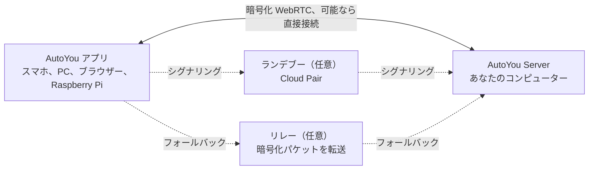

<div align="center">

[English](../../README.md) · [简体中文](README_zh.md) · [繁體中文](README_zh-TW.md) · **日本語** · [한국어](README_ko.md) · [हिन्दी](README_hi.md) · [Español](README_es.md) · [Français](README_fr.md) · [Deutsch](README_de.md) · [Português (Brasil)](README_pt-BR.md) · [Русский](README_ru.md) · [العربية](README_ar.md)


# AutoYou Server

### いま持っているコンピューターで、自分だけの AI サーバーを。

**あなたは製品ではありません。所有者です。**

[](https://github.com/autoyou-ai/AutoYou-Server/actions/workflows/public-checks.yml)
[](https://github.com/autoyou-ai/AutoYou-Server/releases)
[](../../requirements/README.md)
[](../../servers/README.md)
[](../../autoyou_agents/README.md)
[](../../LICENSE)

**[ウェブサイト](https://www.autoyou.me/) · [アプリ](https://www.autoyou.me/downloads/) · [エコシステム](https://www.autoyou.me/ecosystem/) · [コミュニティ](https://www.autoyou.me/community/)**

[クイックスタート](#quick-start) · [仕組み](#how-autoyou-works) · [できること](#what-you-can-do) · [エージェント](#agents) · [ペアリング](#pairing-modes) · [セキュリティ](#security-modes-and-tiers) · [クライアント](#supported-clients) · [FAQ](#faq) · [ドキュメント](#documentation)

<code>./run_autoyou.sh</code>

</div>

> [!IMPORTANT]
> AutoYou Server は [autoyou-ai/AutoYou-Server](https://github.com/autoyou-ai/AutoYou-Server) または [autoyou.me](https://www.autoyou.me/) から入手し、アプリは[対応クライアント](#supported-clients)のストアリンクから入手してください。似た名前のリポジトリやコピーされた README は、公式のダウンロードである証明にはなりません。

<div align="center">
<br />

<br /><br />
</div>

---

机の上のコンピューターを、あなたのすべてのデバイスのためのプライベート AI サーバーに。AutoYou Server は、AI モデルとエージェント、音声・ビデオ通話、リモートデスクトップ、ゲーム、そしてあなた自身の Web アプリを Windows、macOS、Linux 上で動かします。スマートフォンや他のコンピューター、ブラウザーは、自宅でも外出先でも暗号化されたピアツーピア接続でアクセスします。

会話、ファイル、エージェントの活動はホスト型の AutoYou サービスではなく、そのコンピューターに保存されます。Ollama でローカルモデルを動かせばトークン料金なしでチャットでき、好みのクラウドプロバイダーにもつなげられます。一度ペアリングすれば、チャット、ハンズフリーのアシスタント、多言語のリアルタイム音声、デスクトップ、ゲーム、すでに動かしている Web サービスまで、すべてがポケットの中に入ります。

> **はじめての方へ** ランチャーを実行して **http://127.0.0.1:8001/** を開くと、セットアップガイドが AI の選択、使いたい機能の有効化、最初のデバイスのペアリングまで案内します。

<a id="quick-start"></a>

## クイックスタート

Git と Python 3.11 以降が必要です。一部のオプション機能は新しい Python や特定のプラットフォームを必要とします。[依存関係プロファイル](../../requirements/README.md)を参照してください。

### 1. サーバーを取得する

```bash
git clone https://github.com/autoyou-ai/AutoYou-Server.git
cd AutoYou-Server
```

### 2. ランチャーを実行する

Windows:

```powershell
.\run_autoyou.bat --profile base
# Or select the Full profile with LAN access:
.\run_autoyou.bat --profile full --host 0.0.0.0
```

macOS または Linux:

```bash
./run_autoyou.sh --profile base
# Or select the Full profile with LAN access:
./run_autoyou.sh --profile full --host 0.0.0.0
```

ランチャーは Python 環境を作成し、パッケージインデックスから依存関係をインストールし、モデルやネイティブツールをダウンロードする場合があります。先にスクリプトを読み、安全に変更できる環境で実行してください。

### 3. コンソールを開いてデバイスをペアリングする

**http://127.0.0.1:8001/** を開き、固有のサーバーパスワードを決めて、セットアップに従います。AutoYou を何に使いたいか（チャット、ハンズフリーアシスタント、通話、ゲーム、コーディングなど）を尋ね、対応するエージェントをインストールし、スマートフォン用のペアリング QR コードを表示します。

無人セットアップでは、環境変数またはシークレットマネージャーで `AUTOYOU_SERVER_PASSWORD` を指定します。実際のパスワードを共有コマンド、issue、スクリーンショットに含めないでください。

| プロファイル | 追加されるもの |
| --- | --- |
| `base` | コアサーバー、ローカル管理、デバイス接続、クラウドプロバイダー連携 |
| `local` | ローカルモデル用ヘルパーとデバイス上のインテントルーティング |
| `recommended` | メッセージングと Bluetooth 連携の依存関係（`--profile` 省略時の既定） |
| `full` | 音声、ブラウザー、デスクトップ自動化の依存関係 |

更新するには、リポジトリで `git pull` を実行してからランチャーを再実行します。リリースノートは [docs/releases/](../releases/) にあります。

<a id="how-autoyou-works"></a>

## 仕組み

**サーバーはあなた自身のコンピューターで、デバイスはそこへ直接話しかけます。** アプリとサーバーは WebRTC で接続します。短いペアリングハンドシェイクのあと暗号化リンク（DTLS、メディアは SRTP）を開き、チャット、音声、ビデオ、画面共有、ゲーム入力、プロキシされた Web トラフィックを運びます。多くの家庭用・モバイル回線ではルーターのポートを開けずに接続できます。ネットワークが厳しすぎる場合は、同じ暗号化パケットを転送するリレーにフォールバックします。



サーバー上では、デバイス内のインテントルーターが各リクエストを適切なエージェントやツールに送ります。Google ADK がネイティブエージェントを実行し、OpenClaw、Hermes Agent、Odysseus をブリッジすることもできます。LiteLLM はモデル呼び出しをローカルの Ollama か、選んだクラウドプロバイダーへ送ります。音声認識も読み上げもローカルで行い、記憶は SQLite に保存されます。

<a id="what-you-can-do"></a>

## できること

| 機能 | 得られるもの |
| --- | --- |
| **AI チャット** | ペアリング済みのどのデバイスからでも自分の AI とチャット。AutoYou はメッセージ数を制限しません |
| **リアルタイム音声** | AI とのライブ通話、ローカル音声認識、30 以上の言語での音声応答 |
| **アシスタントモード** | スマホ、PC、Raspberry Pi、ブラウザーで「Hey Jarvis」のようなウェイクワード |
| **リモートデスクトップ** | スマホからコンピューターを表示・操作。Windows のロック画面にも対応 |
| **コンピュータービデオ** | 画面、カメラ、動画ファイル、API から送るフレームを通話に流す |
| **ゲームモードと Game Studio** | PC のゲームをスマホへストリーミング、またはスマホで動くオフラインゲームを作成 |
| **Web アプリファクトリー** | エージェントに Web アプリを作らせ、すべてのペアリング済みデバイスで開く |
| **任意のローカルポートを公開** | `localhost:3000` などの Web サービスをペアリング済みデバイスと共有 |
| **エージェント** | メモ、ファイル、コーディング、メディア、ブラウジング、学習などの 45 の組み込みエージェント |
| **MCP** | ChatGPT、Codex、Claude、Antigravity、Cursor、VS Code から AutoYou のツールを利用 |

機能は選んだプロファイル、ハードウェア、権限、設定した連携によって異なります。デスクトップ操作、ゲームモード、録音、ファイルアクセスなどの強力な機能は、有効にするまでオフのままです。

### AI チャット

コンソールの **AI** でプロバイダーを選びます。既定の **Ollama + Agents**（ローカルモデル、API キー不要）、対応 Mac の **Apple Intelligence**、**Gemini**、**OpenRouter**、または LiteLLM 経由の Anthropic、OpenAI、Mistral、DeepSeek、xAI などで、AutoYou のエージェントとツールはそのまま使えます。**OpenClaw**、**Hermes Agent**、**Odysseus** をメインのセッションランタイムにすることもできます。

AutoYou は送信できるメッセージ数を制限しません。ローカルモデルならメッセージごとの費用はかからず、インターネットなしでも動きます。接続したクラウドプロバイダーは独自のプランで課金し、送ったプロンプトを受け取ります。組み込みのモデルライブラリでローカルモデルを閲覧・ダウンロード・切り替えでき、Model Picker エージェントがハードウェアに合うモデルを提案します。

### 多言語のリアルタイム音声

AI に電話して話しかけましょう。音声認識はあなたのコンピューター上で動き（既定ビルドは whisper.cpp、フル音声ビルドは faster-whisper）、音声区間検出、話し始めると応答を止める割り込み、長く考えるための「話し終わるまで待つ」ホールドに対応します。

- **自分の言語で話す。** **STT language** を `auto` にして多言語モデルを選ぶと、話した言語を自動で検出します。
- **同じ言語で返事を聞く。** 既定の **Auto TTS** は応答の言語を検出し、合うシステム音声を選びます。ローカルの Supertonic 3 モデルは 31 言語に対応し、約 401 MB の初回ダウンロード後はオフラインで動作します。
- **声を選ぶ。** システム音声、10 種類の Supertonic プリセット、Voice Training で学習したカスタム音声、中国語と英語の EmotiVoice、ホスト型の OpenAI と Azure の音声。

読み上げは受け取った応答をそのまま話し、翻訳はしません。選ぶチャットモデルも会話の言語に対応している必要があります。

### アシスタントモード

サーバーに「Hey Jarvis」のようなウェイクワードを設定します。ペアリング済みのスマホ、PC、Raspberry Pi、Chrome 拡張機能、管理ページの近くで言うと、続けて話した内容が AutoYou に届きます。ウェイクワードが聞こえるまで、話した内容は文字起こしも AI への送信もされません。3 回録音し、サーバーで数秒で学習し、テストしてから有効にします。ビデオ通話中は、ウェイクワード後のリクエストに最新のカメラ映像を添えられます。詳しくは[アシスタントモード](../admin-ui/assistant-mode.mdx)へ。

### リモートデスクトップ

ペアリング済みのスマホやデスクトップアプリからコンピューターを表示・操作できます。モニターや個別のアプリウィンドウを選び、マウスを動かし、文字を入力し、修飾キーを使えます。デバイスが対応していれば H.264 を優先します。Windows では、オプションの **AutoYou Secure Desktop Helper** サービスにより、ペアリングした所有者がロック画面や UAC プロンプトを表示・操作でき、接続中はコンピューターをスリープさせません。画面キャプチャと入力は別々の権限で、既定はオフです。Peer Link ではリモートデスクトップは提供されません。

### コンピュータービデオ

通話中、コンピューターは 4 種類のソースから映像を送れます。**画面**、**カメラ**、アップロードして再生する**動画ファイル**、自作プログラムが送る **API フレーム**です。コンピューターのマイクや音声も共有できます。コンソールの **Interact** では、接続中デバイスのライブカメラ映像を表示し、そのマイク音声をコンピューターのスピーカーで再生できます。AI 処理も録画もしません。

### ゲームモードと Game Studio

- **ゲームモード**は、コンピューターで描画したゲームをペアリング済みデバイスへストリーミングし、デバイスのタッチ、モーションセンサー、コントローラー、マウス、キーボードをゲーム入力として返します。ラベル付きの仮想ボタンを最大 4 つ定義できます。ゲームモードは独立した権限で、画面送信とリモートデスクトップ入力もオンにします。
- **自分のエンジンを使う。** ローカルのゲームエンジンは、ループバック WebSocket から認証済みの `autoyou_game_v1` 入力フレームを読み取れます。Unreal 用にはサーバーが `/api/game/unreal-plugin` でソースプラグインを提供します。
- **スマホ用オフラインゲーム。** Game Studio エージェントは、ポータブルな Web または WASM ゲームの作成を手伝い、最大 5 GiB の `.aygame` ファイルにまとめ、WebRTC または承認済みの Peer Link でクライアントへ送ります。各ゲームには専用のデバイス内 SQLite データベースがあり、セーブデータは更新後も残ります。

組み込みデモ **Neon Horizon** は、スマホへのダウンロード、Game Studio ページ、コンピューターからのストリーミングで遊べます。

### Web アプリファクトリー

アプリを説明すれば、エージェントが作ります。**Website** エージェントはエージェント用のブラウザーフロントエンドを作成します。シンプルなスターター、または依頼に応じて React や Angular、バックエンドは Python/FastAPI、Node/TypeScript、Go、Rust から選べます。**Agent Builder** は新しいエージェントの雛形を作り、**Coding** と **Pi** エージェントがコードを実装・テストします。どのアプリもローカル Web サービスに登録され、ペアリング済みデバイスのブラウザーに表示されます。**Hosting** エージェントは、無料の一時 `/pair` トンネルと有料の永続 URL による公開方法を説明します。

### 任意のローカルポートを公開

すでに動いているものがあれば、そのまま共有できます。**Websites & Browser > Advertised Websites** で 1〜65535 の任意のポートを、ラベルと任意の転送先 URL（`http://127.0.0.1:3000` や LAN 内の別ホストなど）とともに追加します。ペアリング済みクライアントはそれを見つけ、自分の側の同じポートで開くので、ダッシュボード、開発サーバー、ホームラボのツール、サブパスでの動作を想定していないアプリもそのまま動きます。通信は暗号化されたピアリンク内を通るため、ルーターのポートを開ける必要はありません。ペアリング済みブラウザーには `viewer`、`editor`、`admin` のロールが与えられ、変更できる範囲が制限されます。

<a id="agents"></a>

## エージェント

AutoYou には 45 の組み込みエージェントがあります。メインエージェントが各リクエストを適切な専門エージェントに振り分け、多くの専門エージェントはペアリング済みデバイスに独自の Web ページも提供します。opt-in と記されたエージェントは、コンソールの **Agents** でインストールするまで未インストールのままです。

| 分野 | エージェント |
| --- | --- |
| 日常 | Notes、Tasks、Notify、Memory、Persona、Page、Prompts、Location (opt-in) |
| Web と自動化 | Internet、Assistant、Browser (opt-in)、Client Browser Control、Proxy (opt-in) |
| メディアと制作 | Audio、TV、Media Generation (opt-in)、Game Studio |
| コーディングと構築 | Coding、Pi、Agent Builder、Website、Skills、Files、CLI、Claude CLI、Claude Desktop、Codex Desktop、Antigravity、Prompt Builder（すべて opt-in） |
| インテリジェンス | Model Picker、OpenClaw、Hermes Agent（すべて opt-in） |
| 学習 | Data Collector、Fine-Tuning、Voice Training（すべて opt-in） |
| システムとコンピューター | Admin、Remote Desktop、Backup、Hosting (opt-in)、Windows Security (opt-in)、macOS Security (opt-in)、Education (opt-in) |
| AutoYou の支援 | Support Ads、Earnings、Donation |

パッケージを `autoyou_agents/` にコピーすれば独自のエージェントを追加できます。詳細は[エージェントカタログ](../../autoyou_agents/README.md)を参照してください。

<a id="pairing-modes"></a>

## ペアリング方式

| 方式 | 接続方法 | 主な用途 |
| --- | --- | --- |
| **Local Pair** | LAN 上で直接接続。シグナリングは自分のサーバーが処理 | 同じ Wi-Fi やオフィスネットワーク |
| **Bluetooth Pair** | 接続情報を Bluetooth Low Energy で受け渡し | 近くのスマホの初期設定 |
| **Live Pair** | スマホとコンピューターがアニメーション QR コードを見せ合う。ネットワーク経路は不要 | 隔離された、または制限の厳しいネットワーク |
| **ワンタイムコード** | メッセージチャットで `/pair` を送ると短時間有効なコードとリンクが返る | ゲストデバイスや信頼できないネットワーク |
| **Auto Pair** | 暗号化されたペアリングメッセージを、設定した Telegram、Signal、WhatsApp のチャットで運ぶ | クラウドアカウントなしで遠隔からペアリング |
| **Cloud Pair** | オプションの有料 AutoYou Cloud ランデブーが NAT 越しにコンピューターを見つけ、リレーにもフォールバック | 外出先や厳しいネットワーク |

**Peer Link** は AutoYou アプリ同士をつなぎ、受信側のアプリが各リンクを承認します。コンピューターのパスワードは使いません。**Lobbies** は、アプリが近くの Wi-Fi と Bluetooth で作成・参加するグループルームです。詳細は[ペアリングプロトコル](../technical/pairing-protocols.md)へ。

<a id="security-modes-and-tiers"></a>

## セキュリティモードとセキュリティティア

サーバー全体に 1 つのセキュリティモードが適用されます。新規インストールは **Secure** から始まります。

| モード | ペアリングメッセージ | ペアリングに必要なもの | コンピューター上のデータ |
| --- | --- | --- | --- |
| **Normal** | 暗号化なし | ワンタイムコード | 変更なし |
| **Secure** | サーバーパスワードで暗号化 | サーバーパスワード | 変更なし |
| **Secure Professional** | サーバーパスワードで暗号化 | パスワードと現在の認証コード | 変更なし |
| **Secure Professional Maximus** | Secure Professional と同じ | パスワードと現在の認証コード | セッション、エージェントデータ、Web サイト、メモ、設定を保存時に暗号化 |

Secure 系のモードでは、ペアリングメッセージはパスワード認証鍵交換（ristretto255 と libsodium による CPace 系の構成）で得た鍵で暗号化されます。中継するリレーやメッセージングブリッジは内容を読めず、記録したやり取りをオフラインのパスワード推測に使うこともできません。

**ペアリングのセキュリティティア**は、チャットメッセージによるペアリングの手順を決めます。**Quick Pairing (B)** は 1 通のメッセージでペアリングでき、互換性が最も高い方式です。**Enhanced Pairing (A)** はすべてのクライアントに追加の hello 往復を求め、推測を難しくします。Local Pair、Bluetooth Pair、Cloud Pair は常に強化フローを使います。

ペアリング済みデバイスのブラウザーには `viewer`、`editor`、`admin` のロールが与えられます。認証情報とセキュリティ設定は、コンピューター本体か、管理ポートで直接開いた HTTPS 管理セッションからのみ変更できます。暗号化が守るのは接続であり、端末、エージェントの権限、サードパーティーのサービスまでは守りません。[セキュリティモード](../security/security-modes.md)と [SECURITY.md](../../SECURITY.md) を参照してください。

<a id="supported-clients"></a>

## 対応クライアント

AutoYou Server はあなたのコンピューターで動き、アプリはそれ以外のあらゆる場所からアクセスします。クライアントアプリは別途配布され、そのソースはこのリポジトリには含まれません。

| プラットフォーム | 入手先 |
| --- | --- |
| iPhone と iPad | [App Store](https://apps.apple.com/us/app/autoyou/id6760363728) |
| Android | [Google Play](https://play.google.com/store/apps/details?id=com.autoyou.app) |
| Windows | [Microsoft Store](https://apps.microsoft.com/detail/9mw8l2wfw7wv?hl=en-US&gl=US) |
| macOS と Linux | [ダウンロード](https://www.autoyou.me/downloads/) |
| ブラウザー | Chrome 拡張機能と Web クライアント（[エコシステムページ](https://www.autoyou.me/ecosystem/)） |
| Raspberry Pi | アシスタントモード用の Python 音声クライアント（[設定](../admin-ui/assistant-mode.mdx)） |

スマホアプリには小さなローカル AI（デバイスに応じて LFM 2.5 350M、Gemini Nano、Apple Intelligence）も入っており、コンピューターがなくてもチャットできます。

<a id="mcp"></a>

## コーディングエージェントから AutoYou を使う

ローカル MCP アダプターを使うと、対応する AutoYou のツールを ChatGPT、Codex、Claude Code、Claude Desktop、Google Antigravity、Cursor、VS Code に接続できます。**Admin UI > Messaging > AutoYou MCP** で MCP を有効にして `autoyou-mcp.env` をダウンロードし、[英語版 README の手順](../../README.md#use-autoyou-from-your-coding-agent)に従って各クライアントを設定してください。

<a id="faq"></a>

## FAQ

<details>
<summary><strong>クラウドアカウントや VPN は必要ですか？</strong></summary>

不要です。Local Pair、Bluetooth Pair、Live Pair、ワンタイムコード、Auto Pair は AutoYou アカウントなしで使えます。Cloud Pair はオプションの有料ヘルパーです。Tailscale などの VPN を使っているなら、その上でも動作します。

</details>

<details>
<summary><strong>AI チャットは本当に無制限ですか？</strong></summary>

AutoYou はメッセージ数を制限しません。ローカルの Ollama モデルならメッセージごとの費用はなく、速度はコンピューターの性能次第です。接続したクラウドプロバイダーには独自の料金と制限があります。

</details>

<details>
<summary><strong>ファイルや会話はアップロードされますか？</strong></summary>

あなたのコンピューターに保存されます。データが外に出るのは、クラウドモデルプロバイダー、メッセージングブリッジ、公開トンネルなど、あなたが有効にしたサービスを通じてだけで、それぞれに独自の規約があります。

</details>

<a id="documentation"></a>

## ドキュメント

- [クイックスタート](../quickstart.mdx) · [アーキテクチャ](../architecture/) · [セキュリティとプライバシー](../security/) · [管理コンソール](../admin-ui/)
- [エージェントカタログ](../../autoyou_agents/README.md) · [エージェントリファレンス](../agents/) · [エージェントフレームワーク](../agent-framework/)
- [HTTP / WebSocket API](../api-reference/) · [ガイド](../guides/) · [ペアリングガイド](../../guides/README.md)

## コントリビュート

AutoYou への協力を歓迎します。エージェント、ゲーム、拡張機能、連携を作る、セットアップ、アクセシビリティ、プラットフォーム対応、翻訳、ドキュメントを改善する、デモやガイドを共有する、などです。提出前に [CONTRIBUTING.md](../../CONTRIBUTING.md) と[行動規範](../../CODE_OF_CONDUCT.md)をお読みください。

## ライセンス

AutoYou Server は[サーバーライセンス](../../LICENSE)のもとでソース公開（source-available）されています。現時点では OSI 承認のオープンソースではなく、`LICENSE` の定義が優先されます。個人利用、ローカルビルド、無償での共有はライセンスの条件内で許可されます。組織での利用や商用利用には別途[エンタープライズ契約](https://www.autoyou.me/enterprise/)が必要です。詳細は[英語版 README](../../README.md#license) と [THIRD-PARTY-NOTICES.md](../../THIRD-PARTY-NOTICES.md) を参照してください。

Copyright &copy; 2026 OpenStorey LLC and contributors.
