<div align="center">

[English](../../README.md) · [简体中文](README_zh.md) · [繁體中文](README_zh-TW.md) · **日本語** · [한국어](README_ko.md) · [हिन्दी](README_hi.md) · [Español](README_es.md) · [Français](README_fr.md) · [Deutsch](README_de.md) · [Português (Brasil)](README_pt-BR.md) · [Русский](README_ru.md) · [العربية](README_ar.md)

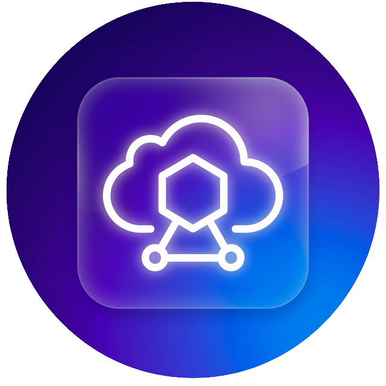

# AutoYou Server

### いま持っているコンピューターで、自分だけの AI サーバーを。

**あなたは製品ではありません。所有者です。**

[](https://github.com/autoyou-ai/AutoYou-Server/actions/workflows/public-checks.yml)
[](https://github.com/autoyou-ai/AutoYou-Server/releases)
[](../../requirements/README.md)
[](../../servers/README.md)
[](../../autoyou_agents/README.md)
[](../../LICENSE)

**[ウェブサイト](https://www.autoyou.me/) · [アプリ](https://www.autoyou.me/downloads/) · [エコシステム](https://www.autoyou.me/ecosystem/) · [コミュニティ](https://www.autoyou.me/community/)**

[クイックスタート](#quick-start) · [仕組み](#how-autoyou-works) · [できること](#what-you-can-do) · [エージェント](#agents) · [ペアリング](#pairing-modes) · [セキュリティ](#security-modes-and-tiers) · [クライアント](#supported-clients) · [FAQ](#faq) · [ドキュメント](#documentation)

<code>./run_autoyou.sh</code>

</div>

> [!IMPORTANT]
> AutoYou Server は [autoyou-ai/AutoYou-Server](https://github.com/autoyou-ai/AutoYou-Server) または [autoyou.me](https://www.autoyou.me/) から入手し、アプリは[対応クライアント](#supported-clients)のストアリンクから入手してください。似た名前のリポジトリやコピーされた README は、公式のダウンロードである証明にはなりません。

<div align="center">
<br />
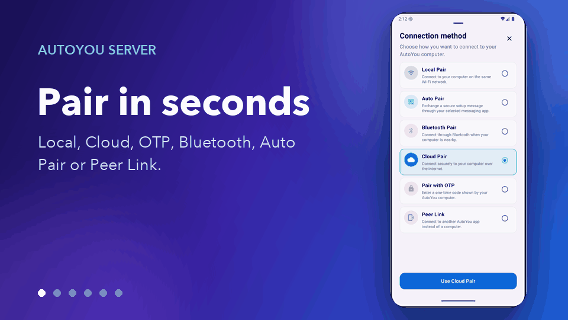
<br /><br />
</div>

---

机の上のコンピューターを、あなたのすべてのデバイスのためのプライベート AI サーバーに。AutoYou Server は、AI モデルとエージェント、音声・ビデオ通話、リモートデスクトップ、ゲーム、そしてあなた自身の Web アプリを Windows、macOS、Linux 上で動かします。スマートフォンや他のコンピューター、ブラウザーは、自宅でも外出先でも暗号化されたピアツーピア接続でアクセスします。

会話、ファイル、エージェントの活動はホスト型の AutoYou サービスではなく、そのコンピューターに保存されます。Ollama でローカルモデルを動かせばトークン料金なしでチャットでき、好みのクラウドプロバイダーにもつなげられます。一度ペアリングすれば、チャット、ハンズフリーのアシスタント、多言語のリアルタイム音声、デスクトップ、ゲーム、すでに動かしている Web サービスまで、すべてがポケットの中に入ります。

> **はじめての方へ** ランチャーを実行して **http://127.0.0.1:8001/** を開くと、セットアップガイドが AI の選択、使いたい機能の有効化、最初のデバイスのペアリングまで案内します。

<a id="quick-start"></a>

## クイックスタート

Git と Python 3.11 以降が必要です。一部のオプション機能は新しい Python や特定のプラットフォームを必要とします。[依存関係プロファイル](../../requirements/README.md)を参照してください。

### 1. サーバーを取得する

```bash
git clone https://github.com/autoyou-ai/AutoYou-Server.git
cd AutoYou-Server
```

### 2. ランチャーを実行する

Windows:

```powershell
.\run_autoyou.bat --profile base
# Or select the Full profile with LAN access:
.\run_autoyou.bat --profile full --host 0.0.0.0
```

macOS または Linux:

```bash
./run_autoyou.sh --profile base
# Or select the Full profile with LAN access:
./run_autoyou.sh --profile full --host 0.0.0.0
```

ランチャーは Python 環境を作成し、パッケージインデックスから依存関係をインストールし、モデルやネイティブツールをダウンロードする場合があります。先にスクリプトを読み、安全に変更できる環境で実行してください。

### 3. コンソールを開いてデバイスをペアリングする

**http://127.0.0.1:8001/** を開き、固有のサーバーパスワードを決めて、セットアップに従います。AutoYou を何に使いたいか（チャット、ハンズフリーアシスタント、通話、ゲーム、コーディングなど）を尋ね、対応するエージェントをインストールし、スマートフォン用のペアリング QR コードを表示します。

無人セットアップでは、環境変数またはシークレットマネージャーで `AUTOYOU_SERVER_PASSWORD` を指定します。実際のパスワードを共有コマンド、issue、スクリーンショットに含めないでください。

| プロファイル | 追加されるもの |
| --- | --- |
| `base` | コアサーバー、ローカル管理、デバイス接続、クラウドプロバイダー連携 |
| `local` | ローカルモデル用ヘルパーとデバイス上のインテントルーティング |
| `recommended` | メッセージングと Bluetooth 連携の依存関係（`--profile` 省略時の既定） |
| `full` | 音声、ブラウザー、デスクトップ自動化の依存関係 |

プロファイルが選ぶのは依存関係だけで、連携機能は別途設定が必要です。`--skip-nuitka` と `--skip-backend-compile` はランチャーに同梱されたライブラリを維持するため、パッケージ版アプリの依存関係のセキュリティ更新には完全な再ビルドが必要です。

更新するには、リポジトリで `git pull` を実行してからランチャーを再実行します。リリースノートは [docs/releases/](../releases/) にあります。

<a id="how-autoyou-works"></a>

## 仕組み

**サーバーはあなた自身のコンピューターで、デバイスはそこへ直接話しかけます。** アプリとサーバーは WebRTC で接続します。短いペアリングハンドシェイクのあと暗号化リンク（DTLS、メディアは SRTP）を開き、チャット、音声、ビデオ、画面共有、ゲーム入力、プロキシされた Web トラフィックを運びます。多くの家庭用・モバイル回線ではルーターのポートを開けずに接続できます。ネットワークが厳しすぎる場合は、同じ暗号化パケットを転送するリレーにフォールバックします。

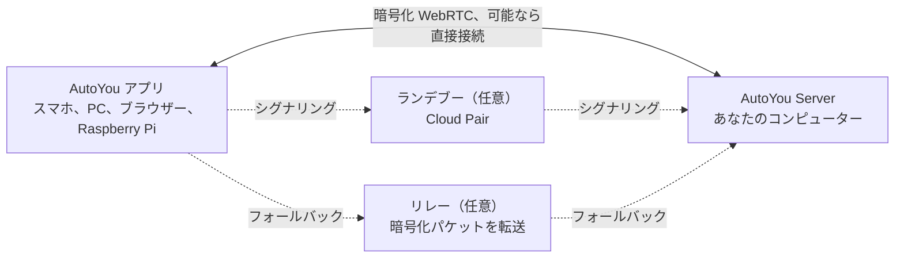

サーバー上では、デバイス内のインテントルーターが各リクエストを適切なエージェントやツールに送ります。Google ADK がネイティブエージェントを実行し、OpenClaw、Hermes Agent、Odysseus をブリッジすることもできます。LiteLLM はモデル呼び出しをローカルの Ollama か、選んだクラウドプロバイダーへ送ります。音声認識も読み上げもローカルで行い、記憶は SQLite に保存されます。

<picture>
  <source media="(prefers-color-scheme: dark)" srcset="../images/architecture-dark.png" />
  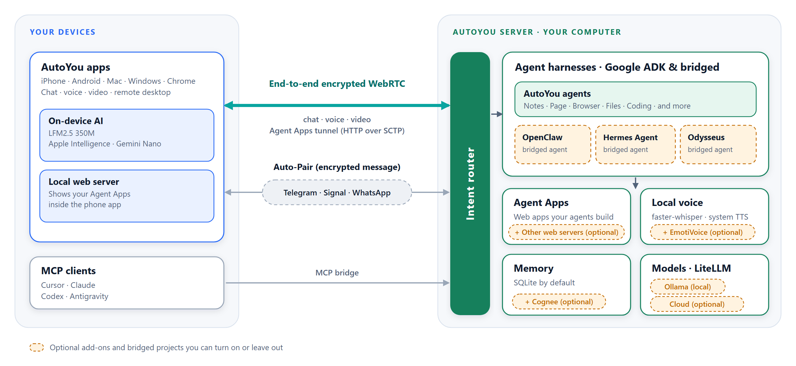
</picture>

この図は [scripts/build_architecture_diagram.py](../../scripts/build_architecture_diagram.py) で生成されます。破線の枠は任意のアドオンまたは接続されたプロジェクトです。

<a id="what-you-can-do"></a>

## できること

| 機能 | 得られるもの |
| --- | --- |
| **AI チャット** | ペアリング済みのどのデバイスからでも自分の AI とチャット。AutoYou はメッセージ数を制限しません |
| **リアルタイム音声** | AI とのライブ通話、ローカル音声認識、30 以上の言語での音声応答 |
| **アシスタントモード** | スマホ、PC、Raspberry Pi、ブラウザーで「Hey Jarvis」のようなウェイクワード |
| **リモートデスクトップ** | スマホからコンピューターを表示・操作。Windows のロック画面にも対応 |
| **コンピュータービデオ** | 画面、カメラ、動画ファイル、API から送るフレームを通話に流す |
| **ゲームモードと Game Studio** | PC のゲームをスマホへストリーミング、またはスマホで動くオフラインゲームを作成 |
| **Web アプリファクトリー** | エージェントに Web アプリを作らせ、すべてのペアリング済みデバイスで開く |
| **任意のローカルポートを公開** | `localhost:3000` などの Web サービスをペアリング済みデバイスと共有 |
| **エージェント** | メモ、ファイル、コーディング、メディア、ブラウジング、学習などの 45 の組み込みエージェント |
| **MCP** | ChatGPT、Codex、Claude、Antigravity、Cursor、VS Code から AutoYou のツールを利用 |
| **メッセージング** | 自分で管理するコネクターで Telegram、Signal、WhatsApp からサーバーにアクセス |
| **メモリ** | SQLite のメモリと非公開のペルソナ日記。Cognee は任意のアドオン |

機能は選んだプロファイル、ハードウェア、権限、設定した連携によって異なります。デスクトップ操作、ゲームモード、録音、ファイルアクセスなどの強力な機能は、有効にするまでオフのままです。

<a id="ai-chat"></a>

### AI チャット

コンソールの **AI** でプロバイダーを選びます。既定の **Ollama + Agents**（ローカルモデル、API キー不要）、対応 Mac の **Apple Intelligence**、**Gemini**、**OpenRouter**、または LiteLLM 経由の Anthropic、OpenAI、Mistral、DeepSeek、xAI などで、AutoYou のエージェントとツールはそのまま使えます。**OpenClaw**、**Hermes Agent**、**Odysseus** をメインのセッションランタイムにすることもできます。

AutoYou は送信できるメッセージ数を制限しません。ローカルモデルならメッセージごとの費用はかからず、インターネットなしでも動きます。接続したクラウドプロバイダーは独自のプランで課金し、送ったプロンプトを受け取ります。組み込みのモデルライブラリでローカルモデルを閲覧・ダウンロード・切り替えでき、Model Picker エージェントがハードウェアに合うモデルを提案します。

小さな量子化ローカルモデルが正確さを保てるよう支援します。オフラインのインテント分類器がよくある依頼を適切なエージェントへ直接送り、コンパクトなルーティングモードがツール一覧を短く保ちます。[小さなモデルが正確さを保つ仕組み](../../autoyou_agents/README.md#small-local-models)を参照してください。

<a id="realtime-voice-in-many-languages"></a>

### 多言語のリアルタイム音声

AI に電話して話しかけましょう。音声認識はあなたのコンピューター上で動き（既定ビルドは whisper.cpp、フル音声ビルドは faster-whisper）、音声区間検出、話し始めると応答を止める割り込み、長く考えるための「話し終わるまで待つ」ホールドに対応します。

- **自分の言語で話す。** **STT language** を `auto` にして多言語モデルを選ぶと、話した言語を自動で検出します。
- **同じ言語で返事を聞く。** 既定の **Auto TTS** は応答の言語を検出し、合うシステム音声を選びます。ローカルの Supertonic 3 モデルは 31 言語に対応し、約 401 MB の初回ダウンロード後はオフラインで動作します。
- **声を選ぶ。** システム音声、10 種類の Supertonic プリセット、Voice Training で学習したカスタム音声、中国語と英語の EmotiVoice、ホスト型の OpenAI と Azure の音声。

読み上げは受け取った応答をそのまま話し、翻訳はしません。選ぶチャットモデルも会話の言語に対応している必要があります。

<a id="assistant-mode"></a>

### アシスタントモード

サーバーに「Hey Jarvis」のようなウェイクワードを設定します。ペアリング済みのスマホ、PC、Raspberry Pi、Chrome 拡張機能、管理ページの近くで言うと、続けて話した内容が AutoYou に届きます。ウェイクワードが聞こえるまで、話した内容は文字起こしも AI への送信もされません。3 回録音し、サーバーで数秒で学習し、テストしてから有効にします。ビデオ通話中は、ウェイクワード後のリクエストに最新のカメラ映像を添えられます。詳しくは[アシスタントモード](../admin-ui/assistant-mode.mdx)へ。

<a id="remote-desktop"></a>

### リモートデスクトップ

ペアリング済みのスマホやデスクトップアプリからコンピューターを表示・操作できます。モニターや個別のアプリウィンドウを選び、マウスを動かし、文字を入力し、修飾キーを使えます。デバイスが対応していれば H.264 を優先します。Windows では、オプションの **AutoYou Secure Desktop Helper** サービスにより、ペアリングした所有者がロック画面や UAC プロンプトを表示・操作でき、接続中はコンピューターをスリープさせません。画面キャプチャと入力は別々の権限で、既定はオフです。Peer Link ではリモートデスクトップは提供されません。

<a id="computer-video"></a>

### コンピュータービデオ

通話中、コンピューターは 4 種類のソースから映像を送れます。**画面**、**カメラ**、アップロードして再生する**動画ファイル**、自作プログラムが送る **API フレーム**です。コンピューターのマイクや音声も共有できます。コンソールの **Interact** では、接続中デバイスのライブカメラ映像を表示し、そのマイク音声をコンピューターのスピーカーで再生できます。AI 処理も録画もしません。

<a id="game-mode-and-game-studio"></a>

### ゲームモードと Game Studio

- **ゲームモード**は、コンピューターで描画したゲームをペアリング済みデバイスへストリーミングし、デバイスのタッチ、モーションセンサー、コントローラー、マウス、キーボードをゲーム入力として返します。ラベル付きの仮想ボタンを最大 4 つ定義できます。ゲームモードは独立した権限で、画面送信とリモートデスクトップ入力もオンにします。
- **自分のエンジンを使う。** ローカルのゲームエンジンは、ループバック WebSocket から認証済みの `autoyou_game_v1` 入力フレームを読み取れます。Unreal 用にはサーバーが `/api/game/unreal-plugin` でソースプラグインを提供します。
- **スマホ用オフラインゲーム。** Game Studio エージェントは、ポータブルな Web または WASM ゲームの作成を手伝い、最大 5 GiB の `.aygame` ファイルにまとめ、WebRTC または承認済みの Peer Link でクライアントへ送ります。各ゲームには専用のデバイス内 SQLite データベースがあり、セーブデータは更新後も残ります。

組み込みデモ **Neon Horizon** は、スマホへのダウンロード、Game Studio ページ、コンピューターからのストリーミングで遊べます。

<a id="web-app-factory"></a>

### Web アプリファクトリー

アプリを説明すれば、エージェントが作ります。**Website** エージェントはエージェント用のブラウザーフロントエンドを作成します。シンプルなスターター、または依頼に応じて React や Angular、バックエンドは Python/FastAPI、Node/TypeScript、Go、Rust から選べます。**Agent Builder** は新しいエージェントの雛形を作り、**Coding** と **Pi** エージェントがコードを実装・テストします。どのアプリもローカル Web サービスに登録され、ペアリング済みデバイスのブラウザーに表示されます。**Hosting** エージェントは、無料の一時 `/pair` トンネルと有料の永続 URL による公開方法を説明します。

<a id="host-any-local-port"></a>

### 任意のローカルポートを公開

すでに動いているものがあれば、そのまま共有できます。**Websites & Browser > Advertised Websites** で 1〜65535 の任意のポートを、ラベルと任意の転送先 URL（`http://127.0.0.1:3000` や LAN 内の別ホストなど）とともに追加します。ペアリング済みクライアントはそれを見つけ、自分の側の同じポートで開くので、ダッシュボード、開発サーバー、ホームラボのツール、サブパスでの動作を想定していないアプリもそのまま動きます。通信は暗号化されたピアリンク内を通るため、ルーターのポートを開ける必要はありません。ペアリング済みブラウザーには `viewer`、`editor`、`admin` のロールが与えられ、変更できる範囲が制限されます。

<a id="agents"></a>

## エージェント

AutoYou には 45 の組み込みエージェントがあります。メインエージェントが各リクエストを適切な専門エージェントに振り分け、多くの専門エージェントはペアリング済みデバイスに独自の Web ページも提供します。opt-in と記されたエージェントは、コンソールの **Agents** でインストールするまで未インストールのままです。

| 分野 | エージェント |
| --- | --- |
| 日常 | Notes、Tasks、Notify、Memory、Persona、Page、Prompts、Location (opt-in) |
| Web と自動化 | Internet、Assistant、Browser (opt-in)、Client Browser Control、Proxy (opt-in) |
| メディアと制作 | Audio、TV、Media Generation (opt-in)、Game Studio |
| コーディングと構築 | Coding、Pi、Agent Builder、Website、Skills、Files、CLI、Claude CLI、Claude Desktop、Codex Desktop、Antigravity、Prompt Builder（すべて opt-in） |
| インテリジェンス | Model Picker、OpenClaw、Hermes Agent（すべて opt-in） |
| 学習 | Data Collector、Fine-Tuning、Voice Training（すべて opt-in） |
| システムとコンピューター | Admin、Remote Desktop、Backup、Hosting (opt-in)、Windows Security (opt-in)、macOS Security (opt-in)、Education (opt-in) |
| AutoYou の支援 | Support Ads、Earnings、Donation |

パッケージを `autoyou_agents/` にコピーすれば独自のエージェントを追加できます。詳細は[エージェントカタログ](../../autoyou_agents/README.md)を参照してください。

[生成されたエージェントリファレンス](../agents/)には、各エージェントが宣言するすべてのツールが載っています。

<a id="pairing-modes"></a>

## ペアリング方式

| 方式 | 接続方法 | 主な用途 |
| --- | --- | --- |
| **Local Pair** | LAN 上で直接接続。シグナリングは自分のサーバーが処理 | 同じ Wi-Fi やオフィスネットワーク |
| **Bluetooth Pair** | 接続情報を Bluetooth Low Energy で受け渡し | 近くのスマホの初期設定 |
| **Live Pair** | スマホとコンピューターがアニメーション QR コードを見せ合う。ネットワーク経路は不要 | 隔離された、または制限の厳しいネットワーク |
| **ワンタイムコード** | メッセージチャットで `/pair` を送ると短時間有効なコードとリンクが返る | ゲストデバイスや信頼できないネットワーク |
| **Auto Pair** | 暗号化されたペアリングメッセージを、設定した Telegram、Signal、WhatsApp のチャットで運ぶ | クラウドアカウントなしで遠隔からペアリング |
| **Cloud Pair** | オプションの有料 AutoYou Cloud ランデブーが NAT 越しにコンピューターを見つけ、リレーにもフォールバック | 外出先や厳しいネットワーク |

**Peer Link** は AutoYou アプリ同士をつなぎ、受信側のアプリが各リンクを承認します。コンピューターのパスワードは使いません。**Lobbies** は、アプリが近くの Wi-Fi と Bluetooth で作成・参加するグループルームです。詳細は[ペアリングプロトコル](../technical/pairing-protocols.md)へ。

<a id="security-modes-and-tiers"></a>

## セキュリティモードとセキュリティティア

サーバー全体に 1 つのセキュリティモードが適用されます。新規インストールは **Secure** から始まります。

| モード | ペアリングメッセージ | ペアリングに必要なもの | コンピューター上のデータ |
| --- | --- | --- | --- |
| **Normal** | 暗号化なし | ワンタイムコード | 変更なし |
| **Secure** | サーバーパスワードで暗号化 | サーバーパスワード | 変更なし |
| **Secure Professional** | サーバーパスワードで暗号化 | パスワードと現在の認証コード | 変更なし |
| **Secure Professional Maximus** | Secure Professional と同じ | パスワードと現在の認証コード | セッション、エージェントデータ、Web サイト、メモ、設定を保存時に暗号化 |

Secure 系のモードでは、ペアリングメッセージはパスワード認証鍵交換（ristretto255 と libsodium による CPace 系の構成）で得た鍵で暗号化されます。中継するリレーやメッセージングブリッジは内容を読めず、記録したやり取りをオフラインのパスワード推測に使うこともできません。

**ペアリングのセキュリティティア**は、チャットメッセージによるペアリングの手順を決めます。**Quick Pairing (B)** は 1 通のメッセージでペアリングでき、互換性が最も高い方式です。**Enhanced Pairing (A)** はすべてのクライアントに追加の hello 往復を求め、推測を難しくします。Local Pair、Bluetooth Pair、Cloud Pair は常に強化フローを使います。

ペアリング済みデバイスのブラウザーには `viewer`、`editor`、`admin` のロールが与えられます。認証情報とセキュリティ設定は、コンピューター本体か、管理ポートで直接開いた HTTPS 管理セッションからのみ変更できます。暗号化が守るのは接続であり、端末、エージェントの権限、サードパーティーのサービスまでは守りません。[セキュリティモード](../security/security-modes.md)と [SECURITY.md](../../SECURITY.md) を参照してください。

<details>
<summary><strong>各レイヤーが守るもの、守らないもの</strong></summary>

| レイヤー | AutoYou が行うこと |
| --- | --- |
| ネットワークへの公開 | 既定では `127.0.0.1` で待ち受けます。LAN での待ち受けは明示的な設定です。 |
| アクセス | 管理コンソールはサーバーパスワードで保護され、認証アプリ（TOTP）のコードも任意で使えます。 |
| ペアリング | パスワード認証付きの鍵交換、ワンタイムコード、Peer Link ではリンクごとの承認。 |
| 通信 | 両端の間は WebRTC DTLS と SRTP。リレーがパケットを中継する場合も同じです。 |
| 保存データ | 認証情報は暗号化されたキーストアに保存されます。Maximus では AutoYou が管理するデータも暗号化します。 |
| 依存関係 | ロックファイル付きのマニフェスト、セキュリティ勧告のチェック、固定された CI アクション。 |

暗号化が守るのは接続です。その周りのすべてを守るわけではありません。

- **デバイス。** サーバーのコンピューターやペアリング済みデバイス上のマルウェアは、そのデバイスと同じアクセス権を持ちます。
- **エージェント。** エージェントはサーバーの権限で動きます。ブラウザー自動化、ファイルアクセス、デスクトップ操作、コマンド実行は強力なので、必要なものだけを有効にし、動作を確認してください。
- **サードパーティ。** クラウドのモデルプロバイダー、メッセージングブリッジ、公開トンネルにはそれぞれ独自のデータの流れと規約があります。有効にする前に確認してください。
- **運用。** サーバーを運用すると、更新、バックアップ、認証情報の管理はあなたの責任になります。

</details>

<details>
<summary><strong>関わる外部サービス</strong></summary>

あなたが運用するサーバーは 1 台、あなた自身のサーバーだけです。アシスタントの実行やデータの保存に AutoYou が運営するアプリケーションサーバーは必要なく、サーバーは AutoYou Cloud に接続せずにローカルネットワークで動作します（[詳細](../architecture/cloud-and-remote.mdx)）。それ以外はすべて、変更できる既定値か任意の補助機能です。

| コンポーネント | 動作場所 | 見えるもの |
| --- | --- | --- |
| AutoYou Server：エージェント、モデル、ストレージ、コンソール | あなたのコンピューター | あなたのデータ。接続の一方の端です。 |
| アプリとブラウザークライアント | あなたのデバイス | あなたが共有したもの |
| アドレス検出用の STUN サーバー（既定で有効） | 変更しない限り Google の公開 STUN サーバー | WebRTC 接続の送信元となる公開 IP とポート |
| Cloud Pair の待ち合わせ地点（任意） | AutoYou Cloud | アカウントのメール、デバイス ID、一時的なペアリングデータ、ネットワークのメタデータ |
| 予備のリレー（任意） | AutoYou Cloud | 暗号化されたパケットとネットワークのメタデータ |
| スマートフォンアプリを起こすプッシュ通知（任意） | Apple と Google のプッシュサービス | アプリの起動が要求されたこと |
| 更新の確認（アカウント連携時に有効） | AutoYou Cloud の更新チャネル | 連携アカウントで認証された更新リクエスト |
| クラウドのモデルプロバイダー（任意） | あなたが選んだプロバイダー | 送信したプロンプト |
| Telegram、Signal、WhatsApp のブリッジ（任意） | 各サービス | 経由するメッセージ（各サービスの規約に従う） |
| Web サイト用の公開トンネル（任意） | トンネルのプロバイダー | 公開 URL へのトラフィック。エンドツーエンドではありません。 |

**公開 STUN は既定で有効です**（Local Pair でも同様）。この問い合わせをインターネットに出さないようにするには、サーバー起動前に `AUTOYOU_DISABLE_PUBLIC_STUN=1` を設定するか、`AUTOYOU_LOCAL_STUNTURN_HOST` で自前の STUN／TURN サーバーを指定します（TURN には `AUTOYOU_LOCAL_TURN_USERNAME` と `AUTOYOU_LOCAL_TURN_PASSWORD` も必要）。STUN や TURN サーバーがまったくないと、NAT 越しの接続は失敗することがあります。

</details>

<a id="supported-clients"></a>

## 対応クライアント

AutoYou Server はあなたのコンピューターで動き、アプリはそれ以外のあらゆる場所からアクセスします。クライアントアプリは別途配布され、そのソースはこのリポジトリには含まれません。

| プラットフォーム | 入手先 |
| --- | --- |
| iPhone と iPad | [App Store](https://apps.apple.com/us/app/autoyou/id6760363728) |
| Android | [Google Play](https://play.google.com/store/apps/details?id=com.autoyou.app) |
| Windows | [Microsoft Store](https://apps.microsoft.com/detail/9mw8l2wfw7wv?hl=en-US&gl=US) |
| macOS と Linux | [ダウンロード](https://www.autoyou.me/downloads/) |
| ブラウザー | Chrome 拡張機能と Web クライアント（[エコシステムページ](https://www.autoyou.me/ecosystem/)） |
| Raspberry Pi | アシスタントモード用の Python 音声クライアント（[設定](../admin-ui/assistant-mode.mdx)） |

スマホアプリには小さなローカル AI（デバイスに応じて LFM 2.5 350M、Gemini Nano、Apple Intelligence）も入っており、コンピューターがなくてもチャットできます。

| ペアリングモード | 自分の AI とチャット | 近くのロビー | スマートフォン上のローカル AI |
| --- | --- | --- | --- |
| 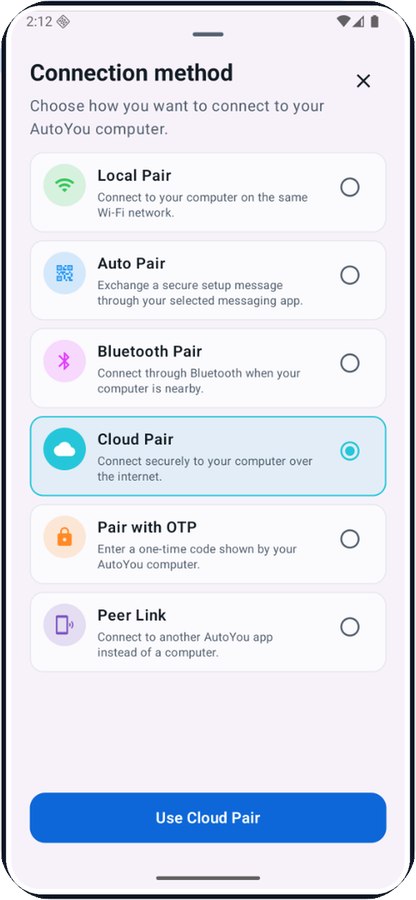 | 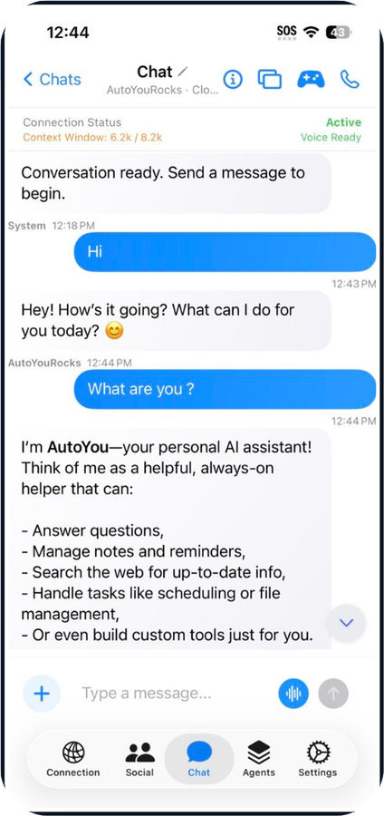 | 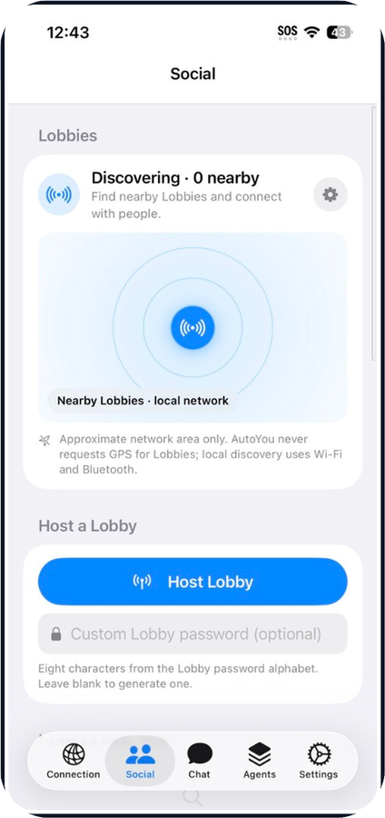 | 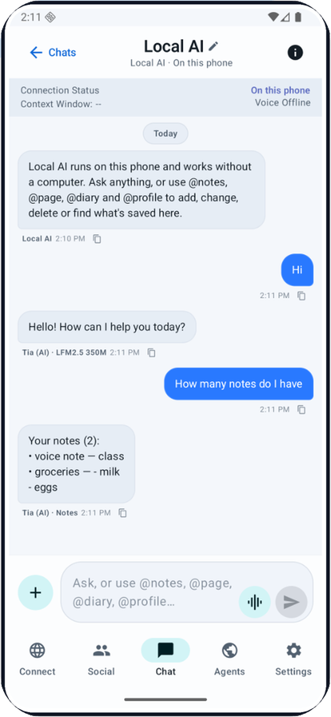 |

- **ロビー。** Wi-Fi と Bluetooth で近くのルームを作成または参加し、ホストに加えて最大 6 人のゲストとチャットや音声・ビデオを楽しめます。
- **Peer Link。** アプリ同士を接続します。受け取る側のアプリがリンクごとに承認し、任意の AI 返信はあなたが伝えた内容だけを使います。
- **あなたのコンピューターをどこでも。** チャット、通話、リモートデスクトップ、ゲームモード、エージェントの Web サイト、公開したポートを、ペアリングしたすべてのデバイスで。

<a id="mcp"></a>
<a id="use-autoyou-from-your-coding-agent"></a>

## コーディングエージェントから AutoYou を使う

ChatGPT、Codex、Claude Code または Claude Desktop、Google Antigravity、Cursor、VS Code の MCP 対応機能を、AutoYou の対応ツールにつなげます。ローカルの MCP アダプターは別プロセスで、サーバーがこれらのクライアントにインストールすることはありません。また MCP 呼び出しで使えるのはアダプターが対応するツールだけで、ファイルへの任意のアクセスや AutoYou の全機能ではありません。

1. AutoYou Server を起動し、**http://127.0.0.1:8001/** を開きます。
2. **Admin UI > Messaging > AutoYou MCP** で MCP を有効にし、非公開のアダプタートークンを生成して `autoyou-mcp.env` をダウンロードします。このファイルは非公開にしてください。
3. 別途メンテナンスされているアダプターを、専用の Python 環境にインストールします。

   ```powershell
   git clone https://github.com/autoyou-ai/AutoYou.git
   cd AutoYou
   py -3 -m venv .venv-mcp
   .\.venv-mcp\Scripts\python.exe -m pip install -e .\plugins\autoyou-mcp
   ```

   macOS または Linux では `python3 -m venv .venv-mcp` と `.venv-mcp/bin/python -m pip install -e ./plugins/autoyou-mcp` を使います。

ローカルの MCP プロセスを起動するクライアントでは、絶対パスで次のコマンドを使います。

```text
<path-to-.venv-mcp-python> -m autoyou_mcp --env-file <path-to-autoyou-mcp.env> --transport stdio
```

<details>
<summary><strong>各クライアントに AutoYou を追加する</strong></summary>

JSON 形式の `mcpServers` を使うクライアントでは、エントリーは次のようになります。2 つのパスの例を置き換え、JSON で Windows のバックスラッシュを使う場合はエスケープしてください。

```json
{
  "mcpServers": {
    "autoyou": {
      "command": "C:/path/to/AutoYou/.venv-mcp/Scripts/python.exe",
      "args": [
        "-m", "autoyou_mcp",
        "--env-file", "C:/path/to/autoyou-mcp.env",
        "--transport", "stdio"
      ]
    }
  }
}
```

**Web 版 ChatGPT** はローカルの `stdio` プロセスではなく、リモートの MCP 接続を使います。アダプターを `--transport streamable-http` で起動し、ローカルのエンドポイント `http://127.0.0.1:8071/mcp` を OpenAI Secure MCP Tunnel でつなぎます。ChatGPT では開発者モードと、それに応じたワークスペースまたは管理者の権限が必要で、OpenAI はプランに応じて完全な MCP アクションを制限しています。[ChatGPT 向け AutoYou MCP の設定](https://github.com/autoyou-ai/AutoYou/blob/main/plugins/autoyou-mcp/README.md#connect-chatgpt-web)と [OpenAI の MCP アプリガイド](https://help.openai.com/en/articles/12584461-developer-mode-and-mcp-apps-in-chatgpt)に従ってください。

**Codex CLI、デスクトップアプリ、IDE 拡張機能**は Codex ホストの MCP 設定を共有します。

```powershell
codex mcp add autoyou -- "C:/path/to/AutoYou/.venv-mcp/Scripts/python.exe" -m autoyou_mcp --env-file "C:/path/to/autoyou-mcp.env" --transport stdio
codex mcp list
```

または `~/.codex/config.toml` の `[mcp_servers.autoyou]` に同等の `command` と `args` を追加します。[Codex の MCP ガイド](https://learn.chatgpt.com/docs/extend/mcp?surface=cli)を参照してください。

**Claude Code：**

```powershell
claude mcp add --transport stdio autoyou -- "C:/path/to/AutoYou/.venv-mcp/Scripts/python.exe" -m autoyou_mcp --env-file "C:/path/to/autoyou-mcp.env" --transport stdio
claude mcp list
```

その後、Claude Code で `/mcp` を実行します。[Claude Code の MCP ガイド](https://code.claude.com/docs/en/mcp)を参照してください。

**Claude Desktop** はアダプターをローカルの stdio サーバーとして起動します。macOS では `~/Library/Application Support/Claude/claude_desktop_config.json`、Windows では `%APPDATA%\Claude\claude_desktop_config.json` に `mcpServers.autoyou` エントリーを追加し、Claude Desktop を完全に終了してから開き直してください。AutoYou は現在 `.mcpb` デスクトップ拡張機能を配布していません。[Claude Desktop の MCP ガイド](https://support.claude.com/en/articles/10949351-getting-started-with-local-mcp-servers-on-claude-desktop)を参照してください。

**Google Antigravity** は全体設定として `~/.gemini/config/mcp_config.json`、ワークスペースでは `.agents/mcp_config.json` を使います。Antigravity IDE では **MCP Servers > Manage MCP Servers > View raw config** を開きます。[Antigravity の MCP ガイド](https://antigravity.google/docs/mcp)を参照してください。

**Cursor** は同じ `mcpServers` エントリーで `~/.cursor/mcp.json` または `.cursor/mcp.json` を使います。[Cursor の MCP ガイド](https://prod.cursor.com/help/customization/mcp)を参照してください。

**VS Code** はワークスペースのルートにあるポータブルな `.mcp.json` を使えます。`.vscode/mcp.json` では代わりに最上位の `servers` オブジェクトと `"type": "stdio"` を使います。[VS Code の MCP ガイド](https://code.visualstudio.com/docs/agent-customization/mcp-servers)を参照してください。

macOS または Linux では Python の実行ファイルは `.venv-mcp/bin/python` です。クライアントのバージョン、設定、組織のポリシー、ツールの承認によって利用可否が変わることがあります。

</details>

接続したら、書き込みを行うツールを使う前に、`get_autoyou_status` が表示され、想定どおりのサーバー状態を返すことを確認してください。対象範囲、セキュリティモデル、制限については [AutoYou MCP 連携ガイド](../guides/mcp-integration.mdx)を参照してください。

<a id="admin-console"></a>

## 管理コンソール

<p align="center">
  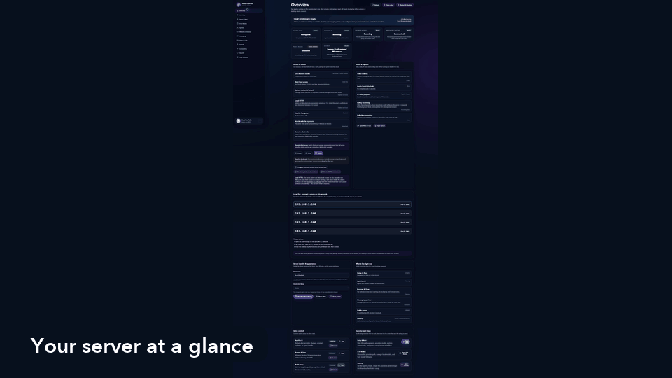
</p>

ローカルのコンソールには、セットアップ、モデル、音声、エージェント、接続、権限、セキュリティがまとまっています。ガイド付きセットアップは AutoYou を何に使いたいかを尋ね、合ったエージェントと権限を提案します。プランを確認して保存するまで何も変わりません。スクリーンショットはサンプル値を使っています。プレビューを選ぶと原寸の画像が開きます。

| サーバーの概要 | デバイスとアクティビティ | アクセスとセキュリティ |
| --- | --- | --- |
| [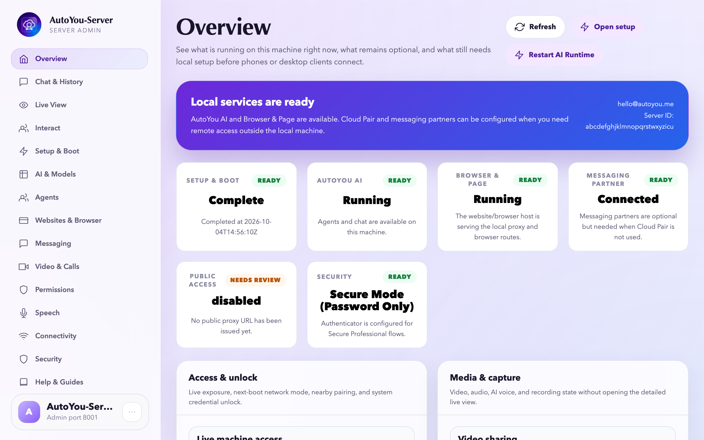](../images/admin/overview.png) | [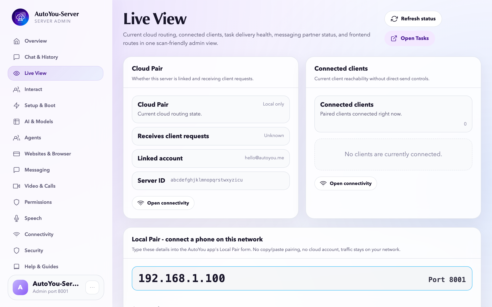](../images/admin/live-view.png) | [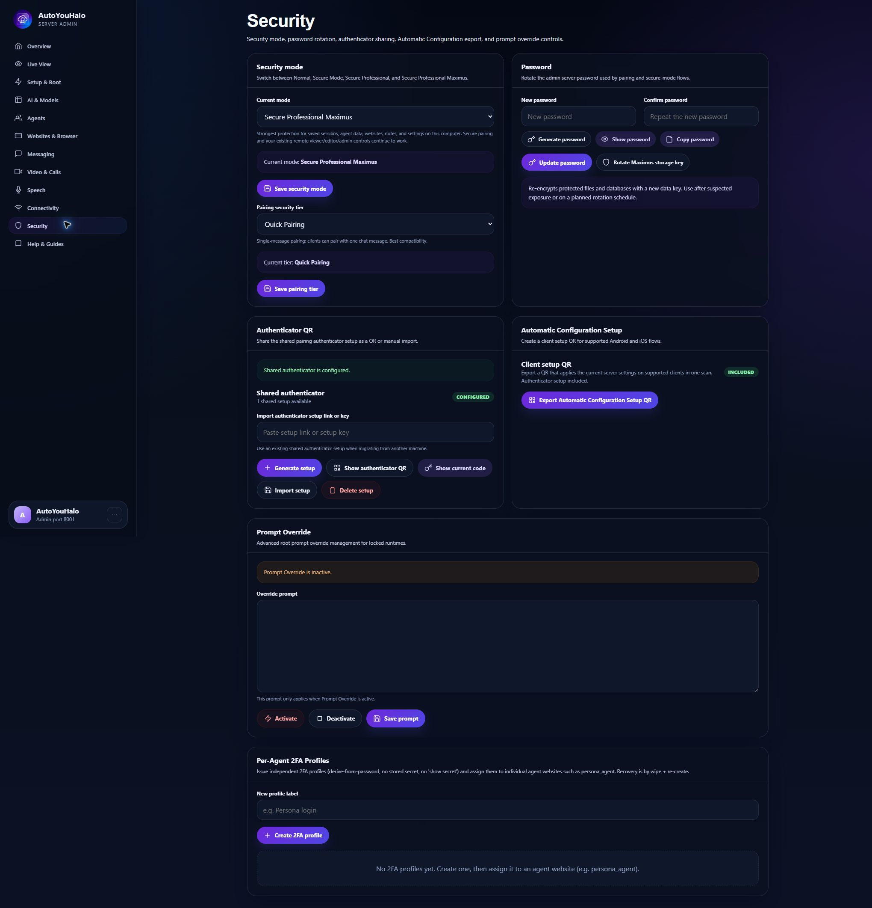](../images/admin/security.png) |

<a id="other-ways-to-run"></a>

## その他の実行方法

<details>
<summary><strong>Docker</strong></summary>

`AUTOYOU_SERVER_PASSWORD` を安全な方法で渡してから、次を実行します。

```bash
docker compose up --build
```

Compose ファイルはポートをホストのループバックにだけ公開し、設定を名前付きボリュームに保存します。同じコンピューターで `http://localhost:8001/` を開いてください。ファイルがこのループバック限定の公開を宣言している（`AUTOYOU_ADMIN_TRUST_PUBLISHED_LOOPBACK=1`）ため、ログインが "requires localhost or HTTPS" で拒否されることはありません。素の `docker run` では `127.0.0.1` に公開して同じ変数を渡すか、前段に TLS プロキシを置いてください。ループバックでの分離に頼る前に、お使いの Docker のバージョンがポートをどう公開するか確認してください。

ビルド時と実行時の Tunnelmole のダウンロードを止めるには、ビルドと起動の前に `AUTOYOU_SKIP_TUNNELMOLE_DOWNLOAD=1` と `AUTOYOU_NO_DOWNLOAD_TUNNELMOLE=1` を設定します。その場合、これに依存する機能には別途用意したバイナリが必要です。

</details>

<details>
<summary><strong>非公式のローカルビルドを作る</strong></summary>

リポジトリのルートから：

```powershell
# Windows
.\servers\windows\build-all.ps1 -Configuration Debug
```

```bash
# macOS
./servers/macos/build-all.sh --no-sign --dev

# Linux / WSL
./servers/wsl/build-backend.sh --unofficial
```

これらの方法には AutoYou アカウントも公式リリースの承認も必要ありません。依存関係をインストールまたは調整することがあります。ライセンスと通知が表示されたら確認してください。確認後に対話なしで同意するには、Windows では `-AcceptTerms`、macOS と Linux では `--accept-terms` を渡します。

必要条件、出力先、既知の制限：
[Windows](../../servers/windows/README.md) · [macOS](../../servers/macos/README.md) · [Linux / WSL](../../servers/wsl/README.md).

</details>

<a id="faq"></a>

## FAQ

<details>
<summary><strong>クラウドアカウントや VPN は必要ですか？</strong></summary>

不要です。Local Pair、Bluetooth Pair、Live Pair、ワンタイムコード、Auto Pair は AutoYou アカウントなしで使えます。Cloud Pair はオプションの有料ヘルパーです。Tailscale などの VPN を使っているなら、その上でも動作します。

</details>

<details>
<summary><strong>AI チャットは本当に無制限ですか？</strong></summary>

AutoYou はメッセージ数を制限しません。ローカルの Ollama モデルならメッセージごとの費用はなく、速度はコンピューターの性能次第です。接続したクラウドプロバイダーには独自の料金と制限があります。

</details>

<details>
<summary><strong>ファイルや会話はアップロードされますか？</strong></summary>

あなたのコンピューターに保存されます。データが外に出るのは、クラウドモデルプロバイダー、メッセージングブリッジ、公開トンネルなど、あなたが有効にしたサービスを通じてだけで、それぞれに独自の規約があります。

</details>

<details>
<summary><strong>どの言語で話せますか？</strong></summary>

**STT language** が `auto` で多言語モデルが選ばれていれば、音声認識が言語を検出します。音声の返答には一致するシステム音声か、31 言語に対応するローカルモデル Supertonic 3 を使います。チャットモデルもその言語を理解できる必要があります。

</details>

<details>
<summary><strong>Web アプリやゲームを友だちと共有できますか？</strong></summary>

はい。あなたのサーバーとペアリングした人は、与えたロールの範囲内でエージェントの Web サイトや公開したポートを開けます。共有デバイスは共有として表示されるので、サイト側で見せる内容を制限できます。ペアリングしていない人向けには、Hosting エージェントが無料の一時リンクと有料の永続 URL を説明します。

</details>

<details>
<summary><strong>バグを見つけたら？</strong></summary>

まず更新してください。最新版で修正済みかもしれません。それでも直らなければ、AutoYou のバージョン（`VERSION`）、OS、プロファイル、再現手順、エラー出力を添えて [issue を作成](https://github.com/autoyou-ai/AutoYou-Server/issues)してください。脆弱性は [SECURITY.md](../../SECURITY.md) に従って非公開で報告してください。

</details>

<a id="documentation"></a>

## ドキュメント

- [クイックスタート](../quickstart.mdx) · [アーキテクチャ](../architecture/) · [セキュリティとプライバシー](../security/) · [管理コンソール](../admin-ui/)
- [エージェントカタログ](../../autoyou_agents/README.md) · [エージェントリファレンス](../agents/) · [エージェントフレームワーク](../agent-framework/)
- [HTTP / WebSocket API](../api-reference/) · [ガイド](../guides/) · [ペアリングガイド](../../guides/README.md)

<a id="contributing"></a>

## コントリビュート

あなたの協力を歓迎します。[組み込みエージェント](../../autoyou_agents/README.md)、[Agent Builder](../admin-ui/agent-workbench-ui.mdx)、[カスタムエージェントのチュートリアル](../guides/custom-agent-tutorial.mdx)から始めてみてください。

- **作る：** エージェント、ゲーム、拡張機能、連携機能、Web インターフェース。
- **改善する：** インストール、アクセシビリティ、プラットフォーム対応、翻訳、ドキュメント、再現可能なバグ。
- **共有する：** デモ、ガイド、またはライセンスを守り非公式と明示したビルド。

作業を送る前に [CONTRIBUTING.md](../../CONTRIBUTING.md) と[行動規範](../../CODE_OF_CONDUCT.md)を読んでください。独立したオリジナルのコードには、MIT や Apache-2.0 を含め好きなライセンスを使えます。既存の AutoYou コードへの変更はそのライセンスを引き継ぎます。

<a id="license"></a>

## ライセンス

AutoYou Server は[サーバーライセンス](../../LICENSE)のもとで source-available です。現時点で OSI 承認のオープンソースプロジェクトではなく、`LICENSE` の定義が優先されます。

| 対象または利用 | 条件 |
| --- | --- |
| 個人利用、ローカルビルド、無償配布 | サーバーライセンスとその条件のもとで許可 |
| AutoYou コードの変更 | 適用される AutoYou のライセンスを維持 |
| 独立していて分離可能なオリジナルのコード | MIT や Apache-2.0 を含む任意のライセンス |
| 組織での利用または商用利用 | 別途の [Enterprise 契約](https://www.autoyou.me/enterprise/) |

通知を保持し、非公式ビルドであることを明示し、同梱コンポーネントの義務を守ってください。[THIRD-PARTY-NOTICES.md](../../THIRD-PARTY-NOTICES.md) と[商標ポリシー](../legal/trademark-policy.md)を参照してください。

OpenStorey は対象となる純収益の少なくとも 15% をコントリビューター基金に充て、その[審査と資格のルール](../contributors/contributor-pool.md)に従って分配します。[資金計画](https://www.autoyou.me/donate/)にはサーバーコードを公開するための 500 万ドルのマイルストーンがあります。マイルストーンだけで、すでに手元にあるコピーのライセンスが変わることはありません。詳細：[docs/legal/open-source-commitment.md](../legal/open-source-commitment.md)。

<a id="support"></a>

## サポート

- **質問とインストールの手助け：** [SUPPORT.md](../../SUPPORT.md) と[コミュニティ](https://www.autoyou.me/community/)。
- **バグと具体的な提案：** [issue を作成](https://github.com/autoyou-ai/AutoYou-Server/issues)。
- **脆弱性：** [SECURITY.md](../../SECURITY.md) の手順で非公開で報告してください。未公開の脆弱性に公開 issue を使わないでください。

エージェントはサーバーの権限で動きます。動作を確認し、必要なものだけを有効にし、バックアップを取ってください。

Copyright &copy; 2026 OpenStorey LLC and contributors.
