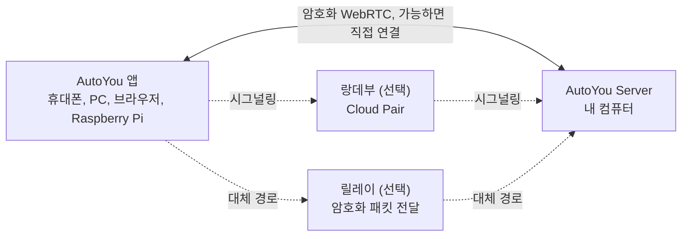

<div align="center">

[English](../../README.md) · [简体中文](README_zh.md) · [繁體中文](README_zh-TW.md) · [日本語](README_ja.md) · **한국어** · [हिन्दी](README_hi.md) · [Español](README_es.md) · [Français](README_fr.md) · [Deutsch](README_de.md) · [Português (Brasil)](README_pt-BR.md) · [Русский](README_ru.md) · [العربية](README_ar.md)


# AutoYou Server

### 이미 가진 컴퓨터에서 돌아가는 나만의 AI 서버.

**당신은 상품이 아닙니다. 주인입니다.**

[](https://github.com/autoyou-ai/AutoYou-Server/actions/workflows/public-checks.yml)
[](https://github.com/autoyou-ai/AutoYou-Server/releases)
[](../../requirements/README.md)
[](../../servers/README.md)
[](../../autoyou_agents/README.md)
[](../../LICENSE)

**[웹사이트](https://www.autoyou.me/) · [앱](https://www.autoyou.me/downloads/) · [에코시스템](https://www.autoyou.me/ecosystem/) · [커뮤니티](https://www.autoyou.me/community/)**

[빠른 시작](#quick-start) · [작동 방식](#how-autoyou-works) · [할 수 있는 일](#what-you-can-do) · [에이전트](#agents) · [페어링](#pairing-modes) · [보안](#security-modes-and-tiers) · [클라이언트](#supported-clients) · [FAQ](#faq) · [문서](#documentation)

<code>./run_autoyou.sh</code>

</div>

> [!IMPORTANT]
> AutoYou Server는 [autoyou-ai/AutoYou-Server](https://github.com/autoyou-ai/AutoYou-Server) 또는 [autoyou.me](https://www.autoyou.me/)에서 받고, 앱은 [지원 클라이언트](#supported-clients)의 스토어 링크에서 받으세요. 비슷한 이름의 저장소나 복사된 README는 공식 다운로드임을 보장하지 않습니다.

<div align="center">
<br />

<br /><br />
</div>

---

책상 위의 컴퓨터를 내 모든 기기를 위한 개인 AI 서버로 바꾸세요. AutoYou Server는 AI 모델과 에이전트, 음성·영상 통화, 원격 데스크톱, 게임, 그리고 직접 만든 웹 앱을 Windows, macOS, Linux 컴퓨터에서 실행합니다. 휴대폰, 다른 컴퓨터, 브라우저는 집에서든 밖에서든 암호화된 P2P 연결로 접속합니다.

대화, 파일, 에이전트 활동은 호스팅된 AutoYou 서비스가 아니라 그 컴퓨터에 저장됩니다. Ollama로 로컬 모델을 실행하면 토큰 요금 없이 채팅할 수 있고, 원하는 클라우드 제공자에 연결할 수도 있습니다. 한 번 페어링하면 채팅, 핸즈프리 어시스턴트, 다국어 실시간 음성, 데스크톱, 게임, 이미 실행 중인 모든 웹 서비스가 주머니 속에 들어옵니다.

> **처음이신가요?** 런처를 실행하고 **http://127.0.0.1:8001/**을 열면, 설정 가이드가 AI 선택, 원하는 기능 켜기, 첫 기기 페어링까지 안내합니다.

<a id="quick-start"></a>

## 빠른 시작

Git과 Python 3.11 이상이 필요합니다. 일부 선택 기능은 더 새로운 Python이나 특정 플랫폼이 필요합니다. [의존성 프로필](../../requirements/README.md)을 참고하세요.

### 1. 서버 받기

```bash
git clone https://github.com/autoyou-ai/AutoYou-Server.git
cd AutoYou-Server
```

### 2. 런처 실행

Windows:

```powershell
.\run_autoyou.bat --profile base
# Or select the Full profile with LAN access:
.\run_autoyou.bat --profile full --host 0.0.0.0
```

macOS 또는 Linux:

```bash
./run_autoyou.sh --profile base
# Or select the Full profile with LAN access:
./run_autoyou.sh --profile full --host 0.0.0.0
```

런처는 Python 환경을 만들고 패키지 인덱스에서 의존성을 설치하며, 모델과 네이티브 도구를 내려받을 수 있습니다. 먼저 스크립트를 읽고, 안전하게 변경해도 되는 환경에서 실행하세요.

### 3. 콘솔을 열고 기기 페어링

**http://127.0.0.1:8001/**에 접속해 고유한 서버 비밀번호를 정하고 설정을 따라가세요. AutoYou를 어디에 쓸지(채팅, 핸즈프리 어시스턴트, 통화, 게임, 코딩 등) 묻고, 맞는 에이전트를 설치한 뒤 휴대폰 페어링용 QR 코드를 보여줍니다.

무인 설치에서는 환경 변수나 시크릿 관리자로 `AUTOYOU_SERVER_PASSWORD`를 제공하세요. 실제 비밀번호를 공유 명령, 이슈, 스크린샷에 넣지 마세요.

| 프로필 | 추가 항목 |
| --- | --- |
| `base` | 핵심 서버, 로컬 관리, 기기 연결, 클라우드 제공자 연동 |
| `local` | 로컬 모델 도우미와 기기 내 의도 라우팅 |
| `recommended` | 메시징 및 블루투스 연동 의존성 (`--profile` 생략 시 기본값) |
| `full` | 음성, 브라우저, 데스크톱 자동화 의존성 |

업데이트하려면 저장소에서 `git pull`을 실행한 뒤 런처를 다시 실행하세요. 릴리스 노트는 [docs/releases/](../releases/)에 있습니다.

<a id="how-autoyou-works"></a>

## 작동 방식

**서버는 내 컴퓨터이고, 기기는 그 컴퓨터와 직접 통신합니다.** 앱과 서버는 WebRTC로 연결됩니다. 짧은 페어링 핸드셰이크 후 암호화된 링크(DTLS, 미디어는 SRTP)를 열어 채팅, 음성, 영상, 화면 공유, 게임 입력, 프록시된 웹 트래픽을 전달합니다. 대부분의 가정 및 모바일 네트워크에서는 공유기 포트를 열지 않아도 연결됩니다. 네트워크가 너무 엄격하면 같은 암호화 패킷을 전달하는 릴레이로 전환합니다.



서버에서는 기기 내 의도 라우터가 각 요청을 알맞은 에이전트나 도구로 보냅니다. Google ADK가 기본 에이전트를 실행하고, OpenClaw, Hermes Agent, Odysseus를 연결할 수도 있습니다. LiteLLM은 모델 호출을 내 컴퓨터의 Ollama나 선택한 클라우드 제공자로 보냅니다. 음성 인식과 음성 출력은 로컬에서 이뤄지고, 기억은 SQLite에 저장됩니다.

<a id="what-you-can-do"></a>

## 할 수 있는 일

| 기능 | 제공하는 것 |
| --- | --- |
| **AI 채팅** | 페어링한 어느 기기에서든 내 AI와 채팅. AutoYou는 메시지 수를 제한하지 않습니다 |
| **실시간 음성** | AI와 실시간 통화, 로컬 음성 인식, 30개 이상 언어의 음성 답변 |
| **어시스턴트 모드** | 휴대폰, 컴퓨터, Raspberry Pi, 브라우저에서 "Hey Jarvis" 같은 호출어 |
| **원격 데스크톱** | 휴대폰으로 컴퓨터를 보고 제어. Windows 잠금 화면 포함 |
| **컴퓨터 영상** | 화면, 카메라, 동영상 파일, API 프레임을 통화로 전송 |
| **게임 모드와 Game Studio** | 컴퓨터 게임을 휴대폰으로 스트리밍하거나 휴대폰에서 오프라인으로 도는 게임 제작 |
| **웹 앱 팩토리** | 에이전트에게 웹 앱을 만들게 하고 모든 페어링 기기에서 열기 |
| **로컬 포트 공유** | `localhost:3000` 같은 웹 서비스를 페어링한 기기와 공유 |
| **에이전트** | 메모, 파일, 코딩, 미디어, 브라우징, 학습 등 45개 내장 에이전트 |
| **MCP** | ChatGPT, Codex, Claude, Antigravity, Cursor, VS Code에서 AutoYou 도구 사용 |

기능은 선택한 프로필, 하드웨어, 권한, 설정한 연동에 따라 다릅니다. 데스크톱 제어, 게임 모드, 녹음, 파일 접근 같은 강력한 기능은 직접 켜기 전까지 꺼져 있습니다.

### AI 채팅

콘솔의 **AI**에서 제공자를 고르세요. 기본값인 **Ollama + Agents**(로컬 모델, API 키 불필요), 지원되는 Mac의 **Apple Intelligence**, **Gemini**, **OpenRouter**, 또는 LiteLLM을 통한 Anthropic, OpenAI, Mistral, DeepSeek, xAI 등을 AutoYou의 에이전트와 도구와 함께 쓸 수 있습니다. **OpenClaw**, **Hermes Agent**, **Odysseus**를 기본 세션 런타임으로 쓸 수도 있습니다.

AutoYou는 보낼 수 있는 메시지 수를 제한하지 않습니다. 로컬 모델을 쓰면 메시지당 비용이 없고 인터넷 없이도 동작합니다. 연결한 클라우드 제공자는 자체 요금제로 과금하며 보낸 프롬프트를 받습니다. 내장 모델 라이브러리에서 로컬 모델을 둘러보고 내려받고 전환할 수 있으며, Model Picker 에이전트가 하드웨어에 맞는 모델을 추천합니다.

### 다국어 실시간 음성

AI에게 전화해서 말하세요. 음성 인식은 내 컴퓨터에서 실행되며(기본 빌드는 whisper.cpp, 전체 음성 빌드는 faster-whisper), 음성 구간 감지, 말을 시작하면 답변을 멈추는 끼어들기, 긴 생각을 위한 "말이 끝날 때까지 기다리기" 기능을 지원합니다.

- **내 언어로 말하기.** **STT language**를 `auto`로 두고 다국어 모델을 선택하면 말한 언어를 자동으로 감지합니다.
- **같은 언어로 답 듣기.** 기본값인 **Auto TTS**는 답변의 언어를 감지해 맞는 시스템 음성을 고릅니다. 로컬 Supertonic 3 모델은 31개 언어를 지원하며, 약 401 MB를 한 번 내려받으면 오프라인으로 동작합니다.
- **목소리 고르기.** 시스템 음성, 10가지 Supertonic 프리셋, Voice Training에서 학습한 맞춤 음성, 중국어·영어 EmotiVoice, 호스팅된 OpenAI와 Azure 음성.

음성 합성은 받은 답변을 읽을 뿐 번역하지 않습니다. 선택한 채팅 모델도 대화 언어를 지원해야 합니다.

### 어시스턴트 모드

서버에 "Hey Jarvis" 같은 호출어를 정하세요. 페어링한 휴대폰, 컴퓨터, Raspberry Pi, Chrome 확장 프로그램, 관리 페이지 근처에서 말하면 이어서 한 말이 AutoYou로 갑니다. 호출어가 들리기 전에는 아무 말도 받아쓰거나 AI로 보내지 않습니다. 세 번 녹음하고, 서버에서 몇 초 만에 학습시키고, 테스트한 뒤 켜면 됩니다. 영상 통화 중에는 호출어 뒤의 요청에 최신 카메라 화면을 함께 보낼 수 있습니다. [어시스턴트 모드](../admin-ui/assistant-mode.mdx)를 참고하세요.

### 원격 데스크톱

페어링한 휴대폰이나 데스크톱 앱에서 컴퓨터를 보고 제어합니다. 모니터나 개별 앱 창을 고르고, 마우스를 움직이고, 입력하고, 보조 키를 쓸 수 있습니다. 기기가 지원하면 H.264를 우선 사용합니다. Windows에서는 선택 사항인 **AutoYou Secure Desktop Helper** 서비스로 페어링한 소유자가 잠금 화면과 UAC 창을 보고 조작할 수 있고, 연결 중에는 컴퓨터가 절전 모드로 들어가지 않게 할 수 있습니다. 화면 캡처와 입력은 별도 권한이며 기본적으로 꺼져 있습니다. Peer Link에서는 원격 데스크톱을 제공하지 않습니다.

### 컴퓨터 영상

통화 중 컴퓨터는 네 가지 소스에서 영상을 보낼 수 있습니다. **화면**, **카메라**, 업로드해 재생하는 **동영상 파일**, 직접 만든 프로그램이 넣는 **API 프레임**입니다. 컴퓨터의 마이크와 소리도 공유할 수 있습니다. 콘솔의 **Interact**는 연결된 기기의 실시간 카메라 화면을 보여주고, 그 마이크 소리를 컴퓨터 스피커로 재생할 수 있습니다. AI 처리나 녹화는 하지 않습니다.

### 게임 모드와 Game Studio

- **게임 모드**는 컴퓨터에서 렌더링한 게임을 페어링한 기기로 스트리밍하고, 기기의 터치, 모션 센서, 컨트롤러, 마우스, 키보드를 게임 입력으로 돌려받습니다. 이름을 붙인 가상 버튼을 최대 4개까지 정의할 수 있습니다. 게임 모드는 별도 권한이며 화면 전송과 원격 데스크톱 입력도 함께 켭니다.
- **내 엔진 사용하기.** 로컬 게임 엔진은 루프백 WebSocket에서 인증된 `autoyou_game_v1` 입력 프레임을 읽을 수 있습니다. Unreal용 소스 플러그인은 `/api/game/unreal-plugin`에서 제공합니다.
- **휴대폰용 오프라인 게임.** Game Studio 에이전트가 이식 가능한 웹 또는 WASM 게임 제작을 돕고, 최대 5 GiB의 `.aygame` 파일로 묶어 WebRTC나 승인된 Peer Link로 클라이언트에 보냅니다. 게임마다 기기 내 전용 SQLite 데이터베이스가 있고, 진행 상황은 업데이트 후에도 유지됩니다.

내장 데모 **Neon Horizon**은 휴대폰 다운로드, Game Studio 페이지, 컴퓨터 스트리밍으로 즐길 수 있습니다.

### 웹 앱 팩토리

앱을 설명하면 에이전트가 만듭니다. **Website** 에이전트는 에이전트용 브라우저 프런트엔드를 만듭니다. 간단한 스타터, 또는 요청 시 React나 Angular, 백엔드는 Python/FastAPI, Node/TypeScript, Go, Rust 중에서 고릅니다. **Agent Builder**가 새 에이전트의 뼈대를 만들고, **Coding**과 **Pi** 에이전트가 코드를 구현하고 테스트합니다. 모든 앱은 로컬 웹 서비스에 등록되어 페어링한 기기의 브라우저에 나타납니다. **Hosting** 에이전트는 무료 임시 `/pair` 터널과 유료 고정 URL로 공개하는 방법을 설명합니다.

### 로컬 포트 공유

이미 실행 중인 서비스가 있다면 그대로 공유하세요. **Websites & Browser > Advertised Websites**에서 1~65535 사이의 아무 포트를 라벨, 선택적 전달 URL(`http://127.0.0.1:3000` 또는 LAN의 다른 호스트 등)과 함께 추가합니다. 페어링한 클라이언트는 이를 발견해 자기 쪽의 같은 포트로 열기 때문에, 대시보드, 개발 서버, 홈랩 도구, 하위 경로에서 동작하도록 만들어지지 않은 앱도 그대로 동작합니다. 트래픽은 암호화된 P2P 링크 안으로 흐르므로 공유기 포트를 열 필요가 없습니다. 페어링한 브라우저는 `viewer`, `editor`, `admin` 역할을 받아 변경할 수 있는 범위가 제한됩니다.

<a id="agents"></a>

## 에이전트

AutoYou에는 45개의 내장 에이전트가 있습니다. 메인 에이전트가 각 요청을 알맞은 전문 에이전트로 보내고, 많은 전문 에이전트가 페어링한 기기에 자체 웹 페이지를 제공합니다. opt-in으로 표시된 에이전트는 콘솔의 **Agents**에서 설치하기 전까지 설치되지 않습니다.

| 분야 | 에이전트 |
| --- | --- |
| 일상 | Notes, Tasks, Notify, Memory, Persona, Page, Prompts, Location (opt-in) |
| 웹과 자동화 | Internet, Assistant, Browser (opt-in), Client Browser Control, Proxy (opt-in) |
| 미디어와 창작 | Audio, TV, Media Generation (opt-in), Game Studio |
| 코딩과 빌드 | Coding, Pi, Agent Builder, Website, Skills, Files, CLI, Claude CLI, Claude Desktop, Codex Desktop, Antigravity, Prompt Builder (모두 opt-in) |
| 지능과 모델 | Model Picker, OpenClaw, Hermes Agent (모두 opt-in) |
| 학습 | Data Collector, Fine-Tuning, Voice Training (모두 opt-in) |
| 시스템과 컴퓨터 | Admin, Remote Desktop, Backup, Hosting (opt-in), Windows Security (opt-in), macOS Security (opt-in), Education (opt-in) |
| AutoYou 후원 | Support Ads, Earnings, Donation |

패키지를 `autoyou_agents/`에 복사하면 나만의 에이전트를 추가할 수 있습니다. 자세한 내용은 [에이전트 카탈로그](../../autoyou_agents/README.md)를 보세요.

<a id="pairing-modes"></a>

## 페어링 방식

| 방식 | 연결 방법 | 주요 용도 |
| --- | --- | --- |
| **Local Pair** | LAN에서 직접 연결. 시그널링은 내 서버가 처리 | 같은 Wi-Fi나 사무실 네트워크 |
| **Bluetooth Pair** | 연결 정보를 Bluetooth Low Energy로 전달 | 가까운 휴대폰의 첫 설정 |
| **Live Pair** | 휴대폰과 컴퓨터가 움직이는 QR 코드를 서로 보여줌. 네트워크 경로 불필요 | 격리되었거나 제한된 네트워크 |
| **일회용 코드** | 메시지 채팅에서 `/pair`를 보내면 짧게 유효한 코드와 링크를 받음 | 게스트 기기와 신뢰할 수 없는 네트워크 |
| **Auto Pair** | 암호화된 페어링 메시지를 설정한 Telegram, Signal, WhatsApp 채팅으로 전달 | 클라우드 계정 없이 원격 페어링 |
| **Cloud Pair** | 선택 사항인 유료 AutoYou Cloud 랑데부가 NAT 너머의 컴퓨터를 찾고 릴레이로도 전환 | 외출 중이거나 엄격한 네트워크 |

**Peer Link**는 AutoYou 앱끼리 연결하며, 받는 쪽 앱이 각 연결을 승인하고 컴퓨터 비밀번호는 절대 쓰지 않습니다. **Lobbies**는 앱이 근처에서 Wi-Fi와 블루투스로 만들고 참여하는 그룹 방입니다. [페어링 프로토콜](../technical/pairing-protocols.md)을 참고하세요.

<a id="security-modes-and-tiers"></a>

## 보안 모드와 보안 등급

서버 전체에 하나의 보안 모드가 적용됩니다. 새로 설치하면 **Secure**로 시작합니다.

| 모드 | 페어링 메시지 | 페어링에 필요한 것 | 컴퓨터의 데이터 |
| --- | --- | --- | --- |
| **Normal** | 암호화 안 함 | 일회용 코드 | 변화 없음 |
| **Secure** | 서버 비밀번호로 암호화 | 서버 비밀번호 | 변화 없음 |
| **Secure Professional** | 서버 비밀번호로 암호화 | 비밀번호와 현재 인증 코드 | 변화 없음 |
| **Secure Professional Maximus** | Secure Professional과 같음 | 비밀번호와 현재 인증 코드 | 세션, 에이전트 데이터, 웹사이트, 메모, 설정을 저장 시 암호화 |

Secure 계열 모드에서 페어링 메시지는 비밀번호 인증 키 교환(ristretto255와 libsodium 기반 CPace 계열 구성)으로 얻은 키로 암호화됩니다. 이를 전달하는 릴레이나 메시징 브리지는 내용을 읽을 수 없고, 녹화한 교환 과정으로 오프라인 비밀번호 추측을 할 수도 없습니다.

**페어링 보안 등급**은 채팅 메시지 페어링에 필요한 단계를 정합니다. **Quick Pairing (B)**은 메시지 한 통으로 페어링되어 호환성이 가장 좋고, **Enhanced Pairing (A)**은 모든 클라이언트에 추가 hello 왕복을 요구해 추측을 더 어렵게 만듭니다. Local Pair, Bluetooth Pair, Cloud Pair는 항상 강화 흐름을 사용합니다.

페어링한 기기의 브라우저는 `viewer`, `editor`, `admin` 역할을 받습니다. 자격 증명과 보안 설정은 컴퓨터 자체에서, 또는 관리 포트에서 직접 연 HTTPS 관리 세션에서만 바꿀 수 있습니다. 암호화는 연결을 보호할 뿐 단말, 에이전트 권한, 제3자 서비스까지 보호하지는 않습니다. [보안 모드](../security/security-modes.md)와 [SECURITY.md](../../SECURITY.md)를 참고하세요.

<a id="supported-clients"></a>

## 지원 클라이언트

AutoYou Server는 내 컴퓨터에서 실행되고, 앱은 그 밖의 모든 곳에서 접속합니다. 클라이언트 앱은 별도로 배포되며 소스는 이 저장소에 포함되지 않습니다.

| 플랫폼 | 받는 곳 |
| --- | --- |
| iPhone 및 iPad | [App Store](https://apps.apple.com/us/app/autoyou/id6760363728) |
| Android | [Google Play](https://play.google.com/store/apps/details?id=com.autoyou.app) |
| Windows | [Microsoft Store](https://apps.microsoft.com/detail/9mw8l2wfw7wv?hl=en-US&gl=US) |
| macOS 및 Linux | [다운로드](https://www.autoyou.me/downloads/) |
| 브라우저 | Chrome 확장 프로그램과 웹 클라이언트 ([에코시스템 페이지](https://www.autoyou.me/ecosystem/)) |
| Raspberry Pi | 어시스턴트 모드용 Python 음성 클라이언트 ([설정](../admin-ui/assistant-mode.mdx)) |

휴대폰 앱에는 작은 로컬 AI(기기에 따라 LFM 2.5 350M, Gemini Nano, Apple Intelligence)도 들어 있어 컴퓨터 없이도 채팅할 수 있습니다.

<a id="mcp"></a>

## 코딩 에이전트에서 AutoYou 사용하기

로컬 MCP 어댑터로 지원되는 AutoYou 도구를 ChatGPT, Codex, Claude Code, Claude Desktop, Google Antigravity, Cursor, VS Code에 연결할 수 있습니다. **Admin UI > Messaging > AutoYou MCP**에서 MCP를 켜고 `autoyou-mcp.env`를 내려받은 뒤, [영문 README의 단계](../../README.md#use-autoyou-from-your-coding-agent)에 따라 각 클라이언트를 설정하세요.

<a id="faq"></a>

## FAQ

<details>
<summary><strong>클라우드 계정이나 VPN이 필요한가요?</strong></summary>

아니요. Local Pair, Bluetooth Pair, Live Pair, 일회용 코드, Auto Pair는 AutoYou 계정 없이 동작합니다. Cloud Pair는 선택 사항인 유료 도우미입니다. Tailscale 같은 VPN을 이미 쓰고 있다면 그 위에서도 동작합니다.

</details>

<details>
<summary><strong>AI 채팅은 정말 무제한인가요?</strong></summary>

AutoYou는 메시지 수를 제한하지 않습니다. 로컬 Ollama 모델을 쓰면 메시지당 비용이 없고, 속도는 컴퓨터 성능에 따라 다릅니다. 연결한 클라우드 제공자에는 자체 요금과 제한이 있습니다.

</details>

<details>
<summary><strong>AutoYou가 내 파일이나 대화를 업로드하나요?</strong></summary>

내 컴퓨터에 저장됩니다. 데이터는 클라우드 모델 제공자, 메시징 브리지, 공개 터널처럼 직접 켠 서비스를 통해서만 나가며, 각 서비스에는 자체 약관이 있습니다.

</details>

<a id="documentation"></a>

## 문서

- [빠른 시작](../quickstart.mdx) · [아키텍처](../architecture/) · [보안과 개인정보](../security/) · [관리 콘솔](../admin-ui/)
- [에이전트 카탈로그](../../autoyou_agents/README.md) · [에이전트 레퍼런스](../agents/) · [에이전트 프레임워크](../agent-framework/)
- [HTTP 및 WebSocket API](../api-reference/) · [가이드](../guides/) · [페어링 가이드](../../guides/README.md)

## 기여하기

AutoYou에 함께해 주세요. 에이전트, 게임, 확장, 연동을 만들거나 설치, 접근성, 플랫폼 지원, 번역, 문서를 개선하거나 데모와 가이드를 공유할 수 있습니다. 제출 전에 [CONTRIBUTING.md](../../CONTRIBUTING.md)와 [행동 강령](../../CODE_OF_CONDUCT.md)을 읽어 주세요.

## 라이선스

AutoYou Server는 [서버 라이선스](../../LICENSE)에 따라 소스가 공개된(source-available) 프로젝트입니다. 현재 OSI 승인 오픈소스는 아니며, `LICENSE`의 정의가 우선합니다. 개인 사용, 로컬 빌드, 무료 공유는 라이선스 조건 안에서 허용되며, 기관 사용이나 상업적 이용에는 별도의 [엔터프라이즈 계약](https://www.autoyou.me/enterprise/)이 필요합니다. 자세한 내용은 [영문 README](../../README.md#license)와 [THIRD-PARTY-NOTICES.md](../../THIRD-PARTY-NOTICES.md)를 보세요.

Copyright &copy; 2026 OpenStorey LLC and contributors.
