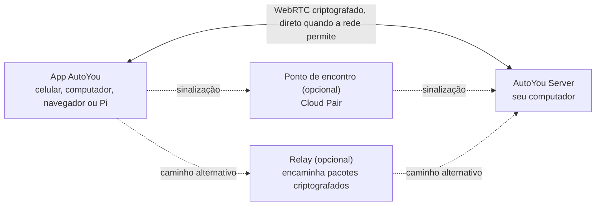

<div align="center">

[English](../../README.md) · [简体中文](README_zh.md) · [繁體中文](README_zh-TW.md) · [日本語](README_ja.md) · [한국어](README_ko.md) · [हिन्दी](README_hi.md) · [Español](README_es.md) · [Français](README_fr.md) · [Deutsch](README_de.md) · **Português (Brasil)** · [Русский](README_ru.md) · [العربية](README_ar.md)


# AutoYou Server

### Seu próprio servidor de IA, no computador que você já tem.

**Você não é o produto. Você é o dono.**

[](https://github.com/autoyou-ai/AutoYou-Server/actions/workflows/public-checks.yml)
[](https://github.com/autoyou-ai/AutoYou-Server/releases)
[](../../requirements/README.md)
[](../../servers/README.md)
[](../../autoyou_agents/README.md)
[](../../LICENSE)

**[Site](https://www.autoyou.me/) · [Apps](https://www.autoyou.me/downloads/) · [Ecossistema](https://www.autoyou.me/ecosystem/) · [Comunidade](https://www.autoyou.me/community/)**

[Início rápido](#quick-start) · [Como funciona](#how-autoyou-works) · [O que você pode fazer](#what-you-can-do) · [Agentes](#agents) · [Pareamento](#pairing-modes) · [Segurança](#security-modes-and-tiers) · [Clientes](#supported-clients) · [Perguntas frequentes](#faq) · [Documentação](#documentation)

<code>./run_autoyou.sh</code>

</div>

> [!IMPORTANT]
> Baixe o AutoYou Server em [autoyou-ai/AutoYou-Server](https://github.com/autoyou-ai/AutoYou-Server) ou [autoyou.me](https://www.autoyou.me/), e os apps pelos links das lojas em [Clientes compatíveis](#supported-clients). Um repositório com nome parecido ou um README copiado não torna um download oficial.

<div align="center">
<br />

<br /><br />
</div>

---

Transforme o computador da sua mesa em um servidor de IA privado para todos os seus dispositivos. O AutoYou Server roda seus modelos e agentes de IA, chamadas de voz e vídeo, área de trabalho remota, jogos e seus próprios apps web no seu Windows, macOS ou Linux. Seu celular, outros computadores e navegadores se conectam a ele por conexões ponto a ponto criptografadas, em casa ou fora.

Suas conversas, arquivos e a atividade dos agentes ficam nesse computador, não em um serviço hospedado do AutoYou. Rode modelos locais com o Ollama para conversar sem conta de tokens, ou conecte o provedor de nuvem que preferir. Pareie um dispositivo uma vez e tudo o que o servidor oferece fica no seu bolso: chat, um assistente mãos livres, voz em tempo real em vários idiomas, sua área de trabalho, seus jogos e qualquer serviço web que você já rode.

> **Primeira vez?** Rode o script de inicialização, abra **http://127.0.0.1:8001/** e a configuração guiada ajuda você a escolher sua IA, ativar os recursos que quiser e parear o primeiro dispositivo.

<a id="quick-start"></a>

## Início rápido

Você precisa do Git e do Python 3.11 ou mais recente. Alguns recursos opcionais exigem um Python mais novo ou uma plataforma específica; veja os [perfis de dependências](../../requirements/README.md).

### 1. Baixe o servidor

```bash
git clone https://github.com/autoyou-ai/AutoYou-Server.git
cd AutoYou-Server
```

### 2. Rode o script de inicialização

Windows:

```powershell
.\run_autoyou.bat --profile base
# Or select the Full profile with LAN access:
.\run_autoyou.bat --profile full --host 0.0.0.0
```

macOS ou Linux:

```bash
./run_autoyou.sh --profile base
# Or select the Full profile with LAN access:
./run_autoyou.sh --profile full --host 0.0.0.0
```

O script cria um ambiente Python, instala dependências dos índices de pacotes e pode baixar modelos e ferramentas nativas. Leia os scripts antes e rode-os em um ambiente que você possa modificar com segurança.

### 3. Abra o console e pareie um dispositivo

Acesse **http://127.0.0.1:8001/**, escolha uma senha de servidor única e siga a configuração. Ela pergunta para que você quer usar o AutoYou (chat, assistente mãos livres, chamadas, jogos, programação e mais), instala os agentes correspondentes e mostra um QR code para parear seu celular.

Em uma primeira configuração sem supervisão, forneça `AUTOYOU_SERVER_PASSWORD` pelo ambiente ou por um gerenciador de segredos. Não coloque senhas reais em comandos compartilhados, issues ou capturas de tela.

| Perfil | Adiciona |
| --- | --- |
| `base` | Servidor principal, administração local, conexões de dispositivos e integrações com provedores de nuvem |
| `local` | Auxiliares para modelos locais e roteamento de intenção no dispositivo |
| `recommended` | Dependências de mensageria e Bluetooth (padrão quando `--profile` é omitido) |
| `full` | Dependências de voz, navegador e automação da área de trabalho |

Para atualizar, rode `git pull` na sua cópia e inicie o script de novo. As notas de versão ficam em [docs/releases/](../releases/).

<a id="how-autoyou-works"></a>

## Como o AutoYou funciona

**O servidor é o seu próprio computador, e os dispositivos falam direto com ele.** Apps e servidor se conectam com WebRTC. Depois de um breve handshake de pareamento, abrem um link criptografado (DTLS, com SRTP para mídia) que carrega chat, voz, vídeo, compartilhamento de tela, controles de jogo e tráfego web via proxy. A maioria das redes domésticas e móveis cria esse link sem abrir portas no roteador. Quando a rede é restrita demais, a conexão passa para um relay que encaminha os mesmos pacotes criptografados.



No servidor, um roteador de intenção local envia cada pedido ao agente ou ferramenta certos. O Google ADK roda os agentes nativos, e OpenClaw, Hermes Agent e Odysseus podem ser conectados. O LiteLLM envia as chamadas de modelo ao Ollama na sua máquina ou ao provedor de nuvem que você escolher. A fala é reconhecida e sintetizada localmente, e a memória fica no SQLite.

<a id="what-you-can-do"></a>

## O que você pode fazer

| Recurso | O que oferece |
| --- | --- |
| **Chat com IA** | Converse com sua própria IA de qualquer dispositivo pareado; o AutoYou não limita mensagens |
| **Voz em tempo real** | Chamadas ao vivo com sua IA, reconhecimento de voz local e respostas faladas em mais de 30 idiomas |
| **Modo assistente** | Uma palavra de ativação como "Hey Jarvis" no celular, computador, Raspberry Pi ou navegador |
| **Área de trabalho remota** | Veja e controle o computador pelo celular, inclusive a tela de bloqueio do Windows |
| **Vídeo do computador** | Envie para uma chamada a tela, uma câmera, um arquivo de vídeo ou quadros via API |
| **Modo jogo e Game Studio** | Transmita jogos do computador para o celular ou crie jogos que rodam offline nele |
| **Fábrica de apps web** | Peça a um agente para criar um app web e abra-o em todos os dispositivos pareados |
| **Hospede qualquer porta local** | Compartilhe qualquer serviço web do computador, como `localhost:3000`, com seus dispositivos |
| **Agentes** | 45 agentes integrados para notas, arquivos, programação, mídia, navegação, treinamento e mais |
| **MCP** | Use ferramentas do AutoYou no ChatGPT, Codex, Claude, Antigravity, Cursor e VS Code |

Os recursos dependem do perfil escolhido, do hardware, das permissões e das integrações configuradas. Capacidades poderosas, como controle da área de trabalho, modo jogo, gravação e acesso a arquivos, ficam desligadas até você ativá-las.

### Chat com IA

Escolha um provedor em **AI** no console: **Ollama + Agents** por padrão (modelo local, sem chave de API), **Apple Intelligence** em Macs compatíveis, **Gemini**, **OpenRouter** ou outros provedores via LiteLLM (Anthropic, OpenAI, Mistral, DeepSeek, xAI e mais), sempre com os agentes e ferramentas do AutoYou. Você também pode usar **OpenClaw**, **Hermes Agent** ou **Odysseus** como runtime principal da sessão.

O AutoYou não limita quantas mensagens você envia. Com um modelo local, o chat não tem custo por mensagem e funciona sem internet. Um provedor de nuvem que você conectar cobra pelo próprio plano e vê os prompts que você envia. A biblioteca de modelos integrada permite explorar, baixar e trocar modelos locais, e o agente Model Picker recomenda um adequado ao seu hardware.

### Voz em tempo real em vários idiomas

Ligue para sua IA e fale. O reconhecimento de voz roda no seu computador (whisper.cpp na versão padrão, faster-whisper nas versões completas de voz), com detecção de atividade de voz, interrupção assim que você começa a falar e uma pausa **Espere eu terminar de falar** para pensamentos longos.

- **Fale no seu idioma.** Deixe **STT language** em `auto` e um modelo multilíngue detecta o idioma falado.
- **Ouça a resposta nesse idioma.** O **Auto TTS**, padrão, detecta o idioma da resposta e escolhe uma voz do sistema compatível. O modelo local Supertonic 3 fala 31 idiomas e funciona offline após um único download de cerca de 401 MB.
- **Escolha sua voz.** Vozes do sistema, dez vozes predefinidas do Supertonic, uma voz personalizada treinada no app Voice Training, EmotiVoice para chinês e inglês, ou vozes hospedadas da OpenAI e da Azure.

A síntese de voz fala a resposta que recebe; ela não traduz. O modelo de chat escolhido também precisa suportar o idioma da conversa.

### Modo assistente

Dê ao seu servidor uma palavra de ativação, como "Hey Jarvis". Diga-a perto de um celular, computador, Raspberry Pi, da extensão do Chrome ou da página de administração, e o que você disser em seguida vai para o AutoYou. Até a palavra ser ouvida, nada do que você diz é transcrito nem enviado à IA. Grave-a três vezes, treine no servidor em poucos segundos, teste e ative. Em uma videochamada, o pedido após a palavra de ativação pode levar a imagem mais recente da câmera. Veja [Modo assistente](../admin-ui/assistant-mode.mdx).

### Área de trabalho remota

Veja e controle o computador a partir de um celular ou app de desktop pareado: escolha um monitor ou uma única janela, mova o mouse, digite e use teclas modificadoras. O H.264 é preferido quando o dispositivo suporta. No Windows, o serviço opcional **AutoYou Secure Desktop Helper** permite ao dono pareado ver e usar a tela de bloqueio e os avisos do UAC, e o servidor pode manter o computador acordado durante a conexão. Captura de tela e entrada são permissões separadas, desligadas por padrão, e a área de trabalho remota nunca é oferecida por um Peer Link.

### Vídeo do computador

Em uma chamada, o computador pode enviar vídeo de quatro fontes: a **tela**, uma **câmera**, um **arquivo de vídeo** que você envia e reproduz, ou **quadros via API** alimentados pelo seu próprio programa. O microfone e o som do computador também podem ser compartilhados. No console, **Interact** mostra ao vivo as câmeras dos dispositivos conectados e pode tocar os microfones deles nos alto-falantes do computador, sem processamento de IA e sem gravação.

### Modo jogo e Game Studio

- **O modo jogo** transmite para um dispositivo pareado um jogo renderizado no computador, e o toque, os sensores de movimento, o controle, o mouse e o teclado do dispositivo voltam como comandos do jogo. Você pode definir até quatro botões virtuais com nome. O modo jogo é uma permissão própria e também ativa o envio de tela e a entrada da área de trabalho remota.
- **Use sua própria engine.** Uma engine de jogo local pode ler, por um WebSocket local, quadros de entrada autenticados no protocolo `autoyou_game_v1`. Para Unreal, o servidor oferece um plugin com código-fonte em `/api/game/unreal-plugin`.
- **Jogos offline para o celular.** O agente Game Studio ajuda você a criar jogos web ou WASM portáteis, empacota-os como arquivos `.aygame` de até 5 GiB e os envia aos clientes por WebRTC ou por um Peer Link aprovado. Cada jogo tem seu próprio banco SQLite no dispositivo, e o progresso salvo sobrevive às atualizações.

**Neon Horizon** é a demo integrada: jogue como download no celular, na página do Game Studio ou transmitido do computador.

### Fábrica de apps web

Descreva um app e deixe os agentes construí-lo. O agente **Website** cria uma interface web para um agente: um modelo simples, ou React ou Angular quando você pedir, com back-end em Python/FastAPI, Node/TypeScript, Go ou Rust. O **Agent Builder** cria a estrutura de um novo agente, e os agentes **Coding** e **Pi** implementam e testam o código. Cada app é registrado no serviço web local e aparece no navegador dos seus dispositivos pareados. O agente **Hosting** explica como publicar em um link público: um túnel temporário gratuito `/pair` ou uma URL persistente paga.

### Hospede qualquer porta local

Já tem algo rodando? Compartilhe. Em **Websites & Browser > Advertised Websites**, adicione qualquer porta de 1 a 65535 com um rótulo e uma URL de encaminhamento opcional, como `http://127.0.0.1:3000` ou outro host da sua rede. Os clientes pareados descobrem e abrem na mesma porta do lado deles, então painéis, servidores de desenvolvimento, ferramentas de homelab e apps que não foram feitos para rodar sob um subcaminho continuam funcionando. O tráfego passa dentro do link criptografado, então não é preciso abrir a porta no roteador, e navegadores pareados recebem o papel `viewer`, `editor` ou `admin`, que limita o que podem alterar.

<a id="agents"></a>

## Agentes

O AutoYou vem com 45 agentes. O agente principal envia cada pedido ao especialista adequado, e muitos especialistas têm a própria página web nos seus dispositivos pareados. Agentes marcados como opt-in só são instalados quando você os instala em **Agents** no console.

| Área | Agentes |
| --- | --- |
| Dia a dia | Notes, Tasks, Notify, Memory, Persona, Page, Prompts, Location (opt-in) |
| Web e automação | Internet, Assistant, Browser (opt-in), Client Browser Control, Proxy (opt-in) |
| Mídia e criação | Audio, TV, Media Generation (opt-in), Game Studio |
| Programação e construção | Coding, Pi, Agent Builder, Website, Skills, Files, CLI, Claude CLI, Claude Desktop, Codex Desktop, Antigravity, Prompt Builder (todos opt-in) |
| Inteligência e modelos | Model Picker, OpenClaw, Hermes Agent (todos opt-in) |
| Treinamento | Data Collector, Fine-Tuning, Voice Training (todos opt-in) |
| Sistema e computador | Admin, Remote Desktop, Backup, Hosting (opt-in), Windows Security (opt-in), macOS Security (opt-in), Education (opt-in) |
| Apoiar o AutoYou | Support Ads, Earnings, Donation |

Adicione os seus copiando um pacote para `autoyou_agents/`. Todos os detalhes estão no [catálogo de agentes](../../autoyou_agents/README.md).

<a id="pairing-modes"></a>

## Modos de pareamento

| Método | Como conecta | Uso típico |
| --- | --- | --- |
| **Local Pair** | Direto pela sua LAN; seu próprio servidor responde à sinalização | Mesma Wi-Fi ou rede do escritório |
| **Bluetooth Pair** | Os dados de conexão são passados por Bluetooth Low Energy | Primeira configuração de um celular próximo |
| **Live Pair** | Celular e computador mostram QR codes animados um ao outro, sem caminho de rede | Redes isoladas ou bloqueadas |
| **Código de uso único** | `/pair` em um chat de mensagens devolve um código e um link temporários | Dispositivos de convidados e redes não confiáveis |
| **Auto Pair** | Uma mensagem de pareamento criptografada passa por um chat do Telegram, Signal ou WhatsApp que você configura | Parear à distância sem conta na nuvem |
| **Cloud Pair** | Um ponto de encontro opcional e pago do AutoYou Cloud encontra seu computador através de NAT, com relay de reserva | Fora de casa ou em redes restritas |

O **Peer Link** conecta um app AutoYou a outro; o app que recebe aprova cada link, e a senha do computador nunca é usada. **Lobbies** são salas de grupo que os apps criam e entram por perto via Wi-Fi e Bluetooth. Veja os [protocolos de pareamento](../technical/pairing-protocols.md).

<a id="security-modes-and-tiers"></a>

## Modos e níveis de segurança

Um único modo de segurança vale para o servidor inteiro. Uma instalação nova começa em **Secure**.

| Modo | Mensagens de pareamento | O que um dispositivo precisa | Dados no computador |
| --- | --- | --- | --- |
| **Normal** | Sem criptografia | Um código de uso único | Sem alteração |
| **Secure** | Criptografadas com a senha do servidor | A senha do servidor | Sem alteração |
| **Secure Professional** | Criptografadas com a senha do servidor | A senha e um código atual do autenticador | Sem alteração |
| **Secure Professional Maximus** | Igual ao Secure Professional | A senha e um código atual do autenticador | Sessões, dados de agentes, sites, notas e configurações criptografados em repouso |

Nos modos Secure, as mensagens de pareamento são criptografadas com uma chave obtida por troca de chaves autenticada por senha (uma construção da família CPace sobre ristretto255 com libsodium). Um relay ou ponte de mensagens que as transporte não consegue lê-las, e uma troca gravada não serve para testar senhas offline.

**O nível de segurança do pareamento** define quanto trabalho um pareamento por mensagem de chat exige: **Quick Pairing (B)** permite parear com uma única mensagem e tem a melhor compatibilidade; **Enhanced Pairing (A)** exige de cada cliente uma ida e volta hello extra antes, o que dificulta adivinhações. Local Pair, Bluetooth Pair e Cloud Pair sempre usam o fluxo reforçado.

O navegador de um dispositivo pareado recebe o papel `viewer`, `editor` ou `admin`. Credenciais e configurações de segurança só podem ser alteradas no próprio computador ou em uma sessão de administração HTTPS aberta diretamente na porta de administração. A criptografia protege a conexão, não os dispositivos, as permissões dos agentes nem os serviços de terceiros. Veja [modos de segurança](../security/security-modes.md) e [SECURITY.md](../../SECURITY.md).

<a id="supported-clients"></a>

## Clientes compatíveis

O AutoYou Server roda no seu computador; os apps chegam até ele de qualquer outro lugar. Os apps cliente são distribuídos separadamente e o código deles não faz parte deste repositório.

| Plataforma | Onde obter |
| --- | --- |
| iPhone e iPad | [App Store](https://apps.apple.com/us/app/autoyou/id6760363728) |
| Android | [Google Play](https://play.google.com/store/apps/details?id=com.autoyou.app) |
| Windows | [Microsoft Store](https://apps.microsoft.com/detail/9mw8l2wfw7wv?hl=en-US&gl=US) |
| macOS e Linux | [Downloads](https://www.autoyou.me/downloads/) |
| Navegador | Extensão do Chrome e cliente web ([página do ecossistema](https://www.autoyou.me/ecosystem/)) |
| Raspberry Pi | Cliente de voz em Python para o modo assistente ([configuração](../admin-ui/assistant-mode.mdx)) |

Os apps de celular também trazem uma pequena IA local (LFM 2.5 350M, Gemini Nano ou Apple Intelligence, conforme o aparelho) para conversar mesmo sem computador.

<a id="mcp"></a>

## Use o AutoYou a partir do seu agente de programação

O adaptador MCP local conecta as ferramentas compatíveis do AutoYou ao ChatGPT, Codex, Claude Code, Claude Desktop, Google Antigravity, Cursor e VS Code. Ative o MCP em **Admin UI > Messaging > AutoYou MCP**, baixe `autoyou-mcp.env` e siga os [passos do README em inglês](../../README.md#use-autoyou-from-your-coding-agent) para cada cliente.

<a id="faq"></a>

## Perguntas frequentes

<details>
<summary><strong>Preciso de conta na nuvem ou de VPN?</strong></summary>

Não. Local Pair, Bluetooth Pair, Live Pair, códigos de uso único e Auto Pair funcionam sem conta AutoYou. O Cloud Pair é um auxiliar opcional e pago. Se você já usa uma VPN como o Tailscale, o AutoYou também funciona por ela.

</details>

<details>
<summary><strong>O chat com IA é mesmo ilimitado?</strong></summary>

O AutoYou não limita mensagens. Com um modelo local do Ollama, cada mensagem é gratuita e a velocidade depende do seu computador. Um provedor de nuvem que você conectar tem os próprios preços e limites.

</details>

<details>
<summary><strong>O AutoYou envia meus arquivos ou conversas para algum lugar?</strong></summary>

Eles ficam no seu computador. Os dados só saem pelos serviços que você ativa, como um provedor de modelos na nuvem, uma ponte de mensagens ou um túnel público, e cada um tem seus próprios termos.

</details>

<a id="documentation"></a>

## Documentação

- [Início rápido](../quickstart.mdx) · [Arquitetura](../architecture/) · [Segurança e privacidade](../security/) · [Console de administração](../admin-ui/)
- [Catálogo de agentes](../../autoyou_agents/README.md) · [Referência de agentes](../agents/) · [Framework de agentes](../agent-framework/)
- [API HTTP e WebSocket](../api-reference/) · [Guias](../guides/) · [Guias de pareamento](../../guides/README.md)

## Contribua

Adoraríamos sua ajuda: crie um agente, um jogo, uma extensão ou uma integração; melhore a instalação, a acessibilidade, o suporte a plataformas, as traduções ou a documentação; ou compartilhe uma demo ou um guia. Leia o [CONTRIBUTING.md](../../CONTRIBUTING.md) e o [Código de Conduta](../../CODE_OF_CONDUCT.md) antes de enviar.

## Licença

O AutoYou Server é source-available sob a [licença do servidor](../../LICENSE). Atualmente não é um projeto de código aberto aprovado pela OSI, e valem as definições do `LICENSE`. Uso individual, builds locais e compartilhamento gratuito são permitidos nas condições da licença; uso institucional ou comercial exige um [acordo Enterprise](https://www.autoyou.me/enterprise/) separado. Veja o [README em inglês](../../README.md#license) e o [THIRD-PARTY-NOTICES.md](../../THIRD-PARTY-NOTICES.md).

Copyright &copy; 2026 OpenStorey LLC and contributors.
