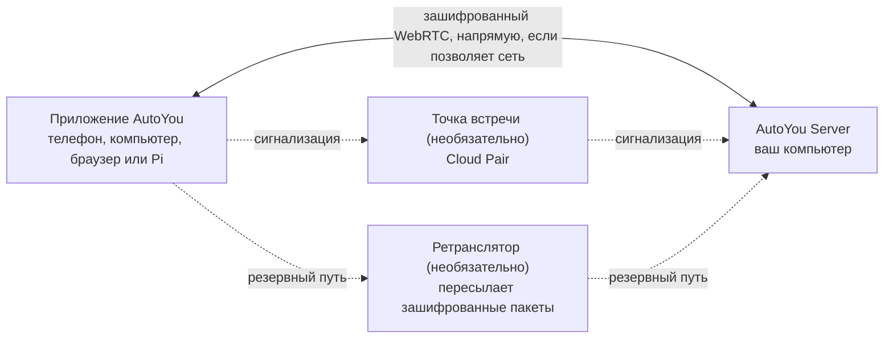

<div align="center">

[English](../../README.md) · [简体中文](README_zh.md) · [繁體中文](README_zh-TW.md) · [日本語](README_ja.md) · [한국어](README_ko.md) · [हिन्दी](README_hi.md) · [Español](README_es.md) · [Français](README_fr.md) · [Deutsch](README_de.md) · [Português (Brasil)](README_pt-BR.md) · **Русский** · [العربية](README_ar.md)


# AutoYou Server

### Ваш собственный ИИ-сервер на компьютере, который у вас уже есть.

**Вы не продукт. Вы владелец.**

[](https://github.com/autoyou-ai/AutoYou-Server/actions/workflows/public-checks.yml)
[](https://github.com/autoyou-ai/AutoYou-Server/releases)
[](../../requirements/README.md)
[](../../servers/README.md)
[](../../autoyou_agents/README.md)
[](../../LICENSE)

**[Сайт](https://www.autoyou.me/) · [Приложения](https://www.autoyou.me/downloads/) · [Экосистема](https://www.autoyou.me/ecosystem/) · [Сообщество](https://www.autoyou.me/community/)**

[Быстрый старт](#quick-start) · [Как это работает](#how-autoyou-works) · [Возможности](#what-you-can-do) · [Агенты](#agents) · [Сопряжение](#pairing-modes) · [Безопасность](#security-modes-and-tiers) · [Клиенты](#supported-clients) · [Вопросы и ответы](#faq) · [Документация](#documentation)

<code>./run_autoyou.sh</code>

</div>

> [!IMPORTANT]
> Загружайте AutoYou Server из [autoyou-ai/AutoYou-Server](https://github.com/autoyou-ai/AutoYou-Server) или с [autoyou.me](https://www.autoyou.me/), а приложения — по ссылкам на магазины в разделе [Поддерживаемые клиенты](#supported-clients). Репозиторий с похожим названием или скопированный README не делают загрузку официальной.

<div align="center">
<br />

<br /><br />
</div>

---

Превратите компьютер на своём столе в частный ИИ-сервер для всех ваших устройств. AutoYou Server запускает ИИ-модели и агентов, голосовые и видеозвонки, удалённый рабочий стол, игры и ваши собственные веб-приложения на Windows, macOS или Linux. Телефон, другие компьютеры и браузеры подключаются к нему по зашифрованным одноранговым соединениям — дома и в дороге.

Ваши разговоры, файлы и действия агентов хранятся на этом компьютере, а не в размещённом сервисе AutoYou. Запускайте локальные модели через Ollama и общайтесь без счетов за токены или подключите облачного провайдера по своему выбору. Один раз выполните сопряжение устройства — и всё, что предлагает сервер, у вас в кармане: чат, помощник без рук, голос в реальном времени на многих языках, ваш рабочий стол, ваши игры и любой веб-сервис, который у вас уже работает.

> **Впервые здесь?** Запустите скрипт, откройте **http://127.0.0.1:8001/**, и мастер настройки поможет выбрать ИИ, включить нужные функции и подключить первое устройство.

<a id="quick-start"></a>

## Быстрый старт

Нужны Git и Python 3.11 или новее. Некоторым дополнительным функциям нужен более новый Python или определённая платформа; см. [профили зависимостей](../../requirements/README.md).

### 1. Получите сервер

```bash
git clone https://github.com/autoyou-ai/AutoYou-Server.git
cd AutoYou-Server
```

### 2. Запустите скрипт

Windows:

```powershell
.\run_autoyou.bat --profile base
# Or select the Full profile with LAN access:
.\run_autoyou.bat --profile full --host 0.0.0.0
```

macOS или Linux:

```bash
./run_autoyou.sh --profile base
# Or select the Full profile with LAN access:
./run_autoyou.sh --profile full --host 0.0.0.0
```

Скрипт создаёт окружение Python, устанавливает зависимости из индексов пакетов и может скачивать модели и нативные инструменты. Сначала прочитайте скрипты и запускайте их в окружении, которое можно безопасно менять.

### 3. Откройте консоль и подключите устройство

Перейдите на **http://127.0.0.1:8001/**, задайте уникальный пароль сервера и следуйте мастеру. Он спросит, для чего вам AutoYou (чат, помощник без рук, звонки, игры, программирование и многое другое), установит подходящих агентов и покажет QR-код для сопряжения телефона.

Для автоматической первоначальной настройки передайте `AUTOYOU_SERVER_PASSWORD` через окружение или менеджер секретов. Не указывайте настоящие пароли в общих командах, issue и скриншотах.

| Профиль | Что добавляет |
| --- | --- |
| `base` | Ядро сервера, локальное администрирование, подключение устройств и интеграции с облачными провайдерами |
| `local` | Помощники для локальных моделей и маршрутизация намерений на устройстве |
| `recommended` | Зависимости для мессенджеров и Bluetooth (по умолчанию, если `--profile` не указан) |
| `full` | Зависимости для речи, браузера и автоматизации рабочего стола |

Профили выбирают только зависимости; интеграции всё равно нужно настроить. `--skip-nuitka` и `--skip-backend-compile` сохраняют встроенные библиотеки лаунчера, поэтому обновления безопасности зависимостей в упакованных приложениях требуют полной пересборки.

Для обновления выполните `git pull` в своей копии и перезапустите скрипт. Примечания к выпускам — в [docs/releases/](../releases/).

<a id="how-autoyou-works"></a>

## Как работает AutoYou

**Сервер — это ваш собственный компьютер, и устройства общаются с ним напрямую.** Приложения и сервер соединяются через WebRTC. После короткого рукопожатия сопряжения они открывают зашифрованный канал (DTLS, для медиа — SRTP), по которому идут чат, голос, видео, демонстрация экрана, игровой ввод и проксируемый веб-трафик. Большинство домашних и мобильных сетей устанавливают такой канал без открытия портов на роутере. Если сеть слишком строгая, соединение переключается на ретранслятор, который пересылает те же зашифрованные пакеты.



На сервере локальный маршрутизатор намерений направляет каждый запрос нужному агенту или инструменту. Google ADK запускает встроенных агентов, также можно подключить OpenClaw, Hermes Agent и Odysseus. LiteLLM отправляет запросы к модели в Ollama на вашем компьютере или выбранному облачному провайдеру. Речь распознаётся и озвучивается локально, а память хранится в SQLite.

<picture>
  <source media="(prefers-color-scheme: dark)" srcset="../images/architecture-dark.png" />
  
</picture>

Схема создаётся скриптом [scripts/build_architecture_diagram.py](../../scripts/build_architecture_diagram.py). Пунктирные блоки — это необязательные дополнения или подключённые проекты.

<a id="what-you-can-do"></a>

## Возможности

| Функция | Что она даёт |
| --- | --- |
| **ИИ-чат** | Общайтесь со своим ИИ с любого сопряжённого устройства; AutoYou не ограничивает число сообщений |
| **Голос в реальном времени** | Живые звонки с ИИ, локальное распознавание речи и голосовые ответы на 30+ языках |
| **Режим помощника** | Слово активации вроде «Hey Jarvis» на телефоне, компьютере, Raspberry Pi или в браузере |
| **Удалённый рабочий стол** | Смотрите и управляйте компьютером с телефона, включая экран блокировки Windows |
| **Видео с компьютера** | Передавайте в звонок экран, камеру, видеофайл или кадры через API |
| **Игровой режим и Game Studio** | Транслируйте игры с компьютера на телефон или создавайте игры, работающие на телефоне без сети |
| **Фабрика веб-приложений** | Поручите агенту создать веб-приложение и открывайте его на всех сопряжённых устройствах |
| **Публикация любого локального порта** | Делитесь любым веб-сервисом компьютера, например `localhost:3000`, с вашими устройствами |
| **Агенты** | 45 встроенных агентов: заметки, файлы, программирование, медиа, браузинг, обучение и другое |
| **MCP** | Используйте инструменты AutoYou в ChatGPT, Codex, Claude, Antigravity, Cursor и VS Code |
| **Мессенджеры** | Связь с сервером через Telegram, Signal и WhatsApp с помощью коннекторов под вашим контролем |
| **Память** | Память в SQLite и личный дневник персоны, с Cognee в качестве необязательного дополнения |

Функции зависят от выбранного профиля, оборудования, разрешений и настроенных интеграций. Мощные возможности — управление рабочим столом, игровой режим, запись и доступ к файлам — остаются выключенными, пока вы их не включите.

<a id="ai-chat"></a>

### ИИ-чат

Выберите провайдера в разделе **AI** консоли: по умолчанию **Ollama + Agents** (локальная модель, ключ API не нужен), **Apple Intelligence** на поддерживаемых Mac, **Gemini**, **OpenRouter** или другие провайдеры через LiteLLM (Anthropic, OpenAI, Mistral, DeepSeek, xAI и другие) — всегда с агентами и инструментами AutoYou. Основной средой сеанса также может быть **OpenClaw**, **Hermes Agent** или **Odysseus**.

AutoYou не ограничивает количество сообщений. С локальной моделью сообщения ничего не стоят и чат работает без интернета. Подключённый облачный провайдер выставляет счета по своему тарифу и видит отправленные ему запросы. Встроенная библиотека моделей позволяет просматривать, скачивать и переключать локальные модели, а агент Model Picker порекомендует модель под ваше оборудование.

Небольшим квантованным локальным моделям помогают оставаться точными: офлайн-классификатор намерений отправляет частые запросы сразу нужному агенту, а компактный режим маршрутизации держит список инструментов коротким. См. [как маленькие модели остаются точными](../../autoyou_agents/README.md#small-local-models).

<a id="realtime-voice-in-many-languages"></a>

### Голос в реальном времени на многих языках

Позвоните своему ИИ и говорите. Распознавание речи работает на вашем компьютере (whisper.cpp в стандартной сборке, faster-whisper в полных голосовых сборках) с обнаружением голосовой активности, прерыванием ответа, как только вы начинаете говорить, и удержанием **«Подожди, пока я договорю»** для длинных мыслей.

- **Говорите на своём языке.** Оставьте **STT language** в значении `auto` и выберите многоязычную модель — язык речи определится автоматически.
- **Слушайте ответ на том же языке.** **Auto TTS** по умолчанию определяет язык ответа и выбирает подходящий системный голос. Локальная модель Supertonic 3 говорит на 31 языке, включая русский, и работает без сети после однократной загрузки около 401 МБ.
- **Выберите голос.** Системные голоса, десять пресетов Supertonic, собственный голос, обученный в приложении Voice Training, EmotiVoice для китайского и английского или облачные голоса OpenAI и Azure.

Синтез речи озвучивает полученный ответ и не переводит его. Выбранная модель чата тоже должна поддерживать язык разговора.

<a id="assistant-mode"></a>

### Режим помощника

Задайте серверу слово активации, например «Hey Jarvis». Произнесите его рядом с сопряжённым телефоном, компьютером, Raspberry Pi, расширением Chrome или страницей администрирования — и всё, что вы скажете дальше, уйдёт в AutoYou. Пока слово не услышано, ничего из сказанного не расшифровывается и не отправляется ИИ. Запишите слово три раза, обучите его на сервере за несколько секунд, проверьте и включите. Во время видеозвонка запрос после слова активации может включать последний кадр с камеры. См. [Режим помощника](../admin-ui/assistant-mode.mdx).

<a id="remote-desktop"></a>

### Удалённый рабочий стол

Смотрите и управляйте компьютером с сопряжённого телефона или настольного приложения: выберите монитор или отдельное окно, двигайте мышь, печатайте и используйте клавиши-модификаторы. Если устройство поддерживает H.264, используется он. В Windows дополнительная служба **AutoYou Secure Desktop Helper** позволяет сопряжённому владельцу видеть экран блокировки и запросы UAC и работать с ними, а сервер может не давать компьютеру уснуть во время подключения. Захват экрана и ввод — отдельные разрешения, выключенные по умолчанию; через Peer Link удалённый рабочий стол не предоставляется никогда.

<a id="computer-video"></a>

### Видео с компьютера

Во время звонка компьютер может передавать видео из четырёх источников: **экран**, **камера**, загруженный и воспроизводимый **видеофайл** или **кадры через API** от вашей собственной программы. Можно поделиться и микрофоном и звуком компьютера. В консоли раздел **Interact** показывает живое изображение с камер подключённых устройств и может воспроизводить их микрофоны через динамики компьютера — без обработки ИИ и без записи.

<a id="game-mode-and-game-studio"></a>

### Игровой режим и Game Studio

- **Игровой режим** транслирует на сопряжённое устройство игру, которая отрисовывается на вашем компьютере, а касания, датчики движения, геймпад, мышь и клавиатура устройства возвращаются как игровой ввод. Можно задать до четырёх подписанных виртуальных кнопок. Игровой режим — отдельное разрешение; он также включает передачу экрана и ввод удалённого рабочего стола.
- **Свой движок.** Локальный игровой движок может читать через локальный WebSocket аутентифицированные кадры ввода по протоколу `autoyou_game_v1`. Для Unreal сервер предоставляет плагин с исходным кодом по адресу `/api/game/unreal-plugin`.
- **Офлайн-игры для телефона.** Агент Game Studio помогает создавать переносимые веб- или WASM-игры, упаковывает их в файлы `.aygame` размером до 5 ГиБ и отправляет клиентам через WebRTC или одобренный Peer Link. У каждой игры есть своя база SQLite на устройстве, а сохранённый прогресс переживает обновления.

**Neon Horizon** — встроенная демо-игра: её можно скачать на телефон, запустить на странице Game Studio или транслировать с компьютера.

<a id="web-app-factory"></a>

### Фабрика веб-приложений

Опишите приложение — агенты его создадут. Агент **Website** делает браузерный интерфейс для агента: простой шаблон или, по запросу, React или Angular, с бэкендом на Python/FastAPI, Node/TypeScript, Go или Rust. **Agent Builder** создаёт каркас нового агента, а агенты **Coding** и **Pi** пишут и тестируют код. Каждое приложение регистрируется в локальном веб-сервисе и появляется в браузере ваших сопряжённых устройств. Агент **Hosting** объясняет, как опубликовать сайт по публичной ссылке: через бесплатный временный туннель `/pair` или платный постоянный URL.

<a id="host-any-local-port"></a>

### Публикация любого локального порта

Что-то уже запущено? Поделитесь. В разделе **Websites & Browser > Advertised Websites** добавьте любой порт от 1 до 65535 с подписью и необязательным адресом пересылки, например `http://127.0.0.1:3000` или другой хост в вашей сети. Сопряжённые клиенты обнаружат его и откроют на том же порту у себя, поэтому дашборды, dev-серверы, инструменты домашней лаборатории и приложения, не рассчитанные на работу под подпутём, продолжают работать. Трафик идёт внутри зашифрованного канала, так что открывать порт на роутере не нужно. Сопряжённые браузеры получают роль `viewer`, `editor` или `admin`, которая ограничивает, что они могут изменять.

<a id="agents"></a>

## Агенты

В AutoYou 45 встроенных агентов. Главный агент передаёт каждый запрос подходящему специалисту, а у многих специалистов есть собственная веб-страница на ваших сопряжённых устройствах. Агенты с пометкой opt-in не установлены, пока вы не установите их в разделе **Agents** консоли.

| Область | Агенты |
| --- | --- |
| Повседневное | Notes, Tasks, Notify, Memory, Persona, Page, Prompts, Location (opt-in) |
| Веб и автоматизация | Internet, Assistant, Browser (opt-in), Client Browser Control, Proxy (opt-in) |
| Медиа и творчество | Audio, TV, Media Generation (opt-in), Game Studio |
| Программирование и сборка | Coding, Pi, Agent Builder, Website, Skills, Files, CLI, Claude CLI, Claude Desktop, Codex Desktop, Antigravity, Prompt Builder (все opt-in) |
| Интеллект и модели | Model Picker, OpenClaw, Hermes Agent (все opt-in) |
| Обучение | Data Collector, Fine-Tuning, Voice Training (все opt-in) |
| Система и компьютер | Admin, Remote Desktop, Backup, Hosting (opt-in), Windows Security (opt-in), macOS Security (opt-in), Education (opt-in) |
| Поддержка AutoYou | Support Ads, Earnings, Donation |

Чтобы добавить своего агента, скопируйте пакет в `autoyou_agents/`. Подробности — в [каталоге агентов](../../autoyou_agents/README.md).

В [сгенерированном справочнике агентов](../agents/) перечислены все инструменты, которые объявляет каждый агент.

<a id="pairing-modes"></a>

## Способы сопряжения

| Способ | Как подключается | Типичное применение |
| --- | --- | --- |
| **Local Pair** | Напрямую по локальной сети; сигнализацию обрабатывает ваш собственный сервер | Одна Wi-Fi-сеть или офис |
| **Bluetooth Pair** | Данные подключения передаются по Bluetooth Low Energy | Первая настройка телефона рядом |
| **Live Pair** | Телефон и компьютер показывают друг другу анимированные QR-коды, сеть между ними не нужна | Изолированные или закрытые сети |
| **Одноразовый код** | `/pair` в мессенджере возвращает краткосрочный код и ссылку | Гостевые устройства и недоверенные сети |
| **Auto Pair** | Зашифрованное сообщение сопряжения передаётся через настроенный вами чат Telegram, Signal или WhatsApp | Удалённое сопряжение без облачного аккаунта |
| **Cloud Pair** | Необязательная платная точка встречи AutoYou Cloud находит ваш компьютер за NAT, с резервным ретранслятором | В поездке или в строгих сетях |

**Peer Link** соединяет одно приложение AutoYou с другим; принимающее приложение одобряет каждое соединение, а пароль компьютера не используется никогда. **Lobbies** — групповые комнаты, которые приложения создают и к которым подключаются поблизости через Wi-Fi и Bluetooth. См. [протоколы сопряжения](../technical/pairing-protocols.md).

<a id="security-modes-and-tiers"></a>

## Режимы и уровни безопасности

На весь сервер действует один режим безопасности. Новая установка начинает в режиме **Secure**.

| Режим | Сообщения сопряжения | Что нужно устройству | Данные на компьютере |
| --- | --- | --- | --- |
| **Normal** | Не шифруются | Одноразовый код | Без изменений |
| **Secure** | Шифруются паролем сервера | Пароль сервера | Без изменений |
| **Secure Professional** | Шифруются паролем сервера | Пароль и текущий код аутентификатора | Без изменений |
| **Secure Professional Maximus** | Как Secure Professional | Пароль и текущий код аутентификатора | Сеансы, данные агентов, сайты, заметки и настройки шифруются при хранении |

В режимах Secure сообщения сопряжения шифруются ключом, полученным при обмене ключами с аутентификацией по паролю (конструкция семейства CPace на ristretto255 с libsodium). Ретранслятор или мост мессенджера, через который они проходят, не может их прочитать, а записанный обмен нельзя использовать для подбора пароля офлайн.

**Уровень безопасности сопряжения** определяет, сколько шагов требует сопряжение через сообщение в чате: **Quick Pairing (B)** позволяет выполнить сопряжение одним сообщением и обеспечивает лучшую совместимость; **Enhanced Pairing (A)** требует от каждого клиента сначала пройти дополнительный обмен hello, что затрудняет подбор. Local Pair, Bluetooth Pair и Cloud Pair всегда используют усиленную схему.

Браузер сопряжённого устройства получает роль `viewer`, `editor` или `admin`. Учётные данные и настройки безопасности можно изменить только на самом компьютере или в HTTPS-сеансе администратора, открытом напрямую на порту администрирования. Шифрование защищает соединение, но не сами устройства, права агентов или сторонние сервисы. См. [режимы безопасности](../security/security-modes.md) и [SECURITY.md](../../SECURITY.md).

<details>
<summary><strong>Что защищает каждый уровень и где заканчивается защита</strong></summary>

| Уровень | Что делает AutoYou |
| --- | --- |
| Доступность в сети | По умолчанию слушает `127.0.0.1`. Прослушивание в локальной сети — отдельная явная настройка. |
| Доступ | Консоль администратора защищена паролем сервера, с необязательными кодами из приложения-аутентификатора (TOTP). |
| Сопряжение | Обмен ключами с проверкой по паролю, одноразовые коды и подтверждение каждой связи в Peer Link. |
| Передача | WebRTC DTLS и SRTP между двумя конечными точками, даже когда пакеты пересылает ретранслятор. |
| Данные на диске | Учётные данные хранятся в зашифрованном хранилище ключей; Maximus также шифрует данные, которыми управляет AutoYou. |
| Зависимости | Манифесты с lock-файлами, проверка уведомлений о безопасности и закреплённые действия CI. |

Шифрование защищает соединение. Оно не защищает всё вокруг:

- **Устройства.** Вредоносная программа на компьютере-сервере или сопряжённом устройстве получает тот доступ, который есть у этого устройства.
- **Агенты.** Агенты работают с правами сервера. Автоматизация браузера, доступ к файлам, управление рабочим столом и выполнение команд — мощные возможности; включайте только нужное и проверяйте, что делают агенты.
- **Третьи стороны.** У облачных провайдеров моделей, мостов мессенджеров и публичных туннелей свои потоки данных и условия. Изучите их перед включением.
- **Эксплуатация.** Если вы держите сервер, вы отвечаете за обновления, резервные копии и учётные данные.

</details>

<details>
<summary><strong>Какие внешние сервисы участвуют</strong></summary>

Вы управляете одним сервером — своим. Для работы ассистента и хранения данных не нужен сервер приложений под управлением AutoYou, а сам сервер работает в локальной сети без подключения к AutoYou Cloud ([подробнее](../architecture/cloud-and-remote.mdx)). Всё остальное — изменяемые настройки по умолчанию или необязательные помощники:

| Компонент | Где работает | Что может видеть |
| --- | --- | --- |
| AutoYou Server: агенты, модели, хранилище, консоль | Ваш компьютер | Ваши данные. Это одна из конечных точек соединения. |
| Приложения и браузерные клиенты | Ваши устройства | То, чем вы с ними делитесь |
| Серверы STUN для определения адреса (включены по умолчанию) | Публичные серверы STUN Google, если вы их не замените | Публичный IP и порт, с которых приходит соединение WebRTC |
| Точка встречи Cloud Pair (необязательно) | AutoYou Cloud | Почта аккаунта, ID устройства, временные данные сопряжения и сетевые метаданные |
| Резервный ретранслятор (необязательно) | AutoYou Cloud | Зашифрованные пакеты и сетевые метаданные |
| Push-уведомления для пробуждения мобильных приложений (необязательно) | Push-сервисы Apple и Google | Что был запрошен вызов приложения |
| Проверка обновлений (включена, если привязан аккаунт) | Канал обновлений AutoYou Cloud | Запрос обновления, подписанный привязанным аккаунтом |
| Облачные провайдеры моделей (необязательно) | Выбранный вами провайдер | Промпты, которые вы ему отправляете |
| Мосты Telegram, Signal и WhatsApp (необязательно) | Эти сервисы | Сообщения, проходящие через них, по их условиям |
| Публичный туннель для сайтов (необязательно) | Провайдер туннеля | Трафик к публичному URL. Это не сквозное шифрование. |

**Публичный STUN включён по умолчанию**, в том числе для Local Pair. Чтобы этот запрос не уходил в интернет, задайте `AUTOYOU_DISABLE_PUBLIC_STUN=1` перед запуском сервера или укажите собственный сервер STUN и TURN через `AUTOYOU_LOCAL_STUNTURN_HOST` (плюс `AUTOYOU_LOCAL_TURN_USERNAME` и `AUTOYOU_LOCAL_TURN_PASSWORD` для TURN). Без серверов STUN и TURN соединения через NAT могут не устанавливаться.

</details>

<a id="supported-clients"></a>

## Поддерживаемые клиенты

AutoYou Server работает на вашем компьютере, а приложения подключаются к нему откуда угодно. Клиентские приложения распространяются отдельно, их исходный код не входит в этот репозиторий.

| Платформа | Где взять |
| --- | --- |
| iPhone и iPad | [App Store](https://apps.apple.com/us/app/autoyou/id6760363728) |
| Android | [Google Play](https://play.google.com/store/apps/details?id=com.autoyou.app) |
| Windows | [Microsoft Store](https://apps.microsoft.com/detail/9mw8l2wfw7wv?hl=en-US&gl=US) |
| macOS и Linux | [Загрузки](https://www.autoyou.me/downloads/) |
| Браузер | Расширение Chrome и веб-клиент ([страница экосистемы](https://www.autoyou.me/ecosystem/)) |
| Raspberry Pi | Голосовой клиент на Python для режима помощника ([настройка](../admin-ui/assistant-mode.mdx)) |

Мобильные приложения также содержат небольшой локальный ИИ (LFM 2.5 350M, Gemini Nano или Apple Intelligence в зависимости от устройства), чтобы общаться даже без компьютера.

| Режимы сопряжения | Чат с собственным ИИ | Лобби поблизости | Локальный ИИ на телефоне |
| --- | --- | --- | --- |
|  |  |  |  |

- **Лобби.** Создавайте комнаты поблизости или присоединяйтесь к ним через Wi-Fi и Bluetooth, с чатом и аудио или видео для шести гостей и хозяина.
- **Peer Link.** Соедините одно приложение с другим. Принимающее приложение подтверждает каждую связь, а необязательные ответы ИИ используют только то, что вы ему рассказали.
- **Ваш компьютер везде.** Чат, звонки, удалённый рабочий стол, игровой режим, сайты агентов и опубликованные порты на каждом сопряжённом устройстве.

<a id="mcp"></a>
<a id="use-autoyou-from-your-coding-agent"></a>

## Используйте AutoYou из своего агента для программирования

Подключите функции MCP в ChatGPT, Codex, Claude Code или Claude Desktop, Google Antigravity, Cursor и VS Code к поддерживаемым инструментам AutoYou. Локальный адаптер MCP — отдельный процесс; сервер не устанавливает его в эти клиенты, а вызовы MCP открывают только поддерживаемые адаптером инструменты, а не произвольный доступ к вашим файлам или ко всем функциям AutoYou.

1. Запустите AutoYou Server и откройте **http://127.0.0.1:8001/**.
2. В **Admin UI > Messaging > AutoYou MCP** включите MCP, создайте закрытый токен адаптера и скачайте `autoyou-mcp.env`. Храните этот файл в секрете.
3. Установите адаптер, который поддерживается отдельно, в отдельное окружение Python:

   ```powershell
   git clone https://github.com/autoyou-ai/AutoYou.git
   cd AutoYou
   py -3 -m venv .venv-mcp
   .\.venv-mcp\Scripts\python.exe -m pip install -e .\plugins\autoyou-mcp
   ```

   На macOS или Linux используйте `python3 -m venv .venv-mcp` и `.venv-mcp/bin/python -m pip install -e ./plugins/autoyou-mcp`.

Для клиентов, которые запускают локальный процесс MCP, используйте эту команду с абсолютными путями:

```text
<path-to-.venv-mcp-python> -m autoyou_mcp --env-file <path-to-autoyou-mcp.env> --transport stdio
```

<details>
<summary><strong>Добавьте AutoYou в каждый клиент</strong></summary>

Для клиентов с JSON-форматом `mcpServers` запись выглядит так. Замените два примера путей и экранируйте обратные слеши Windows, если используете их в JSON:

```json
{
  "mcpServers": {
    "autoyou": {
      "command": "C:/path/to/AutoYou/.venv-mcp/Scripts/python.exe",
      "args": [
        "-m", "autoyou_mcp",
        "--env-file", "C:/path/to/autoyou-mcp.env",
        "--transport", "stdio"
      ]
    }
  }
}
```

**ChatGPT в браузере** использует удалённое подключение MCP, а не локальный процесс `stdio`. Запустите адаптер с `--transport streamable-http` и подключите его локальную точку `http://127.0.0.1:8071/mcp` через OpenAI Secure MCP Tunnel. ChatGPT требует режим разработчика и соответствующий доступ к рабочему пространству или права администратора, а OpenAI ограничивает полные действия MCP в зависимости от тарифа. Следуйте [настройке AutoYou MCP для ChatGPT](https://github.com/autoyou-ai/AutoYou/blob/main/plugins/autoyou-mcp/README.md#connect-chatgpt-web) и [руководству OpenAI по приложениям MCP](https://help.openai.com/en/articles/12584461-developer-mode-and-mcp-apps-in-chatgpt).

**Codex CLI, настольное приложение и расширение для IDE** используют общую конфигурацию MCP хоста Codex:

```powershell
codex mcp add autoyou -- "C:/path/to/AutoYou/.venv-mcp/Scripts/python.exe" -m autoyou_mcp --env-file "C:/path/to/autoyou-mcp.env" --transport stdio
codex mcp list
```

Или добавьте соответствующие `command` и `args` в раздел `[mcp_servers.autoyou]` файла `~/.codex/config.toml`. См. [руководство Codex по MCP](https://learn.chatgpt.com/docs/extend/mcp?surface=cli).

**Claude Code:**

```powershell
claude mcp add --transport stdio autoyou -- "C:/path/to/AutoYou/.venv-mcp/Scripts/python.exe" -m autoyou_mcp --env-file "C:/path/to/autoyou-mcp.env" --transport stdio
claude mcp list
```

Затем выполните `/mcp` в Claude Code. См. [руководство Claude Code по MCP](https://code.claude.com/docs/en/mcp).

**Claude Desktop** запускает адаптер как локальный stdio-сервер. Добавьте запись `mcpServers.autoyou` в `~/Library/Application Support/Claude/claude_desktop_config.json` на macOS или в `%APPDATA%\Claude\claude_desktop_config.json` на Windows, затем полностью закройте и снова откройте Claude Desktop. AutoYou пока не распространяет настольное расширение `.mcpb`. См. [руководство Claude Desktop по MCP](https://support.claude.com/en/articles/10949351-getting-started-with-local-mcp-servers-on-claude-desktop).

**Google Antigravity** использует `~/.gemini/config/mcp_config.json` глобально или `.agents/mcp_config.json` в рабочем пространстве. В Antigravity IDE откройте **MCP Servers > Manage MCP Servers > View raw config**. См. [руководство Antigravity по MCP](https://antigravity.google/docs/mcp).

**Cursor** использует `~/.cursor/mcp.json` или `.cursor/mcp.json` с той же записью `mcpServers`. См. [руководство Cursor по MCP](https://prod.cursor.com/help/customization/mcp).

**VS Code** может использовать переносимый файл `.mcp.json` в корне рабочего пространства. В `.vscode/mcp.json` вместо этого используется объект `servers` верхнего уровня с `"type": "stdio"`. См. [руководство VS Code по MCP](https://code.visualstudio.com/docs/agent-customization/mcp-servers).

На macOS или Linux исполняемый файл Python — `.venv-mcp/bin/python`. На доступность могут влиять версии клиентов, их настройки, политики организации и подтверждение инструментов.

</details>

После подключения убедитесь, что `get_autoyou_status` появился и возвращает ожидаемое состояние сервера, прежде чем использовать инструменты, которые что-то записывают. Область действия, модель безопасности и ограничения описаны в [руководстве по интеграции MCP в AutoYou](../guides/mcp-integration.mdx).

<a id="admin-console"></a>

## Консоль администратора

<p align="center">
  
</p>

Локальная консоль объединяет настройку, модели, голос, агентов, подключения, разрешения и безопасность. Мастер настройки спрашивает, для чего вам AutoYou, и предлагает подходящих агентов и разрешения; ничего не меняется, пока вы не проверите и не сохраните план. На снимках экрана примерные значения. Выберите миниатюру, чтобы открыть полноразмерное изображение.

| Сводка сервера | Устройства и активность | Доступ и безопасность |
| --- | --- | --- |
| [](../images/admin/overview.png) | [](../images/admin/live-view.png) | [](../images/admin/security.png) |

<a id="other-ways-to-run"></a>

## Другие способы запуска

<details>
<summary><strong>Docker</strong></summary>

Безопасно передайте `AUTOYOU_SERVER_PASSWORD` и выполните:

```bash
docker compose up --build
```

Файл Compose публикует порты только на loopback-интерфейсе хоста и хранит конфигурацию в именованном томе. Откройте `http://localhost:8001/` на том же компьютере; файл объявляет эту публикацию только на loopback (`AUTOYOU_ADMIN_TRUST_PUBLISHED_LOOPBACK=1`), поэтому вход не отклоняется с ошибкой "requires localhost or HTTPS". При обычном `docker run` публикуйте на `127.0.0.1` и передайте ту же переменную либо поставьте перед сервером TLS-прокси. Проверьте, как ваша версия Docker публикует порты, прежде чем полагаться на изоляцию через loopback.

Чтобы отключить загрузку Tunnelmole при сборке и запуске, задайте `AUTOYOU_SKIP_TUNNELMOLE_DOWNLOAD=1` и `AUTOYOU_NO_DOWNLOAD_TUNNELMOLE=1` перед сборкой и запуском. Функциям, которым он нужен, тогда потребуется отдельно предоставленный исполняемый файл.

</details>

<details>
<summary><strong>Соберите неофициальную локальную версию</strong></summary>

Из корня репозитория:

```powershell
# Windows
.\servers\windows\build-all.ps1 -Configuration Debug
```

```bash
# macOS
./servers/macos/build-all.sh --no-sign --dev

# Linux / WSL
./servers/wsl/build-backend.sh --unofficial
```

Для этих способов не нужны аккаунт AutoYou и одобрение официального выпуска. Они могут устанавливать или настраивать зависимости. Прочитайте лицензию и уведомления, когда они появятся. Чтобы принять их без запроса после прочтения, передайте `-AcceptTerms` на Windows или `--accept-terms` на macOS и Linux.

Требования, расположение результатов и известные ограничения:
[Windows](../../servers/windows/README.md) · [macOS](../../servers/macos/README.md) · [Linux / WSL](../../servers/wsl/README.md).

</details>

<a id="faq"></a>

## Вопросы и ответы

<details>
<summary><strong>Нужен ли облачный аккаунт или VPN?</strong></summary>

Нет. Local Pair, Bluetooth Pair, Live Pair, одноразовые коды и Auto Pair работают без аккаунта AutoYou. Cloud Pair — необязательная платная услуга. Если вы уже пользуетесь VPN вроде Tailscale, AutoYou работает и через него.

</details>

<details>
<summary><strong>ИИ-чат правда безлимитный?</strong></summary>

AutoYou не ограничивает сообщения. С локальной моделью Ollama каждое сообщение бесплатно, а скорость зависит от вашего компьютера. У подключённого облачного провайдера свои цены и ограничения.

</details>

<details>
<summary><strong>Загружает ли AutoYou мои файлы или разговоры куда-либо?</strong></summary>

Они хранятся на вашем компьютере. Данные уходят только через включённые вами сервисы — облачного провайдера моделей, мост мессенджера или публичный туннель, — и у каждого из них свои условия.

</details>

<details>
<summary><strong>На каких языках можно говорить?</strong></summary>

Распознавание речи определяет язык, когда **STT language** установлен в `auto` и выбрана многоязычная модель. Голосовые ответы используют подходящий системный голос или локальную модель Supertonic 3, которая поддерживает 31 язык. Ваша чат-модель тоже должна понимать этот язык.

</details>

<details>
<summary><strong>Можно ли поделиться веб-приложением или игрой с друзьями?</strong></summary>

Да. Любой, кто сопряжён с вашим сервером, может открывать сайты агентов и опубликованные порты в рамках выданной роли. Общие устройства помечаются как общие, поэтому ваши сайты могут ограничивать то, что они видят. Для тех, кто не сопряжён, агент Hosting объясняет бесплатную временную ссылку и платный постоянный URL.

</details>

<details>
<summary><strong>Что делать, если я нашёл ошибку?</strong></summary>

Сначала обновитесь: возможно, новая версия её уже исправила. Если проблема осталась, [создайте issue](https://github.com/autoyou-ai/AutoYou-Server/issues) с версией AutoYou (`VERSION`), операционной системой, профилем, шагами воспроизведения и выводом ошибки. Об уязвимостях сообщайте конфиденциально по [SECURITY.md](../../SECURITY.md).

</details>

<a id="documentation"></a>

## Документация

- [Быстрый старт](../quickstart.mdx) · [Архитектура](../architecture/) · [Безопасность и конфиденциальность](../security/) · [Консоль администратора](../admin-ui/)
- [Каталог агентов](../../autoyou_agents/README.md) · [Справочник агентов](../agents/) · [Фреймворк агентов](../agent-framework/)
- [HTTP и WebSocket API](../api-reference/) · [Руководства](../guides/) · [Руководства по сопряжению](../../guides/README.md)

<a id="contributing"></a>

## Участие в проекте

Мы будем рады вашей помощи. Начните со [встроенных агентов](../../autoyou_agents/README.md), [Agent Builder](../admin-ui/agent-workbench-ui.mdx) или [руководства по созданию своего агента](../guides/custom-agent-tutorial.mdx).

- **Создайте** агента, игру, расширение, интеграцию или веб-интерфейс.
- **Улучшите** установку, доступность, поддержку платформ, переводы, документацию или исправьте воспроизводимую ошибку.
- **Поделитесь** демо, руководством или чётко обозначенной неофициальной сборкой, соблюдающей лицензию.

Перед отправкой работы прочитайте [CONTRIBUTING.md](../../CONTRIBUTING.md) и [Кодекс поведения](../../CODE_OF_CONDUCT.md). Оригинальный независимый код может использовать любую выбранную вами лицензию, включая MIT или Apache-2.0. Изменения существующего кода AutoYou сохраняют его лицензию.

<a id="license"></a>

## Лицензия

AutoYou Server распространяется с открытым исходным кодом для просмотра (source-available) по [лицензии сервера](../../LICENSE). Сейчас это не проект с открытым исходным кодом, одобренный OSI, и определения в `LICENSE` имеют приоритет.

| Материал или использование | Условия |
| --- | --- |
| Личное использование, локальные сборки и бесплатное распространение | Разрешены по лицензии сервера и её условиям |
| Изменения кода AutoYou | Сохраняют действующую лицензию AutoYou |
| Оригинальный, независимый и отделимый код | Любая выбранная вами лицензия, включая MIT или Apache-2.0 |
| Использование организациями или коммерческая эксплуатация | Отдельное [соглашение Enterprise](https://www.autoyou.me/enterprise/) |

Сохраняйте уведомления, обозначайте неофициальные сборки и выполняйте обязательства включённых компонентов. См. [THIRD-PARTY-NOTICES.md](../../THIRD-PARTY-NOTICES.md) и [политику товарных знаков](../legal/trademark-policy.md).

OpenStorey направляет не менее 15 % подходящей чистой выручки в фонд участников, который распределяется по его [правилам проверки и отбора](../contributors/contributor-pool.md). [План финансирования](https://www.autoyou.me/donate/) включает этап в 5 миллионов долларов для открытия кода сервера; сам по себе этап не меняет лицензию копии, которая у вас уже есть. Подробнее: [docs/legal/open-source-commitment.md](../legal/open-source-commitment.md).

<a id="support"></a>

## Поддержка

- **Вопросы и помощь с установкой:** [SUPPORT.md](../../SUPPORT.md) и [сообщество](https://www.autoyou.me/community/).
- **Ошибки и конкретные предложения:** [создайте issue](https://github.com/autoyou-ai/AutoYou-Server/issues).
- **Уязвимости:** сообщайте конфиденциально, как описано в [SECURITY.md](../../SECURITY.md). Не используйте публичные issue для нераскрытых уязвимостей.

Агенты работают с правами сервера: проверяйте, что они делают, включайте только нужное и делайте резервные копии.

Copyright &copy; 2026 OpenStorey LLC and contributors.
