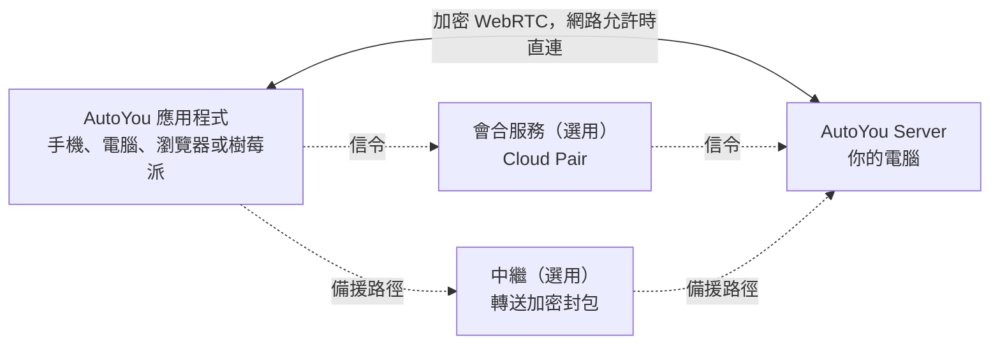

<div align="center">

[English](../../README.md) · [简体中文](README_zh.md) · **繁體中文** · [日本語](README_ja.md) · [한국어](README_ko.md) · [हिन्दी](README_hi.md) · [Español](README_es.md) · [Français](README_fr.md) · [Deutsch](README_de.md) · [Português (Brasil)](README_pt-BR.md) · [Русский](README_ru.md) · [العربية](README_ar.md)


# AutoYou Server

### 在你已經擁有的電腦上，執行屬於你自己的 AI 伺服器。

**你不是產品，你是主人。**

[](https://github.com/autoyou-ai/AutoYou-Server/actions/workflows/public-checks.yml)
[](https://github.com/autoyou-ai/AutoYou-Server/releases)
[](../../requirements/README.md)
[](../../servers/README.md)
[](../../autoyou_agents/README.md)
[](../../LICENSE)

**[官網](https://www.autoyou.me/) · [應用程式下載](https://www.autoyou.me/downloads/) · [生態系](https://www.autoyou.me/ecosystem/) · [社群](https://www.autoyou.me/community/)**

[快速開始](#quick-start) · [運作方式](#how-autoyou-works) · [功能一覽](#what-you-can-do) · [代理](#agents) · [配對方式](#pairing-modes) · [安全](#security-modes-and-tiers) · [用戶端](#supported-clients) · [常見問題](#faq) · [文件](#documentation)

<code>./run_autoyou.sh</code>

</div>

> [!IMPORTANT]
> 請從 [autoyou-ai/AutoYou-Server](https://github.com/autoyou-ai/AutoYou-Server) 或 [autoyou.me](https://www.autoyou.me/) 取得 AutoYou Server，並透過[支援的用戶端](#supported-clients)中的商店連結取得應用程式。名稱相似的儲存庫或複製的 README 並不代表下載是官方的。

<div align="center">
<br />

<br /><br />
</div>

---

把你桌上的電腦變成服務你所有裝置的私人 AI 伺服器。AutoYou Server 在你的 Windows、macOS 或 Linux 電腦上執行 AI 模型與代理、語音與視訊通話、遠端桌面、遊戲，以及你自己的 Web 應用程式。無論在家或外出，手機、其他電腦和瀏覽器都透過加密的點對點連線存取它。

你的對話、檔案和代理活動保存在這台電腦上，而非託管的 AutoYou 服務中。用 Ollama 執行本機模型，聊天不必支付 token 費用；也可以接上你偏好的雲端供應商。配對一次，伺服器提供的一切都在你的口袋裡：聊天、免手動助理、多語言即時語音、你的桌面、你的遊戲，以及你已經在執行的任何 Web 服務。

> **第一次使用？** 執行啟動腳本，開啟 **http://127.0.0.1:8001/**，設定精靈會引導你選擇 AI、開啟需要的功能並配對第一台裝置。

<a id="quick-start"></a>

## 快速開始

你需要 Git 與 Python 3.11 或更新版本。部分選用功能需要更新的 Python 或特定平台，請參閱[相依性設定](../../requirements/README.md)。

### 1. 取得伺服器

```bash
git clone https://github.com/autoyou-ai/AutoYou-Server.git
cd AutoYou-Server
```

### 2. 執行啟動腳本

Windows：

```powershell
.\run_autoyou.bat --profile base
# Or select the Full profile with LAN access:
.\run_autoyou.bat --profile full --host 0.0.0.0
```

macOS 或 Linux：

```bash
./run_autoyou.sh --profile base
# Or select the Full profile with LAN access:
./run_autoyou.sh --profile full --host 0.0.0.0
```

啟動腳本會建立 Python 環境、從套件索引安裝相依套件，並可能下載模型與原生工具。請先閱讀腳本，並在可以安全修改的環境中執行。

### 3. 開啟主控台並配對裝置

前往 **http://127.0.0.1:8001/**，設定一組唯一的伺服器密碼，然後依精靈操作。它會詢問你想用 AutoYou 做什麼（聊天、免手動助理、通話、遊戲、程式開發等），安裝相應的代理，並顯示手機配對用的 QR 碼。

無人值守安裝時，請透過環境變數或密鑰管理工具提供 `AUTOYOU_SERVER_PASSWORD`。不要在共享的指令、issue 或截圖中暴露真實密碼。

| 設定檔 (profile) | 增加的內容 |
| --- | --- |
| `base` | 核心伺服器、本機管理、裝置連線與雲端供應商整合 |
| `local` | 本機模型輔助工具與裝置端意圖路由 |
| `recommended` | 訊息應用程式與藍牙整合相依套件（省略 `--profile` 時的預設值） |
| `full` | 語音、瀏覽器與桌面自動化相依套件 |

更新時在儲存庫目錄中執行 `git pull`，再重新執行啟動腳本。版本說明見 [docs/releases/](../releases/)。

<a id="how-autoyou-works"></a>

## 運作方式

**伺服器就是你自己的電腦，裝置直接與它通訊。** 應用程式與伺服器透過 WebRTC 連線。完成簡短的配對交握後，雙方建立加密連結（DTLS，媒體使用 SRTP），承載聊天、語音、視訊、螢幕分享、遊戲輸入和代理的網頁流量。多數家用與行動網路不需要在路由器開放連接埠即可建立連線；網路過於嚴格時，會改用轉送相同加密封包的中繼。



在伺服器上，裝置端意圖路由器會把每個請求交給合適的代理或工具。Google ADK 執行原生代理，也可以橋接 OpenClaw、Hermes Agent 和 Odysseus。LiteLLM 把模型呼叫送到你電腦上的 Ollama 或你選擇的雲端供應商。語音在本機辨識、在本機朗讀，記憶保存在 SQLite 中。

<a id="what-you-can-do"></a>

## 功能一覽

| 功能 | 帶給你什麼 |
| --- | --- |
| **AI 聊天** | 在任何已配對裝置上與你自己的 AI 聊天，AutoYou 不限制訊息數量 |
| **即時語音** | 與 AI 即時通話，本機語音辨識，30 多種語言的語音回覆 |
| **助理模式** | 在手機、電腦、樹莓派或瀏覽器上使用喚醒詞，例如 "Hey Jarvis" |
| **遠端桌面** | 用手機檢視並控制電腦，包括 Windows 鎖定畫面 |
| **電腦視訊** | 把電腦的螢幕、攝影機、影片檔或 API 輸入的畫面送進通話 |
| **遊戲模式與 Game Studio** | 把電腦上的遊戲串流到手機，或製作在手機上離線執行的遊戲 |
| **Web 應用程式工廠** | 讓代理建構 Web 應用程式，並在所有已配對裝置上開啟 |
| **託管任意本機連接埠** | 把電腦上的任何 Web 服務（如 `localhost:3000`）分享給已配對裝置 |
| **代理** | 45 個內建代理，涵蓋筆記、檔案、程式開發、媒體、瀏覽、訓練等 |
| **MCP** | 在 ChatGPT、Codex、Claude、Antigravity、Cursor 和 VS Code 中使用 AutoYou 工具 |

功能取決於所選設定檔、硬體、權限與已設定的整合。桌面控制、遊戲模式、錄音和檔案存取等強大能力，在你開啟之前都保持關閉。

### AI 聊天

在主控台的 **AI** 頁面選擇供應商：預設的 **Ollama + Agents**（本機模型，不需 API 金鑰）、支援的 Mac 上的 **Apple Intelligence**、**Gemini**、**OpenRouter**，或透過 LiteLLM 接上 Anthropic、OpenAI、Mistral、DeepSeek、xAI 等，同時保留 AutoYou 的所有代理與工具。也可以把 **OpenClaw**、**Hermes Agent** 或 **Odysseus** 作為主要工作階段執行環境。

AutoYou 不限制你傳送的訊息數量。使用本機模型時，聊天不按訊息計費，離線也能使用；你接上的雲端供應商會依其方案收費，並能看到你送出的提示詞。內建模型庫可瀏覽、下載和切換本機模型，Model Picker 代理會推薦適合你硬體的模型。

### 多語言即時語音

打電話給你的 AI 直接說話。語音辨識在你的電腦上執行（預設版本使用 whisper.cpp，完整語音版本使用 faster-whisper），支援語音活動偵測、一開口即可打斷，以及用於長段思考的「等我說完」保持功能。

- **說你的語言。** 將 **STT language** 設為 `auto` 並選擇多語言模型，即可自動偵測你說的語言。
- **用同一種語言聽回覆。** 預設的 **Auto TTS** 會偵測回覆語言並選擇相符的系統語音。本機 Supertonic 3 模型支援 31 種語言，一次下載約 401 MB 後即可離線使用。
- **選擇你的聲音。** 系統語音、10 種 Supertonic 預設、在 Voice Training 中訓練的自訂聲音、中英文 EmotiVoice，或託管的 OpenAI 與 Azure 語音。

文字轉語音只朗讀給它的回覆，不負責翻譯；你選擇的聊天模型也需要支援對話語言。

### 助理模式

為伺服器設定喚醒詞，例如 "Hey Jarvis"。在已配對的手機、電腦、樹莓派、Chrome 擴充功能或管理頁面附近說出它，之後說的話就會送到 AutoYou。在聽到喚醒詞之前，你說的任何話都不會被轉錄或送給 AI。錄三次、在伺服器上幾秒內完成訓練、測試後即可開啟。視訊通話中，喚醒詞之後的請求可附上最新的攝影機畫面。詳見[助理模式](../admin-ui/assistant-mode.mdx)。

### 遠端桌面

從已配對的手機或桌面應用程式檢視並控制電腦：選擇螢幕或單一應用程式視窗，移動滑鼠、打字並使用修飾鍵。裝置支援時優先使用 H.264。在 Windows 上，選用的 **AutoYou Secure Desktop Helper** 服務讓已配對的擁有者能看到並操作鎖定畫面與 UAC 提示，伺服器也能在連線期間讓電腦保持喚醒。螢幕擷取與輸入是兩個獨立權限，預設關閉；Peer Link 永遠不提供遠端桌面。

### 電腦視訊

通話中，電腦可以從四種來源傳送視訊：**螢幕**、**攝影機**、你上傳並播放的**影片檔**，或你自己的程式輸入的 **API 畫面**。也可以分享電腦的麥克風與聲音。主控台的 **Interact** 頁面能顯示已連線裝置的即時攝影機畫面，並在電腦喇叭上播放它們的麥克風聲音，不經過 AI 處理，也不錄製。

### 遊戲模式與 Game Studio

- **遊戲模式**把在電腦上算繪的遊戲串流到已配對裝置，裝置的觸控、動作感測器、控制器、滑鼠和鍵盤會作為遊戲輸入傳回。最多可定義四個有標籤的虛擬按鍵。遊戲模式是獨立權限，同時會開啟螢幕傳送與遠端桌面輸入。
- **使用你自己的引擎。** 本機遊戲引擎可以透過回送 WebSocket 讀取經過驗證的 `autoyou_game_v1` 輸入影格。伺服器在 `/api/game/unreal-plugin` 提供 Unreal 原始碼外掛。
- **手機離線遊戲。** Game Studio 代理協助你建構可攜的 Web 或 WASM 遊戲，打包成最大 5 GiB 的 `.aygame` 檔，並透過 WebRTC 或已核准的 Peer Link 傳送給用戶端。每款遊戲都有自己的裝置端 SQLite 資料庫，進度在更新後保留。

內建示範遊戲 **Neon Horizon** 可作為手機下載、在 Game Studio 頁面遊玩，或從電腦串流。

### Web 應用程式工廠

描述一個應用程式，讓代理來建構。**Website** 代理為代理建立瀏覽器前端：簡單的起步範本，或依需求使用 React、Angular，後端可選 Python/FastAPI、Node/TypeScript、Go 或 Rust。**Agent Builder** 建立新代理的骨架，**Coding** 與 **Pi** 代理實作並測試程式碼。每個應用程式都會註冊到本機網站服務，出現在已配對裝置的瀏覽器中。**Hosting** 代理說明如何發布到公開網路：免費的臨時 `/pair` 通道或付費的永久 URL。

### 託管任意本機連接埠

已經在執行某個服務？直接分享。在 **Websites & Browser > Advertised Websites** 中新增 1 到 65535 之間的任意連接埠，填寫標籤與選用的轉送 URL（如 `http://127.0.0.1:3000` 或區域網路中的其他主機）。已配對用戶端會發現它，並在自己這端的相同連接埠開啟，因此儀表板、開發伺服器、家庭實驗室工具，以及不支援子路徑的應用程式都能正常運作。流量在加密的點對點連結內傳輸，不需要在路由器開放連接埠；已配對瀏覽器會獲得 `viewer`、`editor` 或 `admin` 角色，限制能修改的內容。

<a id="agents"></a>

## 代理

AutoYou 內建 45 個代理。主代理把每個請求路由到合適的專家，許多專家也在你的已配對裝置上提供自己的網頁。標示為 opt-in 的代理，在你於主控台 **Agents** 頁面安裝前保持未安裝。

| 領域 | 代理 |
| --- | --- |
| 日常 | Notes、Tasks、Notify、Memory、Persona、Page、Prompts、Location (opt-in) |
| 網頁與自動化 | Internet、Assistant、Browser (opt-in)、Client Browser Control、Proxy (opt-in) |
| 媒體與創作 | Audio、TV、Media Generation (opt-in)、Game Studio |
| 程式與建構 | Coding、Pi、Agent Builder、Website、Skills、Files、CLI、Claude CLI、Claude Desktop、Codex Desktop、Antigravity、Prompt Builder（皆為 opt-in） |
| 智慧與模型 | Model Picker、OpenClaw、Hermes Agent（皆為 opt-in） |
| 訓練 | Data Collector、Fine-Tuning、Voice Training（皆為 opt-in） |
| 系統與電腦 | Admin、Remote Desktop、Backup、Hosting (opt-in)、Windows Security (opt-in)、macOS Security (opt-in)、Education (opt-in) |
| 支持 AutoYou | Support Ads、Earnings、Donation |

把代理套件複製到 `autoyou_agents/` 即可加入你自己的代理。完整說明見[代理目錄](../../autoyou_agents/README.md)。

<a id="pairing-modes"></a>

## 配對方式

| 方式 | 連線方式 | 典型用途 |
| --- | --- | --- |
| **Local Pair** | 透過區域網路直連，由你自己的伺服器處理信令 | 同一個 Wi-Fi 或辦公網路 |
| **Bluetooth Pair** | 透過低功耗藍牙傳遞連線資訊 | 首次設定附近的手機 |
| **Live Pair** | 手機與電腦互相顯示動態 QR 碼，不需要網路路徑 | 隔離或受限的網路 |
| **一次性代碼** | 在訊息聊天中傳送 `/pair`，取得短時間有效的代碼與連結 | 訪客裝置與不受信任的網路 |
| **Auto Pair** | 加密的配對訊息透過你設定的 Telegram、Signal 或 WhatsApp 聊天傳遞 | 不需雲端帳號的遠端配對 |
| **Cloud Pair** | 選用的付費 AutoYou Cloud 會合服務跨越 NAT 找到你的電腦，並支援中繼備援 | 外出或網路嚴格時 |

**Peer Link** 連接兩個 AutoYou 應用程式，由接收方核准每個連結，且從不使用電腦的密碼。**Lobbies** 是應用程式在附近透過 Wi-Fi 與藍牙建立和加入的群組房間。詳見[配對協定](../technical/pairing-protocols.md)。

<a id="security-modes-and-tiers"></a>

## 安全模式與安全層級

整台伺服器使用同一種安全模式。新安裝預設為 **Secure**。

| 模式 | 配對訊息 | 裝置配對需要 | 電腦上的資料 |
| --- | --- | --- | --- |
| **Normal** | 不加密 | 一次性代碼 | 不變 |
| **Secure** | 以伺服器密碼加密 | 伺服器密碼 | 不變 |
| **Secure Professional** | 以伺服器密碼加密 | 密碼加上目前的驗證器代碼 | 不變 |
| **Secure Professional Maximus** | 同 Secure Professional | 密碼加上目前的驗證器代碼 | 工作階段、代理資料、網站、筆記與設定皆靜態加密 |

在 Secure 模式下，配對訊息以密碼驗證金鑰交換（基於 ristretto255 與 libsodium 的 CPace 系列構造）衍生的金鑰加密。轉送它們的中繼或訊息橋無法讀取內容，錄下的交換過程也無法用來離線猜測密碼。

**配對安全層級**決定一次聊天訊息配對需要多少步驟：**Quick Pairing (B)** 允許用戶端以一則訊息完成配對，相容性最佳；**Enhanced Pairing (A)** 要求每個用戶端先完成一次額外的 hello 往返，讓猜測更困難。Local Pair、Bluetooth Pair 與 Cloud Pair 一律使用增強流程。

已配對裝置的瀏覽器會獲得 `viewer`、`editor` 或 `admin` 角色。憑證與安全設定只能在電腦本機，或直接在管理連接埠開啟的 HTTPS 管理工作階段中變更。加密保護的是連線本身，而非端點裝置、代理權限或第三方服務。詳見[安全模式](../security/security-modes.md)與 [SECURITY.md](../../SECURITY.md)。

<a id="supported-clients"></a>

## 支援的用戶端

AutoYou Server 在你的電腦上執行，應用程式從其他任何地方存取它。用戶端應用程式另外發布，原始碼不在本儲存庫中。

| 平台 | 取得方式 |
| --- | --- |
| iPhone 與 iPad | [App Store](https://apps.apple.com/us/app/autoyou/id6760363728) |
| Android | [Google Play](https://play.google.com/store/apps/details?id=com.autoyou.app) |
| Windows | [Microsoft Store](https://apps.microsoft.com/detail/9mw8l2wfw7wv?hl=en-US&gl=US) |
| macOS 與 Linux | [下載](https://www.autoyou.me/downloads/) |
| 瀏覽器 | Chrome 擴充功能與 Web 用戶端，見[生態系頁面](https://www.autoyou.me/ecosystem/) |
| 樹莓派 | 用於助理模式的 Python 語音用戶端（[設定](../admin-ui/assistant-mode.mdx)） |

手機應用程式也內建小型本機 AI（依裝置為 LFM 2.5 350M、Gemini Nano 或 Apple Intelligence），沒有電腦時也能聊天。

<a id="mcp"></a>

## 在程式開發代理中使用 AutoYou

本機 MCP 轉接器能把支援的 AutoYou 工具連接到 ChatGPT、Codex、Claude Code、Claude Desktop、Google Antigravity、Cursor 與 VS Code。在 **Admin UI > Messaging > AutoYou MCP** 中啟用 MCP 並下載 `autoyou-mcp.env`，再依照[英文 README 的步驟](../../README.md#use-autoyou-from-your-coding-agent)設定各個用戶端。

<a id="faq"></a>

## 常見問題

<details>
<summary><strong>需要雲端帳號或 VPN 嗎？</strong></summary>

不需要。Local Pair、Bluetooth Pair、Live Pair、一次性代碼與 Auto Pair 都不需要 AutoYou 帳號。Cloud Pair 是選用的付費輔助服務。若你已經在使用 Tailscale 等 VPN，AutoYou 也能透過它運作。

</details>

<details>
<summary><strong>AI 聊天真的無限制嗎？</strong></summary>

AutoYou 不限制訊息數量。使用本機 Ollama 模型時，每則訊息都不收費，速度取決於你的電腦。你接上的雲端供應商有自己的價格與限制。

</details>

<details>
<summary><strong>AutoYou 會上傳我的檔案或對話嗎？</strong></summary>

它們保存在你的電腦上。資料只會透過你開啟的服務離開，例如雲端模型供應商、訊息橋或公開通道，各項服務都有自己的條款。

</details>

<a id="documentation"></a>

## 文件

- [快速開始](../quickstart.mdx) · [架構](../architecture/) · [安全與隱私](../security/) · [管理主控台](../admin-ui/)
- [代理目錄](../../autoyou_agents/README.md) · [代理參考](../agents/) · [代理框架](../agent-framework/)
- [HTTP 與 WebSocket API](../api-reference/) · [指南](../guides/) · [配對指南](../../guides/README.md)

## 參與貢獻

歡迎一起打造 AutoYou：建構代理、遊戲、擴充功能或整合，改善安裝、無障礙、平台支援、翻譯與文件，或分享示範和指南。提交前請閱讀 [CONTRIBUTING.md](../../CONTRIBUTING.md) 與[行為準則](../../CODE_OF_CONDUCT.md)。

## 授權

AutoYou Server 以[伺服器授權](../../LICENSE)原始碼公開（source-available）的方式提供，目前並非 OSI 認可的開源專案，以 `LICENSE` 中的定義為準。個人使用、本機建置與免費分享在授權條件下允許；機構使用或商業利用需另簽[企業協議](https://www.autoyou.me/enterprise/)。詳見[英文 README](../../README.md#license) 與 [THIRD-PARTY-NOTICES.md](../../THIRD-PARTY-NOTICES.md)。

Copyright &copy; 2026 OpenStorey LLC and contributors.
