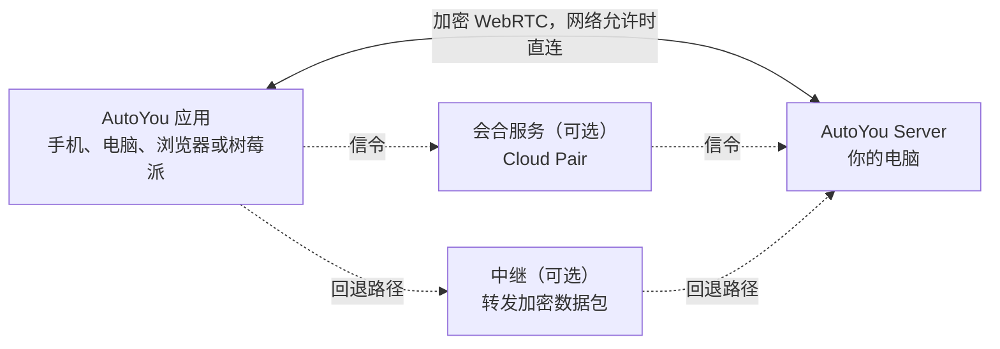

<div align="center">

[English](../../README.md) · **简体中文** · [繁體中文](README_zh-TW.md) · [日本語](README_ja.md) · [한국어](README_ko.md) · [हिन्दी](README_hi.md) · [Español](README_es.md) · [Français](README_fr.md) · [Deutsch](README_de.md) · [Português (Brasil)](README_pt-BR.md) · [Русский](README_ru.md) · [العربية](README_ar.md)


# AutoYou Server

### 在你已经拥有的电脑上，运行属于你自己的 AI 服务器。

**你不是产品，你是主人。**

[](https://github.com/autoyou-ai/AutoYou-Server/actions/workflows/public-checks.yml)
[](https://github.com/autoyou-ai/AutoYou-Server/releases)
[](../../requirements/README.md)
[](../../servers/README.md)
[](../../autoyou_agents/README.md)
[](../../LICENSE)

**[官网](https://www.autoyou.me/) · [应用下载](https://www.autoyou.me/downloads/) · [生态](https://www.autoyou.me/ecosystem/) · [社区](https://www.autoyou.me/community/)**

[快速开始](#quick-start) · [工作原理](#how-autoyou-works) · [功能一览](#what-you-can-do) · [智能体](#agents) · [配对方式](#pairing-modes) · [安全](#security-modes-and-tiers) · [客户端](#supported-clients) · [常见问题](#faq) · [文档](#documentation)

<code>./run_autoyou.sh</code>

</div>

> [!IMPORTANT]
> 请从 [autoyou-ai/AutoYou-Server](https://github.com/autoyou-ai/AutoYou-Server) 或 [autoyou.me](https://www.autoyou.me/) 获取 AutoYou Server，并通过[支持的客户端](#supported-clients)中的应用商店链接获取应用。名称相似的仓库或复制的 README 并不代表下载是官方的。

<div align="center">
<br />

<br /><br />
</div>

---

把你桌上的电脑变成服务你所有设备的私人 AI 服务器。AutoYou Server 在你的 Windows、macOS 或 Linux 电脑上运行 AI 模型和智能体、语音与视频通话、远程桌面、游戏，以及你自己的 Web 应用。无论在家还是外出，手机、其他电脑和浏览器都通过加密的点对点连接访问它。

你的对话、文件和智能体活动保存在这台电脑上，而不是托管的 AutoYou 服务中。用 Ollama 运行本地模型，聊天无需支付 token 费用；也可以接入你喜欢的云端服务商。配对一次，服务器提供的一切都在你的口袋里：聊天、免手动助手、多语言实时语音、你的桌面、你的游戏，以及你已经在运行的任何 Web 服务。

> **第一次使用？** 运行启动脚本，打开 **http://127.0.0.1:8001/**，设置向导会带你选择 AI、开启需要的功能并配对第一台设备。

<a id="quick-start"></a>

## 快速开始

你需要 Git 和 Python 3.11 或更高版本。部分可选功能需要更新的 Python 或特定平台，参见[依赖配置](../../requirements/README.md)。

### 1. 获取服务器

```bash
git clone https://github.com/autoyou-ai/AutoYou-Server.git
cd AutoYou-Server
```

### 2. 运行启动脚本

Windows：

```powershell
.\run_autoyou.bat --profile base
# Or select the Full profile with LAN access:
.\run_autoyou.bat --profile full --host 0.0.0.0
```

macOS 或 Linux：

```bash
./run_autoyou.sh --profile base
# Or select the Full profile with LAN access:
./run_autoyou.sh --profile full --host 0.0.0.0
```

启动脚本会创建 Python 环境、从软件包索引安装依赖，并可能下载模型和原生工具。请先阅读脚本，并在可以安全修改的环境中运行。

### 3. 打开控制台并配对设备

访问 **http://127.0.0.1:8001/**，设置一个唯一的服务器密码，然后按向导操作。它会询问你想用 AutoYou 做什么（聊天、免手动助手、通话、游戏、编程等），安装相应的智能体，并显示用于手机配对的二维码。

无人值守安装时，请通过环境变量或密钥管理器提供 `AUTOYOU_SERVER_PASSWORD`。不要在共享的命令、issue 或截图中暴露真实密码。

| 配置 (profile) | 增加的内容 |
| --- | --- |
| `base` | 核心服务器、本地管理、设备连接和云端服务商集成 |
| `local` | 本地模型辅助工具和设备端意图路由 |
| `recommended` | 消息应用和蓝牙集成依赖（省略 `--profile` 时的默认值） |
| `full` | 语音、浏览器和桌面自动化依赖 |

配置档只决定安装哪些依赖；各项集成仍需单独设置。`--skip-nuitka` 和 `--skip-backend-compile` 会保留启动器自带的库，因此打包应用中的依赖安全更新需要完整重新构建。

更新时在仓库目录中运行 `git pull`，然后重新运行启动脚本。发布说明见 [docs/releases/](../releases/)。

<a id="how-autoyou-works"></a>

## 工作原理

**服务器就是你自己的电脑，设备直接与它通信。** 应用和服务器通过 WebRTC 连接。完成简短的配对握手后，双方建立加密链路（DTLS，媒体使用 SRTP），承载聊天、语音、视频、屏幕共享、游戏输入和代理的网页流量。大多数家庭和移动网络无需在路由器上开放端口即可建立连接；网络过于严格时，会回退到转发同样加密数据包的中继。



在服务器上，设备端意图路由器把每个请求交给合适的智能体或工具。Google ADK 运行原生智能体，也可以桥接 OpenClaw、Hermes Agent 和 Odysseus。LiteLLM 把模型调用发送到你电脑上的 Ollama 或你选择的云端服务商。语音在本地识别、在本地朗读，记忆保存在 SQLite 中。

<picture>
  <source media="(prefers-color-scheme: dark)" srcset="../images/architecture-dark.png" />
  
</picture>

此图由 [scripts/build_architecture_diagram.py](../../scripts/build_architecture_diagram.py) 生成。虚线框表示可选插件或已连接的项目。

<a id="what-you-can-do"></a>

## 功能一览

| 功能 | 带给你什么 |
| --- | --- |
| **AI 聊天** | 在任何已配对设备上与你自己的 AI 聊天，AutoYou 不限制消息数量 |
| **实时语音** | 与 AI 实时通话，本地语音识别，30 多种语言的语音回复 |
| **助手模式** | 在手机、电脑、树莓派或浏览器上使用唤醒词，例如 "Hey Jarvis" |
| **远程桌面** | 用手机查看并控制电脑，包括 Windows 锁屏界面 |
| **电脑视频** | 把电脑的屏幕、摄像头、视频文件或 API 输入的画面发送到通话中 |
| **游戏模式与 Game Studio** | 把电脑上的游戏串流到手机，或制作在手机上离线运行的游戏 |
| **Web 应用工厂** | 让智能体构建 Web 应用，并在所有已配对设备上打开 |
| **托管任意本地端口** | 把电脑上的任何 Web 服务（如 `localhost:3000`）分享给已配对设备 |
| **智能体** | 45 个内置智能体，涵盖笔记、文件、编程、媒体、浏览、训练等 |
| **MCP** | 在 ChatGPT、Codex、Claude、Antigravity、Cursor 和 VS Code 中使用 AutoYou 工具 |
| **消息** | 通过你掌控的连接器，在 Telegram、Signal 和 WhatsApp 中联系你的服务器 |
| **记忆** | SQLite 记忆和私人角色日记，Cognee 为可选插件 |

功能取决于所选配置、硬件、权限和已配置的集成。桌面控制、游戏模式、录音和文件访问等强大能力在你开启之前都保持关闭。

<a id="ai-chat"></a>

### AI 聊天

在控制台的 **AI** 页面选择服务商：默认的 **Ollama + Agents**（本地模型，无需 API 密钥）、支持的 Mac 上的 **Apple Intelligence**、**Gemini**、**OpenRouter**，或通过 LiteLLM 接入 Anthropic、OpenAI、Mistral、DeepSeek、xAI 等，同时保留 AutoYou 的全部智能体和工具。也可以把 **OpenClaw**、**Hermes Agent** 或 **Odysseus** 作为主会话运行时。

AutoYou 不限制你发送的消息数量。使用本地模型时，聊天没有按消息计费，断网也能使用；你接入的云端服务商会按其自身方案计费，并能看到你发给它的提示词。内置模型库可以浏览、下载和切换本地模型，Model Picker 智能体会推荐适合你硬件的模型。

小型量化本地模型也能保持准确：离线意图分类器把常见请求直接交给合适的智能体，紧凑路由模式则让工具列表保持简短。参见[小模型如何保持准确](../../autoyou_agents/README.md#small-local-models)。

<a id="realtime-voice-in-many-languages"></a>

### 多语言实时语音

给你的 AI 打电话直接说话。语音识别在你的电脑上运行（默认构建使用 whisper.cpp，完整语音构建使用 faster-whisper），支持语音活动检测、开口即可打断，以及用于长段思考的"等我说完"保持功能。

- **说你的语言。** 将 **STT language** 设为 `auto` 并选择多语言模型，即可自动识别你说的语言。
- **用同一种语言听回复。** 默认的 **Auto TTS** 会检测回复的语言并选择匹配的系统语音。本地 Supertonic 3 模型支持 31 种语言，一次性下载约 401 MB 后可离线使用。
- **选择你的声音。** 系统语音、10 个 Supertonic 预设、在 Voice Training 中训练的自定义声音、中英文 EmotiVoice，或托管的 OpenAI 与 Azure 语音。

文字转语音只朗读给它的回复，不负责翻译；你选择的聊天模型也需要支持对话语言。

<a id="assistant-mode"></a>

### 助手模式

为服务器设置一个唤醒词，例如 "Hey Jarvis"。在已配对的手机、电脑、树莓派、Chrome 扩展或管理页面附近说出它，之后说的话会发送给 AutoYou。在听到唤醒词之前，你说的任何话都不会被转写或发送给 AI。录制三遍、在服务器上几秒钟完成训练、测试后即可开启。视频通话中，唤醒词之后的请求可以附带最新的摄像头画面。详见[助手模式](../admin-ui/assistant-mode.mdx)。

<a id="remote-desktop"></a>

### 远程桌面

从已配对的手机或桌面应用查看并控制电脑：选择显示器或单个应用窗口，移动鼠标、打字并使用修饰键。设备支持时优先使用 H.264。在 Windows 上，可选的 **AutoYou Secure Desktop Helper** 服务允许已配对的主人查看并操作锁屏和 UAC 提示，服务器还能在连接期间保持电脑唤醒。屏幕捕获和输入是两个独立权限，默认关闭；Peer Link 永远不提供远程桌面。

<a id="computer-video"></a>

### 电脑视频

通话中，电脑可以从四种来源发送视频：**屏幕**、**摄像头**、你上传并播放的**视频文件**，或你自己的程序输入的 **API 画面**。也可以共享电脑的麦克风和声音。控制台的 **Interact** 页面可以显示已连接设备的实时摄像头画面，并在电脑扬声器上播放它们的麦克风声音，不经过 AI 处理，也不录制。

<a id="game-mode-and-game-studio"></a>

### 游戏模式与 Game Studio

- **游戏模式**把在电脑上渲染的游戏串流到已配对设备，设备的触摸、运动传感器、手柄、鼠标和键盘作为游戏输入传回。最多可定义四个带标签的虚拟按键。游戏模式是独立权限，同时会开启屏幕发送和远程桌面输入。
- **使用你自己的引擎。** 本地游戏引擎可以通过回环 WebSocket 读取经过认证的 `autoyou_game_v1` 输入帧。服务器在 `/api/game/unreal-plugin` 提供 Unreal 源码插件。
- **手机离线游戏。** Game Studio 智能体帮助你构建可移植的 Web 或 WASM 游戏，打包为最大 5 GiB 的 `.aygame` 文件，并通过 WebRTC 或已批准的 Peer Link 发送给客户端。每个游戏都有独立的设备端 SQLite 数据库，存档在更新后保留。

内置演示游戏 **Neon Horizon** 可以作为手机下载、在 Game Studio 页面中游玩，或从电脑串流。

<a id="web-app-factory"></a>

### Web 应用工厂

描述一个应用，让智能体来构建。**Website** 智能体为智能体创建浏览器前端：简单起步模板，或按需使用 React、Angular，后端可选 Python/FastAPI、Node/TypeScript、Go 或 Rust。**Agent Builder** 搭建新智能体，**Coding** 和 **Pi** 智能体实现并测试代码。每个应用都会注册到本地网站服务，出现在已配对设备的浏览器中。**Hosting** 智能体介绍如何发布到公网：免费的临时 `/pair` 隧道或付费的持久 URL。

<a id="host-any-local-port"></a>

### 托管任意本地端口

已经在运行某个服务？直接分享。在 **Websites & Browser > Advertised Websites** 中添加 1 到 65535 之间的任意端口，填写标签和可选的转发 URL（如 `http://127.0.0.1:3000` 或局域网中的其他主机）。已配对客户端会发现它，并在自己这一侧的相同端口打开，因此仪表盘、开发服务器、家庭实验室工具，以及不支持子路径的应用都能正常工作。流量在加密的点对点链路内传输，无需在路由器上开放端口；已配对浏览器会获得 `viewer`、`editor` 或 `admin` 角色，限制它们能修改的内容。

<a id="agents"></a>

## 智能体

AutoYou 内置 45 个智能体。主智能体把每个请求路由到合适的专家，许多专家还在你的已配对设备上提供自己的网页。标记为 opt-in 的智能体在你于控制台 **Agents** 页面安装前保持未安装。

| 领域 | 智能体 |
| --- | --- |
| 日常 | Notes、Tasks、Notify、Memory、Persona、Page、Prompts、Location (opt-in) |
| 网页与自动化 | Internet、Assistant、Browser (opt-in)、Client Browser Control、Proxy (opt-in) |
| 媒体与创作 | Audio、TV、Media Generation (opt-in)、Game Studio |
| 编程与构建 | Coding、Pi、Agent Builder、Website、Skills、Files、CLI、Claude CLI、Claude Desktop、Codex Desktop、Antigravity、Prompt Builder（均为 opt-in） |
| 智能与模型 | Model Picker、OpenClaw、Hermes Agent（均为 opt-in） |
| 训练 | Data Collector、Fine-Tuning、Voice Training（均为 opt-in） |
| 系统与电脑 | Admin、Remote Desktop、Backup、Hosting (opt-in)、Windows Security (opt-in)、macOS Security (opt-in)、Education (opt-in) |
| 支持 AutoYou | Support Ads、Earnings、Donation |

把智能体包复制到 `autoyou_agents/` 即可添加你自己的智能体。完整说明见[智能体目录](../../autoyou_agents/README.md)。

[自动生成的智能体参考](../agents/)列出了每个智能体声明的所有工具。

<a id="pairing-modes"></a>

## 配对方式

| 方式 | 连接方式 | 典型用途 |
| --- | --- | --- |
| **Local Pair** | 通过局域网直连，由你自己的服务器处理信令 | 同一 Wi-Fi 或办公网络 |
| **Bluetooth Pair** | 通过低功耗蓝牙传递连接信息 | 首次设置附近的手机 |
| **Live Pair** | 手机和电脑互相展示动态二维码，无需网络通路 | 隔离或受限网络 |
| **一次性代码** | 在消息聊天中发送 `/pair`，返回短时有效的代码和链接 | 访客设备和不受信任的网络 |
| **Auto Pair** | 加密的配对消息通过你设置的 Telegram、Signal 或 WhatsApp 聊天传递 | 无需云账号的远程配对 |
| **Cloud Pair** | 可选的付费 AutoYou Cloud 会合服务跨越 NAT 找到你的电脑，并支持中继回退 | 外出或网络严格时 |

**Peer Link** 连接两个 AutoYou 应用，由接收方批准每个链接，且从不使用电脑的密码。**Lobbies** 是应用在附近通过 Wi-Fi 和蓝牙创建和加入的群组房间。详见[配对协议](../technical/pairing-protocols.md)。

<a id="security-modes-and-tiers"></a>

## 安全模式与安全等级

整个服务器使用同一种安全模式。新安装默认为 **Secure**。

| 模式 | 配对消息 | 设备配对需要 | 电脑上的数据 |
| --- | --- | --- | --- |
| **Normal** | 不加密 | 一次性代码 | 不变 |
| **Secure** | 用服务器密码加密 | 服务器密码 | 不变 |
| **Secure Professional** | 用服务器密码加密 | 密码加当前验证器代码 | 不变 |
| **Secure Professional Maximus** | 同 Secure Professional | 密码加当前验证器代码 | 会话、智能体数据、网站、笔记和设置均静态加密 |

在 Secure 模式下，配对消息使用口令认证密钥交换（基于 ristretto255 和 libsodium 的 CPace 系列构造）派生的密钥加密。转发它们的中继或消息桥无法读取内容，录下的交换过程也不能用于离线猜测密码。

**配对安全等级**决定一次聊天消息配对需要多少步骤：**Quick Pairing (B)** 允许客户端用一条消息完成配对，兼容性最好；**Enhanced Pairing (A)** 要求每个客户端先完成一次额外的 hello 往返，使猜测更难。Local Pair、Bluetooth Pair 和 Cloud Pair 始终使用增强流程。

已配对设备的浏览器会获得 `viewer`、`editor` 或 `admin` 角色。凭据和安全设置只能在电脑本机，或直接在管理端口上打开的 HTTPS 管理会话中修改。加密保护的是连接本身，不保护终端设备、智能体权限或第三方服务。详见[安全模式](../security/security-modes.md)和 [SECURITY.md](../../SECURITY.md)。

<details>
<summary><strong>每一层保护什么，以及保护到哪里为止</strong></summary>

| 层 | AutoYou 的做法 |
| --- | --- |
| 网络暴露 | 默认只监听 `127.0.0.1`。在局域网上监听需要明确开启。 |
| 访问 | 管理控制台受服务器密码保护，可选配身份验证器应用（TOTP）验证码。 |
| 配对 | 基于密码认证的密钥交换、一次性代码，以及 Peer Link 中逐条链接的批准。 |
| 传输 | 两端之间使用 WebRTC DTLS 和 SRTP，即使由中继转发数据包也是如此。 |
| 静态数据 | 凭据保存在加密的密钥库中；Maximus 还会加密 AutoYou 管理的数据。 |
| 依赖 | 带锁文件的清单、安全公告检查，以及固定版本的 CI Action。 |

加密保护的是连接本身，而不是它周围的一切：

- **设备。** 服务器电脑或已配对设备上的恶意软件，拥有该设备所拥有的访问权限。
- **智能体。** 智能体以服务器的权限运行。浏览器自动化、文件访问、桌面控制和命令执行都很强大；只开启你需要的功能，并检查它们在做什么。
- **第三方。** 云端模型服务商、消息桥接和公共隧道都有各自的数据流向和条款。开启前请先了解。
- **运维。** 自己运行服务器，就要自己负责更新、备份和凭据。

</details>

<details>
<summary><strong>涉及哪些外部服务</strong></summary>

你只运行一台服务器：你自己的。运行助手或存储数据都不需要 AutoYou 运营的应用服务器，服务器在不连接 AutoYou Cloud 的局域网中也能工作（[详情](../architecture/cloud-and-remote.mdx)）。其余都是可以更改的默认设置或可选的辅助服务：

| 组件 | 运行位置 | 能看到什么 |
| --- | --- | --- |
| AutoYou Server：智能体、模型、存储、控制台 | 你的电脑 | 你的数据。它是连接的一端。 |
| 应用和浏览器客户端 | 你的设备 | 你与它们分享的内容 |
| 用于发现地址的 STUN 服务器（默认开启） | Google 的公共 STUN 服务器，除非你更换 | WebRTC 连接所显示的公网 IP 和端口 |
| Cloud Pair 汇合点（可选） | AutoYou Cloud | 账户邮箱、设备 ID、临时配对数据和网络元数据 |
| 备用中继（可选） | AutoYou Cloud | 加密的数据包和网络元数据 |
| 唤醒手机应用的推送通知（可选） | Apple 和 Google 的推送服务 | 有人请求唤醒应用这一事实 |
| 更新检查（关联账户后开启） | AutoYou Cloud 更新通道 | 使用关联账户认证的更新请求 |
| 云端模型服务商（可选） | 你选择的服务商 | 你发送给它的提示词 |
| Telegram、Signal 和 WhatsApp 桥接（可选） | 这些服务 | 经过它们的消息，受其条款约束 |
| 网站公共隧道（可选） | 隧道服务商 | 访问公共 URL 的流量。不是端到端加密。 |

**公共 STUN 默认开启**，Local Pair 也不例外。若不想让这次查询发往互联网，请在启动服务器前设置 `AUTOYOU_DISABLE_PUBLIC_STUN=1`，或用 `AUTOYOU_LOCAL_STUNTURN_HOST` 指向你自己的 STUN 和 TURN 服务器（TURN 还需 `AUTOYOU_LOCAL_TURN_USERNAME` 和 `AUTOYOU_LOCAL_TURN_PASSWORD`）。完全没有 STUN 或 TURN 服务器时，穿越 NAT 的连接可能失败。

</details>

<a id="supported-clients"></a>

## 支持的客户端

AutoYou Server 运行在你的电脑上，应用从其他任何地方访问它。客户端应用单独发布，其源代码不在本仓库中。

| 平台 | 获取方式 |
| --- | --- |
| iPhone 和 iPad | [App Store](https://apps.apple.com/us/app/autoyou/id6760363728) |
| Android | [Google Play](https://play.google.com/store/apps/details?id=com.autoyou.app) |
| Windows | [Microsoft Store](https://apps.microsoft.com/detail/9mw8l2wfw7wv?hl=en-US&gl=US) |
| macOS 和 Linux | [下载](https://www.autoyou.me/downloads/) |
| 浏览器 | Chrome 扩展和 Web 客户端，见[生态页面](https://www.autoyou.me/ecosystem/) |
| 树莓派 | 用于助手模式的 Python 语音客户端（[设置](../admin-ui/assistant-mode.mdx)） |

手机应用还内置小型本地 AI（视设备而定为 LFM 2.5 350M、Gemini Nano 或 Apple Intelligence），没有电脑时也能聊天。

| 配对方式 | 和你自己的 AI 聊天 | 附近的 Lobbies | 手机上的本地 AI |
| --- | --- | --- | --- |
|  |  |  |  |

- **Lobbies。** 通过 Wi-Fi 和蓝牙创建或加入附近的房间，支持主持人加最多六位访客进行聊天和音视频通话。
- **Peer Link。** 让一个应用连接另一个应用。接收方应用会逐条批准链接，可选的 AI 回复只使用你告诉它的内容。
- **你的电脑，随处可用。** 聊天、通话、远程桌面、游戏模式、智能体网站和已发布的端口，在每台配对设备上都能使用。

<a id="mcp"></a>
<a id="use-autoyou-from-your-coding-agent"></a>

## 在编程智能体中使用 AutoYou

把 ChatGPT、Codex、Claude Code 或 Claude Desktop、Google Antigravity、Cursor 和 VS Code 中支持 MCP 的功能连接到 AutoYou 支持的工具。本地 MCP 适配器是一个独立进程；服务器不会把它安装到这些客户端中，MCP 调用暴露的是适配器支持的工具，而不是对你文件的任意访问，也不是 AutoYou 的全部功能。

1. 启动 AutoYou Server，打开 **http://127.0.0.1:8001/**。
2. 在 **Admin UI > Messaging > AutoYou MCP** 中启用 MCP，生成私有的适配器令牌，并下载 `autoyou-mcp.env`。请妥善保管此文件。
3. 把单独维护的适配器安装到专用的 Python 环境中：

   ```powershell
   git clone https://github.com/autoyou-ai/AutoYou.git
   cd AutoYou
   py -3 -m venv .venv-mcp
   .\.venv-mcp\Scripts\python.exe -m pip install -e .\plugins\autoyou-mcp
   ```

   在 macOS 或 Linux 上，使用 `python3 -m venv .venv-mcp` 和 `.venv-mcp/bin/python -m pip install -e ./plugins/autoyou-mcp`。

对于会启动本地 MCP 进程的客户端，使用带绝对路径的以下命令：

```text
<path-to-.venv-mcp-python> -m autoyou_mcp --env-file <path-to-autoyou-mcp.env> --transport stdio
```

<details>
<summary><strong>把 AutoYou 添加到各个客户端</strong></summary>

对于使用 `mcpServers` JSON 格式的客户端，条目如下。请替换两个示例路径；在 JSON 中使用 Windows 反斜杠时要转义：

```json
{
  "mcpServers": {
    "autoyou": {
      "command": "C:/path/to/AutoYou/.venv-mcp/Scripts/python.exe",
      "args": [
        "-m", "autoyou_mcp",
        "--env-file", "C:/path/to/autoyou-mcp.env",
        "--transport", "stdio"
      ]
    }
  }
}
```

**网页版 ChatGPT** 使用远程 MCP 连接，而不是本地 `stdio` 进程。以 `--transport streamable-http` 启动适配器，并通过 OpenAI Secure MCP Tunnel 连接其本地端点 `http://127.0.0.1:8071/mcp`。ChatGPT 需要开发者模式和相应的工作区或管理员权限，OpenAI 还会按套餐限制完整的 MCP 操作。请按照 [ChatGPT 的 AutoYou MCP 设置](https://github.com/autoyou-ai/AutoYou/blob/main/plugins/autoyou-mcp/README.md#connect-chatgpt-web)和 [OpenAI 的 MCP 应用指南](https://help.openai.com/en/articles/12584461-developer-mode-and-mcp-apps-in-chatgpt)操作。

**Codex CLI、桌面应用和 IDE 扩展**共用 Codex 主机的 MCP 配置：

```powershell
codex mcp add autoyou -- "C:/path/to/AutoYou/.venv-mcp/Scripts/python.exe" -m autoyou_mcp --env-file "C:/path/to/autoyou-mcp.env" --transport stdio
codex mcp list
```

也可以在 `~/.codex/config.toml` 的 `[mcp_servers.autoyou]` 下添加对应的 `command` 和 `args`。参见 [Codex MCP 指南](https://learn.chatgpt.com/docs/extend/mcp?surface=cli)。

**Claude Code：**

```powershell
claude mcp add --transport stdio autoyou -- "C:/path/to/AutoYou/.venv-mcp/Scripts/python.exe" -m autoyou_mcp --env-file "C:/path/to/autoyou-mcp.env" --transport stdio
claude mcp list
```

然后在 Claude Code 中运行 `/mcp`。参见 [Claude Code MCP 指南](https://code.claude.com/docs/en/mcp)。

**Claude Desktop** 会把适配器作为本地 stdio 服务器启动。在 macOS 的 `~/Library/Application Support/Claude/claude_desktop_config.json` 或 Windows 的 `%APPDATA%\Claude\claude_desktop_config.json` 中添加 `mcpServers.autoyou` 条目，然后完全退出并重新打开 Claude Desktop。AutoYou 目前不提供 `.mcpb` 桌面扩展。参见 [Claude Desktop MCP 指南](https://support.claude.com/en/articles/10949351-getting-started-with-local-mcp-servers-on-claude-desktop)。

**Google Antigravity** 全局使用 `~/.gemini/config/mcp_config.json`，在工作区中使用 `.agents/mcp_config.json`。在 Antigravity IDE 中打开 **MCP Servers > Manage MCP Servers > View raw config**。参见 [Antigravity MCP 指南](https://antigravity.google/docs/mcp)。

**Cursor** 使用 `~/.cursor/mcp.json` 或 `.cursor/mcp.json`，条目同样是 `mcpServers`。参见 [Cursor MCP 指南](https://prod.cursor.com/help/customization/mcp)。

**VS Code** 可以使用工作区根目录下可移植的 `.mcp.json` 文件。`.vscode/mcp.json` 则使用顶层 `servers` 对象，并带 `"type": "stdio"`。参见 [VS Code MCP 指南](https://code.visualstudio.com/docs/agent-customization/mcp-servers)。

在 macOS 或 Linux 上，Python 可执行文件是 `.venv-mcp/bin/python`。客户端版本、设置、组织策略和工具审批都可能影响可用性。

</details>

连接后，在使用任何会写入数据的工具之前，先确认 `get_autoyou_status` 已出现并返回预期的服务器状态。适用范围、安全模型和限制见 [AutoYou MCP 集成指南](../guides/mcp-integration.mdx)。

<a id="admin-console"></a>

## 管理控制台

<p align="center">
  
</p>

本地控制台集中管理设置、模型、语音、智能体、连接、权限和安全。引导式设置会询问你想用 AutoYou 做什么，并推荐合适的智能体和权限；在你检查并保存方案之前不会做任何更改。截图使用示例数据。点击预览图可打开原尺寸图片。

| 服务器概览 | 设备与活动 | 访问与安全 |
| --- | --- | --- |
| [](../images/admin/overview.png) | [](../images/admin/live-view.png) | [](../images/admin/security.png) |

<a id="other-ways-to-run"></a>

## 其他运行方式

<details>
<summary><strong>Docker</strong></summary>

以安全的方式提供 `AUTOYOU_SERVER_PASSWORD`，然后运行：

```bash
docker compose up --build
```

Compose 文件只把端口发布到主机的回环地址，并把配置保存在命名卷中。在同一台电脑上打开 `http://localhost:8001/`；该文件声明了这种仅回环的发布方式（`AUTOYOU_ADMIN_TRUST_PUBLISHED_LOOPBACK=1`），因此登录不会因 "requires localhost or HTTPS" 被拒绝。若直接使用 `docker run`，请发布到 `127.0.0.1` 并传入同一变量，或在前面放一个 TLS 代理。依赖回环隔离之前，请确认你的 Docker 版本如何发布端口。

若要在构建和运行时禁止下载 Tunnelmole，请在构建和启动前设置 `AUTOYOU_SKIP_TUNNELMOLE_DOWNLOAD=1` 和 `AUTOYOU_NO_DOWNLOAD_TUNNELMOLE=1`。这样，依赖它的功能就需要另行提供的二进制文件。

</details>

<details>
<summary><strong>构建非官方的本地版本</strong></summary>

在仓库根目录下：

```powershell
# Windows
.\servers\windows\build-all.ps1 -Configuration Debug
```

```bash
# macOS
./servers/macos/build-all.sh --no-sign --dev

# Linux / WSL
./servers/wsl/build-backend.sh --unofficial
```

这些方式不需要 AutoYou 账户，也不需要官方版本的批准。它们可能会安装或调整依赖。出现许可证和声明时请阅读。阅读后若要免交互接受，在 Windows 上传入 `-AcceptTerms`，在 macOS 和 Linux 上传入 `--accept-terms`。

前提条件、输出位置和已知限制：
[Windows](../../servers/windows/README.md) · [macOS](../../servers/macos/README.md) · [Linux / WSL](../../servers/wsl/README.md).

</details>

<a id="faq"></a>

## 常见问题

<details>
<summary><strong>需要云账号或 VPN 吗？</strong></summary>

不需要。Local Pair、Bluetooth Pair、Live Pair、一次性代码和 Auto Pair 都无需 AutoYou 账号。Cloud Pair 是可选的付费辅助服务。如果你已经在使用 Tailscale 等 VPN，AutoYou 也能通过它工作。

</details>

<details>
<summary><strong>AI 聊天真的不限量吗？</strong></summary>

AutoYou 不限制消息数量。使用本地 Ollama 模型时，每条消息都不收费，速度取决于你的电脑。你接入的云端服务商有自己的价格和限制。

</details>

<details>
<summary><strong>AutoYou 会上传我的文件或对话吗？</strong></summary>

它们保存在你的电脑上。数据只会通过你开启的服务离开，例如云端模型服务商、消息桥或公网隧道，每项服务都有自己的条款。

</details>

<details>
<summary><strong>我可以用哪些语言说话？</strong></summary>

当 **STT language** 设为 `auto` 且选用了多语言模型时，语音识别会自动检测语言。语音回复使用匹配的系统语音，或覆盖 31 种语言的本地模型 Supertonic 3。你的聊天模型也需要理解这种语言。

</details>

<details>
<summary><strong>可以和朋友分享 Web 应用或游戏吗？</strong></summary>

可以。任何与你的服务器配对的人，都能在你授予的角色范围内打开你的智能体网站和已发布端口。共享设备会被标记为共享，因此你的网站可以限制它们能看到的内容。对于未配对的人，Hosting 智能体会介绍免费的临时链接和付费的永久 URL。

</details>

<details>
<summary><strong>遇到 bug 怎么办？</strong></summary>

先更新，新版本可能已经修复。如果问题仍在，请附上 AutoYou 版本（`VERSION`）、操作系统、配置档、复现步骤和错误输出，[提交 issue](https://github.com/autoyou-ai/AutoYou-Server/issues)。安全漏洞请按 [SECURITY.md](../../SECURITY.md) 私下报告。

</details>

<a id="documentation"></a>

## 文档

- [快速开始](../quickstart.mdx) · [架构](../architecture/) · [安全与隐私](../security/) · [管理控制台](../admin-ui/)
- [智能体目录](../../autoyou_agents/README.md) · [智能体参考](../agents/) · [智能体框架](../agent-framework/)
- [HTTP 与 WebSocket API](../api-reference/) · [指南](../guides/) · [配对指南](../../guides/README.md)

<a id="contributing"></a>

## 参与贡献

欢迎你的帮助。可以从[内置智能体](../../autoyou_agents/README.md)、[Agent Builder](../admin-ui/agent-workbench-ui.mdx) 或[自定义智能体教程](../guides/custom-agent-tutorial.mdx)开始。

- **构建**智能体、游戏、扩展、集成或 Web 界面。
- **改进**安装、无障碍、平台支持、翻译、文档，或修复可复现的 bug。
- **分享**演示、指南，或明确标注为非官方且遵守许可证的构建版本。

提交之前请阅读 [CONTRIBUTING.md](../../CONTRIBUTING.md) 和[行为准则](../../CODE_OF_CONDUCT.md)。原创且独立的代码可以使用你选择的许可证，包括 MIT 或 Apache-2.0。对现有 AutoYou 代码的修改沿用其许可证。

<a id="license"></a>

## 许可证

AutoYou Server 依据[服务器许可证](../../LICENSE)以 source-available 方式提供。它目前不是 OSI 认可的开源项目，以 `LICENSE` 中的定义为准。

| 内容或用途 | 条款 |
| --- | --- |
| 个人使用、本地构建和免费分发 | 依据服务器许可证及其条件允许 |
| 对 AutoYou 代码的修改 | 沿用适用的 AutoYou 许可证 |
| 原创、独立且可分离的代码 | 你选择的许可证，包括 MIT 或 Apache-2.0 |
| 机构使用或商业利用 | 单独的 [Enterprise 协议](https://www.autoyou.me/enterprise/) |

请保留声明、标明非官方构建，并履行所含组件的义务。参见 [THIRD-PARTY-NOTICES.md](../../THIRD-PARTY-NOTICES.md) 和[商标政策](../legal/trademark-policy.md)。

OpenStorey 将至少 15% 的合格净收入投入贡献者资金池，按其[审核与资格规则](../contributors/contributor-pool.md)分配。[资金路线图](https://www.autoyou.me/donate/)包含一个 500 万美元的里程碑，用于开放服务器代码；里程碑本身不会改变你已持有副本的许可证。详情：[docs/legal/open-source-commitment.md](../legal/open-source-commitment.md)。

<a id="support"></a>

## 支持

- **问题与安装帮助：** [SUPPORT.md](../../SUPPORT.md) 和[社区](https://www.autoyou.me/community/)。
- **Bug 和具体建议：** [提交 issue](https://github.com/autoyou-ai/AutoYou-Server/issues)。
- **安全漏洞：** 请按 [SECURITY.md](../../SECURITY.md) 的说明私下报告。不要用公开 issue 报告未披露的漏洞。

智能体以服务器的权限运行：检查它们在做什么，只开启需要的功能，并做好备份。

Copyright &copy; 2026 OpenStorey LLC and contributors.
